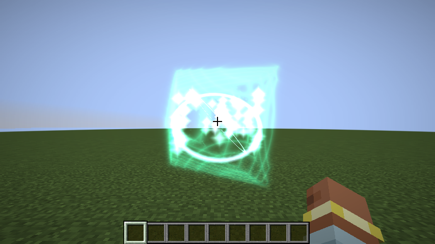

# API de efeitos (introduzida na 0.3)

Este documento descreve a API introduzida na 0.3, que continua válida na 0.7.0. Para o exemplo incluído no pacote atual, caminhos de instalação e publicação de cartões, abra [Addons 0.4](ADDONS-0.4.md).

Para Minecraft Java 1.21.1, NeoForge 21.1.x e Java 21. A interface pública desta versão é `dev.calamidade_awakening.api.v1.Effects` e seus tipos internos. O pacote contém um JAR de motor e conteúdo. O consumidor instala seu próprio JAR junto dele e da RimuLib 1.3.0 em ambos os lados.

## Primeira integração

O projeto Gradle independente em [examples/vfx-sample](../examples/vfx-sample/) já contém o código e os recursos deste exercício. A partir da raiz extraída, coloque o JAR oficial da RimuLib em `libs/rimulib-1.3.0-neoforge.jar` e mantenha o JAR do Calamidade em `dist/`. Execute:

```sh
./gradlew -p examples/vfx-sample build
./gradlew -p examples/vfx-sample runClient
```

No Windows use `gradlew.bat`. O primeiro build precisa baixar os artefatos de desenvolvimento do NeoForge. Para testar sem compilar, gere o consumidor com `./gradlew -p examples/vfx-sample build`; o JAR `vfx-sample-1.4.0.jar` fica em `examples/vfx-sample/build/libs/`. Também é possível instalar o JAR produzido em `examples/vfx-sample/build/libs/` em um perfil NeoForge com os dois mods. Em um mundo com comandos habilitados:

1. Use `/vfxsample at`. O sinal aparece quatro blocos à frente. Ande para ver que ele fica parado.
2. Use `/vfxsample follow`. O exemplo encerra o sinal anterior e cria um novo na sua entidade. Use F5 e caminhe para ver o movimento.
3. Use `/vfxsample stop` durante os seis segundos do efeito. A emissão e a geometria cessam; partículas já emitidas completam a própria vida.

Para usar em outro repositório, copie o modelo de dependências de build.gradle, adapte os caminhos locais e leve a dependência obrigatória de calamidade_awakening do neoforge.mods.toml para o manifesto do seu mod. O exemplo atual declara o intervalo [0.6.1,0.7.0). As chamadas desta página existem desde a 0.3.0. O mod de exemplo é opcional.



A captura mostra o efeito de posição fixa antes do tick 40. Para comparar com o instante do impacto, observe a cor da grama e do céu no segundo 2.

## Onde registrar e onde executar

Registre a definição no construtor comum do mod, com o mesmo ID e os mesmos parâmetros em cliente e servidor. O ID é transmitido como namespace e caminho. A ordem de carregamento de dois consumidores não determina o ID na rede. Reserve um nome do seu próprio namespace para cada efeito.

```java
var signal = ResourceLocation.fromNamespaceAndPath("vfxsample", "signal");
Effects.register(signal, new Effects.Definition(120, 2.0, 0xff65e8c9,
    Effects.Shape.RINGS, Effects.Material.CRYSTAL,
    ResourceLocation.withDefaultNamespace("end_rod"), signal));
```

O primeiro ID opcional é um SimpleParticleType registrado. O segundo é uma entrada de sounds.json do cliente. O exemplo inclui assets/vfxsample/sounds.json e sounds/signal.ogg. Passe null em cada posição que deseja omitir. O som toca na posição de abertura para quem recebe o evento no início. Cada cliente emite uma partícula a cada quatro ticks na âncora; o Minecraft aplica as opções locais de partículas. O motor usa triângulos e composição próprios para a geometria e o material.

## Referência de execução

| Chamada | Resultado |
|---|---|
| Effects.register(id, definition) | Registra uma definição comum. ID duplicado ou namespace reservado do Calamidade gera erro. |
| Effects.start(id, serverLevel, position) | Abre uma instância fixa. Posição em blocos, em coordenadas absolutas do mundo. |
| Effects.follow(id, entity, offset) | Acompanha a posição interpolada dos pés da entidade. Offset em blocos nos eixos do mundo, independente da rotação. |
| Effects.start(id, serverPlayer, position) | Âncora fixa com identificação do conjurador. Para efeitos internos com filme configurado, o conjurador pode receber a câmera. |
| handle.stop() | Encerra a instância para os observadores. Retorna true ao encerrar e false se já terminou. |

Execute start, follow e stop na thread do servidor. Em callbacks assíncronos, despache primeiro com server.execute. Um ID desconhecido ou coordenadas não finitas geram IllegalArgumentException. As operações de início retornam Optional.empty() se a capacidade for atingida ou a âncora inicial estiver indisponível. Valide permissão, alcance, custos e recarga no mod que solicita o efeito. Para dano ou outra consequência sincronizada com o visual, registre um cue (capítulo de gameplay). Não envie posições ou IDs arbitrários de clientes diretamente para a API.

O servidor mantém até 64 instâncias. O cliente recebe inícios dentro do alcance da definição (128 blocos por padrão, configurável de 16 a 1024 com `withRange`) e usa o tempo original do evento ao entrar ou voltar à área. O cliente depende de rastrear a entidade para renderizar uma âncora móvel. Na troca de dimensão, o cliente limpa o estado local. A remoção ou transferência da entidade encerra aquela instância no servidor. A âncora fixa termina se o chunk for descarregado. O motor não mantém chunks carregados e as instâncias não são salvas entre sessões.

## Convenções visuais e limites

- Duração de 1 a 12000 ticks (10 minutos; até a 0.6.1 o limite era 1200). A 20 ticks/s, 120 ticks equivalem a seis segundos. Para efeitos ambientes, use uma duração longa e encerre com `stop()`. Acima de 1200 ticks, a entrada e a saída automáticas ficam fixas em 168 e 336 ticks em vez de proporcionais. Raio finito maior que zero e até 512 blocos.
- Alcance de distribuição de 16 a 1024 blocos: `new Definition(...).withRange(600)`. O efeito só pinta o que cada cliente renderizou; além da distância de renderização do jogador, só existem pixels de céu, então alcances grandes servem principalmente a efeitos no céu. A extensão visível depende do estilo.
- Cor em ARGB. O matiz afeta a geometria; os materiais volumétricos têm paletas próprias. A intensidade sobe e decai pela curva do motor.
- Geometrias disponíveis: NONE, RINGS, PRISM, ORBIT e NEXUS. Materiais: NONE, CRYSTAL, VEIL, LENS e NEBULA. Combine geometria e material separadamente. Os cinco efeitos jogáveis continuam acessíveis pelo Atlas; registrar um efeito externo não cria um cartão.
- LOW, BALANCED e HIGH selecionam até 3/6/12 sinais de geometria e 1/2/4 volumes por quadro. O servidor continua avançando o relógio quando o cliente omite uma camada. O filtro de distância e o orçamento por quadro não substituem o controle de quantidade de instâncias do consumidor.
- A iluminação de superfície é visual. Os efeitos não alteram níveis de luz dos blocos, IA, dano ou terreno. A interrupção impede novas emissões, mas um som de abertura já iniciado segue a duração de seu clipe.
- A versão 0.3 oferece materiais prontos e recursos de partículas e áudio do consumidor. Shaders GLSL arbitrários por namespace, modelos e ossos de Blockbench, skyboxes empilháveis, curvas de câmera externas e efeitos persistentes sem prazo ainda exigem evolução da API.

## Atualização a partir de 0.2.0

Substitua o JAR em cliente e servidor juntos. O formato de sincronização de efeitos mudou para incluir entidade e offset e passou a incluir uma mensagem de encerramento. O ID do mod, as teclas e o item Focus continuam compatíveis. Registros externos ficam fora do catálogo interno de habilidades e usam o mesmo agendador que os efeitos jogáveis.

## Como marcar o impacto de uma explosão

Escolha o tick do contato no relógio da habilidade. No projeto de exemplo, execute `/vfxsample at` e observe o segundo 2. O anel mantém sua cor durante a formação; no tick 40 começa uma breve perda de saturação com aumento de contraste. O trecho compilável está em Sample.java.

```java
var cue = new Effects.Impact(40, 3, .75f, Effects.ImpactStyle.MONOCHROME);
var definition = new Effects.Definition(120, 2, 0xff65e8c9,
    Effects.Shape.RINGS, Effects.Material.CRYSTAL, null, null, cue);
Effects.register(ResourceLocation.fromNamespaceAndPath("meumod", "explosao"), definition);
```

- **Tick e duração.** O primeiro número é o tick de início; o segundo é a duração, entre 1 e 20 ticks. Três ticks duram cerca de 150 ms a 20 ticks/s. O número de quadros mostrados depende do FPS. O pico ocorre no início e decai linearmente. A janela inteira precisa caber na duração do efeito.
- **Estilo.** MONOCHROME remove parte da saturação e aumenta o contraste do quadro. TINTED_FLASH ilumina a tela com o RGB da definição. Para um clarão discreto, experimente TINTED_FLASH com força 0.2f por dois ticks. A força aceita valores maiores que zero até 1.
- **Composição.** A distância reduz o impacto até zero a 64 blocos. A visibilidade e o orçamento do cliente também contam. Entre sinais simultâneos do mesmo estilo, prevalece o mais forte. Uma entrada tardia usa o relógio original e não repete um impacto passado.
- **Preferência do jogador.** Em Opções → Acessibilidade, habilitar a opção de ocultar clarões de relâmpago desativa os acentos de tela do Calamidade, inclusive o monocromático. Partículas, brilho das malhas e iluminação de superfícies continuam visíveis. Use também forma, movimento e som para comunicar o contato.
- **Dica de autoria.** Teste primeiro a geometria sem o acento e depois compare as duas versões no mesmo local. A definição de sete argumentos continua disponível e usa o acento suave padrão do motor. A versão com Impact substitui esse acento pela janela escolhida.
