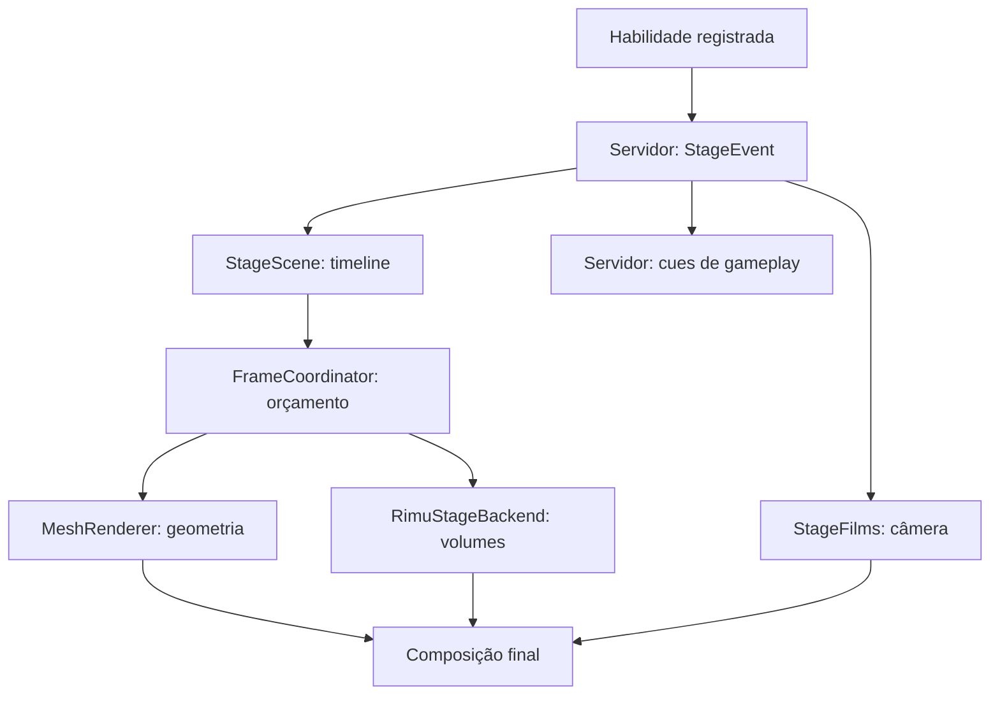

# Arquitetura do Calamidade_Awakening

## Um conjunto de definições

VisualKind mantém um catálogo imutável de definições após a inicialização. Cada habilidade possui ID numérico estável, nome de recursos, título, cor, duração, raio, estilo de geometria, material de volume e opções de cinema e cena orbital. AwakeningSkills cria os itens do menu a partir do mesmo catálogo. O cliente e servidor devem usar a mesma versão.

## Servidor e rede

StageNetwork usa a API pública NetApi da RimuLib. CastRequest contém a chave com namespace da habilidade (por exemplo, `calamidade_awakening:prism`). O servidor valida esse ID, jogador, recarga (por jogador e por habilidade, em Cooldowns) e limite de sequências, calcula a origem com AimApi e emite StageEvent. A cada tick, antes de remover instâncias vencidas, o servidor executa os cues de gameplay agendados no relógio de cada instância.

| Campo | Finalidade |
|---|---|
| visual | Chave com namespace no pacote, convertida em ID local ao receber |
| order | Identidade e ordenação da sequência |
| tick | Relógio de início |
| caster | Identidade do jogador |
| dimension | Dimensão autoritativa |
| center | Centro mundial |
| seed | Aleatoriedade reproduzível |

O servidor mantém até 64 sequências ativas. Envia ao conjurador e observadores dentro do alcance da definição (128 blocos nos efeitos internos, 16 a 1024 nos de addons), inclusive quem entra durante a execução. O cliente deduplica por order, descarta eventos expirados e verifica a dimensão. Ele calcula progresso a partir do relógio de mundo, produzindo a mesma fase sem pacotes por quadro.

## Cliente e orçamento

StageScene mantém até 96 sequências residentes. Para cada quadro, FrameBudget calcula prioridade baseada em distância e intensidade. FrameCoordinator gera uma seleção que GeometryEffects e RimuStageBackend compartilham.

Os limites de Quality controlam número de efeitos, número de volumes, passos do shader, vértices, segmentos por primitiva e partículas por efeito. O orçamento de vértices é dividido entre efeitos de geometria no quadro. Efeitos distantes usam menos segmentos e partículas. A seleção testa os limites do efeito contra os planos do frustum antes de priorizar os candidatos. RenderFrameEvent.Pre e mudanças de estado invalidam a seleção para o próximo quadro.

## Geometria

MeshRenderer conecta a geometria a AFTER_PARTICLES. O renderer emite triângulos com posições relativas à câmera, usa teste de profundidade e blend aditivo, e salva/restaura os estados gráficos que altera. Um buffer é compartilhado pelos efeitos selecionados. O material energy é registrado pelo RegisterShadersEvent.

Mesh fornece triangles, quad, ring, billboard, ribbon, beam e sphere. Anéis, feixes e esferas reduzem a subdivisão antes de emitir os vértices. Se a forma mínima não couber, ela é omitida. GeometryEffects compõe essas primitivas com envelopes, rotação e amostragem determinística.

## Volumes, lente e cena orbital

RimuStageBackend registra uma única camada via FxApi. Não cria outro RenderTarget. Quando há volumes relevantes ou uma cena orbital, envia um passe com os parâmetros de até quatro marcas e número de passos do perfil.

O shader `assets/calamidade_awakening/shaders/fx/awakening_field.fsh` usa o ambiente da RimuLib:

- imagem e profundidade da cena;
- raio por pixel e reconstrução da posição;
- projeção de centro do efeito;
- interseção raio-esfera, limites de amostragem por profundidade;
- quatro materiais (cristal, véu refrativo, lente, nebulosa);
- composição de emissividade, deslocamento, aberração cromática e núcleo escuro;
- cena orbital procedural opcional com planeta, estrelas e nuvens.

Amostras volumétricas só são executadas para raios que atravessam o volume e segmento visível. Quando não há volumes nem cena, não há passe de campo. A camada pode contribuir ao bloom compartilhado quando só há geometria, e ao flash e tremor na fase de liberação, com atenuação por distância.

## Câmera

StageFilms utiliza FilmApi.follow, cut, sweep e play. As tomadas são calculadas com base no raio e duração da definição. Somente o conjurador local recebe a cinematográfica automática. O skip da RimuLib e a tecla O cancelam a câmera. A cena espacial usa FilmApi.weight e time, portanto sua contribuição termina quando a tomada perde controle da câmera.

## Dependência e recursos

A versão de referência usa RimuLib 1.3.0, NeoForge 21.1.267 e JDK 21. A RimuLib é instalada separadamente; a API pública é descrita em [docs.rimuru.cyou](https://docs.rimuru.cyou/rimulib/).

## Atlas Estelar

StarAtlas registra a posição e a orientação da câmera uma vez na abertura. Cartões, órbita e textos usam coordenadas de mundo e profundidades diferentes. A seleção cruza o raio da câmera com o plano de cada cartão e testa os blocos até o ponto alcançado. O clique envia CastRequest para o mesmo caminho de validação das teclas de habilidade. O servidor mantém o controle da recarga e da execução. Cada cliente vê seu próprio atlas.

## Horizon Core na 0.2.0

A sequência usa 200 ticks do evento do servidor. Durante a formação, quatro fitas espirais convergem para o centro. A compressão fecha as fitas e o volume em torno de uma fenda. A ruptura começa no tick 120. O filme segura o enquadramento durante a ruptura e recua a partir do tick 150. A tecla O libera a câmera e os demais clientes continuam vendo o efeito.

O shader reconstrói a posição da superfície visível e calcula a distância tridimensional ao ponto de impacto. A borda branca e o rastro violeta chegam mais tarde a superfícies elevadas. A onda descreve uma expansão esférica sobre as superfícies visíveis. Uma simulação de propagação por blocos conectados teria outro comportamento em túneis e atrás de paredes. O sinal é composto no passe existente.

Quatro sons posicionais originais são agendados nos ticks 4, 69, 120 e 145. Um cliente que entra tarde só ouve os próximos sinais. O índice temporal do cliente reinicia na troca de mundo.

O Atlas interpola coordenadas locais na abertura e usa a mesma função de posição no desenho e no teste do clique. Uma seleção válida envia o pedido imediatamente. O cartão marca a escolha brevemente e o servidor decide a execução.

## Diagnóstico (0.5.0)

PerfOverlay (tecla F7) mostra o renderizador OpenGL, FPS, mediana e percentil 95 dos últimos 240 quadros, perfil de qualidade, sequências residentes, efeitos e volumes desenhados, vértices emitidos e passes de pós-processamento. Os renderizadores escrevem os contadores durante o quadro e o painel publica os valores no início do quadro seguinte, então ele sempre mostra o último quadro completo. `/calamidade_client record <segundos>` grava os mesmos dados por quadro em `calamidade_bench/frames-*.csv` na pasta do jogo. No servidor, `/calamidade bench <n> [efeito]` cria uma carga reproduzível e `/calamidade status` informa as instâncias ativas. O roteiro de uso está em [TESTE-REAL.md](TESTE-REAL.md).
