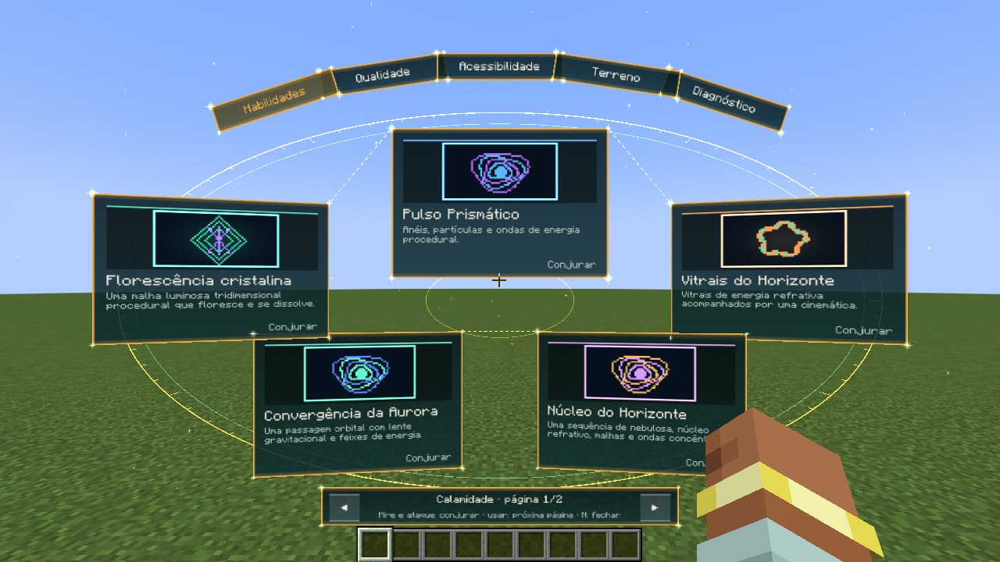
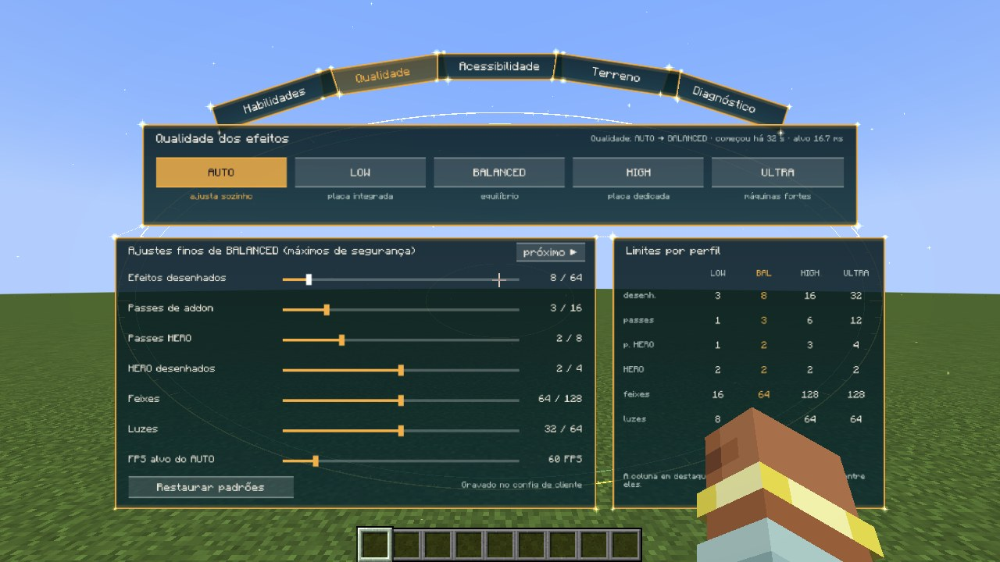

# Atlas Estelar (0.11.2)

O Atlas Estelar é o único painel holográfico do Calamidade. Desde a 0.11.2 ele é um conjunto de placas **paradas no mundo**, à frente de onde você olhava quando o abriu. Você continua andando, pulando e olhando em volta: não há tela por cima do jogo nem controle travado. Dá para dar a volta nas placas, vê-las de lado e por trás, e virar de costas.

## Abrir, fechar e trazer de volta

| Ação | Como |
|---|---|
| Abrir ou fechar | **N** (ou o botão "Atlas Estelar" no menu de pausa) |
| Trazer para a frente da mira | **B** (Recall) |
| Apontar com o cursor do mouse | segurar **Alt esquerdo** (a câmera para, WASD continua) |
| Escolher, clicar, arrastar | mirar e **Atacar** (botão esquerdo) ou **Usar** (botão direito) |
| Rolar | roda do mouse com a mira numa placa |

As teclas mudam em Controles → Calamidade_Awakening. O Atlas escolhe sozinho uma posição que não entre em paredes: aproxima as placas quando há uma parede na frente e gira o arco para o lado livre; num espaço muito apertado avisa e usa a menor distância.

Ele **fecha na hora** na morte, no renascimento, na troca de dimensão, no logout, no modo espectador e quando um menu da RimuLib abre; **some com a animação** com N, logo depois de conjurar e quando você se afasta mais de 24 blocos. Fica visível (sem responder) com inventário, chat e pausa abertos, e se esconde sem fechar durante uma câmera cinematográfica e com F1.

## Clique sem atacar o que está atrás

O clique é da placa só quando a mira acerta a face da frente dela, a até 6 blocos, e **mais perto** que o bloco ou mob que o jogo escolheria. Então:

- clicar numa placa nunca ataca, minera, coloca bloco nem usa o item da mão, mesmo com um mob ou bloco logo atrás, mesmo no criativo;
- um bloco ou mob **na frente** da placa continua sendo do mundo;
- o dono de cada botão é decidido no aperto e vale até soltar: segurar o clique numa placa e virar para um bloco não minera; uma mineração que começou no mundo para quando a mira passa por uma placa e volta quando sai;
- a roda só é da placa com a mira nela (fora das placas, troca o slot da barra); as teclas 1–9 nunca são capturadas.

## Visual: o astrolábio

Um anel de latão com marcas de grau, um anel interno verde-petróleo e um pequeno anel central ficam atrás dos cartões; os cartões ficam em órbita, as abas inclinadas ao longo do arco de cima e linhas de constelação tracejadas ligam os cartões. Estrelas marcam os cantos de cada placa e poeira estelar em várias profundidades dá paralaxe de verdade, porque as placas estão no mundo. Na abertura, as estrelas se acendem, o anel cresce do centro, as linhas se desenham e os cartões se formam a partir das estrelas; no fechamento, o caminho inverso. Todo texto é medido e cortado com reticências para nunca sair do cartão.

## Abas

| Aba | O que tem |
|---|---|
| **Habilidades** | Os cinco cartões do motor e uma página por addon (namespace), até cinco cartões cada. Atacar num cartão conjura pelo servidor (que confere a recarga); usar passa à próxima página; roda nos cartões troca a página. |
| **Qualidade** | AUTO, LOW, BALANCED, HIGH e ULTRA com o motivo da última troca do AUTO; sliders dos seis limites de cada perfil (desenhados, passes, passes HERO, HERO desenhados, feixes, luzes) com os máximos de segurança, FPS alvo do AUTO e "Restaurar padrões"; tabela dos limites de todos os perfis. |
| **Acessibilidade** | Intensidade dos efeitos de tela, tremor, efeitos de movimento, névoa da atmosfera pela névoa do jogo e a opção do jogo "ocultar clarões". |
| **Terreno** | Só leitura: se a destruição está ligada, nesta dimensão, volume, blocos por tick, dimensões, block entities, mobGriefing, desfazer, estrutura, evento de explosão e proteção de spawn. Vem da config do servidor, que o NeoForge sincroniza ao entrar; mudar exige o servidor. |
| **Diagnóstico** | As linhas do F7 ao vivo, o gráfico do tempo de quadro (últimos 240 quadros, guias de 60 e 30 FPS), bench 6/24/60 e parar (com permissão 2 no servidor) e gravação de 8 s com mediana e p95 no próprio painel (o CSV vai para `calamidade_bench/`). |

Os valores mudam na hora e ficam gravados em `calamidade_awakening-client.toml`. Os comandos de servidor continuam pedindo permissão no servidor.

## Para addons

Nada muda para quem publica cartões: `Addons.publish` e a arte em `textures/gui/sprites/skill/focus/addon/<ns>/<id>.png` (proporção 2:1) continuam valendo (capítulo de addons). O título do cartão vem do `titleKey`, a linha de baixo do `tier` e a recarga do `cooldown`.

## Engenharia

O código está em `client/holo` (`AtlasWorld`, `AtlasInput`, `Atlas`, `HoloPanel`, `HoloSurface`, `HoloZone`, `HoloGl`) e as partes puras em `api/holo` (`HoloGeometry`, `HoloPlacement`, `HoloInputArbiter`, testadas no `checkBudget`).

- **Um só espaço:** o Atlas é uma prancha de 640 × 360 unidades que vira mundo por uma matriz (`HoloGeometry.layoutToWorld`): o olho da prancha é a posição dos olhos na abertura e a frente aponta para o yaw dela. Desenho, mira, clique, arrasto e roda usam as matrizes congeladas do mesmo quadro.
- **Quadro:** em `RenderFrameEvent.Pre`, animação, hover e o conteúdo de cada placa desenhado num framebuffer próprio (reaproveitado, com mipmap; placas fora da vista não são redesenhadas). Em `RenderLevelStageEvent` AFTER_LEVEL, a passada 3D com a projeção da câmera real e teste de profundidade contra o cenário, sem gravar nem limpar o depth buffer (parede na frente esconde a placa). `HoloGl.end` devolve projeção, model-view, máscara e função de profundidade, cull, mistura, névoa e cor do shader.
- **Entrada:** `InputEvent.MouseButton.Pre` (antes do vanilla: cancelado, o ataque e o uso nem descem), `MouseScrollingEvent` e `InteractionKeyMappingTriggered` (rede de segurança e ações presas ao teclado), com o dono de cada botão em `HoloInputArbiter`.

**Origem:** a engenharia das placas foi adaptada do menu holográfico da tecla K do RespectCraft (mesmo autor, que autorizou copiar e adaptar; handoffs 4.8.1, 4.8.4-A e 4.8.4-B do repositório `Juann027/MineModding_01`). O código vive no Calamidade, no namespace dele, sem importar nada do RespectCraft; o Calamidade não depende do RespectCraft. O visual e as abas são originais.

## Testes

`xvfb-run -a ./gradlew testeAtlas` (depois de `./gradlew testeJogo`, que cria o mundo, e do build do vfx-sample): placas paradas enquanto o jogador anda, as cinco abas, clique em aba com pedra atrás no criativo (pedra intacta), clique direito com tábuas (nada colocado), roda (página muda, barra não), Recall, clique em cartão com vaca atrás (sem dano, habilidade conjurada, Atlas fecha), controle sem o Atlas (o mesmo clique quebra a pedra), fechamento por distância, dimensão e morte. Roteiro manual: TESTE-REAL.md, parte 9.
