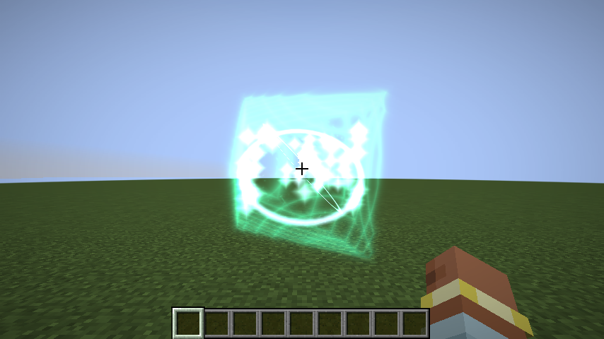
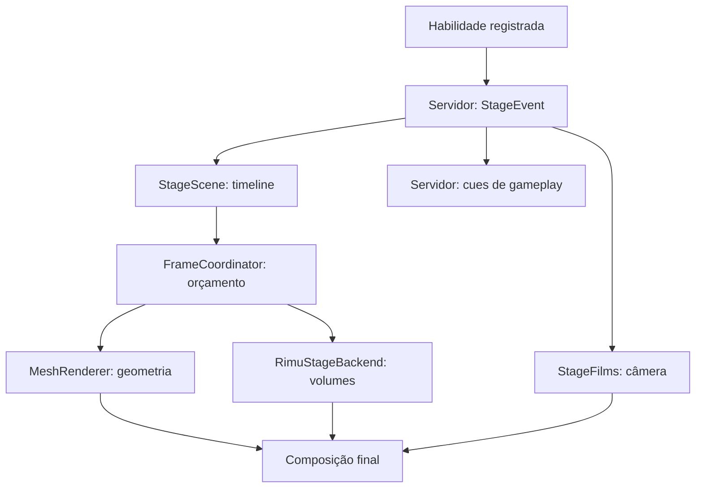
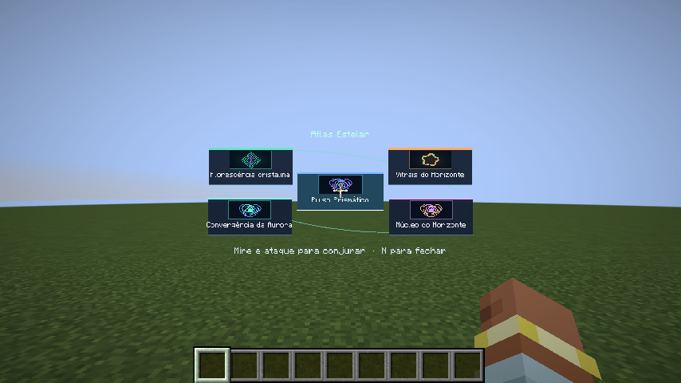
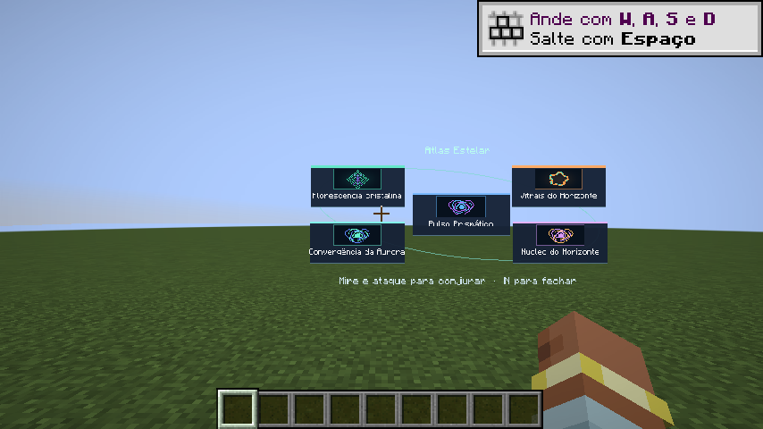

# Manual geral do Calamidade_Awakening 0.11.2

Minecraft Java 1.21.1 · NeoForge 21.1.267 · Java 21 · RimuLib 1.3.0

> Arquivo gerado por `scripts/gerar_manual.py` a partir dos capítulos em `docs/`. Edite os capítulos, não este arquivo.

## Por onde começar

**Para jogar**, instale a RimuLib e o JAR do Calamidade na pasta mods do cliente e do servidor. Pressione N para abrir o Atlas no mundo, mire em um cartão e ataque para conjurar. Usar item passa à próxima página quando há addons. Para o segundo menu, obtenha o Focus com `/give @s calamidade_awakening:focus`, segure-o e pressione H. Veja o capítulo 1.

**Para criar seu primeiro efeito**, comece pelo capítulo 2. Use uma posição fixa para um portal ou uma âncora de entidade para acompanhar um personagem. Para que o efeito cause dano ou outra consequência no mundo, registre um cue (capítulo 3). Para publicar um cartão, adicionar uma câmera ou fornecer um shader pelo JAR do seu mod, siga o capítulo 4. O Sinal de Maré é o exemplo executável de todo esse fluxo.

**Para efeitos no nível de chefe** (uniforms próprios, vários passes por fase, zoom blur, câmera com cortes e travellings), use os ganchos do capítulo 5. Para escrever o roteiro do efeito uma vez só (fases, trilhas e marcadores que servidor, shader e câmera compartilham) e para efeitos ambientes em loop, use a Timeline do capítulo 6. Para mudar o clima da cena (céu, névoa, exposição, tinta e estrelas) sem escrever shader, use a Atmosphere do capítulo 7. Para feixes (lasers, pilares, teias) e para luz que clareia o terreno em volta do efeito, também sem shader, use o Beam e a Light dos capítulos 8 e 9. Para que o efeito principal de uma cena apareça inteiro com dezenas de outros na tela, marque-o como protagonista (HERO, capítulo 10, que também explica para leigos a diferença entre quantos efeitos são desenhados e quanto cada um custa). Para virar efeitos, dispará-los de itens, blocos e mobs e usar o Calamidade a partir de outro mod, veja o capítulo 11. Para crateras, trincheiras, um meteoro que vira bloco real ou uma construção que cai e fica no mundo, use a Terrain API do capítulo 12.

**Para IAs e agentes**, comece por `AGENTS.md` na raiz do repositório e pelo material de `docs/ai/`: referência da API gerada do JAR, guia de GLSL com a biblioteca `calamidade_fx.glsl`, vinte e uma receitas completas (`/vfxsample receita <nome>`, item, blocos e mob do exemplo) e o modelo para usar o Calamidade como dependência (`docs/ai/usar-como-dependencia.md`). `python3 scripts/novo_efeito.py <namespace> <nome>` gera o esqueleto de um efeito novo.

**Para modificar o motor**, consulte os capítulos 13 e 14. O build baixa a RimuLib do CurseForge para `libs/` e confere o SHA-256; ela não é versionada. Na raiz, use `./gradlew build` para compilar e testar, `./gradlew dist` para copiar o JAR para `dist/` e `./gradlew runClient` para abrir o cliente de desenvolvimento. No Windows, use `gradlew.bat`.

**Para medir e validar**, use o capítulo 15 (painel F7, gravação de quadros e `/calamidade bench`) e registre os resultados no capítulo 16.

**Escopo.** As cinco habilidades internas são cosméticas. O motor oferece iluminação visual por materiais e shaders, desde a 0.8 tingimento do céu e névoa por efeito (Atmosphere) e, desde a 0.9, feixes e luz visual sobre o que a câmera vê (Beam e Light) , desde a 0.10, efeitos orientados e gatilhos de item, bloco e mob e, desde a 0.11, edições de terreno (Terrain API) com regras de segurança do servidor e desfazer; a luz da 0.9 não muda o nível de luz da simulação (spawn de mobs, plantas), e substituir o skybox por texturas próprias exige implementação adicional. Consequências de gameplay pertencem aos addons, pelos cues de servidor e pela Terrain API.


1. [Jogar e instalar](#cap1)
2. [API de efeitos e impact frames](#cap2)
3. [Gameplay sincronizado no servidor](#cap3)
4. [Criar addons e publicar cartões](#cap4)
5. [Ganchos avançados: pós-processamento, câmera e início](#cap5)
6. [Timeline: fases, trilhas, marcadores e sustain](#cap6)
7. [Atmosphere: céu, névoa, exposição e tinta](#cap7)
8. [Beam: feixes de luz](#cap8)
9. [Light: luz visual sobre o mundo](#cap9)
10. [Prioridade protagonista e orçamento por quadro](#cap10)
11. [Integração com outros mods: orientação, fontes, limites e gatilhos](#cap11)
12. [Terrain API: destruição, crateras e objetos que viram blocos reais](#cap12)
13. [Arquitetura do motor](#cap13)
14. [Criar habilidades dentro do motor](#cap14)
15. [Testes em GPU real e multiplayer](#cap15)
16. [Validação, medições e limites](#cap16)
17. [Histórico e evolução prevista](#cap17)

Leitura complementar, fora do manual: [estudo técnico da integração da SA Series](ESTUDO-SA-SERIES.md).

<a id="cap1"></a>

## 1. Jogar e instalar

Motor modular de efeitos visuais para Minecraft Java 1.21.1, NeoForge 21.1.x e Java 21. A versão 0.11.1 usa RimuLib 1.3.0. As cinco habilidades internas são cosméticas; consequências no mundo (dano, empurrão) vêm de addons que usam os cues de servidor e, desde a 0.11.0, crateras e estruturas que caem pela Terrain API (que respeita as regras de terreno da config do servidor, desde a 0.11.1 também claims de mods de proteção, a borda do mundo, a proteção de spawn e o modo aventura, e se desfaz com `/calamidade terrain undo`).

### Instalação

Coloque o JAR `dist/calamidade_awakening-0.11.1.jar` e a RimuLib 1.3.0 para NeoForge na pasta mods. Baixe a RimuLib do [CurseForge](https://www.curseforge.com/minecraft/mc-mods/rimulib/files/9676532) (`rimulib-1.3.0-neoforge.jar`); ela não fica no repositório nem nos releases do GitHub, que trazem só os JARs do Calamidade e do exemplo. Use as mesmas versões no servidor e em todos os clientes (a 0.10.0 mudou o pacote de início de efeito para `event_v2` e a 0.11.0 criou o `terrain_v1`, mantido na 0.11.1; versões diferentes simplesmente não trocam efeitos ou o terreno). Substitua o JAR da versão anterior; o namespace, o item e as teclas da 0.1.2 em diante continuam compatíveis. Para obter o Focus, use `/give @s calamidade_awakening:focus`. Teclas personalizadas são reatribuídas em Controles.

A interface usa inglês como padrão e tem tradução para português do Brasil pela opção de idioma do Minecraft.

| Tecla padrão | Ação |
|---|---|
| N | Abrir ou fechar o Atlas Estelar |
| K | Pulso Prismático |
| U | Florescência Cristalina |
| I | Vitrais do Horizonte |
| V | Convergência da Aurora |
| Y | Núcleo do Horizonte |
| O | Interromper a câmera cinematográfica |
| F7 | Painel de diagnóstico |
| F8 | Alternar a qualidade visual |

Se a Convergência da Aurora ainda estiver em L depois de atualizar, reatribua para V em Controles. L abre a tela de Progressos do Minecraft.

### Atlas Estelar

Abra o **Atlas Estelar** pelo menu de pausa ou pressione **N** durante o jogo. Cinco cartões aparecem quatro blocos à frente da câmera. É possível andar em volta deles ou olhar para outro lado. Mire em um cartão e pressione **Atacar** (botão esquerdo) para conjurar a habilidade pelo servidor. **Usar item** (botão direito) passa à próxima página quando há addons. O Atlas fecha depois da escolha, na troca de dimensão ou a mais de 24 blocos. Nenhum item é necessário para abri-lo.

O Atlas se abre em 0,44 segundo, com um pequeno atraso nos cartões externos. Um cartão em movimento já pode ser escolhido. O destaque acompanha o foco e marca a escolha enviada.

### Habilidades internas

**Núcleo do Horizonte** dura dez segundos. Quatro lâminas curvas se reúnem acima do alvo, estreitam-se numa fenda e liberam uma onda violeta e branca pelas superfícies visíveis próximas. A onda usa distância 3D, então chega mais tarde a blocos elevados. Quatro sons posicionais marcam reunião, tensão, ruptura e eco. A câmera segura o enquadramento durante o impacto; pressione O para voltar à sua visão.

**Pulso Prismático** libera o primeiro pulso cerca de quatro ticks depois da conjuração. Com 38 ticks de apresentação e 48 de recarga, é a alternativa rápida ao Núcleo do Horizonte.

A recarga é contada por habilidade: conjurar o Núcleo do Horizonte não impede o Pulso Prismático.

### Acessibilidade

Em **Mods → Calamidade_Awakening → Configurar** (ou no arquivo `config/calamidade_awakening-client.toml`):

- **Intensidade dos efeitos de tela** (0 a 1): reduz bloom, clarões, contraste e dessaturação deste mod e de todos os addons. 0 desliga.
- **Tremor de tela**: liga ou desliga o tremor.

A opção do Minecraft "Ocultar clarões de relâmpago" também desliga os clarões dos impact frames.

### Focus

Segurando o Foco Awakening, a tecla **H** abre o menu de habilidades da RimuLib. Escolha uma habilidade, feche o menu e use o Focus com o botão direito. Habilidades de addons aparecem no mesmo menu, com arte, descrição e, quando o addon define, controle de potência.

### Ferramentas de teste

**F7** mostra a GPU em uso, FPS, tempo de quadro (mediana e percentil 95), eventos ativos e o custo do quadro. `/calamidade_client record 30` grava 30 segundos em `calamidade_bench/` na pasta do jogo. Com permissão de comandos, `/calamidade bench 6` cria seis Núcleos do Horizonte à sua frente e `/calamidade bench stop` os encerra. O roteiro completo está no capítulo de testes em GPU real e multiplayer.

### Desenvolvimento

O build baixa a RimuLib do CurseForge para `libs/` e confere o SHA-256 (task `rimulib`, veja `libs/README.md`); o JAR nunca é versionado. Com o JDK 21, `./gradlew build` compila e roda os testes de orçamento; `./gradlew dist` copia o JAR para `dist/`; `./gradlew runClient` abre o cliente de desenvolvimento e `./gradlew runServer` o servidor dedicado. No Windows, use `gradlew.bat`.

<a id="cap2"></a>

## 2. API de efeitos e impact frames

Este documento descreve a API introduzida na 0.3, que continua válida na 0.10.0. Para o exemplo incluído no pacote atual, caminhos de instalação e publicação de cartões, abra [Addons 0.4](ADDONS-0.4.md).

Para Minecraft Java 1.21.1, NeoForge 21.1.x e Java 21. A interface pública desta versão é `dev.calamidade_awakening.api.v1.Effects` e seus tipos internos. O pacote contém um JAR de motor e conteúdo. O consumidor instala seu próprio JAR junto dele e da RimuLib 1.3.0 em ambos os lados.

### Primeira integração

O projeto Gradle independente em [examples/vfx-sample](../examples/vfx-sample/) já contém o código e os recursos deste exercício. Na raiz, `./gradlew dist` baixa a RimuLib para `libs/` (conferida por SHA-256) e gera o JAR do Calamidade em `dist/`, que o exemplo usa. Execute:

```sh
./gradlew -p examples/vfx-sample build
./gradlew -p examples/vfx-sample runClient
```

No Windows use `gradlew.bat`. O primeiro build precisa baixar os artefatos de desenvolvimento do NeoForge. Para testar sem compilar, gere o consumidor com `./gradlew -p examples/vfx-sample build`; o JAR `vfx-sample-1.6.0.jar` fica em `examples/vfx-sample/build/libs/`. Também é possível instalar o JAR produzido em `examples/vfx-sample/build/libs/` em um perfil NeoForge com os dois mods. Em um mundo com comandos habilitados:

1. Use `/vfxsample at`. O sinal aparece quatro blocos à frente. Ande para ver que ele fica parado.
2. Use `/vfxsample follow`. O exemplo encerra o sinal anterior e cria um novo na sua entidade. Use F5 e caminhe para ver o movimento.
3. Use `/vfxsample stop` durante os seis segundos do efeito. A emissão e a geometria cessam; partículas já emitidas completam a própria vida.

Para usar em outro repositório, use o modelo de [docs/ai/usar-como-dependencia.md](ai/usar-como-dependencia.md) (o JAR vem do release do GitHub, conferido por SHA-256, sem Maven) e leve a dependência de calamidade_awakening do neoforge.mods.toml para o manifesto do seu mod. O exemplo atual declara o intervalo [0.10.0,0.11.0). Desde a 0.10.0, `Effects.start` e `Effects.follow` também aceitam orientação e uma `Placement` ([INTEGRACAO-0.10.md](INTEGRACAO-0.10.md)). As chamadas desta página existem desde a 0.3.0. O mod de exemplo é opcional.



A captura mostra o efeito de posição fixa antes do tick 40. Para comparar com o instante do impacto, observe a cor da grama e do céu no segundo 2.

### Onde registrar e onde executar

Registre a definição no construtor comum do mod, com o mesmo ID e os mesmos parâmetros em cliente e servidor. O ID é transmitido como namespace e caminho. A ordem de carregamento de dois consumidores não determina o ID na rede. Reserve um nome do seu próprio namespace para cada efeito.

```java
var signal = ResourceLocation.fromNamespaceAndPath("vfxsample", "signal");
Effects.register(signal, new Effects.Definition(120, 2.0, 0xff65e8c9,
    Effects.Shape.RINGS, Effects.Material.CRYSTAL,
    ResourceLocation.withDefaultNamespace("end_rod"), signal));
```

O primeiro ID opcional é um SimpleParticleType registrado. O segundo é uma entrada de sounds.json do cliente. O exemplo inclui assets/vfxsample/sounds.json e sounds/signal.ogg. Passe null em cada posição que deseja omitir. O som toca na posição de abertura para quem recebe o evento no início. Cada cliente emite uma partícula a cada quatro ticks na âncora; o Minecraft aplica as opções locais de partículas. O motor usa triângulos e composição próprios para a geometria e o material.

### Referência de execução

| Chamada | Resultado |
|---|---|
| Effects.register(id, definition) | Registra uma definição comum. ID duplicado ou namespace reservado do Calamidade gera erro. |
| Effects.start(id, serverLevel, position) | Abre uma instância fixa. Posição em blocos, em coordenadas absolutas do mundo. |
| Effects.follow(id, entity, offset) | Acompanha a posição interpolada dos pés da entidade. Offset em blocos nos eixos do mundo, independente da rotação. |
| Effects.start(id, serverPlayer, position) | Âncora fixa com identificação do conjurador. Para efeitos internos com filme configurado, o conjurador pode receber a câmera. |
| handle.stop() | Encerra a instância para os observadores. Retorna true ao encerrar e false se já terminou. |

Execute start, follow e stop na thread do servidor. Em callbacks assíncronos, despache primeiro com server.execute. Um ID desconhecido ou coordenadas não finitas geram IllegalArgumentException. As operações de início retornam Optional.empty() se a capacidade for atingida ou a âncora inicial estiver indisponível. Valide permissão, alcance, custos e recarga no mod que solicita o efeito. Para dano ou outra consequência sincronizada com o visual, registre um cue (capítulo de gameplay). Não envie posições ou IDs arbitrários de clientes diretamente para a API.

O servidor mantém até 64 instâncias. O cliente recebe inícios dentro do alcance da definição (128 blocos por padrão, configurável de 16 a 1024 com `withRange`) e usa o tempo original do evento ao entrar ou voltar à área. O cliente depende de rastrear a entidade para renderizar uma âncora móvel. Na troca de dimensão, o cliente limpa o estado local. A remoção ou transferência da entidade encerra aquela instância no servidor. A âncora fixa termina se o chunk for descarregado. O motor não mantém chunks carregados e as instâncias não são salvas entre sessões.

### Convenções visuais e limites

- Duração de 1 a 12000 ticks (10 minutos; até a 0.6.1 o limite era 1200). A 20 ticks/s, 120 ticks equivalem a seis segundos. Para efeitos ambientes, use uma duração longa e encerre com `stop()`. Acima de 1200 ticks, a entrada e a saída automáticas ficam fixas em 168 e 336 ticks em vez de proporcionais. Raio finito maior que zero e até 512 blocos.
- Alcance de distribuição de 16 a 1024 blocos: `new Definition(...).withRange(600)`. O efeito só pinta o que cada cliente renderizou; além da distância de renderização do jogador, só existem pixels de céu, então alcances grandes servem principalmente a efeitos no céu. A extensão visível depende do estilo.
- Cor em ARGB. O matiz afeta a geometria; os materiais volumétricos têm paletas próprias. A intensidade sobe e decai pela curva do motor.
- Geometrias disponíveis: NONE, RINGS, PRISM, ORBIT e NEXUS. Materiais: NONE, CRYSTAL, VEIL, LENS e NEBULA. Combine geometria e material separadamente. Os cinco efeitos jogáveis continuam acessíveis pelo Atlas; registrar um efeito externo não cria um cartão.
- LOW, BALANCED e HIGH selecionam até 3/6/12 sinais de geometria e 1/2/4 volumes por quadro. O servidor continua avançando o relógio quando o cliente omite uma camada. O filtro de distância e o orçamento por quadro não substituem o controle de quantidade de instâncias do consumidor.
- A iluminação de superfície é visual. Os efeitos não alteram níveis de luz dos blocos, IA, dano ou terreno. A interrupção impede novas emissões, mas um som de abertura já iniciado segue a duração de seu clipe.
- A versão 0.3 oferece materiais prontos e recursos de partículas e áudio do consumidor. Shaders GLSL arbitrários por namespace, modelos e ossos de Blockbench, skyboxes empilháveis, curvas de câmera externas e efeitos persistentes sem prazo ainda exigem evolução da API.

### Atualização a partir de 0.2.0

Substitua o JAR em cliente e servidor juntos. O formato de sincronização de efeitos mudou para incluir entidade e offset e passou a incluir uma mensagem de encerramento. O ID do mod, as teclas e o item Focus continuam compatíveis. Registros externos ficam fora do catálogo interno de habilidades e usam o mesmo agendador que os efeitos jogáveis.

### Como marcar o impacto de uma explosão

Escolha o tick do contato no relógio da habilidade. No projeto de exemplo, execute `/vfxsample at` e observe o segundo 2. O anel mantém sua cor durante a formação; no tick 40 começa uma breve perda de saturação com aumento de contraste. O trecho compilável está em Sample.java.

```java
var cue = new Effects.Impact(40, 3, .75f, Effects.ImpactStyle.MONOCHROME);
var definition = new Effects.Definition(120, 2, 0xff65e8c9,
    Effects.Shape.RINGS, Effects.Material.CRYSTAL, null, null, cue);
Effects.register(ResourceLocation.fromNamespaceAndPath("meumod", "explosao"), definition);
```

- **Tick e duração.** O primeiro número é o tick de início; o segundo é a duração, entre 1 e 20 ticks. Três ticks duram cerca de 150 ms a 20 ticks/s. O número de quadros mostrados depende do FPS. O pico ocorre no início e decai linearmente. A janela inteira precisa caber na duração do efeito.
- **Estilo.** MONOCHROME remove parte da saturação e aumenta o contraste do quadro. TINTED_FLASH ilumina a tela com o RGB da definição. Para um clarão discreto, experimente TINTED_FLASH com força 0.2f por dois ticks. A força aceita valores maiores que zero até 1.
- **Composição.** A distância reduz o impacto até zero a 64 blocos. A visibilidade e o orçamento do cliente também contam. Entre sinais simultâneos do mesmo estilo, prevalece o mais forte. Uma entrada tardia usa o relógio original e não repete um impacto passado.
- **Preferência do jogador.** Em Opções → Acessibilidade, habilitar a opção de ocultar clarões de relâmpago desativa os acentos de tela do Calamidade, inclusive o monocromático. Partículas, brilho das malhas e iluminação de superfícies continuam visíveis. Use também forma, movimento e som para comunicar o contato.
- **Dica de autoria.** Teste primeiro a geometria sem o acento e depois compare as duas versões no mesmo local. A definição de sete argumentos continua disponível e usa o acento suave padrão do motor. A versão com Impact substitui esse acento pela janela escolhida.

<a id="cap3"></a>

## 3. Gameplay sincronizado no servidor

O motor continua cosmético: ele não altera vida, blocos ou IA por conta própria. A partir da 0.5.0, um addon pode agendar **cues**: funções que rodam no servidor quando o relógio de uma instância chega a um tick. É o lugar certo para dano, empurrão, efeitos de poção, quebra de blocos ou custo de mana, porque o cue usa o mesmo relógio que o cliente usa para desenhar. O golpe acontece no quadro em que o jogador vê o contato.

### Registro

Registre o efeito e depois os cues, no construtor comum do mod:

```java
var golpe = ResourceLocation.fromNamespaceAndPath("meumod", "golpe");
Effects.register(golpe, new Effects.Definition(80, 4, 0xffffb050,
    Effects.Shape.RINGS, Effects.Material.LENS, null, null,
    new Effects.Impact(30, 3, .8f, Effects.ImpactStyle.TINTED_FLASH)));

// Mesmo tick do impact frame (30).
Effects.onImpact(golpe, ctx -> {
    var fonte = ctx.caster() == null ? ctx.level().damageSources().magic()
        : ctx.level().damageSources().indirectMagic(ctx.caster(), ctx.caster());
    for (var alvo : ctx.living(4)) alvo.hurt(fonte, 6);
});

// Qualquer outro tick, de 0 até a duração menos 1.
Effects.cue(golpe, 0, ctx -> ctx.level().playSound(null, BlockPos.containing(ctx.center()),
    SoundEvents.WARDEN_SONIC_CHARGE, SoundSource.HOSTILE, 1f, 1f));
```

| Chamada | Resultado |
|---|---|
| Effects.cue(id, tick, cue) | Agenda o cue no tick indicado de toda instância desse efeito. Vários cues por efeito e por tick são permitidos e rodam na ordem de registro. |
| Effects.onImpact(id, cue) | Atalho para o tick do Impact da definição. Gera erro se a definição não tiver Impact. |
| ctx.level(), ctx.center() | Mundo e centro atual. Para instâncias presas a uma entidade, o centro já inclui o offset. |
| ctx.caster() | Jogador que conjurou, ou null quando o efeito foi iniciado sem jogador ou o jogador saiu. |
| ctx.anchor() | Entidade âncora de Effects.follow, ou null. |
| ctx.living(raio) | Entidades vivas cujo centro está dentro do raio, sem o conjurador e sem a âncora. Raio até 128. |
| ctx.tick(), ctx.seed() | Tick agendado e seed da instância (a mesma que o cliente usa no visual). |
| ctx.handle() | Handle da própria instância. `ctx.handle().stop()` encerra o efeito, por exemplo quando o alvo morre. `ctx.handle().release()` libera um efeito com sustain (0.7.0). |
| Effects.cue(id, "marcador", cue) | 0.7.0: cue no tick de um marcador da Timeline do efeito. Registre a timeline antes (capítulo da Timeline). |
| ctx.timeline(), ctx.localAge(), ctx.age() | 0.7.0: timeline do efeito (null sem timeline), idade local (igual ao tick) e idade real da instância. |

### Regras

- Registre somente efeitos do seu namespace. Os cinco efeitos internos não aceitam cues.
- O cue roda na thread do servidor, uma vez por instância e por tick agendado, mesmo se o servidor atrasar alguns ticks.
- Instâncias encerradas por `stop()`, perda da âncora ou descarregamento do chunk não executam os cues seguintes, nem os que estavam agendados para o mesmo tick depois do cue que chamou `stop()`.
- Uma exceção no cue é registrada no log e não derruba o efeito nem os outros cues.
- Valide permissões, PvP, proteção de terreno e custos dentro do cue ou no callback de conjuração. O motor não sabe quem pode ferir quem.
- Para chefes, combine `Effects.follow(id, chefe, offset)` com cues: o centro acompanha o chefe e o golpe acontece onde ele está naquele tick.

O Sinal de Maré do exemplo agenda o cue no marcador `impacto` da timeline (tick 40, o mesmo do impact frame) para causar 2 corações de dano e empurrar as criaturas a até três blocos. Com timeline, os ticks dos cues são locais: dentro de um loop de sustain, um cue roda a cada volta (veja TIMELINE-0.7.md). O código está em `examples/vfx-sample/src/main/java/example/vfxsample/Sample.java`.

<a id="cap4"></a>

## 4. Criar addons e publicar cartões

O projeto independente em [examples/vfx-sample](../examples/vfx-sample/) implementa o **Sinal de Maré**. Use-o como ponto de partida. O jogador pode descobrir o cartão no Atlas, ajustar a potência no Focus e acompanhar uma execução com câmera, malha, shader de superfície, partículas, som e HUD. O motor e o addon têm JARs e namespaces próprios.

### Teste de cinco minutos

1. Em Minecraft Java 1.21.1 com NeoForge, instale RimuLib 1.3.0 e o JAR 0.9.0 da pasta dist (gerado por `./gradlew dist`). Para experimentar o addon, acrescente o vfx-sample-1.6.0.jar gerado por `./gradlew -p examples/vfx-sample build` em examples/vfx-sample/build/libs. No multiplayer, instale as mesmas versões no servidor e nos clientes.
2. Pressione **N** olhando para um espaço livre. A página inicial contém as cinco habilidades internas. Use o botão **Usar item** (direito por padrão) para passar às páginas dos addons. Mire no Sinal de Maré e pressione **Atacar** (esquerdo por padrão). A tecla O interrompe a câmera.
3. Para o menu compartilhado, obtenha o Focus com `/give @s calamidade_awakening:focus`, segure-o e pressione **H**. Selecione o Sinal de Maré. Sua linha tem descrição, arte e controle de potência. O painel do addon explica o parâmetro. Aumentar a potência eleva o ponto da conjuração seguinte. Feche o menu, mire e use o Focus com o botão direito para conjurar a habilidade selecionada. A recarga do cartão é de 130 ticks. No tick 40, o impacto causa dano leve e empurra as criaturas a até três blocos (veja o capítulo de gameplay).
4. Os comandos `/vfxsample at`, `follow` e `stop` continuam disponíveis com permissão de comandos. Eles exercitam as instâncias diretamente. Para testar recarga, seleção do item e callback de conjuração, use o cartão.
5. Para recompilar o addon na raiz extraída, execute `./gradlew dist` (baixa a RimuLib para libs/, conferida por SHA-256) e depois `./gradlew -p examples/vfx-sample build` com Java 21. No Windows, use gradlew.bat. O exemplo compila contra o JAR em dist e declara sua dependência em META-INF/neoforge.mods.toml.

### Registro comum

O construtor do seu mod chama Effects.register para cada efeito. Addons.publish torna a definição selecionável. Essa segunda chamada é opcional: efeitos ambientais, fases internas de uma sequência e efeitos que dependem de lógica de um boss podem continuar privados ao fluxo de conjuração do seu mod.

```java
Addons.resources("meuaddon", MeuAddon.class);
var id = ResourceLocation.fromNamespaceAndPath("meuaddon", "onda");
Effects.register(id, new Effects.Definition(120, 4, 0xff65e8c9,
    Effects.Shape.RINGS, Effects.Material.CRYSTAL, null, null));
var card = new Addons.Card("ability.meuaddon.onda", "Wave", "TIDE", 140, null, List.of());
Addons.publish(id, card);
```

Addons.resources associa o namespace à classe do seu mod para que o carregador de shaders encontre o JAR correto. Isso é necessário para um shader empacotado em um módulo Java separado.

Use o mesmo registro nos dois lados, durante a construção do mod. O cadastro é fechado no registro de itens, antes da criação das teclas da RimuLib. O Atlas agrupa por namespace, ordena as entradas e cria páginas com até cinco cartões. IDs iguais em namespaces diferentes têm cartões independentes. O motor inclui as entradas no conjunto de habilidades do Focus em uma única etapa, depois que os addons terminam seus construtores.

### Arquivos que o addon fornece

| Recurso no JAR do addon | Uso |
|---|---|
| assets/calamidade_awakening/textures/gui/sprites/skill/focus/addon/meuaddon/onda.png | Arte compartilhada pelo Focus e pelo Atlas. Use PNG RGBA, proporção 2:1. O exemplo tem 64 × 32 pixels. O caminho inclui o namespace do autor para evitar colisão. |
| assets/meuaddon/lang/en_us.json e pt_br.json | Registre ability.meuaddon.onda para o título, skill.calamidade_awakening.focus.addon/meuaddon/onda.desc para a descrição e key.calamidade_awakening.focus.addon/meuaddon/onda para o controle. |
| assets/meuaddon/shaders/fx/onda.fsh | Passe opcional. Informe meuaddon:onda no campo shader do cartão. |
| assets/meuaddon/sounds.json e sounds/*.ogg | Recursos opcionais para a definição de efeito. Consulte [API de instâncias](API-0.3.md). |

### Decisão do servidor e composição

Addons.publish(id, card) usa o alvo calculado pelo servidor e inicia o efeito com identificação do conjurador. Para exigir um item, desbloqueio ou condição do seu mod, use a sobrecarga com callback. O pedido de rede identifica a habilidade e a potência desejada. O motor verifica a publicação, estado do jogador, recarga, capacidade e alvo. O callback deve validar os requisitos específicos antes de alterar o mundo. Retorne true quando aceitar a conjuração. A partir da 0.5.0, a recarga é contada no servidor por jogador **e por habilidade**: conjurar uma habilidade não bloqueia as outras. A duração vem do campo cooldown do cartão.

```java
Addons.publish(id, card, new Addons.Range(.5f, 1f, 2f), (player, target, power) -> {
    Vec3 center = target.add(0, power - 1, 0);
    return Effects.start(id, player, center).isPresent();
});
```

Range define mínimo, valor inicial e máximo finitos. O servidor limita o valor recebido; valores não finitos voltam ao inicial. A escala da potência é uma decisão do callback. No exemplo, o parâmetro altera altura em blocos. Para combinar dois efeitos, inicie a segunda definição a partir do mesmo callback. Guarde os handles se as etapas puderem ser canceladas. Se a segunda criação falhar e as duas precisarem ser indivisíveis, chame stop no primeiro handle antes de retornar false. Para um atraso, agende no relógio do servidor e limpe o trabalho na troca de mundo.

### Câmera, HUD e painel

Cada Addons.Shot contém o tick de fim, deslocamento de câmera em blocos relativo ao alvo na base usada por aroundTarget, e FOV em graus. A primeira posição é mantida até o primeiro fim; entre as seguintes o motor interpola posição e FOV. Use ticks crescentes dentro da duração. Uma lista vazia mantém a câmera do jogador. A apresentação automática depende das opções locais, da identidade do conjurador e da chegada do evento no início. O observador recebe os efeitos no mundo.

Registre os desenhos no setup **exclusivo do cliente**. A classe SampleClient do exemplo contém as três camadas funcionando juntas:

- AddonLayers.world(id, callback) recebe tempo normalizado, opacidade, seed, raio e um emissor de triângulos e fitas. Os pontos são offsets da âncora interpolada, em blocos. O motor aplica opacidade, profundidade e orçamento de vértices. Não armazene o emissor para outro quadro.
- AddonLayers.hud(id, callback) recebe GuiGraphics e o tempo. Desenhe em coordenadas da GUI. O motor escolhe uma instância por ID para o HUD dentre os efeitos visíveis priorizados naquele quadro. O HUD oculto pelo jogador é respeitado.
- AddonLayers.panel(id, callback) desenha informações suplementares no Focus quando o seu conjunto está aberto e a habilidade está selecionada. Um painel pode mostrar lore, progresso ou uma dica contextual. O controle editável implementado nesta versão é o slider de potência do Focus. Teclados ou seletores próprios de uma habilidade exigem lógica de entrada do addon.

### Shader autoral

Os fragment shaders recebem o cabeçalho comum da RimuLib. Omita #version e use sampleScene(texCoord) para a cor de entrada. O exemplo lê a profundidade do terreno, reconstrói a posição com scenePosAt e soma uma onda verde apenas na superfície visível.

| Uniform | Convenção |
|---|---|
| vec3 CaCenter | Posição da âncora relativa à câmera, no mesmo espaço de scenePosAt. |
| vec4 CaEffect | Progresso de 0 a 1, opacidade, seed normalizada, raio em blocos. |
| float CaFlashAllowed | 0 quando o jogador oculta clarões, 1 quando os permite. Um shader autoral precisa consultar esse valor para clarões de tela. Os impact frames da API já respeitam a preferência. |

Há até 1/2/4 passes de addon por quadro em LOW/BALANCED/HIGH, além do passe compartilhado do motor. Esse orçamento é dividido, na ordem de prioridade dos efeitos, entre shaders de cartão e cada passe pedido pelas camadas `AddonLayers.post`. Para uniforms próprios, vários passes por fase, zoom blur ou aberração, use os ganchos avançados da 0.6 ([AVANCADO-0.6.md](AVANCADO-0.6.md)). Entre efeitos concorrentes vale a ordem de prioridade do quadro. Comece com um passe, teste contra paredes e céu, e compare com o shader desligado. Para um simples anel, experimente a malha em lote antes de criar um passe de tela cheia. Evite texto, descrições ou callbacks com efeitos colaterais dentro de um shader ou de uma rotina de desenho.

### Diagnóstico e migração

- Dano, empurrão ou outra consequência no mundo: use Effects.cue ou Effects.onImpact (capítulo de gameplay) em vez de agendar tarefas próprias. O cue roda no relógio da instância, inclusive para instâncias iniciadas pelos comandos e por outros mods.
- Cartão ausente nos dois menus: confira a dependência no manifesto, o ID exatamente igual em register e publish e o registro no construtor comum. A API 0.3 de efeitos continua disponível. Atualize o intervalo de dependência do seu addon antes de usar a 0.4.
- Cartão aparece com textura ausente: verifique o caminho de sprite do Focus no JAR do addon, inclusive addon/namespace e caixa das letras.
- A habilidade aparece e o clique não conjura: confirme a recarga, os requisitos do callback e a mesma instalação nos dois lados. O destaque do Atlas indica o envio do pedido; a execução começa com a aceitação do servidor.
- Geometria aparece mas o shader falha: verifique namespace, shaders/fx e mensagens do compilador GLSL no log do cliente. Um shader de core do Minecraft tem outro contrato. Teste primeiro um passe que apenas devolve a cor de entrada.
- Ao publicar uma versão, teste o mod-base sozinho e com dois addons que escolham o mesmo nome de efeito em namespaces diferentes. Atualize cliente e servidor juntos: o pedido de conjuração da 0.4 inclui potência e usa o canal request_v2. A 0.5.0 mantém o mesmo protocolo de rede; a 0.6.0 também. A 0.7.0 acrescenta o canal release (efeitos com sustain), então servidor e clientes precisam estar na 0.7.0. Addons da 0.4 a 0.6 funcionam sem mudança no código após ampliar o intervalo de dependência para incluir 0.7. A 0.8.0 mantém o protocolo da 0.7.0 (a atmosfera não usa rede); addons da 0.7 só precisam ampliar o intervalo para incluir 0.8. A 0.9.0 também mantém o protocolo (feixes, luzes e prioridade não usam rede); addons da 0.8 só precisam ampliar o intervalo para incluir 0.9. A 0.10.0 troca o pacote de início por `event_v2` (orientação e fonte), então servidor e clientes precisam estar na 0.10.0; addons da 0.9 só precisam ampliar o intervalo para incluir 0.10. Para começar um addon novo, `python3 scripts/novo_efeito.py <namespace> <nome>` gera um efeito que compila sem edição, e `docs/ai/receitas/` traz dezessete efeitos completos.

<a id="cap5"></a>

## 5. Ganchos avançados: pós-processamento, câmera e início

A API de cartões cobre o caso comum: um shader com `CaCenter` e `CaEffect`, uma lista linear de tomadas e o acento de impacto. Efeitos de chefe e sequências longas precisam de mais. A 0.6 abre três ganchos de cliente que entregam ao addon as ferramentas da própria RimuLib, sem perder o que o motor já oferece: sincronização, seleção por prioridade, orçamento por qualidade, Atlas, Focus e cues.

Registre todos no setup **exclusivo do cliente** (FMLClientSetupEvent), um por ID de efeito.

### AddonLayers.post: passes próprios e pós-processamento

```java
AddonLayers.post(id, post -> {
    float pulse = (float) Math.exp(-Math.abs(post.age() - 40) / 4.0);
    post.pass("meuaddon:fase_ruptura", u -> {
        u.v3("Centro", post.center());
        u.f4("Estado", (float) post.age(), pulse, post.time().opacity(), (float) post.time().radius());
    });
    // Passe extra só quando há orçamento e a fase pede.
    if (post.age() > 60 && post.passesLeft() > 0)
        post.pass("meuaddon:fase_eco", u -> u.v3("Centro", post.center()));
    post.bloom(pulse * .4f);
    post.flash(0xFFFFE0B0, pulse * .6f);
});
```

| Membro | Conteúdo |
|---|---|
| pass(programa, uniforms) | Enfileira um shader de `assets/<namespace>/shaders/fx` com uniforms próprios. Retorna false, sem desenhar, quando o orçamento do quadro acabou. |
| passesLeft() | Passes que ainda cabem neste quadro. Use para escolher uma variante mais barata. |
| bloom, shake, desaturate, contrast | Combinam pelo máximo com os outros efeitos e com o motor; nunca sobrescrevem. Passam pela configuração de acessibilidade do jogador: a intensidade multiplica bloom, contraste e dessaturação, e o tremor pode estar desligado. |
| flash(cor, intensidade) | Clarão colorido, multiplicado pela intensidade configurada. Ignorado quando o jogador oculta clarões. |
| aberration, zoomBlur, vignette, afterimage, grain | 0.7.0. Mesmas regras de combinação e intensidade; zoom blur e afterimage obedecem a "Efeitos de movimento". |
| center() | Centro relativo à câmera, no espaço de `scenePosAt`. Já acompanha a entidade em `Effects.follow`. |
| age(), partial() | Idade em ticks com o tempo parcial, e o tempo parcial do quadro. Desde a 0.7.0, `age()` é a idade local da timeline (igual à real sem sustain) e `realAge()` a idade real. Para fases, prefira `timeline().weight("fase")` (TIMELINE-0.7.md). |
| timeline(), uploadTracks(u, prefixo) | 0.7.0: amostrador da timeline na idade local; envio das trilhas como uniforms float dentro de `pass`. |
| time() | Progresso (0 a 1), opacidade do envelope do motor, seed e raio. |
| distance(), instance() | Distância até a câmera e identificador da instância. |
| quality() | LOW, BALANCED ou HIGH. Reduza passos de raymarch nos perfis menores. |
| flashAllowed() | Falso quando o jogador oculta clarões. Evite também estrobos e mudanças fortes de exposição no shader. |
| screenEffects(), motionEffects() | 0.8.0: intensidade dos efeitos de tela (0 a 1) e a opção "Efeitos de movimento". Multiplique por `screenEffects()` qualquer mudança de tela inteira feita no seu próprio shader (impact frames, gradação de cor) e pule zoom ou borrão com `motionEffects()` falso. Exemplo: receita [impact frame](ai/receitas/04-impact-frame.md). |

Regras:

- **Orçamento por passe.** O quadro tem 1, 2 ou 4 passes de addon (LOW, BALANCED, HIGH). Shaders de cartão e cada `pass` dos posts consomem esse total na ordem de prioridade dos efeitos. Desde a 0.9.0, efeitos HERO têm um orçamento próprio (1, 2 ou 3) e os passes de feixes e de luzes do motor são pagos antes dos posts (seção "Prioridade protagonista", abaixo). Um efeito com shader de cartão e post já gasta uma vaga no cartão. Desde a 0.6.2, o callback é chamado mesmo sem vaga: `pass` retorna false, mas bloom, tremor, contraste e clarão continuam valendo. O painel F7 mostra os passes realmente enfileirados.
- **Outros efeitos de tela (0.7.0).** `aberration(f)`, `zoomBlur(f)`, `vignette(argb, f)`, `afterimage(f)` e `grain(f)` escrevem nos campos do ScreenFx da RimuLib 1.3.0. Combinam pelo máximo e passam pela intensidade configurada; a vinheta usa `addVignette`, que mantém a cor do pedido mais forte. Zoom blur e afterimage são ignorados quando o jogador desliga **Efeitos de movimento** (`motionEffects`).
- **Arrays de uniforms.** Veja a seção abaixo.

#### Arrays de uniforms (conferido no JAR da RimuLib 1.3.0)

O `Uniforms` que o `pass` entrega é a classe interna `PostFxRenderer$Binder`. Pelo `javap -c`:

- `f1`, `f2`, `f3` e `f4` passam o nome recebido, sem alteração, para `ShaderProgram.location(String)`. Esse método guarda o resultado num `HashMap` por nome (`computeIfAbsent`) e, na primeira vez, chama `GL20.glGetUniformLocation(id, nome)` com a mesma string. Não há corte em `[`, troca de caracteres nem prefixo.
- Se a localização vier `-1` (uniform inexistente ou eliminado pelo compilador do driver), a chamada `glUniform*` é pulada em silêncio.
- `vec4s(nome, float[])` procura primeiro `nome + "[0]"` e, se não achar, `nome`; depois envia o array inteiro com uma única chamada `glUniform4fv`.

**Conclusão:** nomes indexados como `u.f4("Pontos[3]", ...)` chegam ao `glGetUniformLocation` exatamente como escritos. O OpenGL aceita `nome[índice]` para elementos de arrays de tipos básicos, então a forma funciona, desde que o shader declare o array e use o elemento (elementos não usados podem ser eliminados e receber `-1`). Para enviar muitos `vec4` de uma vez, prefira `u.vec4s("Pontos", dados)`, com `dados.length` múltiplo de 4: uma chamada só, em vez de uma por elemento. Arrays de `float`, `vec2` ou `vec3` não têm envio em bloco; use nomes indexados ou empacote em `vec4`.

Isso foi conferido no bytecode; o comportamento do driver continua a ser confirmado em jogo (TESTE-REAL.md).
- **Falhas.** Uma exceção no callback desativa aquele post até reiniciar o jogo e é registrada uma vez no log. Os passes enfileirados antes da falha continuam contados.

#### Prioridade protagonista (0.9.0)

`Effects.Definition.withPriority(Effects.Priority.HERO)` marca o efeito principal de uma cena. Instâncias HERO são escolhidas antes das NORMAL, nunca são cortadas pelo limite de efeitos desenhados (no máximo 2 por quadro, as mais próximas) e gastam um orçamento de passes próprio, 1/2/3 por quadro, separado do comum (1/2/4). Num callback de `post`, `passesLeft()` já devolve o orçamento da classe do efeito. Os passes compartilhados `beams` e `lights` são pagos primeiro, pelo orçamento HERO quando um HERO desenhado tem feixes ou luzes. O F7 mostra "Protagonistas (HERO): N desenhadas · X/Y passes". Capítulo completo, com a explicação para leigos de "limite de desenhados" contra "complexidade": [PRIORIDADE-0.9.md](PRIORIDADE-0.9.md).

### AddonLayers.film: câmera própria

```java
AddonLayers.film(id, film -> List.of(
    FilmApi.cut(0, 40, (s, partial, k) ->
        FilmApi.pose(s.aroundTarget(partial, 3 - k, 2, 6), s.target(), 60f)),
    FilmApi.sweep(40, 120, 12, (s, partial, k) ->
        FilmApi.pose(s.aroundTarget(partial, -6 + 12 * k, 4, 9), s.target(), 72f))));
```

O callback roda no cliente do conjurador quando a instância começa e recebe o `Subject` já criado pelo motor (`film.subject()`), o centro, a duração e o identificador. Devolva tomadas da RimuLib (`FilmApi.cut`, `sweep`, `pose`, os helpers do Subject). O motor toca a sequência, cuida do pular, da tecla O e do encerramento junto com a instância. O gancho substitui a lista `camera` do cartão e também funciona para efeitos sem cartão iniciados com `Effects.start(id, jogador, posição)`. Devolva uma lista vazia para não ter câmera.

### AddonLayers.start: início em todos os clientes

```java
AddonLayers.start(id, start -> {
    if (start.age() > 2) return; // quem chegou atrasado não ouve o início
    start.level().playLocalSound(start.center().x, start.center().y, start.center().z,
        SoundEvents.WARDEN_SONIC_BOOM, SoundSource.HOSTILE, 1f, 1f, false);
});
```

Roda uma vez em cada cliente que aceita a instância, inclusive quem entra atrasado ou volta ao alcance da definição (`age()` maior que zero). Serve para estado local, partículas e sons pontuais. `caster()` é verdadeiro no cliente de quem conjurou.

### Quando ir direto à RimuLib

| Necessidade | Caminho |
|---|---|
| Quebrar ou esculpir terreno | `CarveApi` da RimuLib dentro de um cue de servidor (`Effects.cue`/`onImpact`). Defina área máxima, blocos protegidos e permissões. |
| Cutscene independente de efeito | `FilmApi` direto no addon, com pacote próprio. Para câmera ligada a uma instância, prefira `AddonLayers.film`. |
| Menu ou tela própria | `MenuApi`/`UiApi` ou um Screen do addon. O painel do Focus continua em `AddonLayers.panel`. |
| Passe de tela sem instância do Calamidade | Um `FxApi.stage` do próprio addon. Para qualquer coisa ligada a uma instância, prefira `AddonLayers.post`, que já traz tempo, centro e orçamento. |

### Exemplo completo

O Sinal de Maré (1.4.0 em diante) usa os três ganchos, guiados pela Timeline; na 1.5.0 ele também tem uma atmosfera curta no impacto (ATMOSFERA-0.8.md). Em `SampleClient.java`: um passe `signal_ripple` com uniforms próprios e a trilha `intensidade` enviada por `uploadTracks` (anéis dourados que saem do impacto, pedidos a partir de dois ticks antes da fase `impacto` e omitidos em LOW porque o cartão já usa a única vaga), bloom, tremor, zoom blur e aberração no impacto; uma câmera com cortes alinhados às fases; e um som para quem assiste de fora. O shader está em `assets/vfxsample/shaders/fx/signal_ripple.fsh`.

<a id="cap6"></a>

## 6. Timeline: fases, trilhas, marcadores e sustain

Até a 0.6, cada addon escrevia o roteiro do efeito com contas soltas sobre a idade: `exp(-|idade - 40| / 4)` no post, `cut(0, 36, ...)` na câmera, `Effects.cue(id, 40, ...)` no servidor. Os três números precisavam bater, e mudar o momento do impacto exigia caçar todos. A 0.7 junta esse roteiro num objeto só, a **Timeline**: fases com nome, trilhas de valores, marcadores e, para efeitos ambientes, um trecho em loop que só termina quando o servidor manda.

A Timeline é Java puro, sem tipos do Minecraft. O servidor, o cliente e os testes usam a mesma matemática. Efeitos registrados sem timeline continuam exatamente como na 0.6.

### Conceitos

- **Idade local.** Toda consulta recebe a idade *na timeline*, em ticks (com fração, para interpolar entre ticks). Sem sustain, ela é igual à idade real da instância. Com sustain, o motor converte a idade real com `localAge` antes de entregar ao addon; o addon não precisa saber do loop.
- **Fase.** Um intervalo com nome, `[início, fim)`, com subida e queda suaves. `weight` vale 0 fora da fase, sobe em `subida` ticks, fica em 1 e desce nos últimos `queda` ticks. Subida ou queda zero é um degrau. `progress` vai de 0 a 1 linearmente dentro da fase. Fases podem se sobrepor.
- **Trilha.** Uma lista de keyframes `(tick, valor, easing)`. `value` interpola entre eles; antes do primeiro e depois do último keyframe, mantém o valor da ponta. O easing de um keyframe define a curva do trecho que **chega** nele.
- **Marcador.** Um tick com nome. Serve para cues de servidor (`Effects.cue(id, "nome", cue)`) e para o cliente medir tempo relativo (`since("nome")`).
- **Sustain e release.** `sustain(início, fim)`: ao chegar em `fim`, a idade local volta para `início` e repete até a instância receber `release()`. `release(início)` define onde começa a saída (padrão: o fim do sustain). Depois do release, a idade local salta para esse ponto e segue até a duração do efeito, sem repetir.

Nomes seguem `[a-z0-9_]` (até 64 caracteres) e são únicos dentro de cada tipo: uma fase e um marcador podem ter o mesmo nome, como `impacto` no exemplo abaixo.

### Exemplo completo

O Sinal de Maré 1.4.0 (`examples/vfx-sample`) escreve o roteiro uma vez e o usa no servidor, no post e na câmera.

```java
import static dev.calamidade_awakening.api.v1.Timeline.keyframe;

static final Timeline SINAL = Timeline.builder(120)
    .phase("formacao", 0, 40, 8, 6)
    .phase("impacto", 38, 54, 2, 12)
    .phase("eco", 46, 120, 10, 34)
    .track("intensidade",
        keyframe(0, 0f),
        keyframe(36, .45f, Easing.EASE_IN),
        keyframe(40, 1f, Easing.OVERSHOOT),
        keyframe(60, .5f, Easing.SMOOTH),
        keyframe(120, 0f, Easing.EASE_OUT))
    .marker("impacto", 40)
    .build();

// Construtor comum do mod. Ordem obrigatória: register, timeline, cues.
Effects.register(SIGNAL, definicao);          // 120 ticks
Effects.timeline(SIGNAL, SINAL);
Effects.cue(SIGNAL, "impacto", Sample::impact); // dano no tick 40
```

No cliente (FMLClientSetupEvent):

```java
AddonLayers.post(SIGNAL, post -> {
    var t = post.timeline();                       // amostrador na idade local
    float impacto = t.weight("impacto");
    post.pass("vfxsample:signal_ripple", u -> {
        u.v3("RippleCenter", post.center());
        u.f4("RippleState", (float) t.since("impacto"), impacto, post.time().opacity(), (float) post.time().radius());
        post.uploadTracks(u, "Track_");             // uniform float Track_intensidade;
    });
    post.bloom(t.value("intensidade") * .25f);
    post.zoomBlur(impacto * .35f);                  // some com "Efeitos de movimento" desligado
    post.aberration(impacto * .5f);
});

AddonLayers.film(SIGNAL, film -> {
    var t = film.timeline();
    int impacto = t.start("impacto"), eco = t.end("impacto");
    return List.of(
        FilmApi.cut(0, impacto, (s, p, k) -> FilmApi.pose(s.aroundTarget(p, 3 - k, 1.5 + k, 5 - 2 * k), s.target(), 60f)),
        FilmApi.cut(impacto, eco, (s, p, k) -> FilmApi.pose(s.aroundTarget(p, 2, 2.5, 3.5 + k), s.target(), 52f + 14f * (float) k)),
        FilmApi.sweep(eco, t.end("eco") - 20, 10, (s, p, k) -> FilmApi.pose(s.aroundTarget(p, -4 + 8 * k, 3, 7), s.target(), 70f)));
});
```

Para mudar o impacto para o tick 50, basta mexer na timeline: o cue, o shader e o corte de câmera acompanham.

#### Efeito ambiente com sustain: o Farol

```java
static final Timeline FAROL = Timeline.builder(140)
    .phase("acender", 0, 40, 30, 0)
    .phase("apagar", 80, 140, 0, 50)
    .track("feixe", keyframe(0, 0f), keyframe(40, 1f, Easing.EASE_OUT), keyframe(80, 1f), keyframe(140, 0f, Easing.SMOOTH))
    .track("pulso", keyframe(40, 0f), keyframe(60, 1f, Easing.SMOOTH), keyframe(80, 0f, Easing.SMOOTH))
    .marker("pico", 60)      // dentro do loop: o cue toca a cada volta
    .marker("apagar", 80)    // início da saída: o cue toca uma vez, no release
    .sustain(40, 80)
    .build();

Effects.register(FAROL_ID, new Effects.Definition(140, 3, 0xffffd27a,
    Effects.Shape.NONE, Effects.Material.NONE, null, null).withRange(256));
Effects.timeline(FAROL_ID, FAROL);

var handle = Effects.start(FAROL_ID, level, posicao).orElseThrow();
// ... minutos depois:
handle.release();   // apaga em 60 ticks; handle.stop() encerraria na hora
```

No exemplo, `/vfxsample farol start` acende o farol, `/vfxsample farol release` libera e `/vfxsample farol stop` encerra na hora.

### API

#### Montagem (`Timeline.builder(duração)`)

| Chamada | Regras |
|---|---|
| `Timeline.builder(duração)` | 1 a 12000 ticks. A duração não pode passar da `Definition`. |
| `phase(nome, início, fim, subida, queda)` | `0 <= início < fim <= duração`; subida e queda `>= 0`; `subida + queda <= fim - início`. |
| `track(nome, keyframes...)` | Pelo menos um keyframe; ticks estritamente crescentes, de 0 à duração; valores finitos. |
| `keyframe(tick, valor[, easing])` | Easing padrão: `LINEAR`. Opções: `LINEAR`, `SMOOTH`, `EASE_IN`, `EASE_OUT`, `EASE_IN_OUT`, `OVERSHOOT` (passa cerca de 10% do alvo e volta). |
| `marker(nome, tick)` | `0 <= tick < duração`. |
| `sustain(início, fim)` | `0 <= início < fim < duração` (a saída precisa de pelo menos um tick). Uma vez só. |
| `release(início)` | Exige sustain; `fim do sustain <= início < duração`. |
| `build()` | Devolve a Timeline imutável. Erros de validação lançam `IllegalArgumentException`. |

#### Consultas (`Timeline`)

| Método | Resultado |
|---|---|
| `weight(fase, idade)` | Peso de 0 a 1, com entrada e saída suaves (smoothstep). |
| `progress(fase, idade)` | 0 a 1, linear, dentro da fase; 0 antes e 1 depois. |
| `start(fase)`, `end(fase)` | Limites da fase, em ticks. |
| `value(trilha, idade)` | Valor interpolado; fora dos keyframes, o valor da ponta. |
| `tick(marcador)` | Tick do marcador. |
| `localAge(idadeReal, idadeDeLiberação)` | Converte tempo real em tempo da timeline. Use `-1` quando não houve release. Sem sustain, devolve a idade real. |
| `at(idadeLocal)` | Amostrador ligado a uma idade (veja abaixo). |
| `phases()`, `tracks()`, `markers()`, `has...(nome)`, `keyframes(trilha)` | Listagem, na ordem de declaração. |
| `sustained()`, `sustainStart()`, `sustainEnd()`, `releaseStart()` | Dados do loop; `-1` sem sustain. |

Nome inexistente lança `IllegalArgumentException`. Num callback de cliente, isso desativa o callback e registra o erro uma vez no log, o que ajuda a achar erros de digitação.

#### Registro e servidor (`Effects`)

| Chamada | Resultado |
|---|---|
| `Effects.timeline(id, timeline)` | Liga a timeline ao efeito. Depois de `register` e antes de qualquer cue do efeito. Uma por efeito; só efeitos do seu namespace. |
| `Effects.cue(id, "marcador", cue)` | Cue no tick do marcador, resolvido no registro. Exige a timeline registrada antes. |
| `Effects.cue(id, tick, cue)` | Continua valendo. Com timeline, o tick é local. |
| `Handle.release()` | Libera uma instância com sustain. Devolve true só na primeira liberação de uma instância viva com sustain; nos outros casos, false e nada muda. |
| `Handle.stop()` | Continua encerrando na hora, com ou sem sustain. |
| `ctx.timeline()`, `ctx.localAge()`, `ctx.age()` | No cue: a timeline (null sem timeline), a idade local (igual ao tick do cue) e a idade real, que cresce a cada volta do loop. |

#### Cliente (`AddonLayers`)

| Onde | Acesso |
|---|---|
| `world.timeline()`, `hud.timeline()`, `post.timeline()`, `time.timeline()` | Amostrador na idade local da instância: `weight(fase)`, `progress(fase)`, `value(trilha)`, `tick(marcador)`, `since(marcador)`, `localAge()`, `timeline()`. |
| `post.age()` | Idade local com a fração do quadro (igual à real sem sustain, como na 0.6). |
| `post.realAge()` | Idade real, que não volta no loop. Use para rotação contínua ou ruído que não deve saltar. |
| `post.uploadTracks(u, prefixo)` | Dentro do consumer de `pass`: envia cada trilha como `uniform float prefixo + nome`. Uniforms não declarados no shader são ignorados. |
| `film.timeline()` | A Timeline do efeito (vazia se não houver), para alinhar cortes: `film.timeline().start("ruptura")`. |
| `time.progress()` | Idade local dividida pela duração. Opacidade automática e acento de impacto também seguem a idade local. |

Efeitos sem timeline recebem um amostrador de uma timeline vazia: `localAge()` funciona e é a idade real; consultar fases, trilhas ou marcadores lança erro.

### Regras de sustain e release

- **Loop.** Antes do release, a idade local cresce normalmente até `fim do sustain` e então repete `[início, fim)`. O efeito não expira sozinho enquanto não for liberado; ele só termina por `release()` seguido do fim da saída, por `stop()`, por perda da âncora ou por descarregamento do chunk. O limite de 64 instâncias por servidor continua valendo.
- **Release.** A idade local salta para `releaseStart` e segue até a duração da `Definition`. A instância expira na idade real `liberação + duração - releaseStart`. O farol do exemplo, liberado a qualquer momento, apaga em 60 ticks.
- **Release antes do loop.** Se o release chega durante a introdução, a instância pula direto para a saída.
- **Sincronia.** O salto acontece no primeiro tick real cujos cues ainda não rodaram. Assim, um release pedido dentro de um cue vale a partir do tick seguinte, e servidor e clientes trocam para a saída no mesmo tick. O servidor envia a idade de liberação no pacote `release` a todos que já recebem a instância e, logo depois do pacote de início, a quem entra no alcance mais tarde.
- **Cues.** Cues dentro do loop rodam a cada volta. O cue no `releaseStart` roda uma vez, no tick do salto. Cues em ticks que o salto pula (entre a posição do loop e `releaseStart`, ou entre o fim do sustain e um `release(início)` posterior) não rodam. Se o servidor atrasar, ele repassa cada tick real (até 1200 por tick de servidor), então nenhuma volta é perdida.
- **Continuidade.** O motor não suaviza saltos. Para um loop sem emenda, dê às trilhas o mesmo valor em `início` e `fim` do sustain. Para uma saída sem salto, use no `releaseStart` o mesmo valor do trecho em loop (no farol, `feixe` vale 1 em 40, 80 e no início da saída, e `pulso` vale 0 nas duas bordas). O envelope automático de opacidade usa a idade local: deixe o loop dentro do platô (entre 14% e 72% da duração, para efeitos de até 1200 ticks).
- **Câmera.** As tomadas do `film` rodam em tempo real, a partir do início. Alinhe-as às fases anteriores ao loop.
- **Versões.** O pacote `release` é novo na 0.7.0. **Servidor e todos os clientes precisam usar a mesma versão do motor.** Um cliente 0.6 num servidor 0.7 não recebe o release e encerraria efeitos em loop pela duração; um addon com timeline exige o motor 0.7 dos dois lados (declare `[0.7.0,0.8.0)` no manifesto).

### Custo

- **Consultas.** `weight`, `progress`, `start`, `end` e `tick` são uma busca em mapa e algumas multiplicações. `value` percorre os keyframes da trilha até achar o trecho; mantenha cada trilha com poucas dezenas de keyframes.
- **Por quadro.** Cada instância visível cria um amostrador pequeno para cada camada que a desenha (world, hud, post). Não há cache a invalidar nem estado mutável.
- **Uniforms.** `uploadTracks` faz uma chamada `glUniform1f` por trilha e por passe. A RimuLib guarda a localização de cada nome; um uniform que o shader não declara custa só a busca nesse cache.
- **Servidor.** Sem sustain, os cues rodam como na 0.6. Com sustain, cada tick percorre a lista de cues do efeito uma vez.
- **Rede.** Um pacote pequeno (um `long` com a ordem da instância e a idade de liberação em varlong) por release e por entrada tardia numa instância já liberada. Nada é enviado por tick.

<a id="cap7"></a>

## 7. Atmosphere: céu, névoa, exposição e tinta

Até a 0.7, um addon que quisesse escurecer a cena numa luta de chefe ou tingir o céu num ritual escrevia um shader de tela inteira próprio: gastava uma vaga do orçamento de passes, não conversava com a névoa do jogo e brigava com qualquer outro efeito que fizesse o mesmo. A 0.8 junta isso num objeto só, a **Atmosphere**: o clima da cena enquanto o efeito está ativo. O motor mistura as atmosferas ativas, desenha o resultado num passe único por quadro, fora do orçamento de addons, e usa a própria névoa do jogo para que terreno, entidades, partículas, água e nuvens fiquem coerentes.

A Atmosphere é Java puro, sem tipos do Minecraft, como a Timeline. Efeitos sem atmosfera se comportam exatamente como na 0.7: sem passe novo e sem mudança na névoa.

### Conceitos

| Parâmetro | Unidade e faixa | Efeito |
|---|---|---|
| `skyTop`, `skyHorizon` | ARGB (alfa ignorado) | Gradiente vertical do céu: horizonte até ~37° de elevação, zênite acima. |
| `skyBlend` | 0..1 | Quanto o gradiente substitui a cor do céu do jogo. Sol, lua, nuvens e efeitos desenhados sobre o céu continuam visíveis. |
| `fogColor` | ARGB (alfa ignorado) | Cor da névoa. |
| `fogStart`, `fogEnd` | blocos, 0 ≤ início < fim ≤ 2048 | Onde a névoa começa (limpa) e onde fica opaca. |
| `fogDensity` | 0..1 | 0 deixa a névoa do jogo como está; 1 faz a névoa ir exatamente de `fogStart` a `fogEnd` na cor `fogColor`; valores intermediários aproximam a névoa do jogo das suas distâncias e da sua cor nessa proporção. No céu, é a névoa junto ao horizonte. |
| `exposure` | multiplicador, 0..4 | Brilho da cena inteira (1 = sem mudança). |
| `ambientTint`, `ambientStrength` | ARGB e 0..1 | Tinta que multiplica a cena inteira, normalizada para manter o brilho. |
| `stars` | 0..1 | Campo de estrelas procedural no céu, cintilando. |

- **Trilhas.** Todo parâmetro numérico pode vir de uma trilha da Timeline do efeito: `.track(Atmosphere.Param.FOG_DENSITY, "nevoa")`. O valor da trilha é limitado à faixa do parâmetro (uma trilha com `OVERSHOOT` não passa de 1 na densidade). Cores são constantes.
- **Peso.** Cada instância tem um peso global de 0 a 1: o **envelope** da instância (a mesma entrada e saída suaves da opacidade), vezes o peso de uma **fase** opcional (`.weightPhase("impacto")`), vezes uma trilha `Param.WEIGHT` opcional, vezes um fade por distância (1 até 75% do alcance da definição, caindo a 0 no alcance). A atmosfera não depende de o efeito estar na tela: virar de costas não apaga o céu.
- **Mistura.** Com várias atmosferas ativas, o motor usa as **duas de maior peso** (empate: a mais antiga) e as interpola pelo peso:
  - peso final = `min(1, pa + pb)`, então uma troca (uma saindo enquanto a outra entra) mantém a força total;
  - quantidades (`skyBlend`, `fogDensity`, `ambientStrength`, `stars`, `exposure − 1`) = média ponderada × peso final; uma atmosfera sozinha com peso p vale suas quantidades × p;
  - cores e distâncias de névoa = média ponderada por quanto cada uma usa o recurso (peso × quantidade), então uma atmosfera sem névoa não puxa a cor da névoa da outra.

Nomes de trilha e de fase seguem as regras da Timeline (`[a-z0-9_]`, até 64).

### Exemplo completo

O Sinal de Maré 1.5.0 ganha um céu dourado curto, só na fase `impacto` da sua timeline (ticks 38 a 54, pico no 40, junto do dano):

```java
static final Atmosphere SIGNAL_ATMOSPHERE = Atmosphere.builder()
    .sky(0xff4a3008, 0xffffc060, .35f)   // zênite, horizonte, mistura
    .exposure(1.18f)
    .ambient(0xffffd8a0, .12f)
    .weightPhase("impacto")
    .build();

// Construtor comum do mod. Ordem: register, timeline, atmosphere, cues.
Effects.register(SIGNAL, definicao);
Effects.timeline(SIGNAL, SIGNAL_TIMELINE);
Effects.atmosphere(SIGNAL, SIGNAL_ATMOSPHERE);
Effects.cue(SIGNAL, "impacto", Sample::impact);
```

O Farol, efeito ambiente em loop, ganha névoa âmbar enquanto está aceso. A densidade vem de uma trilha com o mesmo valor nas bordas do loop e no início da saída, então nem a volta nem o release saltam:

```java
.track("nevoa", keyframe(0, 0f), keyframe(40, .55f, Easing.SMOOTH), keyframe(80, .55f), keyframe(140, 0f, Easing.SMOOTH))

static final Atmosphere BEACON_ATMOSPHERE = Atmosphere.builder()
    .fog(0xffe0a050, .55f, 6, 48)          // a densidade constante é trocada pela trilha
    .ambient(0xffffc080, .08f)
    .track(Atmosphere.Param.FOG_DENSITY, "nevoa")
    .build();
```

Um efeito pode ter **só** atmosfera, sem camada de cliente nem shader: veja a receita [céu tingido](ai/receitas/07-ceu-tingido.md) (`/vfxsample receita ceu`).

### API

#### Montagem (`Atmosphere.builder()`)

| Chamada | Regras |
|---|---|
| `sky(topo, horizonte, mistura)` | Cores ARGB; mistura 0..1. |
| `fog(cor, densidade, início, fim)` | Densidade 0..1; `0 <= início < fim <= 2048` blocos. |
| `exposure(x)` | 0..4. |
| `ambient(cor, força)` | Força 0..1. |
| `stars(x)` | 0..1. |
| `track(Param, "trilha")` | Um parâmetro por trilha; uma trilha pode alimentar vários parâmetros. `Param`: `SKY_BLEND`, `FOG_DENSITY`, `FOG_START`, `FOG_END`, `EXPOSURE`, `AMBIENT_STRENGTH`, `STARS`, `WEIGHT`. |
| `weightPhase("fase")` | Multiplica o peso pelo peso da fase (0 fora dela). Uma vez só. |
| `build()` | Atmosphere imutável. Tudo começa neutro: sem céu, sem névoa, exposição 1, sem tinta, sem estrelas. |

#### Registro (`Effects`)

| Chamada | Regras |
|---|---|
| `Effects.atmosphere(id, atmosfera)` | Depois de `register`. Se a atmosfera lê trilhas ou fase, depois de `timeline`, e elas precisam existir nela (senão `IllegalArgumentException` no registro, também no servidor dedicado). Uma por efeito; só efeitos do seu namespace. Não muda a ordem dos cues. |

#### Consultas e matemática pura

| Membro | Resultado |
|---|---|
| `sample(amostrador, envelope)` | `Atmosphere.State` da instância naquele instante: parâmetros resolvidos e peso. |
| `Atmosphere.mix(lista)` | Estado misturado (as duas de maior peso). `State.NEUTRAL` sem nenhuma com peso. |
| `State.fogNear(perto)`, `State.fogFar(perto, longe)` | Distâncias que o motor entrega à névoa do jogo. Nunca mais longe que as do jogo. |
| `State.fogColorOver(cor)` | Cor que o motor entrega à névoa do jogo. |
| `State.screenFog(distância)` | Fração de névoa quando o motor a desenha na tela (opção `vanillaFog` desligada). |
| `validate(timeline)`, `animated()`, `track(Param)`, `tracks()`, `weightPhase()` | Inspeção. |

A referência completa, gerada do JAR, está em [ai/API-REFERENCIA.md](ai/API-REFERENCIA.md).

### Como o motor desenha

**Um passe, no fim.** A cada quadro, o motor resolve a atmosfera de toda instância ativa que tem uma (sem frustum nem orçamento) e mistura. Se o peso final passa de 0,001, ele enfileira o passe `calamidade_awakening:atmosphere` **depois** do passe do motor e dos passes de addons, para que exposição e tinta cubram a cena inteira. O passe não consome vaga do orçamento de addons (1/2/4). Sem atmosfera ativa, não há passe.

**Céu.** Nos pixels de céu (`skyAt`), o shader estima a cor que o jogo pintou ali (a cor do céu na câmera, `ClientLevel.getSkyColor`, no alto, e a névoa do quadro junto ao horizonte, como o disco de céu com a névoa `FOG_SKY`) e soma a diferença até o gradiente da atmosfera. Por isso o sol, a lua, as nuvens e efeitos de addon desenhados sobre o céu continuam lá. Estrelas são somadas (`caStars`), e a névoa da atmosfera cobre o céu perto do horizonte (some até ~27° de elevação).

**Névoa: a escolha.** O NeoForge 21.1.267 tem os eventos `ViewportEvent.ComputeFogColor` (cor) e `ViewportEvent.RenderFog` (distâncias, que só valem se o evento for cancelado; conferido no código do `ClientHooks.onFogRender`). O motor usa os dois, com prioridade `LOWEST` (depois dos outros mods):

- `ComputeFogColor`: a cor da névoa do jogo vai em direção a `fogColor` por `fogDensity`. Isso também colore o horizonte do céu, as nuvens e a cor de fundo.
- `RenderFog`, só no modo `FOG_TERRAIN`: início e fim vão em direção a `fogStart` e `fogEnd` por `fogDensity`, nunca mais longe que os do jogo.
- Nenhum dos dois age debaixo d'água, na lava, na neve em pó ou com cegueira ou escuridão: ali a névoa do jogo prevalece.

Por que a névoa do jogo e não só a do passe: o jogo aplica a névoa em cada fragmento, na distância real de cada coisa, inclusive em geometria translúcida (água, partículas, vidro, nuvens). Um passe de tela só conhece a profundidade do que está atrás, então um vaga-lume ou um feixe a 5 blocos na frente de um morro a 60 receberia a névoa do morro. Com os eventos, a névoa fica coerente com a do jogo e as malhas emissivas do motor (que não usam a névoa do jogo) continuam legíveis.

**Plano B na tela.** Alguns shader packs ignoram a névoa do jogo. Para esses casos há a opção de cliente **"Névoa da atmosfera pela névoa do jogo"** (`vanillaFog`, padrão ligado). Desligada, o motor não mexe nas distâncias do jogo e o próprio passe aplica a névoa pela profundidade (`scenePosAt`): `fogDensity × smoothstep(fogStart, fogEnd, distância)`. Nesse modo, geometria translúcida recebe a névoa do que está atrás dela.

**Exposição e tinta.** Depois do céu e da névoa, o passe multiplica a cena pela exposição e mistura a tinta normalizada pela força.

### Acessibilidade

- **Intensidade dos efeitos de tela** (`screenEffects`) escala a exposição (`1 + (exposição − 1) × intensidade`) e a força da tinta. Em 0, a atmosfera não muda o brilho nem a cor da cena; céu, estrelas e névoa continuam, porque são o aspecto do mundo e não um clarão.
- **Ocultar clarões**: a exposição exibida muda no máximo 0,025 por tick (meio ponto de brilho leva cerca de um segundo). Uma exposição de impacto curta, como a do Sinal de Maré, quase não aparece; uma atmosfera longa chega ao valor normal aos poucos. O passe continua até a exposição voltar a 1, mesmo depois de a atmosfera acabar.
- **Névoa da atmosfera pela névoa do jogo**: veja acima.

### Diagnóstico

O painel F7 ganha a linha **"Atmosfera: N ativas · passe sim/não"** (N = instâncias com atmosfera de peso maior que 0,001 no quadro anterior). O CSV de `/calamidade_client record` ganha as colunas `atmospheres` e `atmospherePass`. O passe de atmosfera não entra na contagem "passes de pós-processamento", que continua medindo o motor e os addons.

### Custo

- **Sem atmosfera:** nenhum passe. Os eventos de névoa percorrem a lista de instâncias ativas (até 96) uma vez por quadro e não mudam nada.
- **Com atmosfera:** um passe de tela cheia com poucas operações por pixel; nos pixels de céu com estrelas, quatro hashes. No processador, uma amostragem por instância com atmosfera e uma mistura por quadro, sem alocação além de uma lista pequena.
- **Rede:** nada. A atmosfera é registrada nos dois lados e derivada do relógio da instância, como a Timeline.

### Limites e cuidados

- Só as duas atmosferas de maior peso contam. Uma terceira entra quando uma das duas perde peso.
- A atmosfera vale para todos os jogadores dentro do alcance da definição (`withRange`). Para um clima de área grande, use alcance grande; o fade nos últimos 25% evita um corte seco ao sair.
- A estimativa do céu do jogo é aproximada: cores de nascer e pôr do sol e o céu de outras dimensões podem deixar uma diferença leve no `skyBlend` alto.
- A névoa da atmosfera não age em fluidos, neve em pó, cegueira e escuridão.
- Coberto por testes de lógica (`AtmosphereCheck`, registro e mistura) e por um roteiro automatizado em jogo com renderização por software (VALIDACAO.md). GPU física, multiplayer e os demais casos estão no roteiro de [TESTE-REAL.md](TESTE-REAL.md), casos 21 a 36.

<a id="cap8"></a>

## 8. Beam: feixes de luz

Até a 0.8, cada addon que queria um feixe (um laser, um pilar do céu, uma teia de energia) escrevia o próprio shader com `caSegmentGlow`, gastava uma vaga do orçamento de passes **por efeito** e repetia as mesmas contas de largura por pixel e oclusão. A 0.9 transforma o feixe num objeto do motor, o **Beam**: o addon descreve as pontas, as larguras, as cores e o movimento, e o motor desenha os feixes de todos os efeitos do quadro **num passe só**.

O Beam é Java puro, sem tipos do Minecraft, como a Timeline e a Atmosphere. Efeitos sem feixes se comportam exatamente como na 0.8: sem passe novo.

### Conceitos

| Parâmetro | Unidade e faixa | Efeito |
|---|---|---|
| `from`, `to` | `Point` (veja abaixo) | Início e fim do feixe. |
| `coreWidth`, `haloWidth` | blocos (largura inteira), 0..16 e 0..64 | Núcleo nítido e halo suave em volta. |
| `coreColor`, `haloColor` | ARGB (alfa ignorado) | Núcleo branco e halo saturado leem como luz quente. Padrão: núcleo branco, halo ciano. |
| `intensity` | 0..8 | Brilho do feixe inteiro (1 = normal). |
| `pulses(count, speed, size)` | 0..16 pulsos; blocos por tick (−8..8); blocos | Contas de luz que correm pelo feixe, igualmente espaçadas no comprimento. Velocidade negativa corre do fim para o início. |
| `wave(amplitude, wavelength, speed)` | blocos; blocos (0,25..256); blocos por tick | Ondulação lateral que corre pelo feixe. |
| `noise(amplitude)` | blocos, 0..8 | Tremor lateral (feixe instável, eletricidade). |
| `reveal` | 0..1 | Fração desenhada a partir do início: o feixe "nasce" do início ao fim, com a ponta acesa enquanto cresce. |

- **Pontas presas.** Ondulação e ruído somem nos 2 blocos de cada ponta, então um feixe que liga a mão de alguém a um alvo não "solta" das pontas.
- **Trilhas.** Todo parâmetro numérico pode vir de uma trilha da Timeline: `.track(Beam.Param.REVEAL, "nascer")`. O valor é limitado à faixa do parâmetro (`OVERSHOOT` não passa de 1 na revelação). `PULSE_COUNT` é arredondado. `FROM_X`…`TO_Z` **somam** um deslocamento (blocos, eixos do mundo) às pontas resolvidas.
- **Peso.** Envelope da instância (a mesma entrada e saída suaves da opacidade) × peso de uma fase opcional (`.weightPhase("golpe")`) × trilha `Param.WEIGHT` opcional.
- **Movimento contínuo.** Pulsos, ondulação e ruído andam com a idade **real** da instância, então não saltam na volta de um loop (sustain). Velocidade vinda de trilha muda a posição dos pulsos de uma vez; para pulsos suaves, use velocidade constante.

### Pontas: `Point`

Cada ponta é um `Point`, resolvido no cliente a cada quadro (nada vai pela rede):

| Fábrica | Onde fica |
|---|---|
| `Point.center(dx, dy, dz)` | Deslocamento do centro da instância (que já segue a entidade de `Effects.follow`). |
| `Point.world(x, y, z)` | Posição fixa no mundo, igual para toda instância (peças de arena). |
| `Point.anchor(dx, dy, dz)`, `anchorEye(...)` | Pés ou olhos da entidade de `Effects.follow`, mais o deslocamento. |
| `Point.anchorAim(alcance)` | Primeiro bloco que a entidade de `Effects.follow` mira, até `alcance` blocos (0,5..256); a ponta do alcance se não acertar nada. |
| `Point.caster(...)`, `casterEye(...)`, `casterAim(alcance)` | O mesmo para quem conjurou (`Effects.start(id, jogador, posição)` ou cartão). |

Deslocamentos usam os eixos do mundo, em blocos (até 1024). Pontas de entidade usam a posição interpolada, então acompanham o movimento sem tremer. **Enquanto a entidade não está carregada num cliente** (longe da visão dele, ou a instância não tem âncora ou conjurador), o feixe não é desenhado nesse cliente. A mira é calculada pela rotação da cabeça que o jogo já sincroniza: um laser mirado acompanha a câmera de quem atira em todos os clientes.

### Exemplo completo

O pilar da receita 8 desce do céu, ilumina o chão (capítulo [Luz](LUZ-0.9.md)) e não tem shader nem camada de cliente:

```java
static final Timeline TIMELINE = Timeline.builder(140)
    .phase("chao", 16, 140, 4, 50)
    .track("nascer", keyframe(0, 0f), keyframe(18, 1f, Easing.EASE_IN))
    .track("brilho", keyframe(0, 1f), keyframe(18, 1.8f, Easing.OVERSHOOT), keyframe(40, 1.2f, Easing.SMOOTH))
    .marker("chegada", 18)
    .build();

static final Beam FEIXE = Beam.builder(Point.center(0, 120, 0), Point.center(0, 0, 0))  // do céu ao chão
    .width(.7f, 5f)
    .color(0xffffffff, 0xffffb347)
    .pulses(3, 2f, 10f)                      // três pulsos descendo, 2 blocos por tick
    .track(Beam.Param.REVEAL, "nascer")
    .track(Beam.Param.INTENSITY, "brilho")
    .build();

// Construtor comum do mod. Ordem: register, timeline, beams, lights, cues.
Effects.register(ID, new Effects.Definition(140, 48, 0xffffb347, Effects.Shape.NONE, Effects.Material.NONE,
    null, null).withRange(384));             // raio 48: o frustum (2,5 × raio) cobre os 120 blocos
Effects.timeline(ID, TIMELINE);
Effects.beams(ID, FEIXE);
```

Outros: [laser](ai/receitas/09-laser.md) (dos olhos até a mira, preso ao jogador), [teia](ai/receitas/10-teia.md) (8 feixes com pulsos), [protagonista](ai/receitas/13-protagonista.md) (7 feixes num efeito HERO).

### API

#### Montagem (`Beam.builder(de, até)`)

| Chamada | Regras |
|---|---|
| `Beam.builder(de, até)` | Dois `Point` diferentes. |
| `width(núcleo, halo)` | Larguras inteiras em blocos: núcleo 0..16, halo 0..64. Padrão 0,2 e 1,2. |
| `color(núcleo, halo)`, `color(halo)` | ARGB. A segunda forma mantém o núcleo branco. |
| `intensity(x)` | 0..8. |
| `pulses(n, velocidade, tamanho)` | n 0..16; velocidade −8..8 blocos por tick; tamanho 0..32 blocos. |
| `wave(amplitude, onda, velocidade)` | 0..8 blocos; 0,25..256 blocos; −8..8 blocos por tick. |
| `noise(amplitude)` | 0..8 blocos. |
| `reveal(fração)` | 0..1 (padrão 1). |
| `track(Param, "trilha")` | Um parâmetro por trilha. `Param`: `CORE_WIDTH`, `HALO_WIDTH`, `INTENSITY`, `PULSE_COUNT`, `PULSE_SPEED`, `PULSE_SIZE`, `WAVE_AMPLITUDE`, `WAVE_LENGTH`, `WAVE_SPEED`, `NOISE`, `REVEAL`, `WEIGHT`, `FROM_X/Y/Z`, `TO_X/Y/Z`. |
| `weightPhase("fase")` | Uma vez só. |
| `build()` | Beam imutável. |

#### Registro (`Effects`)

| Chamada | Regras |
|---|---|
| `Effects.beams(id, feixes...)` | 1 a 16 feixes, uma vez por efeito, só no seu namespace. Depois de `register` e, se algum feixe lê trilhas ou fase, depois de `timeline` (senão `IllegalArgumentException`, também no servidor dedicado). Antes de `Effects.lights` quando uma luz segue um feixe. |

#### Consultas

| Membro | Resultado |
|---|---|
| `sample(amostrador, envelope)` | `Beam.State`: parâmetros resolvidos, peso e deslocamentos das pontas. `State.visible()` diz se o motor desenha. |
| `from()`, `to()`, `coreWidth()`… `weightPhase()`, `animated()`, `validate(timeline)` | Inspeção. |
| `Point.source()`, `x()`, `y()`, `z()`, `reach()` | Inspeção de uma ponta. |

Assinaturas completas: [ai/API-REFERENCIA.md](ai/API-REFERENCIA.md).

### Como o motor desenha

**Um passe para todos.** A cada quadro, o motor percorre os efeitos desenhados (os HERO primeiro, depois por peso), resolve as pontas e amostra os feixes. Os que passam do teto do quadro (**16 / 48 / 128** em LOW / BALANCED / HIGH) ficam de fora, começando pelos efeitos menos importantes; um efeito que não cabe inteiro fica com os primeiros feixes. Os dados vão numa textura RGBA32F (7 texels por feixe), porque 128 feixes em uniforms passariam do mínimo que o OpenGL garante. O passe `calamidade_awakening:beams` desenha todos de uma vez, depois dos passes de addon e antes da atmosfera.

**Por pixel**, para cada feixe: pontos mais próximos entre o raio do pixel e o segmento (`caRaySegment`), deslocamento lateral (ondulação e ruído), núcleo com **largura mínima de um pixel** (`caBeamCore`: de longe, o feixe fica com um pixel e mais fraco, em vez de engordar ou sumir), halo cortado entre 2,5 e 5 meias-larguras (`caBeamHalo`, para vários feixes não acenderem a tela inteira), pulsos (`caPulseTrain`) e **oclusão pela profundidade** (`caDepthFade`: o terreno na frente esconde o feixe; um feixe que entra no chão some suave). As funções estão em `calamidade_fx.glsl` (versão 2) e têm testes no WebGL2.

**Perto da câmera.** O trecho a menos de ~1 bloco da câmera some aos poucos. E um feixe com uma ponta a menos de 2 blocos da câmera (um laser que sai dos olhos de quem atira) ganha largura angular limitada, ~0,25 grau de núcleo e ~0,7 grau de halo: na tela de quem atira, ele é um traço fino até o alvo, em vez de um cone que sai de baixo da mira. Quem vê de fora, longe da ponta, vê a largura real. O teste em jogo automatizado achou o cone; a prévia `laser` mostra a correção.

**Vistos de frente.** Quando um feixe aponta quase para a câmera, a ondulação e o ruído diminuem sozinhos (entre ~30 e ~12 graus). Sem isso, a posição ao longo do feixe fica mal definida pixel a pixel e a onda vira anéis em volta dele; a prévia em WebGL2 (`scripts/previa_passes.cjs`) achou esse defeito antes do teste em jogo.

**Orçamento.** O passe conta como passe do efeito, uma vez por quadro: é pago pelo **orçamento HERO** quando algum efeito HERO desenhado tem feixes, senão pelo **comum**, quando algum NORMAL tem. Um orçamento nunca paga pelo outro. Pago, o passe desenha os feixes das duas classes. Os passes de feixes e de luzes são pagos antes dos passes de cartão e de `post.pass`, porque um passe serve todos os efeitos. Detalhes em [Prioridade protagonista](PRIORIDADE-0.9.md).

### Acessibilidade

- **Intensidade dos efeitos de tela** (`screenEffects`) multiplica o halo e os pulsos. Em 0, só o núcleo fica: o feixe continua legível como parte do efeito, sem brilho em volta.
- Pulsos não piscam (correm) e não há clarão; "ocultar clarões" não muda o feixe. O clarão do motor no impacto (Impact) segue as regras de sempre.

### Diagnóstico

O F7 ganha a linha **"Feixes: N desenhados (máx. M) · passe HERO/comum/não"**. O CSV de `/calamidade_client record` ganha as colunas `beams` e `beamPass`. O passe de feixes entra na contagem "passes de pós-processamento".

### Custo

- **Sem feixes:** nada.
- **Com feixes:** um passe de tela cheia com um laço de até 16/48/128 feixes; cada feixe custa algumas dezenas de operações por pixel e sai cedo quando o pixel está longe dele. No processador: uma amostragem por feixe, a resolução das pontas (um raio de mira por entidade e alcance por quadro, compartilhado) e o envio de até 3 KB de dados.
- **Rede:** nada. Feixes são registrados nos dois lados e derivados do relógio da instância.

### Limites e cuidados

- **Frustum.** O teste de visibilidade usa o centro da instância e 2,5 × o raio da definição. Um feixe longo precisa de raio grande (o pilar de 120 blocos usa 48), senão o efeito inteiro some quando o centro sai da tela.
- Feixes são aditivos: sobre o céu claro de dia, cores fortes viram quase branco. De noite e contra o terreno, a cor aparece inteira.
- Feixes não fazem sombra nem iluminam nada sozinhos: para isso, `Light.along(feixe)` ([Luz](LUZ-0.9.md)).
- A oclusão usa a profundidade que a RimuLib entrega ao passe: blocos e entidades escondem o feixe; partículas e parte da geometria translúcida (água, vidro) podem não esconder.
- Coberto por testes de lógica (`BeamCheck`), pela biblioteca no WebGL2, pela prévia sintética e por um roteiro automatizado em jogo com renderização por software ([VALIDACAO.md](VALIDACAO.md)). GPU física: [TESTE-REAL.md](TESTE-REAL.md), parte 4.

**Desde a 0.10.0:** os pontos `Point.center` (e o novo `Point.facing(direita, cima, frente)`) e os deslocamentos de trilha giram com a orientação da instância; sem orientação, nada muda. Veja [INTEGRACAO-0.10.md](INTEGRACAO-0.10.md) e as receitas [14](ai/receitas/14-leque.md) a [17](ai/receitas/17-zumbi.md).

<a id="cap9"></a>

## 9. Light: luz visual sobre o mundo

Um fogo, um pilar de energia ou uma onda de choque que não ilumina nada em volta parece colado na tela. Até a 0.8, o motor não tinha como clarear o terreno em volta de um efeito; um addon precisaria de um shader próprio que reconstruísse a cena. A 0.9 traz a **Light**: luzes que clareiam os blocos, as entidades e o terreno que a câmera vê, desenhadas pelo motor num passe único por quadro.

> **É luz visual.** A Light muda só a imagem. Ela **não** altera o nível de luz do jogo: mobs continuam nascendo no escuro em volta de uma fogueira da Light, plantas não crescem por causa dela, e o servidor não sabe que ela existe. Ela também não faz sombra e não ilumina o que está fora da tela.

A Light é Java puro, como a Timeline, a Atmosphere e o Beam. Efeitos sem luzes se comportam exatamente como na 0.8: sem passe novo.

### Conceitos

| Forma | Fábrica | Ilumina |
|---|---|---|
| Ponto | `Light.point(ponto)` | Em todas as direções até `radius` blocos. |
| Segmento | `Light.segment(de, até)` | A partir do ponto mais próximo do segmento, até `radius` blocos dele. |
| Feixe | `Light.along(feixe)` | Como o segmento, usando as pontas, a revelação, o peso e a cor do halo de um `Beam` do mesmo efeito: a luz cresce e some junto com o feixe. |
| Disco no chão | `Light.disc(centro, raio)` | Um disco de `raio` blocos em volta do centro, com borda suave de `width` blocos (padrão 25% do raio). |
| Anel no chão | `Light.ring(centro, raio, largura)` | Uma faixa de `largura` blocos no `raio`: ondas de choque, com o raio vindo de uma trilha. |

| Parâmetro | Unidade e faixa | Efeito |
|---|---|---|
| `color` | ARGB (alfa ignorado) | Cor da luz. Padrão branco; em `along`, a cor do halo do feixe. |
| `intensity` | 0..8 | Brilho. De noite, 2 a 3 ficam legíveis. |
| `radius` | blocos, 0..128 | Alcance (ponto, segmento, feixe) ou raio (disco, anel). |
| `falloff` | 0,25..4 | Expoente de `(1 − distância / alcance)`: 1 linear, 2 suave (padrão), 4 concentrado. |
| `width`, `height` | blocos | Largura do anel ou borda do disco; alcance vertical do disco e do anel acima e abaixo do centro (padrão 3). |
| `flicker(quantidade, velocidade)` | 0..1; mudanças por segundo, 0..20 | Cintilação por ruído suave (fogo, energia instável); a intensidade fica entre `1 − quantidade` e 1. |

- **Posições** são `Point` (os mesmos das pontas de feixe: centro, mundo, âncora, conjurador, olhos, mira); veja [Feixes](FEIXES-0.9.md#pontas-point). `Param.X/Y/Z` somam um deslocamento vindo de trilha.
- **Trilhas.** Todo parâmetro numérico pode vir de uma trilha: `.track(Light.Param.RADIUS, "onda")`, limitado à faixa. Cores são constantes.
- **Peso.** Envelope da instância × fase opcional (`.weightPhase`) × trilha `WEIGHT` opcional; em `along`, também × o peso do feixe.
- **Faces.** Ponto, segmento e feixe iluminam as faces voltadas para a fonte (cosseno com um envolvimento leve, para o chão em ângulo rasante não ficar preto); faces de costas ficam escuras. Disco e anel iluminam por inteiro as faces voltadas para cima, 40% das paredes e nada dos tetos.

### Exemplo completo

A fogueira da receita 11 é só uma luz, sem geometria, partícula ou shader, acesa até o release:

```java
static final Timeline TIMELINE = Timeline.builder(200)
    .track("chama", keyframe(0, 0f), keyframe(30, 1f, Easing.EASE_OUT), keyframe(40, 1f), keyframe(160, 1f),
        keyframe(200, 0f, Easing.SMOOTH))
    .marker("estalo", 70)
    .sustain(40, 160)
    .build();

static final Light CHAMA = Light.point(Point.center(0, .6, 0))
    .color(0xffff9a40).intensity(3f).radius(10).falloff(1.2f)
    .flicker(.35f, 6)                       // até 35% mais escura, 6 vezes por segundo
    .track(Light.Param.WEIGHT, "chama")
    .build();

// Construtor comum. Ordem: register, timeline, (beams), lights, cues.
Effects.register(ID, new Effects.Definition(200, 4, 0xffff9a40, Effects.Shape.NONE, Effects.Material.NONE, null, null));
Effects.timeline(ID, TIMELINE);
Effects.lights(ID, CHAMA);
```

Uma luz que segue um feixe e uma onda de choque:

```java
Effects.beams(ID, FEIXE);                                                    // primeiro o feixe
Effects.lights(ID,
    Light.along(FEIXE).radius(12).intensity(2f).falloff(1.4f).build(),       // cresce com a revelação do feixe
    Light.ring(Point.center(0, .2, 0), 0, 3).track(Light.Param.RADIUS, "raio").build()); // raio = frente da onda
```

Receitas: [pilar](ai/receitas/08-pilar-de-luz.md), [laser](ai/receitas/09-laser.md) (luz no ponto de impacto), [fogueira](ai/receitas/11-fogueira.md), [onda de luz](ai/receitas/12-onda-de-luz.md), [protagonista](ai/receitas/13-protagonista.md). O Sinal de Maré 1.6.0 ganha uma luz breve verde-água no impacto.

### API

#### Montagem

| Chamada | Regras |
|---|---|
| `Light.point(ponto)` | Padrão: branca, intensidade 1, alcance 8, queda 2. |
| `Light.segment(de, até)` | Dois `Point` diferentes; alcance padrão 4. |
| `Light.along(feixe)` | O feixe precisa estar em `Effects.beams` do mesmo efeito, registrado antes. |
| `Light.disc(centro, raio)`, `Light.ring(centro, raio, largura)` | Raio 0..128; largura 0..64. |
| `color`, `intensity`, `radius`, `falloff`, `width`, `height`, `flicker` | Faixas da tabela acima; erro imediato fora delas. |
| `track(Param, "trilha")`, `weightPhase("fase")` | `Param`: `INTENSITY`, `RADIUS`, `FALLOFF`, `WIDTH`, `HEIGHT`, `FLICKER`, `FLICKER_SPEED`, `X`, `Y`, `Z`, `WEIGHT`. |
| `build()` | Light imutável. |

#### Registro (`Effects`)

| Chamada | Regras |
|---|---|
| `Effects.lights(id, luzes...)` | 1 a 8 luzes, uma vez por efeito, só no seu namespace. Depois de `register`; depois de `timeline` se alguma luz lê trilhas ou fase; depois de `beams` se alguma segue um feixe (senão `IllegalArgumentException`, também no servidor dedicado). |

#### Consultas

| Membro | Resultado |
|---|---|
| `sample(amostrador, envelope, segundos, seed, escalaDaCintilação)` | `Light.State` com parâmetros resolvidos, cintilação aplicada e peso. |
| `Light.flickerFactor(quantidade, velocidade, segundos, seed)` | Multiplicador da cintilação, puro e determinístico. |
| `shape()`, `from()`, `to()`, `beam()`, `color()`… `animated()`, `validate(timeline)` | Inspeção. |

### Como o motor desenha

**Um passe, antes dos efeitos.** A cada quadro, o motor resolve as luzes dos efeitos desenhados (HERO primeiro, depois por peso), até o teto de **8 / 24 / 64** luzes (LOW / BALANCED / HIGH), e enfileira o passe `calamidade_awakening:lights` **antes** do passe do motor, dos passes de addon, dos feixes e da atmosfera. Assim os efeitos ficam por cima da luz e a atmosfera (exposição, tinta, névoa na tela) a cobre na distância. Os dados vão numa textura RGBA32F (4 texels por luz).

**Por pixel:**

1. **Céu:** nunca é iluminado (`skyAt`).
2. **Posição:** `scenePosAt` reconstrói o ponto do mundo que o pixel mostra.
3. **Normal pela profundidade:** a posição dos quatro vizinhos dá a inclinação da superfície; em cada eixo vale a diferença menor, a do lado da mesma superfície, então bordas de blocos e o céu ao lado não estragam a normal (`caNormalFromNeighbors`).
4. **Luz:** atenuação por distância e cosseno com a normal (`caPointLight`, `caSegmentLight`, `caGroundLight`), somadas.
5. **Cor:** a luz é somada sobre um albedo estimado da cena (`caLitColor`: cor^0,4 × 0,8). De noite a cor da cena é quase preta, mas a superfície não; a estimativa realça superfícies escuras sem apagar a textura.
6. **Névoa do jogo:** a luz some junto com a névoa que o jogo usou no quadro (início, fim e forma registrados no evento `RenderFog`, depois de todos os ouvintes). Debaixo d'água, a luz some na distância da água; com a atmosfera, na névoa dela.

**Orçamento.** Igual ao dos feixes: um passe por quadro, pago pelo orçamento HERO quando algum efeito HERO desenhado tem luzes, senão pelo comum; os dois passes do motor (feixes primeiro, depois luzes) são pagos antes dos passes de addon. Em LOW, um efeito com feixe e luz e uma única vaga fica com o feixe. Detalhes em [Prioridade protagonista](PRIORIDADE-0.9.md).

### Acessibilidade

- A luz em si não muda com a intensidade dos efeitos de tela: ela é o aspecto do mundo, como o céu e a névoa da atmosfera.
- A **cintilação** é multiplicada pela intensidade dos efeitos de tela (0 deixa a luz firme) e cai para 1/4 com **"ocultar clarões"**.
- Luzes de impacto (o Sinal de Maré, a onda de luz) sobem em alguns ticks por trilha ou fase, não num degrau.

### Calibre

| Situação | Intensidade | Alcance | Queda |
|---|---|---|---|
| Fogueira, tocha mágica, de noite | 2 a 3 | 8 a 12 | 1,2 a 2 |
| Impacto curto | 2,5 a 3 | 6 a 9 | 1,5 |
| Pilar ou feixe grande (`along`) | 2 | 10 a 16 | 1,3 a 1,5 |
| Onda de choque (`ring`) | 2 a 3 caindo a 0 | frente da onda | largura 2 a 4 |

De dia, a mesma luz quase não aparece, como uma tocha ao sol. Para uma luz que precisa aparecer de dia, aumente a intensidade só numa fase curta.

### Diagnóstico

O F7 ganha a linha **"Luzes: N desenhadas (máx. M) · passe HERO/comum/não"**. O CSV ganha `lights` e `lightPass`. O passe de luzes entra na contagem "passes de pós-processamento".

### Custo

- **Sem luzes:** nada.
- **Com luzes:** um passe de tela cheia com 5 leituras de profundidade por pixel e um laço de até 8/24/64 luzes de poucas operações cada; pixels de céu e já cobertos pela névoa saem cedo.
- **Rede:** nada.

### Limites e cuidados

- **Só o que está na tela:** a luz clareia o que a câmera vê (blocos atrás de outros blocos ou atrás da câmera não existem para o passe) e **não faz sombra**: uma luz do outro lado de um muro também clareia o chão que aparece além dele, se estiver no alcance.
- **Frustum:** como nos feixes, o raio da definição precisa cobrir o alcance da luz (2,5 × raio em volta do centro), senão a luz some quando o centro sai da tela.
- Geometria translúcida (água, vidro) pode receber a luz do que está atrás dela, conforme a profundidade que a RimuLib entrega.
- Shader packs que substituem o pipeline do jogo podem não passar pelo pós-processamento da RimuLib.
- Coberto por testes de lógica (`LightCheck`), pela biblioteca no WebGL2, pela prévia sintética e por um roteiro automatizado em jogo com renderização por software ([VALIDACAO.md](VALIDACAO.md)). GPU física: [TESTE-REAL.md](TESTE-REAL.md), parte 4.

**Desde a 0.10.0:** luzes em pontos do centro e os deslocamentos `X`, `Y` e `Z` giram com a orientação da instância; discos e anéis continuam horizontais (só o centro gira). Veja [INTEGRACAO-0.10.md](INTEGRACAO-0.10.md).

<a id="cap10"></a>

## 10. Prioridade protagonista e orçamento por quadro

Num servidor cheio, dezenas de efeitos disputam a mesma tela. O motor sempre limitou quanto desenha por quadro, e isso protege o FPS. Mas o limite não sabia qual efeito era o principal da cena: o golpe final de um chefe podia perder o lugar para seis faíscas mais perto da câmera. A 0.9 deixa o addon dizer **"este efeito é o protagonista"**.

### Para quem não é programador: quantidade e complexidade

Dois números diferentes decidem o custo dos efeitos na tela:

- **Limite de efeitos desenhados ao mesmo tempo:** quantos efeitos o motor desenha num quadro. Os outros continuam existindo (estão sincronizados, tocam som, causam dano), só não são desenhados naquele quadro. O limite é 3, 6 ou 12 (qualidade LOW, BALANCED ou HIGH).
- **Complexidade de um efeito:** quanto trabalho a placa de vídeo tem para desenhar **um** efeito. O que mais pesa são os **passes**: cada passe é uma passada de shader pela tela inteira. Malhas (vértices), feixes e luzes também contam.

Pense numa cozinha de restaurante: o limite de desenhados é quantas mesas são servidas ao mesmo tempo; a complexidade é quanto trabalho dá cada prato. O orçamento de passes é o número de fogões: por mais mesas que cheguem, só cabem 1, 2 ou 4 panelas ao fogo (o orçamento comum dos addons).

O teste do autor na 0.8.0, numa RTX 4060 em BALANCED, mostra os dois limites funcionando:

| Carga | F7 | Resultado |
|---|---|---|
| 60 × receita de quadro de duas cores | 60 residentes · 6 desenhados · 2 passes de pós | FPS praticamente igual ao do mundo vazio: 60 efeitos chegaram, mas só 6 foram desenhados e só 2 passes rodaram. |
| 6 × céu tingido | 6 atmosferas · 1 passe de atmosfera | Mediana 8,37 ms, p95 11,29 ms: seis céus misturados num único passe custam o mesmo que seis Núcleos do Horizonte da 0.6.2 (8,40 ms e 11,56 ms). |

Ou seja: **mais efeitos não deixam o jogo mais lento depois do limite**; o que pesa é a complexidade dos que são desenhados. A prioridade HERO não muda esses números para os efeitos comuns; ela só garante que o protagonista esteja entre os desenhados e tenha os seus próprios fogões.

### O que HERO faz

```java
Effects.register(ID, new Effects.Definition(240, 80, 0xffffb030, Effects.Shape.NONE, Effects.Material.NONE,
    null, null).withRange(512).withPriority(Effects.Priority.HERO));
```

| Regra | NORMAL (padrão) | HERO |
|---|---|---|
| Seleção | Disputa as vagas por intensidade sobre distância. | Entra **antes** de todos os NORMAL, os mais próximos primeiro. |
| Limite de desenhados (3/6/12) | Pode ser cortado. | **Nunca é cortado**: ocupa vaga, mas o limite mínimo (3) é maior que o teto de HERO. |
| Teto | — | **No máximo 2 HERO desenhados por quadro**, os mais próximos. Um terceiro HERO, mais longe, não é desenhado naquele quadro. Assim, um servidor cheio de HERO não derruba o FPS de novo. |
| Passes (cartão, `post.pass`, feixes, luzes) | Orçamento **comum**: 1/2/4 por quadro, dividido entre os NORMAL. | Orçamento **HERO próprio**: 1/2/3 por quadro (LOW/BALANCED/HIGH), dividido entre os HERO desenhados. |
| Sem nenhum HERO | Exatamente como na 0.8. | — |

- Os dois orçamentos são separados: os HERO nunca gastam do comum, e os NORMAL nunca gastam do HERO.
- `post.passesLeft()` informa o orçamento da classe do efeito.
- Use HERO com moderação: um ou dois efeitos por addon, os que definem a cena.

### Ordem e pagamento dos passes num quadro

| Ordem na tela | Passe | Quem paga |
|---|---|---|
| 1 | `lights` (0.9) | HERO se algum HERO desenhado tem luzes; senão comum, se algum NORMAL tem. |
| 2 | `awakening_field` (volumes do motor) | Fora dos orçamentos de addon. |
| 3 | Shaders de cartão e `post.pass`, na ordem do plano (HERO primeiro) | O orçamento da classe do efeito. |
| 4 | `beams` (0.9) | HERO se algum HERO desenhado tem feixes; senão comum, se algum NORMAL tem. |
| 5 | `atmosphere` (0.8) | Fora dos orçamentos. |

Os passes de feixes e de luzes **são pagos primeiro** (feixes, depois luzes), antes dos cartões e de `post.pass`, porque um único passe serve todos os efeitos do quadro. Um orçamento nunca paga pelo outro; uma vez pago, o passe desenha os feixes ou as luzes das duas classes (HERO primeiro), até o teto do quadro (16/48/128 feixes, 8/24/64 luzes).

Exemplos em BALANCED (2 comuns, 2 HERO):

- Um HERO com feixes, luzes e um `post.pass`: feixes e luzes gastam os 2 HERO; o `post.pass` é recusado (`pass` devolve false; os ajustes de tela do callback continuam valendo). Em HIGH (3 HERO), os três cabem.
- Um NORMAL com feixes e luzes e outro NORMAL com shader de cartão: feixes e luzes gastam os 2 comuns; o cartão fica sem vaga naquele quadro.
- Um HERO com feixes e um NORMAL com feixes: o passe é pago pelo HERO e desenha os dois; o comum fica livre para cartões e `post.pass`.

### Diagnóstico

O F7 ganha a linha **"Protagonistas (HERO): N desenhadas · X/Y passes"**: quantos HERO foram desenhados e quantos passes do orçamento HERO (de Y = 1/2/3) foram usados, incluindo feixes e luzes pagos por ele. As linhas "Feixes" e "Luzes" dizem qual orçamento pagou cada passe. O CSV de `/calamidade_client record` ganha `heroes`, `heroPasses`, `beams`, `beamPass`, `lights` e `lightPass`.

### Como testar

1. `/calamidade bench 60` (60 Núcleos do Horizonte num arco à frente) e, logo depois, `/vfxsample receita protagonista`.
2. F7 em BALANCED: "6 desenhados", "Protagonistas (HERO): 1 desenhadas · 2/2 passes", "Feixes: 7 … passe HERO", "Luzes: 3 … passe HERO".
3. F8 para LOW: "1/1 passes", os feixes ficam e as luzes somem. F8 para HIGH: "2/3 passes".
4. `/calamidade_client record 8` com e sem o protagonista, para comparar o custo (TESTE-REAL.md, parte 4).

Coberto por testes puros no `checkBudget` (`PriorityCheck`: HERO nunca cortado, teto de 2, orçamento separado e seleção NORMAL idêntica à da 0.8 quando não há HERO; `BeamCheck`: pagamento dos passes compartilhados).

<a id="cap11"></a>

## 11. Integração com outros mods: orientação, fontes, limites e gatilhos

A 0.10.0 prepara o Calamidade para ser usado por outros mods: o **RespectCraft** (Finisher Engine: finalizações entre dois participantes, com rigs GeckoLib, câmera própria e eventos por tick como `EVENT_HIT` de força 1 a 3 e `EVENT_FALL`), itens, blocos e ataques de mobs. Quatro peças novas, todas na API pública `dev.calamidade_awakening.api.v1`:

1. **Orientação por instância**: um efeito pode começar com yaw e pitch, e seus pontos, feixes e luzes viram junto.
2. **Fontes, limites e reserva**: toda instância sabe quem a começou (jogador, mob, bloco ou script); o servidor limita cada fonte e guarda vagas para jogadores.
3. **Gatilhos prontos** (`EffectTriggers`): item, block entity e entidade, sem depender de GeckoLib.
4. **Consumo como biblioteca**: um modelo de `build.gradle` que baixa o JAR do release do GitHub com SHA-256.

Addons da 0.9 continuam funcionando sem mudança no código: sem orientação, o referencial é o dos eixos do mundo, e as fontes e os limites só recusam o que antes passaria de 64 instâncias, de 16 por jogador ou da reserva. O protocolo de rede mudou (pacote `event_v2`): **servidor e clientes precisam da mesma versão do motor**.

### 1. Orientação por instância

#### O referencial

Uma instância orientada tem um referencial próprio, com os eixos locais do Minecraft (os mesmos de `^x ^y ^z` nos comandos):

| Eixo local | `Point.center(x, y, z)` | `Point.facing(direita, cima, frente)` | Com yaw 0 e pitch 0 |
|---|---|---|---|
| esquerda | `+x` | `-direita` | leste (+X) |
| cima | `+y` | `cima` | cima (+Y) |
| frente | `+z` | `frente` | sul (+Z) |

Yaw e pitch em graus, na convenção do Minecraft: **yaw 0 olha para o sul**, 90 para o oeste, -90 para o leste, 180 para o norte; **pitch positivo olha para baixo**, de -90 a 90. Sem orientação (yaw 0, pitch 0) o referencial é exatamente o dos eixos do mundo, por isso efeitos escritos para a 0.9 ficam idênticos quando ninguém passa orientação, e viram quando alguém passa.

O que gira com a instância:

| Gira | Não gira |
|---|---|
| Pontos `Point.center(...)` e `Point.facing(...)` de feixes e luzes | Pontos `Point.world(...)` (posição fixa) |
| Deslocamentos por trilha (`Beam.Param.FROM_X`…`TO_Z`, `Light.Param.X/Y/Z`) | Deslocamentos de pontos de entidade (`anchor`, `anchorEye`, `caster`…: eixos do mundo) |
| O deslocamento da âncora (`Placement.on(entidade, offset)`, `follow(..., true)`) | Discos e anéis de luz no chão (só o centro gira; continuam horizontais) |
| `ctx.facing(...)`/`ctx.forward()` nos cues; `post.facing(...)` e `world.facing(...)` nas camadas | A geometria e os volumes embutidos (`Shape`, `Material`) e shaders de addon que não usam `post.facing` |

#### Como começar orientado

```java
// Virado para onde o jogador olha (só na horizontal):
Effects.start(ID, level, posicao, jogador.getYRot(), 0);
Effects.start(ID, jogador, posicao, jogador.getYRot(), jogador.getXRot());   // com conjurador

// Placement: posição ou âncora, orientação, conjurador, fonte, recarga e bloco vinculado.
Effects.start(ID, level, Placement.at(olhos).withLookOf(jogador).shifted(.3, -.25, .4).withCaster(jogador));
Effects.start(ID, level, Placement.at(vitima.getBoundingBox().getCenter()).arrivingFrom(atacante.getEyePosition()));
Effects.start(ID, level, Placement.at(posicao).facing(alvo));                 // olhando para um ponto

// Preso a um mob, com o yaw seguindo o corpo dele a cada tick e quadro:
Effects.start(ID, level, Placement.on(mob).shifted(0, 1.2, .6).followingBody());
Effects.follow(ID, mob, new Vec3(0, 1.2, .6), true);                         // o mesmo, forma curta
```

| `Placement` | O que faz |
|---|---|
| `at(posição)`, `at(posição, yaw, pitch)` | posição fixa, com ou sem orientação |
| `on(entidade)`, `on(entidade, offset)` | presa à entidade (pés + offset no referencial da instância) |
| `withOrientation(yaw, pitch)`, `withYaw(yaw)` | orientação explícita (yaw qualquer, normalizado; pitch em [-90, 90]) |
| `withLookOf(entidade)` | o olhar da entidade (`getYRot`, `getXRot`) |
| `facing(alvo)` | olhando da posição (ou dos olhos da âncora) para `alvo` |
| `arrivingFrom(origem)` | na direção de quem chega de `origem`: a direção de um golpe, do atacante para a vítima |
| `shifted(direita, cima, frente)` | desloca no referencial; numa posição fixa usa a orientação já definida (defina antes), numa âncora soma ao offset |
| `followingBody()` | o yaw segue o corpo da âncora (`yBodyRot`, interpolado no cliente como o renderizador faz); o yaw da Placement vira um desvio; o pitch fica fixo |
| `withCaster(jogador)` | câmera do efeito para esse jogador, `ctx.caster()` e pontos `caster*` |
| `withSource(fonte)`, `withCooldown(ticks)`, `boundTo(blockEntity)` | seção 2 |

No servidor, o `Effects.Context` dos cues traz `yaw()`, `pitch()`, `facing(direita, cima, frente)` e `forward()` do momento do cue (já com o yaw do corpo, se a instância o segue). No cliente, `AddonLayers.Post` e `AddonLayers.World` trazem `yaw()`, `pitch()` e `facing(...)` do quadro.

### 2. Fontes, limites e reserva

#### Quem começou cada instância

`EffectSource` tem quatro tipos:

| Tipo | Quem | Limite padrão por fonte | Usa a reserva |
|---|---|---|---|
| `PLAYER` | um jogador (cartões, itens, comandos com jogador conjurador, efeitos presos a jogadores) | 16 | sim |
| `ENTITY` | uma entidade que não é jogador (ataques de mobs) | 4 | não |
| `BLOCK` | um bloco (dimensão e posição) | 2 | não |
| `SCRIPT` | código sem fonte individual (comandos, datapacks, lógica de mod) | sem limite por fonte | não |

Quando o código não diz, o motor escolhe: o bloco vinculado (`boundTo`), senão o conjurador, senão a âncora (`EffectSource.entity`: PLAYER para jogadores), senão SCRIPT. `Effects.start(id, level, posição)` é SCRIPT; `Effects.start(id, jogador, posição)` é PLAYER; `Effects.follow(id, entidade, offset)` é a entidade.

#### Limites do servidor

`serverconfig/calamidade_awakening-server.toml` de cada mundo (também editável na lista de mods em um jogador):

| Opção | Padrão | Faixa | Significado |
|---|---|---|---|
| `maxPerPlayer` | 16 | 1..64 | instâncias ativas por jogador |
| `maxPerEntity` | 4 | 1..64 | instâncias ativas por mob |
| `maxPerBlock` | 2 | 1..64 | instâncias ativas por bloco |
| `playerReserve` | 16 | 0..64 | das 64 vagas do servidor, quantas só jogadores usam: mobs, blocos e scripts dividem as outras 48 |

Um pedido acima de qualquer limite é **recusado sem erro**: `Effects.start` devolve `Optional.empty()` (os gatilhos devolvem vazio ou `false`). O `/calamidade bench`, que usa fonte SCRIPT, chega a 48 com a reserva padrão (`playerReserve = 0` libera as 64).

#### Recarga por fonte

A recarga é por fonte **e** por efeito, no servidor:

```java
var mob = EffectSource.entity(zumbi);
Effects.cooldownReady(mob, ID, level);        // pode começar agora?
Effects.cooldownLeft(mob, ID, level);         // ticks restantes
Effects.startCooldown(mob, ID, level, 60);    // começa (0 limpa)
Effects.start(ID, level, Placement.on(zumbi).withCooldown(60));   // confere e começa numa chamada
```

Blocos usam `EffectSource.block(level, pos)` (ou `block(blockEntity)`); jogadores, `EffectSource.player(jogador)`. A recarga dos cartões do Focus é a do jogador.

#### Diagnóstico

- **F7**: linha "Fontes: N jogadores · N mobs · N blocos · N scripts" (instâncias residentes no cliente). O CSV de `/calamidade_client record` ganha as colunas `players`, `entities`, `blocks` e `scripts`.
- **`/calamidade status`**: ativas por tipo, os limites em vigor e quantos pedidos cada limite recusou desde que o servidor abriu.

### 3. Gatilhos prontos (`EffectTriggers`)

Cada gatilho é uma configuração imutável (cada método devolve uma cópia): guarde em um campo `static final`. O efeito só precisa estar registrado quando o gatilho dispara.

#### Item

```java
public class Cajado extends Item {
    static final EffectTriggers.ItemTrigger RAIO = EffectTriggers.item(RAIO_ID).offset(.3, -.25, .4).cooldown(30).durability(1);
    static final EffectTriggers.ItemTrigger GOLPE = EffectTriggers.item(GOLPE_ID).at(EffectTriggers.ItemTrigger.Spot.TARGET);
    @Override public InteractionResultHolder<ItemStack> use(Level level, Player player, InteractionHand hand) {
        return RAIO.use(level, player, hand);
    }
    @Override public boolean hurtEnemy(ItemStack stack, LivingEntity alvo, LivingEntity atacante) {
        GOLPE.attack(stack, alvo, atacante);
        return super.hurtEnemy(stack, alvo, atacante);
    }
}
```

| Ponto (`at`) | Onde e como vira |
|---|---|
| `EYES` (padrão) | nos olhos, virado pelo olhar (yaw e pitch): `Point.facing(0, 0, 24)` é sempre "24 blocos à frente" |
| `CASTER` | preso aos pés do usuário, yaw seguindo o corpo (auras, efeitos carregados) |
| `AIM` | no primeiro bloco mirado, até `reach` (32 por padrão), virado pelo yaw do olhar |
| `TARGET` | no meio do alvo do ataque, virado dos olhos do atacante para ele (sem alvo, como `AIM`) |

O usuário é a fonte (PLAYER para jogadores) e, sendo jogador, o conjurador. Depois de uma partida aceita, o item perde `durability` pontos (não em criativo) e, para jogadores, mostra a recarga na barra. `fire(usuário, mão, alvo)` dispara de qualquer lugar no servidor (por exemplo, `releaseUsing`). Receita completa: [15-cajado.md](ai/receitas/15-cajado.md).

#### Block entity

```java
public class PilarEntidade extends BlockEntity {
    static final EffectTriggers.BlockTrigger PULSO = EffectTriggers.blockEntity(PULSO_ID).redstone().period(20);
    private final EffectTriggers.BlockTrigger.Component efeito = PULSO.attach(this);
    public PilarEntidade(BlockPos pos, BlockState state) { super(TIPO.get(), pos, state); }
    static void tick(Level level, BlockPos pos, BlockState state, PilarEntidade self) { self.efeito.tick(); }
}
// No bloco: getTicker devolve createTickerHelper(type, TIPO.get(), PilarEntidade::tick) no servidor.
```

| Modo | Quando começa | Com sustain | `period` |
|---|---|---|---|
| `PERIODIC` (padrão, 40 ticks) | a cada `period` ticks | começa uma vez e fica preso | 1..72000 |
| `REDSTONE` | na borda de subida do sinal | preso enquanto ligado; `release()` ao desligar | 0: uma vez por borda; mais: repete enquanto ligado |
| `PROXIMITY` (`proximity(raio)`) | quando um jogador entra no raio | preso enquanto houver jogador | como no REDSTONE |

O centro é a base do bloco mais `offset(direita, cima, frente)` (padrão 0, 1, 0), virado pela propriedade `facing`/`horizontal_facing` (ou `yaw(...)` fixo). A instância nasce vinculada ao bloco (`Placement.boundTo`): **quebrar o bloco, trocá-lo ou descarregar o chunk encerra o efeito**, mesmo se o mod não avisar (o motor confere `BlockEntity.isRemoved()`, que o jogo marca nos três casos). Partidas recusadas são tentadas de novo no máximo a cada `max(period, 20)` ticks. Receita: [16-pilares.md](ai/receitas/16-pilares.md).

#### Entidade (ataques de mobs)

```java
static final EffectTriggers.EntityTrigger FEIXE = EffectTriggers.entity(ID).offset(0, 1.25, .35).cooldown(20);
// NeoForge.EVENT_BUS, servidor:
void dano(LivingDamageEvent.Post e) {
    if (e.getSource().getEntity() instanceof Zombie zumbi) FEIXE.fire(zumbi, e.getEntity());
}
```

`fire(mob)` vira a instância com o corpo do mob, seguido a cada tick e quadro; `fire(mob, alvo)` a vira para o alvo no instante do golpe (o centro continua preso ao mob, e o offset fica nivelado, sem inclinar com a mira). O mob é a fonte e a âncora: os cues recebem `ctx.anchor()`, os pontos `anchor*` resolvem para ele e a instância acaba quando ele some. Receita: [17-zumbi.md](ai/receitas/17-zumbi.md).

### 4. Mobs animados com GeckoLib (ou outro rig)

O Calamidade **não depende do GeckoLib**; o código abaixo fica no mod do usuário. A regra: **a animação roda nos clientes, o efeito começa no servidor**. Os handlers de keyframe do GeckoLib (som, partícula, instrução personalizada) rodam em cada cliente, então não servem para começar efeitos nem para causar dano.

**Padrão recomendado (servidor manda nos dois):** no servidor, no mesmo tick, dispare a animação e o efeito; escreva a Timeline do efeito com os tempos da animação (segundos do Blockbench × 20 = ticks): um marcador no keyframe do golpe para o cue de dano, fases para preparação e recuperação.

```java
// No mod com GeckoLib (nomes do GeckoLib 4.x para 1.21.1; confira com javap na versão que o seu mod usa).
public class Golem extends Monster implements GeoEntity {
    private static final RawAnimation ATAQUE = RawAnimation.begin().thenPlay("animation.golem.ataque");
    // Animação de 1,25 s (25 ticks) com o golpe no keyframe de 0,6 s (tick 12).
    static final Timeline ROTEIRO = Timeline.builder(30)
        .phase("preparo", 0, 12, 4, 0)
        .phase("golpe", 12, 20, 0, 8)
        .track("feixe", keyframe(10, 0f), keyframe(12, 1f, Easing.EASE_OUT), keyframe(20, 0f, Easing.SMOOTH))
        .marker("golpe", 12)
        .build();
    static final EffectTriggers.EntityTrigger GOLPE = EffectTriggers.entity(GOLPE_ID).offset(0, 1.6, .8);

    @Override public void registerControllers(AnimatableManager.ControllerRegistrar controllers) {
        controllers.add(new AnimationController<>(this, "ataque", 0, state -> PlayState.STOP)
            .triggerableAnim("golpe", ATAQUE));
    }

    /** Chamado pelo goal de ataque, no servidor, quando o ataque começa. */
    void comecarAtaque(LivingEntity alvo) {
        triggerAnim("ataque", "golpe");   // o GeckoLib sincroniza a animação com os clientes
        GOLPE.fire(this, alvo);           // o efeito começa no mesmo tick; o marcador "golpe" cai no keyframe do golpe
    }
}
// Construtor do mod: Effects.register(GOLPE_ID, ...); Effects.timeline(GOLPE_ID, Golem.ROTEIRO);
// Effects.beams(GOLPE_ID, ...track(Beam.Param.REVEAL, "feixe")...);
// Effects.cue(GOLPE_ID, "golpe", ctx -> { /* dano em ctx.living(3) na frente: ctx.forward() */ });
```

Detalhes:

- **Ossos (a ponta do cajado, a mão):** as posições dos ossos só existem no cliente. Meça no Blockbench onde o osso está no keyframe do golpe e use esse deslocamento no `offset` do gatilho ou em `Point.facing`; com `followBody`, ele gira com o mob.
- **Keyframes de instrução** servem para detalhes só de cliente (partículas, som local). Não mande pacote do cliente para o servidor começar um efeito: atrasa e confia no cliente.
- **Golpes repetidos:** o limite por mob (4) e a recarga do gatilho seguram uma animação em loop.

### 5. O Finisher Engine do RespectCraft

Um esboço do lado do RespectCraft (nomes da API do Finisher são ilustrativos):

```java
// Servidor, ouvindo os eventos por tick do Finisher Engine.
void aoEvento(FinisherEvent e) {
    ServerLevel level = (ServerLevel) e.vitima().level();
    switch (e.tipo()) {
        case EVENT_HIT -> {
            ResourceLocation id = switch (e.forca()) { case 1 -> HIT_LEVE; case 2 -> HIT_MEDIO; default -> HIT_FORTE; };
            Effects.start(id, level, Placement.at(e.vitima().getBoundingBox().getCenter())
                .arrivingFrom(e.atacante().getEyePosition())      // "frente" = direção do golpe
                .withSource(EffectSource.entity(e.atacante())));
        }
        case EVENT_FALL -> Effects.start(QUEDA, level, Placement.at(e.vitima().position())
            .withYaw(e.atacante().getYRot()).withSource(EffectSource.entity(e.atacante())));
    }
}
```

- **Força 1 a 3:** três efeitos (ou um efeito com trilhas diferentes) escolhidos pela força; o golpe final pode ser `withPriority(Effects.Priority.HERO)` na definição, para nunca ser cortado pelo limite de desenhados.
- **Direção:** `arrivingFrom(atacante)` põe a "frente" do efeito na direção do golpe; feixes e luzes escritos com `Point.facing` saem para o lado certo, seja qual for o lado da câmera.
- **Câmera:** o Calamidade só toca câmera para efeitos com tomadas de cartão ou `AddonLayers.film`, e só para o conjurador. Efeitos do finisher sem `film` não mexem na câmera do RespectCraft.
- **Fontes e limites:** golpes rápidos de um mesmo mob podem passar de 4 instâncias se cada efeito durar muito. Use efeitos curtos (10 a 20 ticks), a fonte do jogador quando é ele quem finaliza (16 por padrão) ou `EffectSource.script()` para a cena inteira (sem limite por fonte, ainda dentro das 48 vagas não reservadas). O dono do servidor também pode subir `maxPerEntity`.
- **Oclusão:** os rigs são entidades desenhadas pelo jogo e escrevem profundidade; feixes atrás deles ficam escondidos como atrás de blocos.

### 6. Consumo como dependência

Sem Maven: uma task do Gradle baixa `calamidade_awakening-0.10.0.jar` do release do GitHub e a RimuLib do CurseForge, confere os dois por SHA-256 e os põe em `libs/`; o projeto compila com `compileOnly` e roda com `runtimeOnly`. O modelo completo, igual ao projeto real `examples/consumidor` (conferido pelo build), está em [docs/ai/usar-como-dependencia.md](ai/usar-como-dependencia.md), com integração opcional e problemas comuns.

O Calamidade 0.10.0 declara `neoforge [21.1,21.2)`: os releases saem da 21.1.267 e a 0.10.0 foi conferida com a 21.1.265 (compilação, testes e o roteiro em jogo; veja [VALIDACAO.md](VALIDACAO.md)). `./gradlew build -Pneoforge.version=21.1.265` repete a conferência.

### 7. Limites e custo

| Item | Limite |
|---|---|
| Instâncias no servidor | 64; por padrão 16 só para jogadores |
| Por fonte (padrão) | 16 por jogador, 4 por mob, 2 por bloco; script sem limite por fonte |
| Recarga por fonte e efeito | 0..72000 ticks |
| Yaw e pitch | yaw qualquer valor finito (normalizado para [-180, 180)); pitch em [-90, 90] |
| `Placement.on(..., offset)` e `shifted` | até 1024 blocos por eixo |
| Gatilho de item | `reach` 0,5..256 blocos; durabilidade 0..1024 por partida |
| Gatilho de bloco | `period` até 72000 ticks; raio de aproximação 0,5..128 blocos |

Orientação não custa nada a mais por quadro: é uma rotação por ponto no cliente. Os gatilhos rodam no servidor e só leem o sinal de redstone ou a lista de jogadores do mundo por tick.

### 8. Testes

- `./gradlew build`: `OrientationCheck` (eixos, igual a `Vec3.directionFromRotation`, ortonormal, ida e volta, `Placement`, `Context`), `StageEventCheck` (o pacote `event_v2` leva orientação e fonte), `SourceCheck` (fontes, admissão, simulação aleatória, recarga), `TriggerCheck` (modos de bloco e validação dos gatilhos).
- No jogo: receitas 14 a 17, F7 ("Fontes"), `/calamidade status`. Roteiro completo em [TESTE-REAL.md](TESTE-REAL.md), parte 5.

<a id="cap12"></a>

## 12. Terrain API: destruição, crateras e objetos que viram blocos reais

Até a 0.10, o motor era cosmético: um meteoro do Calamidade caía, explodia em luz e deixava o chão intacto. Para cavar uma cratera, um addon teria de chamar `level.setBlock` milhares de vezes num cue (caro e sem desfazer) ou acender TNT (ainda mais caro: raios, drops, física, entidades e luz bloco a bloco, e nenhuma forma controlada). A 0.11 traz a **Terrain API**: o efeito declara uma escavação, uma borda queimada e o que fica no lugar, e o motor troca os blocos em massa, direto nas seções dos chunks, **dentro do impact frame**, como um `/fill` com ar, enquanto o clarão esconde o instante em que os blocos somem e as seções são reenviadas. Depois, um calor desenhado pelo cliente cobre a área por alguns segundos e esfria.

Quatro usos, todos com a mesma API:

1. **Crateras e rasgos:** a forma (esfera, tigela, cápsula, cilindro e combinações) com borda irregular, e uma casca de blocos "queimados" em volta.
2. **Dublê → real:** o objeto que cai é só desenho (uma esfera em chamas do motor); no impacto ele vira blocos reais no centro da cratera, e o desenho esmaece por cima.
3. **Construções que caem:** uma estrutura `.nbt` cai como malha de blocos e fica posicionada no mundo, girada com o yaw do efeito.
4. **Segurança e desfazer:** regras do servidor, um evento cancelável para mods de proteção e `/calamidade terrain undo`.

> **Mexe no mundo de verdade.** Diferente da Light e da Atmosphere, a Terrain API muda blocos no servidor: é salvo, vale para todos os jogadores e só volta com o desfazer (por 10 minutos, padrão). Use mundos de teste ao experimentar e confira as regras do servidor (seção [Segurança](#segurança)).

O protocolo de rede ganhou um canal (`terrain_v1`): **servidor e clientes precisam da mesma versão do motor.** Addons da 0.10 continuam funcionando sem mudança no código: quem não chama `Effects.terrain` não muda nada.

### Exemplo completo

O meteoro da receita 19: uma esfera em chamas cai do céu, abre uma cratera com borda queimada e vira uma esfera de ouro bruto.

```java
static final Timeline TIMELINE = Timeline.builder(320)
    .phase("queda", 0, 60, 4, 2)
    .phase("revelacao", 60, 110, 2, 20)
    .marker("impacto", 60)
    .build();

static final TerrainEdit CRATERA = TerrainEdit.carve(TerrainShape.crater(8, 5).profile(2.2f)
        .union(TerrainShape.sphere(3.5f).offset(0, -3, 0)).rough(1.2f, 3))
    .commitAt("impacto")                                        // marcador da Timeline
    .burn(TerrainPalette.burnt(), 2)                            // casca queimada de 2 blocos
    .fill(TerrainEdit.Fill.solid("minecraft:raw_gold_block", 2.5f).at(0, -3.5f, 0))   // o meteoro real
    .standIn(TerrainEdit.StandIn.sphere(2.5f).from(-18, 90, -30).fall(4).reveal(40).trail(22).color(0xffff7a24).build())
    .cooling(240)                                               // calor esfria em 12 s
    .build();

public static void register() {
    // Impact no MESMO tick do marcador, com 7 ticks: o clarão esconde a troca dos blocos.
    Effects.register(ID, new Effects.Definition(320, 40, 0xffff7a24, Effects.Shape.NONE, Effects.Material.NONE,
        null, null, new Effects.Impact(60, 7, .85f, Effects.ImpactStyle.TINTED_FLASH)).withRange(256));
    Effects.timeline(ID, TIMELINE);
    Effects.terrain(ID, CRATERA);                               // depois da timeline
}

// Servidor: começa no chão, virado com o olhar do jogador (a queda vem de trás e da esquerda dele).
Effects.start(ID, player.serverLevel(), Placement.at(posicao, player.getYRot(), 0).withCaster(player));
```

Nenhum shader, nenhuma camada de cliente: o motor desenha o dublê, o rastro, o calor, as luzes e a poeira.

### Formas (`TerrainShape`)

Todas as formas ficam no **referencial da instância** (o da `Placement` da 0.10): `x` à esquerda, `y` para cima, `z` para a frente, centradas na origem (o centro da instância). Sem orientação, a frente é o sul. Um bloco é cavado quando a distância com sinal no **centro** do bloco é ≤ 0.

| Fábrica | Forma | Limites |
|---|---|---|
| `sphere(raio)` | Bola em volta da origem. | raio (0, 64] |
| `crater(raio, fundo)` | Tigela: fundo `fundo` blocos abaixo da origem no centro, subindo até a origem na borda; profundidade a `r` do centro = `fundo × (1 − (r/raio)^perfil)`. Tudo acima do fundo até `clearance` blocos acima da origem também sai (morros e árvores dentro da borda). | raio e fundo (0, 64]; `profile(1..16)`, padrão 2 (1 cone, 2 parábola, 8+ fundo plano); `clearance(0..64)`, padrão = fundo |
| `trench(comprimento, raio)` | Cápsula de `raio` em volta de um segmento ao longo da frente local, centrada: o rasgo de um raio. Girada pelo yaw, segue o olhar; o pitch a enterra. | comprimento (0, 128], raio (0, 64] |
| `cylinder(raio, altura)` | Cilindro vertical (eixo local para cima), centrado. | raio (0, 64], altura (0, 128] |
| `a.union(b)`, `union(a, b, ...)` | Soma de formas. | até 8 primitivas no total |
| `a.minus(b)` | `a` sem `b` (um pilar poupado no meio da cratera). | `b` sem subtrações próprias |
| `offset(direita, cima, frente)` | Move a forma no referencial da instância. | ±64 por eixo |
| `rough(amplitude, célula)` | Borda irregular: a superfície entra e sai até `amplitude` blocos, com duas oitavas de ruído de valor de células de `célula` blocos, da **seed da instância**. Só na forma final (depois de `union`/`minus`). | amplitude [0, 8], célula [0,5, 64] |

O alcance total (`extent()`, raio em volta da origem que contém tudo, borda incluída) vai até 128 blocos.

**Mesma conta nos dois lados.** A distância é Java puro (`TerrainShape.distance`) e o ruído é aritmética inteira de 32 bits (`TerrainNoise`: hash de rede com viés de 32768, valor com interpolação suave, duas oitavas). O passe do cliente tem uma cópia fiel em `calamidade_terrain.glsl`; `node scripts/testar_glsl.cjs` compara 33 casos com valores calculados pelo Java (hash exato, ruído em 2 × 10⁻⁶, primitivas em 2 × 10⁻⁵). Por isso o cliente desenha o calor exatamente sobre a área cavada **sem receber a lista de blocos**.

### Paleta de queimado (`TerrainPalette`)

`TerrainEdit.Builder.burn(paleta, espessura)` cria uma **casca** de 1 a 4 blocos em volta da escavação. Faixas:

| Faixa | Onde |
|---|---|
| `FLOOR` | Blocos da casca com espaço cavado logo acima (o fundo) e as camadas mais fundas sob ele. |
| `WALL` | Os outros blocos da casca que tocam o espaço cavado (paredes e tetos) e as camadas atrás deles. |
| `RIM` | Camadas mais externas no nível da origem ou acima: o anel queimado no chão em volta da cratera. |

Cada faixa é uma lista de blocos (ID do registro) com pesos; a escolha de cada posição vem de um hash da posição e da seed (determinística, diferente por instância). `TerrainPalette.burnt()` é a paleta padrão, só vanilla: fundo de blackstone, terra grossa, basalto, magma e pedregulho de ardósia; paredes de blackstone, pedregulho, tufo, andesito, pedregulho de ardósia e um pouco de magma; borda de terra grossa, pedregulho, andesito, tufo e blackstone. Uma faixa vazia usa a lista de `WALL`.

**O que a casca troca:** só blocos **sólidos** ganham a paleta. Fluidos na casca são **vedados** com a paleta (a água e a lava da borda ficam presas atrás dela, sem escorrer para a cratera e sem atualização em cascata). Plantas, neve, tochas e outros blocos não sólidos que tocam a cratera queimam (viram ar). Folhas viram ar; troncos ficam. Ar continua ar. Sem `burn`, o motor ainda veda os fluidos que tocam a cratera (pedra para água, obsidiana para lava) e queima o que não é sólido.

**Por que fica estável:** todo bloco que toca o espaço cavado por uma face está na casca (o planejador garante, e o `TerrainCheck` confere). Então nenhum bloco de areia ou cascalho fica suspenso por causa da escavação; se a própria paleta, o preenchimento ou a estrutura escreverem um bloco de gravidade sobre o ar, o motor o assenta (pedregulho) no fim do commit, sem física.

### A edição (`TerrainEdit`)

```java
TerrainEdit.carve(forma)
    .commitAt("impacto")                  // obrigatório: marcador da Timeline
    .burn(TerrainPalette.burnt(), 2)      // casca queimada (opcional)
    .fill(TerrainEdit.Fill.solid("minecraft:raw_gold_block", 2.5f).at(0, -3, 0))   // blocos reais no centro (opcional)
    .structure("meumod:torre").structureOffset(0, -2, 0)                         // estrutura .nbt (opcional)
    .standIn(TerrainEdit.StandIn.sphere(2.5f).from(0, 80, -20).fall(5).reveal(40).build())  // dublê (opcional)
    .blocksPerTick(4096)                  // menos que o padrão do servidor (opcional)
    .replacingBlockEntities()             // trocar baús etc., se o servidor também permitir (opcional)
    .cooling(200).glow(0xffff5a14).smoke(.5f).cracks(.8f)                        // calor (padrões)
    .build();
Effects.terrain(ID, edicao1, edicao2);    // até 4 por efeito, depois de register e timeline
```

| Peça | Detalhe |
|---|---|
| `Fill.solid(bloco, raio)` / `Fill.shell(bloco, raio)` | Esfera sólida ou casca de 1 bloco, raio até 16, em `at(direita, cima, frente)`. Escrita depois da escavação (sobrescreve o ar). |
| `structure(id)` | `data/<ns>/structure/<caminho>.nbt`: centro horizontal na origem, camada mais baixa no nível da origem (mais `structureOffset`), girada `round(yaw / 90)` passos no sentido horário. Estados giram junto; block entities do template recebem seus dados; ar do template limpa o interior; `structure_void` é ignorado. Até `terrainMaxStructure` (32) por eixo. |
| `commitAt(marcador)` | O commit é um cue do motor nesse marcador: roda **uma vez por instância**, quando o relógio passa pelo tick (um release que pula o marcador não comita; num sustain, só a primeira volta). |
| Calor | `cooling(ticks)` (padrão 200): calor `(1 − t/cooling)^1,6` depois do commit; ou `heatTrack("trilha")` com valores 0..1. `noHeat()` desliga. |

Várias edições num mesmo efeito (até 4) comitam cada uma no seu marcador: um rasgo no tick 20 e a cratera final no 40, por exemplo.

### Commit sob o impact frame

```
início ──► regras + plano numa thread de trabalho ──► plano pronto: volume + TerrainEditEvent ──► marcador: commit em lotes
   (tick 0)           (sem ler o mundo)                     (1–2 ticks depois)                  (sob o clarão)
```

1. **Início da instância (servidor):** regras da config (ligado, dimensão, `mobGriefing` para fontes mob) e o plano numa thread de trabalho. O plano é **puro**: forma, origem, orientação, seed e estrutura viram uma lista ordenada de posições e ações, em lotes por seção de chunk (a seção da origem primeiro, depois pela distância). Nenhum acesso ao mundo fora da thread do servidor; não há cópia de seções porque o plano não precisa do mundo.
2. **Plano pronto:** volume máximo (`terrainMaxVolume`) e **um** `TerrainEditEvent` com a área exata (`BoundingBox` de todas as posições) e o volume. Instâncias presas a uma entidade só sabem a origem no marcador: planejam e disparam o evento ali.
3. **Marcador:** o commit começa no mesmo tick e escreve até `terrainBlocksPerTick` blocos por tick (padrão 16 384, **dividido** entre todas as edições em andamento; uma edição pode pedir menos com `blocksPerTick`). As decisões que dependem do mundo (sólido, fluido, protegido, block entity) acontecem aqui, na thread do servidor.
4. **Escrita direta:** `LevelChunkSection.setBlockState(x, y, z, estado, false)`, mais o essencial do `LevelChunk.setBlockState` (heightmaps, fontes de luz do céu, estado da seção no motor de luz, `checkBlock` só quando a luz muda, pontos de interesse, chunk marcado para salvar). Dentro da área escrita, **sem** drops, `onRemove`/`onPlace`, atualização de vizinhos e de forma, nem física (desde a 0.11.1, a casca externa recebe essas atualizações no fim; veja [Integridade do mundo](#integridade-do-mundo)). Uma edição de raio 12 (7 200 blocos) cabe num tick; a de raio 24 (73 000) em cinco.
5. **Fim de cada lote:** cada seção alterada vai **uma vez** aos jogadores que veem o chunk (`ClientboundSectionBlocksUpdatePacket`, só as posições alteradas), seguida, desde a 0.11.1, dos dados de cada block entity nova; o cliente recalcula a luz local e remonta só as seções tocadas.
6. **Fim do commit:** blocos de gravidade escritos sobre o ar são assentados; desde a 0.11.1, a casca externa recebe atualização de forma, de vizinho e ticks de fluido (em lotes, no mesmo orçamento); o snapshot de desfazer fica guardado e `/calamidade terrain list` mostra o relatório (blocos, ticks, tempo na thread do servidor, pacotes).

**Para esconder a troca:** ponha o `Effects.Impact` da definição no tick do marcador, com 4 a 8 ticks (o pacote leva ~1 tick e o cliente remonta as seções nos quadros seguintes). Nos primeiros 1,5 s depois do commit, o passe `terrain` ainda pinta o fundo quente da cratera nos pixels em que o raio atravessa a forma cavada e só acha céu (as seções sendo remontadas), então nem sem clarão aparece um buraco para o céu. Com "ocultar clarões" ligado, o clarão do impacto some e a troca fica visível: acessibilidade vem antes do truque.

### Visual da destruição (cliente)

Um passe do motor por quadro, `terrain`, logo depois do passe de luzes, para todas as instâncias desenhadas:

| Elemento | Como |
|---|---|
| **Brasa e fissuras** | Cada pixel vira posição no mundo (profundidade), recua 0,3 bloco para dentro da face e mede a distância à forma: faces da casca (distância até a espessura) e o que ficou dentro (o preenchimento) brilham na cor da brasa, com manchas e fissuras finas de ruído; o brilho segue o calor (amarelo-alaranjado no auge, vermelho escuro esfriando) e escurece a superfície enquanto está quente. |
| **Faixa incandescente** | Em cada primitiva `trench`, uma faixa clara no fundo, ao longo do eixo: o rastro do raio. |
| **Fumaça leve** | Corda do raio de visão numa esfera sobre a cratera, cortada pela cena, com ruído subindo devagar, proporcional ao calor e a `smoke`. |
| **Tremor de calor** | Desvio leve da imagem sobre a área quente (efeito de movimento). |
| **Luz** | Cada zona quente soma um disco da Light API (laranja que esfria, alcance ≈ o da forma); cada dublê, uma luz de fogo. Contam no teto de luzes e no passe `lights`. |
| **Dublê esférico** | Esfera em chamas (crosta escura, magma correndo, frente incandescente, borda clara), aura e rastro de fogo ao longo da queda (`caSegmentGlow`); depois do commit, fica sobre os blocos reais e esmaece em `reveal` ticks. |
| **Dublê de estrutura** | A malha da estrutura (montada uma vez por template a partir dos blocos que o servidor envia, faces entre vizinhos sólidos cortadas, sombra por direção, brilho máximo) desenhada em movimento depois dos blocos translúcidos; no pouso, ganha precedência de profundidade sobre a estrutura real idêntica e esmaece. Aura e rastro no passe `terrain`. |
| **Poeira** | No pouso de um dublê ou estrutura, uma rajada de fumaça, nuvens e partículas do bloco do chão (seguem a opção de partículas do jogo). |

**Orçamento:** o passe é pago como os de feixes e luzes, uma vez por quadro, do orçamento HERO quando um efeito HERO desenhado precisa dele, senão do comum, **antes** do passe de luzes (o dublê é o próprio objeto; a luz é um extra). Até 2/4/8 zonas quentes e 4/8/8 dublês por quadro (LOW/BALANCED/HIGH); malhas de estrutura 1/2/4. O raio da definição precisa cobrir a queda e a cratera (o teste de frustum usa 2,5 × raio).

**Acessibilidade:** brasa, fissuras, escurecimento, fumaça, aura e rastro seguem a intensidade dos efeitos de tela (0 desliga; o dublê esférico continua desenhado, porque é o objeto). "Ocultar clarões" para o pulso da brasa e a cintilação do rastro. "Efeitos de movimento" desligado tira o tremor de calor.

**F7:** "Terreno: N zonas quentes · N dublês · passe HERO/comum/não" e "Malhas de dublê: N · vértices · última montagem X ms"; o CSV ganha `terrainZones`, `standIns`, `terrainPass`, `meshes` e `meshVertices`.

### Segurança

Config do servidor, seção `terrain` de `serverconfig/calamidade_awakening-server.toml` (por mundo; editável pela lista de mods no singleplayer). Padrões conservadores:

| Opção | Padrão | Efeito |
|---|---|---|
| `terrainEnabled` | `true` | Desligada, nenhuma edição roda (os efeitos tocam sem cratera). |
| `terrainMaxVolume` | 150 000 | Blocos planejados por edição (escavação, casca, preenchimento, estrutura). Acima: recusada inteira. |
| `terrainBlocksPerTick` | 16 384 | Blocos escritos por tick, divididos entre as edições em andamento. |
| `terrainDimensions` | overworld, nether, end | Dimensões permitidas (`"*"` para todas). |
| `terrainBlockEntities` | `false` | Só com isto **e** `replacingBlockEntities()` na edição um bloco com block entity é trocado (os dados vão para o snapshot). |
| `terrainMobGriefing` | `true` | Edições cuja fonte é um mob seguem a regra `mobGriefing`. |
| `terrainUndoMinutes` / `terrainUndoEdits` | 10 / 16 | Quanto tempo e quantos snapshots ficam para desfazer (0 não guarda). |
| `terrainMaxStructure` | 32 | Maior estrutura por eixo. |
| `terrainExplosionEvent` (0.11.1) | `true` | Toda edição passa também pelos eventos de explosão do NeoForge (veja [Compatibilidade](#compatibilidade-0111)): mods de proteção que protegem contra explosões protegem contra crateras. |
| `terrainSpawnProtection` (0.11.1) | `true` | A área de `spawn-protection` do servidor dedicado fica intacta. |

**Nunca tocados:** bedrock, blocos indestrutíveis (dureza < 0), blocos com block entity (baús, fornalhas, blocos de outros mods; salvo as duas opções acima) e a tag de blocos `calamidade_awakening:terrain_protected` (padrão: `#minecraft:wither_immune`, portais, molduras do End, reinforced deepslate, spawners, trial spawners e vaults). Datapacks podem estender a tag. Entidades dentro da área **não** são apagadas: dano e empurrão continuam nos cues.

**`TerrainEditEvent`** (`NeoForge.EVENT_BUS`, thread do servidor, cancelável), uma vez por edição, com nível, efeito, índice, edição, origem, área, volume, fonte e entidade por trás da fonte. Mods de proteção (claims, regiões, spawn) cancelam para recusar:

```java
@SubscribeEvent
public static void protect(TerrainEditEvent event) {
    if (Claims.anyIn(event.level(), event.area())) event.setCanceled(true);
}
```

Desde a 0.11.1, depois do `TerrainEditEvent` vêm a borda do mundo, a proteção de spawn, o modo de jogo do jogador e os eventos de explosão do NeoForge ([Compatibilidade](#compatibilidade-0111)).

Recusas (config, dimensão, `mobGriefing`, evento, volume, estrutura e, desde a 0.11.1, evento de explosão, permissão e área toda protegida) não escrevem nada; o cliente recebe a recusa e não desenha o calor (o dublê, se houver, ainda cai e esmaece). `/calamidade status` mostra as edições em escrita, os snapshots e as recusas por motivo.

### Desfazer

Cada commit guarda um **snapshot compacto**: por seção, os índices alterados e os IDs de estado de antes e depois (cerca de 10 bytes por bloco; a cratera de raio 24 ocupa ~700 KB), mais os dados das block entities trocadas.

- `/calamidade terrain list` (permissão 2): snapshots do mais novo ao mais velho (número, efeito, posição, dimensão, blocos, idade, quem), edições em escrita e o relatório da última.
- `/calamidade terrain undo` ou `undo último` (ou `ultimo`): desfaz o mais novo; `undo <id>`: um específico.

O desfazer usa o mesmo escritor em lotes (sem física, reenvio por seção) e só devolve o estado antigo onde o bloco ainda é o que a edição escreveu: o que um jogador construiu depois fica. O snapshot sai da lista ao ser desfeito ou ao vencer o prazo.

### Rede

Canal novo `terrain_v1` (`TerrainSync`), nunca por tick:

| Estado | Quando | Leva |
|---|---|---|
| `COMMITTED` | No marcador e a quem chega depois | tick do commit, origem, yaw e pitch (o cliente calcula o resto da forma registrada e da seed) |
| `REFUSED` | Na recusa e a quem chega depois | nada |
| `STRUCTURE` | No início (dublê de estrutura) e a quem chega depois | estados girados (IDs) e posições relativas ao canto, uma vez por jogador e instância |

Antes do `COMMITTED` chegar, o cliente prevê o commit no marcador (instâncias fixas). Um motor 0.10 no cliente não registra o canal e só não desenha o calor; versões misturadas não são suportadas.

### Passo 0 — a decisão

A RimuLib 1.3.0 traz uma `CarveApi` (`cyou.rimuru.rimulib.mc1211.api.CarveApi`) para cortar terreno em massa. Antes de
escrever código, ela foi conferida com `javap -p` e `javap -c` (bytecode de `CarveApi`, `CarveApi$Cut` e da classe
interna `terrain.Carving`). O que ela faz de fato:

| Pergunta | O que o bytecode mostra |
|---|---|
| **Forma do corte** | Só cortes de **coluna**: `column`, `flatten`, `slit`, `wedge`, `line` e `lens` recebem uma pegada 2D e um `Floor.at(x, z) → y` (altura do chão por coluna; `UNTOUCHED = Integer.MIN_VALUE` deixa a coluna intacta). Tudo acima do chão da coluna sai; `Surface.at(x, y, z, estado)` troca só a camada de cima. Não há teto, cavidade fechada, cápsula inclinada nem casca 3D. |
| **`prepare()` e `ready()`** | `Cut.prepare()` só põe o corte na lista `PREPARING` (exige `atOnce(true)`). A cada tick, `Carving.prepare(long)` roda **na thread do servidor**, com prazo em nanossegundos: calcula os chãos do chunk, copia as seções não vazias (`copy` = `new LevelChunkSection(SectionCopy.states(getStates()), getBiomes())` + contadores por um accessor de mixin), tira uma impressão de cada seção e manda o corte rodar **sobre as cópias** num pool próprio (`BUILD`, 2 a 8 threads, `CompletableFuture.supplyAsync`). `ChunkEdits.watch/stamp` marca o chunk para detectar edição posterior à cópia. `ready()` devolve `allBuilt`. |
| **Aplicação** | Por **chunk inteiro**: `swap(level, chunk, seções[])` troca o vetor de `LevelChunkSection` do chunk pelas cópias cortadas, conferindo a impressão. |
| **Luz e reenvio** | `relight(level, chunk)`: refaz os heightmaps e as fontes de luz do céu da coluna (por um invoker de mixin em `ChunkSkyLightSources`), `ThreadedLevelLightEngine.propagateLightSources(chunkPos)`, envia um `ClientboundLevelChunkWithLightPacket` do chunk inteiro e, depois de `lightChunk(chunk, true)`, um `ClientboundLightUpdatePacket` do chunk inteiro. |
| **Orçamento** | Estático e **compartilhado por todos os cortes do servidor**: `TICK_BUDGET_NS = 30 000 000` (30 ms de thread do servidor por tick, somados entre todos os cortes ativos) e `CHUNKS_PER_TICK = 12`; `perTick(n)` conta chunks, não blocos. |
| **Blocos com BlockEntity** | `removeBlockEntities(chunk)` tira as block entities dentro do corte. `keepBlocks(Predicate)` registra um predicado **global** (lista estática `CORES`) que vale para todo corte de qualquer mod que peça `keepBlocks()`. |
| **Desfazer e evento** | Não existem. |

#### Decisão: escrita direta nas `LevelChunkSection`, com planejador próprio; a `CarveApi` não é usada

1. **Formas 3D.** A 0.11 precisa de esfera (que pode ser uma cavidade sob o chão), tigela com perfil configurável,
   cápsula inclinada pelo `Placement`, cilindro com topo e combinação de formas, mais uma **casca 3D com faixas** (fundo,
   parede, borda externa). O modelo de chão por coluna da `CarveApi` não expressa nada disso além da tigela aberta.
2. **Orçamento em blocos, configurável por servidor e por edição.** O da `CarveApi` é em tempo (30 ms compartilhados) e
   em chunks inteiros; um corte grande de outro mod consumiria o orçamento das nossas edições e vice-versa.
3. **Segurança.** As regras da 0.11 (nunca bedrock, dureza < 0, blocos com BlockEntity salvo opção explícita, tag
   `calamidade_awakening:terrain_protected`, `mobGriefing`, dimensões permitidas, evento cancelável, desfazer) exigem
   decidir bloco a bloco. A `CarveApi` remove block entities e só aceita um predicado global, que mudaria o comportamento
   dos cortes de outros mods.
4. **Desfazer.** Precisamos do estado anterior de cada posição alterada; com a troca de seções inteiras da `CarveApi` o
   snapshot teria de ser a seção inteira (até 4096 estados) mesmo quando poucos blocos mudam.

O que foi aproveitado é a **técnica** que a `CarveApi` confirma: escrever direto nas seções, sem `Level.setBlock`, e
resolver luz e reenvio por lote. A implementação é nossa:

- **Plano puro em paralelo, sem ler o mundo.** O plano (posições ordenadas, faixa da casca, bloco de destino e lotes por
  seção) depende só da forma, da orientação, da seed e da origem: é Java puro e roda numa thread de trabalho durante a
  cena, antes do marcador. Nenhuma leitura de mundo acontece fora da thread do servidor; não há cópia de seção porque o
  preparo paralelo não precisa do mundo.
- **Commit na thread do servidor, no marcador da Timeline.** As decisões que dependem do mundo (sólido, fluido,
  protegido, BlockEntity) e as escritas acontecem no tick do marcador e nos seguintes, com orçamento de blocos por tick.
  Cada escrita é `LevelChunkSection.setBlockState(x, y, z, estado, false)` (sem trava), mais o que
  `LevelChunk.setBlockState` faz de essencial (conferido com `javap -c`): `Heightmap.update` dos quatro heightmaps,
  `ChunkSkyLightSources.update`, `LevelLightEngine.updateSectionStatus` quando a seção muda de vazia para não vazia e
  `checkBlock` só quando `LightEngine.hasDifferentLightProperties` diz que a luz muda, `ServerLevel.onBlockStateChange`
  (POI) e `setUnsaved`. Ficam de fora, de propósito: `onRemove`/`onPlace`, drops, atualização de vizinhos e de forma,
  física.
- **Reenvio por seção.** No fim de cada lote, cada seção alterada vai uma vez aos jogadores que acompanham o chunk
  (`ChunkMap.getPlayers(pos, false)`), num `ClientboundSectionBlocksUpdatePacket` com as posições alteradas. O cliente
  recalcula a luz local como faz com qualquer bloco recebido; a luz dos jogadores na borda da distância de visão segue o
  caminho normal do jogo (`ChunkHolder.broadcastChanges` envia as seções de luz que o motor de luz marcou).

### Custo medido

Teste automatizado em jogo (Etapa 7 da 0.11.0; detalhes e método em [VALIDACAO.md](VALIDACAO.md#medição-etapa-7)), mundo plano, Mesa llvmpipe, mesmo volume nos três casos (esfera de raio 12, ~7 200 blocos):

| Técnica | Thread do servidor | Pior tick | Ticks > 50 ms |
|---|---|---|---|
| **Terrain API** (commit no marcador) | 10,7 a 13,6 ms, 1 tick | 12,1 a 15,2 ms | 0 |
| `/fill` de ar equivalente (19 × 20 × 19) | 16,0 a 44,7 ms | 21,1 a 51,6 ms | 0 a 1 |
| TNT empilhada (125 blocos, 5 701 destruídos) | ~1,1 s em 140 ticks | 107,8 ms | 3 |
| **Terrain API**, esfera r24 + casca (71 494 blocos) | 63,5 ms em 5 lotes | 24,6 ms | 0 |

O commit é mais barato que o `/fill` porque escreve na seção sem trava, sem `updateFromNeighbourShapes`, sem `blockUpdated` em cada posição e sem pacote por bloco (um por seção); e muito mais barato que a TNT, que gasta em explosões, entidades, drops e física durante segundos. No cliente, o custo é o da remontagem das seções tocadas, como qualquer troca de blocos; a cratera grande pesa alguns quadros enquanto 56 seções são remontadas (meça na sua GPU: TESTE-REAL.md, caso 72). Por instância, o plano roda fora da thread do servidor (a esfera r24 com casca leva ~12 ms numa thread de trabalho) e o snapshot de desfazer guarda ~10 bytes por bloco escrito.

### Limites e cuidados

- **Chunks não carregados são pulados:** o commit nunca carrega chunks. Se ninguém estiver perto quando o marcador chega, as seções daquele chunk ficam como estão (o relatório conta "sections unloaded"). Para edições longe de jogadores, mantenha os chunks carregados (`/forceload`).
- **Sem física dentro da cratera, de propósito:** o volume escrito não recebe atualizações; só a casca externa (0.11.1), uma vez, sem cascata. Água vizinha da vedação recebe tick e fica parada atrás dela; a areia de fora cai só se o bloco embaixo dela virou ar. Blocos protegidos dentro da área podem ficar flutuando.
- **Mobs:** a navegação recalcula quando trava; não é avisada bloco a bloco.
- **Instâncias presas a entidades** planejam no marcador (na thread do servidor), não durante a cena.
- **Mods de renderização e de mundo:** Sodium, Embeddium, C2ME, Distant Horizons e ScalableLux testados na 0.11.1; Moonrise não abre com a RimuLib 1.3.0; shader packs (Iris/Oculus) podem não desenhar o passe `terrain` (como os outros passes de pós). Veja [Compatibilidade](#compatibilidade-0111) e TESTE-REAL.md, partes 6 e 7.
- **Não copie o mundo de outros mods.** A técnica (troca em massa sob o impact frame, dublê que vira bloco, calor que esfria) foi observada em mods de terceiros; a implementação, os shaders, as formas, a paleta e a torre do exemplo são deste projeto, só com blocos vanilla.

### Compatibilidade (0.11.1)

A Terrain API escreve direto nas `LevelChunkSection` (11 a 14 ms contra 16 a 45 ms do `/fill` e 1,1 s da TNT, na mesma cratera). O preço é pular o caminho que o Minecraft e outros mods usam para saber que um bloco mudou (`Level.setBlock`, `BlockEvent`, atualizações de vizinho). A 0.11.1 conferiu, no código e no bytecode (`javap -c`), cada sistema que depende desse caminho, corrigiu o que faltava e deixou um teste automatizado em jogo (`./gradlew testeJogo`, servidor dedicado sem tela, mod de teste em `src/testeJogo`) que compara a cratera com a mesma troca de blocos feita por `setBlock`. Resultado de cada rodada em [VALIDACAO.md](VALIDACAO.md).

#### Proteção territorial

**O problema.** O `TerrainEditEvent` é próprio do Calamidade: um mod de claims não o conhece e não o cancela. Mods de proteção conhecem outro caminho: os eventos de explosão do NeoForge, que toda TNT, creeper e bola de fogo do ghast dispara.

**O que a edição faz agora**, uma vez por edição, na thread do servidor, quando o plano fica pronto (logo depois do `TerrainEditEvent`; instâncias presas a uma entidade, no marcador):

1. **Modo de jogo do jogador.** Com fonte jogador (online), `Player.mayBuild()` falso (aventura, espectador) recusa a edição inteira (motivo `PERMISSION` no `/calamidade status`). Conferido também no início da instância.
2. **Borda do mundo** (`WorldBorder.isWithinBounds`), para qualquer fonte: posições fora dela saem do plano.
3. **Proteção de spawn** (`terrainSpawnProtection`). Com fonte jogador, a conta do próprio servidor (`MinecraftServer.isUnderSpawnProtection`: só no servidor dedicado, no overworld, com algum operador cadastrado, e um operador como fonte fica isento). Para as outras fontes (mob, bloco, script), a mesma área sem isenção. Conferido com `javap -c` em `DedicatedServer.isUnderSpawnProtection`: quadrado de lado `2 × spawn-protection + 1` em volta do spawn do mundo. No singleplayer e na LAN o jogo não tem proteção de spawn, e a edição também não.
4. **Eventos de explosão** (`terrainExplosionEvent`, padrão ligado). Uma `Explosion` sintética (construtor `Explosion(Level, Entity, x, y, z, raio, fogo, BlockInteraction, List<BlockPos>)`, que põe a lista em `toBlow`, conferido com `javap -c`): centro na origem da edição, raio até o canto mais distante da área planejada, `BlockInteraction.DESTROY`, sem fogo, fonte = a entidade por trás do efeito (o jogador, o mob; nula para bloco e script). Ela carrega as posições que a edição mudaria **naquele momento** (o que não é ar, mais todo preenchimento e estrutura). Primeiro `ExplosionEvent.Start`: cancelado, a edição é recusada (motivo `EXPLOSION`). Depois `ExplosionEvent.Detonate`: toda posição que os listeners tirarem de `getAffectedBlocks()` fica fora do commit. A explosão **nunca roda** (`explode` e `finalizeExplosion` não são chamados): sem dano, partículas, som, drops ou fogo.
5. **No commit**, um bit por entrada do plano diz o que pode ser escrito. Uma posição que era ar na hora da autorização (e por isso não foi oferecida aos listeners) é pulada se alguém construir ali antes do marcador: nada muda sem passar pelos listeners. Se todas as posições forem tiradas, a edição é recusada (motivo `PROTECTED`).

O relatório de `/calamidade terrain list` conta as posições guardadas: `N guarded (A border/spawn, B explosion listeners)`.

**Mods de proteção.** Mods que tratam o `ExplosionEvent` do NeoForge passam a valer para as crateras sem saber do Calamidade. **FTB Chunks** e **Open Parties and Claims** protegem claims contra explosões tirando posições da lista de blocos afetados, que no NeoForge é a do `ExplosionEvent.Detonate`; com eles, a cratera deve parar na borda do claim, desde que a proteção contra explosões esteja ligada (no FTB Chunks, a opção do time que permite explosões; no OPAC, a proteção de explosões dos claims). **GriefDefender** e outros valem do mesmo jeito **se** a versão para NeoForge 1.21.1 tratar o `ExplosionEvent` (e não só mixins dentro da explosão vanilla, que a explosão sintética nunca executa). Nenhum desses mods foi instalado aqui: o comportamento foi provado com um listener que faz o mesmo que eles, e precisa ser confirmado com as versões reais (TESTE-REAL.md, caso 75). O `TerrainEditEvent` continua, para quem quiser recusar a edição inteira com a área e a fonte exatas.

**Efeitos colaterais a conhecer.** Todo listener de explosão vê a edição como uma explosão: mods que **regeneram** explosões (devolvem os blocos depois de um tempo) vão regenerar a cratera; mods que criam **destroços** (blocos caindo para cada posição) podem criar milhares de entidades numa cratera grande. Nesses servidores, desligue `terrainExplosionEvent` (fica só o `TerrainEditEvent`, a borda e o spawn) ou configure o outro mod para ignorar explosões sem fonte ou de raio grande. O calor desenhado pelo cliente segue a forma inteira: numa área protegida, os blocos intactos podem brilhar por alguns segundos (é só visual; mudar isso exigiria mudar o protocolo).

**Teste em jogo:** um listener de teste que só conhece o `ExplosionEvent` protege `x ≥ cx`; a cratera abre do lado de fora (183 posições) e nenhuma posição muda do lado protegido, com o bloco de `x = cx − 1` cavado e o de `x = cx` intacto. Também: `Start` cancelado (recusa, nada muda), `terrainExplosionEvent = false` (listener não chamado, cratera inteira), borda do mundo no meio da cratera e proteção de spawn de 16 num servidor dedicado com um operador (nada muda do lado protegido).

#### Iluminação

**O que já era feito (conferido com `javap -c` e no teste).** Cada escrita repete o ramo de luz de `LevelChunk.setBlockState`: quando a seção passa de vazia para não vazia (ou o contrário, no fim do lote), `LevelLightEngine.updateSectionStatus`; quando `LightEngine.hasDifferentLightProperties` diz que a luz muda, `ChunkSkyLightSources.update` da coluna e `LevelLightEngine.checkBlock` da posição. O `ThreadedLevelLightEngine` do servidor enfileira cada `checkBlock` e o processa no fim de cada tick (`ChunkMap.tick` chama `tryScheduleUpdate`); a propagação atravessa seções e chunks vizinhos sozinha, como num `/fill`. Não precisa de uma fila própria por lote: a fila do jogo já é por bloco. Quem recebe a luz:

- **Jogadores perto:** recebem o pacote da seção e o cliente refaz a luz localmente (`ClientPacketListener` aplica cada bloco por `setBlock`, que chama o motor de luz do cliente), exatamente como com o `/fill`.
- **Jogadores na borda da distância de visão:** recebem a luz calculada pelo servidor pelo caminho normal (`ChunkHolder.broadcastChanges` manda as seções de luz que o motor marcou só a eles; conferido com `javap -c`).
- **Disco:** a luz é salva com o chunk, que fica marcado como modificado.

**O que foi corrigido.** Com o **ScalableLux** (motor de luz derivado do Starlight, versão para NeoForge 1.21.1), o primeiro commit quebrava com `NullPointerException`: esse mod substitui as fontes de luz do céu e deixa `LevelChunk.getSkyLightSources()` nulo, e o escritor chamava `update` em toda escrita. O vanilla só chama no ramo "a luz muda", que o mod redireciona. O escritor agora segue o mesmo ramo e confere o nulo; o `checkBlock` continua indo ao motor do mod. E um commit que falha no meio agora guarda o snapshot parcial (dá para desfazer o que foi escrito) em vez de perdê-lo junto com a exceção.

**Teste em jogo.**

| Caso | Resultado |
|---|---|
| Servidor: a mesma cratera (casca e esfera de glowstone, 417 blocos) pela Terrain API e copiada bloco a bloco com `setBlock` (o caminho do `/fill`) em outra região | luz do céu e dos blocos igual em 37 × 31 × 37 posições (0 diferenças); brilho (`getMaxLocalRawBrightness`) igual ao meio-dia e à meia-noite; glowstone dá luz 15 |
| Desfazer | luz igual à de antes do commit (0 diferenças) |
| **ScalableLux** 0.3.0-alpha.0.8 | os 27 casos do servidor passam, luz igual à do `/fill` (depois da correção acima) |
| Cliente (Xvfb, Mesa llvmpipe): luz recalculada pelo cliente na cratera da Terrain API e na do `setBlock` | 0 diferenças entre as duas e 0 diferenças em relação ao servidor |
| Cliente: capturas das duas crateras do mesmo ângulo, de dia e de noite, comparadas em blocos de 40 px (a rotação aleatória da textura da grama impede comparar pixel a pixel) | diferença média 0,23 (dia) e 0,10 (noite) de 255, máxima 2,2 e 3,2: sem manchas escuras nem claras ([imagem](gameplay/luz-0111.jpg)) |

**Mods que substituem o motor de luz.**

- **ScalableLux** (NeoForge 1.21.1): testado aqui, compatível depois da correção.
- **Moonrise** (port do sistema de chunks e do Starlight do Paper, 0.1.0-beta.15 para NeoForge 1.21.1): **não abre junto com a RimuLib 1.3.0.** O jogo para na carga com `InjectionError` no mixin `rimulib.mc1211.world.mixins.json:ServerLevelMixin` (`rimulib$discard` redireciona a mesma chamada que o `moonrise ... ServerLevelMixin.redirectClose`). É um conflito entre a RimuLib e o Moonrise, antes de o Calamidade rodar; não dá para corrigir deste lado. Avise o autor da RimuLib.
- **Starlight** (só Fabric e Forge antigos) e outros: valem as mesmas premissas do ScalableLux (o mod precisa redirecionar `checkBlock` e `updateSectionStatus`, que o escritor chama como o vanilla). Teste com o roteiro do TESTE-REAL.md, caso 76.

#### Integridade do mundo

| Sistema | Antes da 0.11.1 | Teste em jogo |
|---|---|---|
| **Mapas de altura** (`WORLD_SURFACE`, `OCEAN_FLOOR`, `MOTION_BLOCKING`, `MOTION_BLOCKING_NO_LEAVES`) | já certo: `Heightmap.update` em cada escrita, como `LevelChunk.setBlockState` | iguais aos da cópia por `setBlock` e a uma varredura das colunas, depois do commit e do desfazer |
| **Pontos de interesse** (`PoiManager`) | já certo: `ServerLevel.onBlockStateChange` em cada escrita (tira o POI do estado antigo e põe o do novo, na fila de tarefas do servidor) | composteira, mesa de ferraria e magnetita somem com a cratera e voltam no desfazer; composteiras do preenchimento entram e saem; os POI sobrevivem ao reinício |
| **Chunk modificado** | já certo: `setUnsaved(true)` no fim de cada lote | depois de salvar tudo, o jogo salva de novo o chunk da cratera (`ChunkDataEvent.Save`); a cratera (224 posições) e os POI estão lá depois de fechar e abrir o servidor dedicado |
| **Contadores da seção** (não vazios, tick aleatório, fluidos) | já certo: `LevelChunkSection.setBlockState` atualiza os três a cada troca (conferido com `javap -c`) | iguais aos de `recalcBlockCounts()` em todas as seções da cratera, depois do commit e do desfazer |
| **Casca externa** | **faltava**: os blocos logo fora da área escrita não recebiam atualização de forma nem de vizinho | corrigido (abaixo): a cerca da borda solta a conexão com a que sumiu, a água vizinha da vedação ganha tick de fluido e a de mais longe não, nenhuma água entra na cratera; no desfazer, as cercas reconectam |
| **Dados de block entity no cliente** | **faltava**: o pacote de seção não leva dados de block entity; uma placa devolvida pelo desfazer (ou uma estrutura com placa, estandarte, cabeça) aparecia vazia no cliente | corrigido: no fim do lote, cada block entity nova manda o seu `getUpdatePacket()`, como `ChunkHolder.broadcastBlockEntityIfNeeded`; a placa devolvida mostra o texto no cliente |
| **Desfazer** | mesmo escritor | mesmo tratamento: mapas de altura, POI, contadores, luz, casca externa e dados de block entity |

**Casca externa.** Depois da última escrita de um commit (e do assentamento dos blocos de gravidade) ou de um desfazer, a edição percorre, em lotes dentro do mesmo orçamento de blocos por tick, as posições escritas e junta os vizinhos de fora (não escritos e em chunk FULL). Cada um recebe, uma vez:

- `updateShape` na direção de cada vizinho escrito; se a forma muda, `Block.updateOrDestroy` com `UPDATE_CLIENTS | UPDATE_KNOWN_SHAPE | UPDATE_SUPPRESS_DROPS` (vai ao cliente, sem nova rodada de formas, sem drops);
- um `neighborChanged` vindo de um vizinho escrito (redstone, trilhos, fluidos);
- tick de fluido, se tiver fluido. As posições escritas da borda que têm fluido (a água que o desfazer devolve) também ganham o tick.

Dentro da área escrita nada é atualizado: tudo ali foi escrito pela edição, e a casca já veda os fluidos e queima o que não é sólido. Por isso não há cascata. O que um bloco de fora faz com a atualização é o comportamento normal dele: um observador virado para a cratera pulsa, a areia sobre um bloco que virou ar cai, o portal do Nether cuja moldura foi cavada se desfaz (o bloco de portal é protegido pela tag, mas a moldura não). O relatório mostra `N border updates (S shapes, F fluid ticks)`.

**Custo** (servidor dedicado, mesma esfera de raio 24 com casca de 2 da medição da 0.11.0, 36 754 blocos escritos no mundo plano, duas rodadas): commit e casca em 9 ticks, 90,6 a 102,4 ms na thread do servidor ao todo, com 3 621 blocos na casca externa; pior tick 25,5 a 25,9 ms. Desfazer em 7 ticks, 52 a 61 ms, pior tick 18,3 a 32,1 ms. As verificações de proteção rodam uma vez, quando o plano fica pronto (antes do marcador): 19 a 22 ms para 73 508 posições planejadas, num só tick (mais o custo dos listeners de explosão instalados). Nenhum tick passou de 50 ms.

#### Geração de mundo e mods de renderização

**Só chunks FULL (conferido).** O escritor, a casca externa e as verificações de proteção pegam o chunk por `ServerChunkCache.getChunkNow`, que devolve `null` fora da thread do servidor e só devolve um `LevelChunk` (status `FULL`) já carregado (conferido com `javap -c`); desde a 0.11.1, o motor também exige `LevelChunk.getFullStatus()` pelo menos `FULL` (descarta um chunk cujo nível de ticket caiu, a caminho de descarregar). Nada é carregado nem gerado: seções de chunks que não estão em `FULL` (em geração, só com luz, descarregados) são puladas e contadas no relatório (`sections unloaded`). **Teste em jogo:** com um único chunk forçado, o chunk a 2 de distância é `FULL` e o a 3 está carregado sem ser `FULL`; uma cratera no limite escreve só no primeiro, pula 2 seções do segundo, não o promove a `FULL` e, carregado depois, ele está intacto. Uma cratera cortada assim fica com uma parede reta no limite, sem casca do lado que não foi escrito.

**C2ME** (Concurrent Chunk Management Engine, port para NeoForge 0.4.0-alpha.0.124, gera, carrega e salva chunks em paralelo): a Terrain API só escreve, na thread do servidor, em chunks que já chegaram a `FULL`, e marca o chunk como modificado; a geração paralela não vê chunks a meio caminho escritos por ela. **Teste em jogo:** os 51 casos do servidor dedicado passam com o C2ME instalado, inclusive a cratera e os pontos de interesse depois de reiniciar.

**Distant Horizons** (3.3.3 para NeoForge 1.21.1): carrega junto e os 10 casos do cliente passam. As versões distantes (LOD) são refeitas a partir dos dados salvos: o mixin do DH no servidor fica no fim de `ChunkMap.save` (conferido no bytecode do DH 3.3.3). Como a edição marca o chunk como modificado, o LOD se atualiza quando o jogo salva o chunk: em segundos num servidor ocioso (o jogo salva até 20 chunks modificados por tick com tempo sobrando), senão no salvamento automático (a cada 5 minutos). Isso vale no singleplayer e em servidores com DH. **Risco:** num servidor **sem** DH, o DH do cliente só monta o LOD com o que o cliente recebe; a cratera aparece na distância normal de renderização, mas a versão distante pode mostrar o terreno antigo até o cliente recarregar aquele chunk. O dono precisa conferir (TESTE-REAL.md, caso 79).

**Sodium e Embeddium** (Sodium 0.8.13 e Embeddium 1.0.15 para NeoForge 1.21.1): as seções chegam pelo pacote do jogo e esses mods as remontam como qualquer troca de blocos. **Teste em jogo** (Xvfb, Mesa llvmpipe): com cada um, os 10 casos do cliente passam: luz igual à do `setBlock` e à do servidor, imagens de dia e de noite sem manchas, modo aventura, placa com texto depois do desfazer ([imagem: Sodium de dia, Embeddium de noite](gameplay/sodium-embeddium-0111.jpg)). O desempenho numa GPU física fica para o TESTE-REAL (caso 72). Shader packs (Iris/Oculus) não foram testados: podem não desenhar o passe `terrain`, como os outros passes de pós.

### Receitas

[18 — raio que abre uma trincheira](ai/receitas/18-raio-trincheira.md), [19 — meteoro que vira bloco real](ai/receitas/19-meteoro.md), [20 — cratera simples](ai/receitas/20-cratera-simples.md), [21 — torre que cai e fica](ai/receitas/21-torre-caindo.md). Testes: `TerrainCheck` no `checkBudget` (volumes, determinismo pela seed, vedação da casca, orientação da trincheira, ordem estável dos lotes, paleta, preenchimento, estrutura girada, registro) e os casos 63 a 74 de TESTE-REAL.md.

<a id="cap13"></a>

## 13. Arquitetura do motor



### Um conjunto de definições

VisualKind mantém um catálogo imutável de definições após a inicialização. Cada habilidade possui ID numérico estável, nome de recursos, título, cor, duração, raio, estilo de geometria, material de volume e opções de cinema e cena orbital. AwakeningSkills cria os itens do menu a partir do mesmo catálogo. O cliente e servidor devem usar a mesma versão.

### Servidor e rede

StageNetwork usa a API pública NetApi da RimuLib. CastRequest contém a chave com namespace da habilidade (por exemplo, `calamidade_awakening:prism`). O servidor valida esse ID, jogador, recarga (por jogador e por habilidade, em Cooldowns) e limite de sequências, calcula a origem com AimApi e emite StageEvent. A cada tick, antes de remover instâncias vencidas, o servidor executa os cues de gameplay agendados no relógio de cada instância.

| Campo | Finalidade |
|---|---|
| visual | Chave com namespace no pacote, convertida em ID local ao receber |
| order | Identidade e ordenação da sequência |
| tick | Relógio de início |
| caster | Identidade do jogador |
| dimension | Dimensão autoritativa |
| center | Centro mundial |
| seed | Aleatoriedade reproduzível |

O servidor mantém até 64 sequências ativas. Envia ao conjurador e observadores dentro do alcance da definição (128 blocos nos efeitos internos, 16 a 1024 nos de addons), inclusive quem entra durante a execução. O cliente deduplica por order, descarta eventos expirados e verifica a dimensão. Ele calcula progresso a partir do relógio de mundo, produzindo a mesma fase sem pacotes por quadro.

Desde a 0.7.0, um efeito de addon pode ter uma Timeline (TIMELINE-0.7.md). Servidor e cliente convertem a idade real em idade local com a mesma função pura (`Timeline.localAge`); cues, progresso, opacidade, acento de impacto e camadas de addon usam a idade local. Com sustain, a instância repete o trecho em loop e não expira pela duração. `Handle.release()` grava no servidor a idade de liberação, que vai aos clientes no pacote `release` (ReleaseEffect), também logo depois do StageEvent para quem entra mais tarde. A instância expira quando a saída termina. Os canais são event (event_v2 desde a 0.10.0), end_effect, release e request_v2; cliente e servidor precisam estar na mesma versão.

Desde a 0.8.0, um efeito de addon pode ter uma Atmosphere (ATMOSFERA-0.8.md), registrada nos dois lados como a Timeline e sem tráfego de rede. A cada quadro, `StageScene.atmospheres` resolve a atmosfera de toda instância ativa (sem frustum nem orçamento) na idade local, com peso pelo envelope e um fade no fim do alcance; `AtmosphereFrame` mistura as duas de maior peso, aplica a acessibilidade, alimenta os eventos de névoa do NeoForge (`ComputeFogColor` e `RenderFog`) e enfileira o passe `atmosphere` depois dos passes de efeito, fora do orçamento de addons. O shader do passe usa a biblioteca `calamidade_fx.glsl`, incluída pela RimuLib.

Desde a 0.9.0, a seleção (`FrameBudget.select`) põe as instâncias HERO na frente (no máximo 2, as mais próximas) e preenche o resto pelas NORMAL como antes; o orçamento de passes (`PassBudget`) tem dois montantes, comum e HERO. Efeitos de addon podem ter feixes (`Beam`) e luzes (`Light`), registrados nos dois lados e sem rede. A cada quadro, `BeamFrame` e `LightFrame` percorrem os efeitos desenhados em ordem de prioridade, resolvem os `Point` em `StageScene.point` (centro, mundo, âncora, conjurador, olhos ou mira, com um raio de mira por entidade e alcance), amostram as trilhas, aplicam o teto do quadro (`EnginePasses.cap`) e enviam os dados numa textura RGBA32F (`DataTexture`, ligada por `Uniforms.glTexture`). `RimuStageBackend` paga os dois passes (`EnginePasses.pay`: HERO se um HERO os usa, senão comum) antes dos passes de addon e os enfileira nesta ordem: `lights`, `awakening_field`, cartões e `post.pass`, `beams`, `atmosphere`. O passe de luzes recebe a névoa de terreno que o jogo usou no quadro (`ViewportEvent.RenderFog`, registrada depois de todos os ouvintes).

Desde a 0.10.0, uma instância tem orientação e fonte. `Placement` (ou as sobrecargas de `Effects.start`/`follow`) vira um `StageNetwork.Spawn` com posição ou âncora, yaw, pitch, a opção de seguir o corpo, a fonte (`EffectSource`), a recarga e o bloco vinculado. Antes de criar a instância, o servidor confere a recarga por fonte e efeito (`Cooldowns`, agora com chaves de qualquer fonte) e a admissão (`SourceLimits.admit`: total de 64, vagas reservadas para jogadores e limite por fonte, lidos de `ServerConfig`); recusas devolvem `Optional.empty()` e são contadas para o `/calamidade status`. O pacote de início passou a ser `event_v2`, com yaw, pitch, a opção de seguir o corpo e o tipo da fonte. O referencial é um `Basis` puro (eixos locais do Minecraft: x à esquerda, y para cima, z para a frente; identidade com yaw e pitch 0): o servidor o usa no centro das instâncias presas e no `Context` dos cues (com `yBodyRot` da âncora quando segue o corpo), e o cliente o calcula a cada quadro em `StageScene.basis` (com `Mth.rotLerp` de `yBodyRotO` e `yBodyRot`, como o renderizador), guarda-o no `Sample` e gira com ele os pontos do centro e os deslocamentos de trilha de feixes e luzes. Uma instância vinculada a uma block entity termina quando `BlockEntity.isRemoved()` (bloco quebrado ou trocado, chunk descarregado). Os gatilhos de `EffectTriggers` só montam `Placement`s; o de bloco decide com a máquina de estados pura `TriggerLogic`.

Desde a 0.11.0, um efeito pode ter edições de terreno (TERRENO-0.11.md). `Effects.terrain` registra `TerrainEdit`s nos dois lados e um cue do motor no marcador de cada uma. No servidor, `TerrainWorks.started` (chamado por `StageNetwork.start` antes do primeiro despacho) aplica as regras da config (`ServerConfig.terrain()`), carrega a estrutura e manda o `TerrainPlanner` (puro: forma, origem, orientação, seed) para uma thread de trabalho; quando o plano fica pronto, confere o volume, dispara o `TerrainEditEvent` e, desde a 0.11.1, chama o `TerrainGuard` (borda do mundo, proteção de spawn, modo de jogo do jogador e uma `Explosion` sintética nunca executada pelos `ExplosionEvent.Start` e `Detonate` do NeoForge), que devolve um bit por entrada do plano. O cue do marcador cria um `TerrainJob.Commit`, que `TerrainWorks.tick` (depois dos cues, no mesmo tick) avança com o orçamento de blocos por tick: o `TerrainWriter` escreve direto nas `LevelChunkSection` e, no fim de cada lote, reenvia cada seção alterada num `ClientboundSectionBlocksUpdatePacket` (desde a 0.11.1, seguido dos dados de cada block entity nova). Desde a 0.11.1, depois da última escrita, o `TerrainBorder` dá aos blocos logo fora da área escrita `updateShape`, `neighborChanged` e tick de fluido, uma vez, no mesmo orçamento. O commit guarda um `TerrainSnapshot` (índices e IDs de estado antes e depois) para `TerrainJob.Undo`. O estado de cada edição vai aos clientes pelo canal `terrain_v1` (`TerrainSync`: comitida, recusada, blocos do dublê de estrutura), uma vez por mudança e logo depois do StageEvent para quem chega depois. No cliente, `TerrainClient` guarda esses estados e prevê o commit no marcador; `TerrainFrame` monta o passe `terrain` (zonas quentes calculadas no shader pela mesma forma e seed, dublês esféricos) e as luzes do calor, pagos antes do passe de luzes; `TerrainMeshes` desenha a malha em cache das estruturas que caem em `RenderLevelStageEvent.AFTER_TRANSLUCENT_BLOCKS`.

### Cliente e orçamento

StageScene mantém até 96 sequências residentes. Para cada quadro, FrameBudget calcula prioridade baseada em distância e intensidade. FrameCoordinator gera uma seleção que GeometryEffects e RimuStageBackend compartilham.

Os limites de Quality controlam número de efeitos, número de volumes, passos do shader, vértices, segmentos por primitiva e partículas por efeito. O orçamento de vértices é dividido entre efeitos de geometria no quadro. Efeitos distantes usam menos segmentos e partículas. A seleção testa os limites do efeito contra os planos do frustum antes de priorizar os candidatos. RenderFrameEvent.Pre e mudanças de estado invalidam a seleção para o próximo quadro.

### Geometria

MeshRenderer conecta a geometria a AFTER_PARTICLES. O renderer emite triângulos com posições relativas à câmera, usa teste de profundidade e blend aditivo, e salva/restaura os estados gráficos que altera. Um buffer é compartilhado pelos efeitos selecionados. O material energy é registrado pelo RegisterShadersEvent.

Mesh fornece triangles, quad, ring, billboard, ribbon, beam e sphere. Anéis, feixes e esferas reduzem a subdivisão antes de emitir os vértices. Se a forma mínima não couber, ela é omitida. GeometryEffects compõe essas primitivas com envelopes, rotação e amostragem determinística.

### Volumes, lente e cena orbital

RimuStageBackend registra uma única camada via FxApi. Não cria outro RenderTarget. Quando há volumes relevantes ou uma cena orbital, envia um passe com os parâmetros de até quatro marcas e número de passos do perfil.

O shader `assets/calamidade_awakening/shaders/fx/awakening_field.fsh` usa o ambiente da RimuLib:

- imagem e profundidade da cena;
- raio por pixel e reconstrução da posição;
- projeção de centro do efeito;
- interseção raio-esfera, limites de amostragem por profundidade;
- quatro materiais (cristal, véu refrativo, lente, nebulosa);
- composição de emissividade, deslocamento, aberração cromática e núcleo escuro;
- cena orbital procedural opcional com planeta, estrelas e nuvens.

Amostras volumétricas só são executadas para raios que atravessam o volume e segmento visível. Quando não há volumes nem cena, não há passe de campo. A camada pode contribuir ao bloom compartilhado quando só há geometria, e ao flash e tremor na fase de liberação, com atenuação por distância.

### Câmera

StageFilms utiliza FilmApi.follow, cut, sweep e play. As tomadas são calculadas com base no raio e duração da definição. Somente o conjurador local recebe a cinematográfica automática. O skip da RimuLib e a tecla O cancelam a câmera. A cena espacial usa FilmApi.weight e time, portanto sua contribuição termina quando a tomada perde controle da câmera.

### Dependência e recursos

A versão de referência usa RimuLib 1.3.0, NeoForge 21.1.267 e JDK 21. A RimuLib é instalada separadamente; a API pública é descrita em [docs.rimuru.cyou](https://docs.rimuru.cyou/rimulib/).

### Atlas Estelar

StarAtlas registra a posição e a orientação da câmera uma vez na abertura. Cartões, órbita e textos usam coordenadas de mundo e profundidades diferentes. A seleção cruza o raio da câmera com o plano de cada cartão e testa os blocos até o ponto alcançado. O clique envia CastRequest para o mesmo caminho de validação das teclas de habilidade. O servidor mantém o controle da recarga e da execução. Cada cliente vê seu próprio atlas.

### Horizon Core na 0.2.0

A sequência usa 200 ticks do evento do servidor. Durante a formação, quatro fitas espirais convergem para o centro. A compressão fecha as fitas e o volume em torno de uma fenda. A ruptura começa no tick 120. O filme segura o enquadramento durante a ruptura e recua a partir do tick 150. A tecla O libera a câmera e os demais clientes continuam vendo o efeito.

O shader reconstrói a posição da superfície visível e calcula a distância tridimensional ao ponto de impacto. A borda branca e o rastro violeta chegam mais tarde a superfícies elevadas. A onda descreve uma expansão esférica sobre as superfícies visíveis. Uma simulação de propagação por blocos conectados teria outro comportamento em túneis e atrás de paredes. O sinal é composto no passe existente.

Quatro sons posicionais originais são agendados nos ticks 4, 69, 120 e 145. Um cliente que entra tarde só ouve os próximos sinais. O índice temporal do cliente reinicia na troca de mundo.

O Atlas interpola coordenadas locais na abertura e usa a mesma função de posição no desenho e no teste do clique. Uma seleção válida envia o pedido imediatamente. O cartão marca a escolha brevemente e o servidor decide a execução.

### Diagnóstico (0.5.0)

PerfOverlay (tecla F7) mostra o renderizador OpenGL, FPS, mediana e percentil 95 dos últimos 240 quadros, perfil de qualidade, sequências residentes, efeitos e volumes desenhados, vértices emitidos e passes de pós-processamento. Os renderizadores escrevem os contadores durante o quadro e o painel publica os valores no início do quadro seguinte, então ele sempre mostra o último quadro completo. `/calamidade_client record <segundos>` grava os mesmos dados por quadro em `calamidade_bench/frames-*.csv` na pasta do jogo. No servidor, `/calamidade bench <n> [efeito]` cria uma carga reproduzível e `/calamidade status` informa as instâncias ativas. O roteiro de uso está em [TESTE-REAL.md](TESTE-REAL.md).

<a id="cap14"></a>

## 14. Criar habilidades dentro do motor

Para publicar uma habilidade em um JAR separado, use o [tutorial de criação de addons 0.4](ADDONS-0.4.md).

### Nova definição

Abra `src/main/java/dev/calamidade_awakening/api/VisualKind.java`. Cada definição associa uma habilidade a materiais e geometria. Exemplo de uma habilidade original adicional:

```java
public static final VisualKind HALO = register(
    5, "halo", "Ascending Halo", 0xFFFFCB85,
    120, 8,
    Geometry.ORBIT, Volume.VEIL,
    false, false
);
```

Registre definições antes de AwakeningSkills selar o catálogo. IDs e chaves são únicos; após remover uma habilidade, evite reutilizar seu ID. O registro é gerado no cliente e servidor a partir das mesmas definições. A nova habilidade terá um atalho configurável e aparecerá no menu ao segurar Foco Awakening.

Adicione traduções em assets/calamidade_awakening/lang e card PNG 64×32 em assets/calamidade_awakening/textures/gui/sprites/skill/focus/halo.png.

### Estilos reutilizáveis

| Geometria | Resultado |
|---|---|
| NONE | Sem lote de geometria para aquela habilidade |
| PRISM | Anéis, partículas, núcleo e feixe |
| RINGS | Anéis e partículas |
| ORBIT | Anéis inclinados, trilhas, feixe, ondas |
| NEXUS | Quatro lâminas curvas, fenda e frente de ruptura no Horizon Core |

| Material | Resultado |
|---|---|
| NONE | Sem passe volumétrico para aquela habilidade |
| CRYSTAL | Volume de cristal e malha |
| VEIL | Aro deformado com deslocamento tangencial |
| LENS | Lente radial, núcleo escuro e aberração |
| NEBULA | Campo comprimido com lente, luz na superfície e rastro da onda |

### Criar geometria própria

Adicione um estilo ao enum Geometry e sua composição em GeometryEffects. Use Mesh para emitir as primitivas, o centro e progresso de StageScene.Sample, e o perfil de qualidade. Não acesse diretamente o framebuffer nessa camada.

Exemplo de três anéis horizontais:

```java
for (int i = 0; i < 3 && frame.mesh().remaining() >= 12; i++) {
    double radius = 1 + i * 1.5 + sample.progress() * 5;
    frame.mesh().ring(sample.event().center(), new Vec3(1, 0, 0),
        new Vec3(0, 0, 1), radius, .2, quality.segments,
        new Color(.4f, .8f, 1f, sample.opacity()));
}
```

### Material volumétrico próprio

Adicione um modo de shader estável ao enum Volume e implemente uma função de densidade em awakening_field.fsh. A função recebe a posição normalizada dentro do volume, progressão da habilidade e seed. O passe já cuida da interseção, orçamento de passos, oclusão por profundidade e composição. Mantenha a densidade não negativa.

Exemplo conceitual de concha luminosa:

```glsl
float shell = exp(-abs(length(q) - 0.6) * 20.0);
float density = shell * (0.55 + 0.45 * sin(phase * 12.0 + q.y * 8.0));
```

### Sequência cinematográfica

Marque film=true para criar uma tomada local. orbital=true ativa a transição procedural por envelope durante uma parte da sequência. Use StageFilms para personalizar os planos futuros, mantendo um único diretor e cancelamento.

### Testes

O task Gradle checkBudget valida a seleção, a estabilidade em empates, as quantidades máximas, a integridade do catálogo, a recarga por habilidade e o agendamento de cues. Para cada nova habilidade, confirme o descarte após duração, render em outra dimensão, qualidade baixa e efeitos simultâneos.

### Publicar um efeito em outro mod

Para consumidores da 0.3.x, comece pelo [guia da API pública](API-0.3.md) e pelo projeto Gradle em examples/vfx-sample. As instruções anteriores desta página descrevem alterações internas do motor. Um consumidor pode manter a definição, a partícula e o som em seu próprio namespace.

Ao documentar uma nova camada, inclua o registro completo, o evento que a inicia, as unidades e os limites dos parâmetros, o comportamento para observadores e um comando para reproduzir o resultado. Para eventos luminosos, descreva também o resultado com a redução de clarões ligada. Faça o exemplo compilar contra o JAR que será distribuído.

<a id="cap15"></a>

## 15. Testes em GPU real e multiplayer

Até a 0.4.0, toda a validação gráfica usou Mesa llvmpipe (renderização por software) com servidor integrado. Este roteiro cobre o que faltava: desempenho em placa de vídeo física e sincronização entre dois clientes. Ele usa as ferramentas da 0.5.0 e leva cerca de 40 minutos.

### Ferramentas

| Ferramenta | Onde | Uso |
|---|---|---|
| F7 | Cliente | Painel com GPU, FPS, mediana e p95 do tempo de quadro, perfil, eventos residentes e desenhados, volumes, vértices e passes; desde a 0.9, protagonistas (HERO) e passes que usaram, feixes e luzes desenhados e qual orçamento pagou cada passe. |
| `/calamidade_client record <s>` | Cliente | Grava cada quadro em `calamidade_bench/frames-AAAAMMDD-HHMMSS.csv` e mostra mediana e p95 no chat. Até 300 s. |
| `/calamidade bench <n> [efeito]` | Servidor (permissão 2) | Cria n instâncias (1 a 64) num arco 14 blocos à frente do jogador, sem câmera. Padrão: `calamidade_awakening:nexus`. Desde a 0.10 a fonte é SCRIPT: com a reserva padrão para jogadores, chega a 48 (`playerReserve = 0` na config do servidor libera as 64). |
| `/calamidade bench stop` | Servidor | Encerra as instâncias do benchmark. |
| `/calamidade status` | Servidor | Instâncias ativas no servidor (limite 64); desde a 0.10, por tipo de fonte, os limites da config do servidor e as recusas. |

### Parte 1 — desempenho em GPU física

**Preparação.** Mundo plano novo, criativo, sem outros mods de renderização. Janela 1920 × 1080 (repita depois em 1440p se tiver monitor). Gráficos Fancy, distância de renderização 12, limite de FPS em "Ilimitado" e VSync desligado. Pressione F7 e confira que a linha GPU mostra a sua placa (por exemplo, NVIDIA ou AMD), não "llvmpipe" nem "Microsoft Basic Render".

**Medição.** Para cada perfil (F8 alterna LOW, BALANCED, HIGH) e para cada carga 0, 1, 3, 6 e 12:

1. Fique parado, olhando para a frente, no mesmo lugar em todas as rodadas.
2. Rode `/calamidade bench <n>` (pule para a carga 0).
3. Logo em seguida, rode `/calamidade_client record 8`. O Núcleo do Horizonte dura 10 s, então 8 s cobrem formação, ruptura e eco.
4. Anote mediana e p95 do chat. O CSV fica salvo para análise.
5. `/calamidade bench stop` e espere 2 s antes da próxima rodada.

São 15 rodadas. Repita a carga 6 com `calamidade_awakening:prism` e com `vfxsample:signal` para comparar geometria pura, volume e shader de addon.

**Como ler.** O orçamento de qualidade limita os efeitos desenhados (3/6/12) e os volumes (1/2/4). Com 12 instâncias em BALANCED, a coluna "desenhados" deve parar em 6 e "volumes" em 2. Se o p95 subir muito acima da mediana (mais de 2×), há travadas e não só custo médio. Isso costuma vir de compilação de shader no primeiro uso; repita a rodada para confirmar.

**Variações.** Repita BALANCED com 6 instâncias em Fast e Fabulous, e com Sodium/Embeddium e Iris/Oculus se o seu público usa esses mods. Anote se algum efeito desaparece ou fica com cor errada.

### Parte 2 — dois clientes em servidor dedicado

**Preparação.** Servidor dedicado NeoForge 21.1.267 (ou 21.1.265) com RimuLib, Calamidade 0.10.0 e o vfx-sample 1.7.0, os mesmos JARs nos dois clientes (a 0.10.0 trocou o pacote de início por `event_v2`; use a mesma versão nos dois lados). Para testar sozinho no mesmo PC, use `./gradlew runServer` (ou o instalador de servidor do NeoForge), defina `online-mode=false` em `server.properties` **apenas para este teste local** e abra dois clientes com nomes diferentes: por exemplo, `./gradlew runClient` e uma instância do seu launcher com os mesmos mods. Dê permissão aos dois com `/op`. Chame os jogadores de A (conjura) e B (observa).

| # | Ação | Resultado esperado |
|---|---|---|
| 1 | A conjura o Núcleo do Horizonte com Y; B está a 20 blocos, olhando. | B vê o efeito inteiro, na mesma posição, e ouve os quatro sons. Só A recebe a câmera. |
| 2 | B se afasta a mais de 128 blocos durante o efeito e volta antes do fim. | Ao sair, o efeito some para B; ao voltar, reaparece na fase correta, não do começo. |
| 3 | A conjura; B entra no servidor no meio da execução e vai até o local. | B vê o efeito a partir da fase atual. Não recebe câmera. |
| 4 | A usa `/vfxsample follow` e anda; B observa em F5. | O sinal acompanha A sem atraso perceptível nos dois clientes. |
| 5 | A usa `/vfxsample follow`; durante o efeito, A atravessa um portal do Nether. | O efeito termina para B e não aparece na nova dimensão de A. |
| 6 | A conjura o Sinal de Maré pelo Atlas perto de três mobs e de B. | No impacto (2 s), os mobs e B (com `pvp=true`, o padrão) levam dano leve e são empurrados para longe do centro; A não. Os dois clientes veem o empurrão no mesmo momento do impact frame. |
| 7 | Sem o Focus na mão, A conjura o Núcleo do Horizonte com Y e, logo depois, o Pulso Prismático com K. | O Pulso sai normalmente (recarga por habilidade). Uma segunda tentativa de Núcleo durante os 10 s é recusada. |
| 8 | B conjura enquanto A está em recarga. | B conjura normalmente; a recarga é de cada jogador. |
| 9 | `/calamidade bench 64` e depois A tenta conjurar. | Desde a 0.10: o bench para em 48 (fonte SCRIPT; 16 vagas reservadas para jogadores) e A conjura normalmente. Com `playerReserve = 0` na config do servidor, `/calamidade status` mostra 64/64 e a conjuração de A é recusada sem erro; após `bench stop`, volta a funcionar. |
| 10 | A pressiona O durante o Núcleo do Horizonte. | A volta à própria visão; B continua vendo o efeito até o fim. |
| 11 | Em Mods → Calamidade_Awakening → Configurar, B põe a intensidade em 0 e desliga o tremor; A conjura o Núcleo do Horizonte e o Sinal de Maré. | B vê a geometria e as ondas, sem bloom, clarão, dessaturação nem tremor. A continua vendo tudo. |
| 12 | Em qualidade LOW, A conjura o Sinal de Maré. | O shader do cartão aparece; os anéis dourados não (sem vaga), mas o bloom do pico ainda acontece. O F7 mostra 1 passe de addon. |
| 13 | A conjura o Sinal de Maré pelo Atlas e deixa a câmera rodar; B observa. | Câmera de A alinhada às fases: aproximação até cerca de 1,9 s, corte curto e próximo no impacto (2 s) e travelling lateral no eco até cerca de 5 s. Os anéis ficam mais fortes no impacto e enfraquecem no eco; zoom blur e aberração breves no impacto; dano e empurrão no mesmo instante do impact frame, para A e B. |
| 14 | A roda `/vfxsample farol start` e espera 15 s; B está a 20 blocos. | O feixe acende em 2 s e fica aceso; o anel no chão se abre a cada 2 s, com um som de ametista a cada volta, nos dois clientes. Nada se apaga sozinho depois dos 7 s da definição. |
| 15 | Com o farol em loop, B se afasta mais de 256 blocos e volta; depois B sai do servidor e entra de novo. | Ao voltar ou entrar, B vê o farol aceso e em loop, com o anel na mesma fase que A vê (diferença de até um tick). |
| 16 | A roda `/vfxsample farol release`. | Som de beacon desligando; o feixe apaga em 3 s nos dois clientes, ao mesmo tempo. `/calamidade status` volta ao valor anterior. Um segundo `release` responde que não há farol em loop. |
| 17 | A acende outro farol e roda `release`; B entra no alcance (ou no servidor) durante os 3 s de saída. | B vê o farol já apagando, nunca aceso em loop, e ele termina junto com o de A. |
| 18 | A roda `/vfxsample farol start` e depois `/vfxsample farol stop`. | O farol some na hora, sem a fase de apagar. |
| 19 | Em Configurar, B desliga **Efeitos de movimento**; A conjura o Sinal de Maré. | B não vê o zoom blur no impacto, mas vê a aberração, o bloom e o tremor (se ligado). A vê tudo. Com a intensidade em 0, B também perde a aberração e a vinheta quente do farol. |
| 20 | Opcional, para addons: shader de teste com `uniform vec4 Pontos[4];` que pinta a tela com `Pontos[3]`, preenchido por `u.f4("Pontos[3]", ...)` e, numa segunda rodada, por `u.vec4s("Pontos", dados)`. | O elemento 3 recebe o valor nas duas formas. Registre o driver usado. |

Anote qualquer diferença entre A e B: posição, fase, som, momento do impacto e, no farol, a fase do anel e o momento em que começa a apagar. Uma diferença de até um tick (50 ms) entre clientes é esperada pela latência.

### Parte 3 — atmosfera e receitas (0.8.0)

Mesma preparação da parte 2 (pode ser um cliente só nos casos sem B). Mundo no Overworld, de dia, com terreno variado e água à vista. Deixe o F7 aberto: a linha **"Atmosfera: N ativas · passe sim/não"** é a referência. Capítulo: [ATMOSFERA-0.8.md](ATMOSFERA-0.8.md); receitas: [ai/receitas/](ai/receitas/README.md).

| # | Ação | Resultado esperado |
|---|---|---|
| 21 | A roda `/vfxsample receita ceu` e espera 10 s. | Em ~4 s o céu fica roxo no alto e laranja no horizonte; o sol, a lua e as nuvens continuam visíveis. A névoa quente engrossa até ~8 s e as estrelas aparecem até ~10 s, cintilando. A cena fica um pouco mais escura e quente. F7: "1 ativas · passe sim"; ao fim dos 30 s, volta suave a "0 ativas · passe não". |
| 22 | Durante o caso 21, A olha para o terreno a 30–100 blocos, para a água e para mobs e partículas próximos. | Terreno, água e nuvens distantes recebem a névoa laranja na distância real; mobs e partículas próximos continuam nítidos. Nenhum "contorno" de outra cor no fim da distância de renderização. |
| 23 | Durante o caso 21, A vira de costas para o ponto onde rodou o comando. | O céu continua tingido (a atmosfera não depende do efeito estar na tela). |
| 24 | Com o `ceu` ativo, A conjura o Sinal de Maré. | No impacto (2 s), o céu puxa para o dourado e a cena clareia por cerca de 1 s, depois volta ao roxo e laranja sem salto. F7: "2 ativas" durante o impacto. |
| 25 | `/calamidade bench 6 vfxsample:receita_ceu`. | F7: "6 ativas · passe sim" (só as duas mais fortes entram na mistura, o resultado é o mesmo céu). Anote mediana e p95 com `/calamidade_client record 8` e compare com a carga 0. |
| 26 | B está a 20 blocos de A no caso 21; depois B se afasta além de 384 blocos e, por fim, de 512. | Perto, B vê o mesmo céu que A. Entre 384 e 512 blocos o efeito some aos poucos; além de 512, B vê o céu normal. |
| 27 | Em Configurar, B põe a intensidade dos efeitos de tela em 0; A repete o caso 21 e o 24. | B não vê a cena escurecer nem a tinta quente, nem o clarão do Sinal; vê o céu tingido, as estrelas e a névoa. |
| 28 | B liga "ocultar clarões" (Acessibilidade) e repete o caso 24. | No impacto do Sinal, o brilho de B quase não muda; nenhuma piscada. No `ceu`, a cena escurece aos poucos (cerca de meio segundo), não de uma vez. |
| 29 | B desliga **Névoa da atmosfera pela névoa do jogo** e repete o caso 22. | A névoa continua laranja, agora desenhada na tela: o terreno fica igual, mas partículas e vaga-lumes na frente de terreno distante ficam com a névoa do fundo (esperado nesse modo). Religue depois. |
| 30 | Com o `ceu` ativo, A mergulha na água; depois roda `/effect give @s minecraft:blindness 5`. | Debaixo d'água e cego, vale a névoa do jogo (azul da água, escuridão da cegueira), sem a laranja. O céu tingido volta ao sair da água. |
| 31 | A roda `/vfxsample farol start`, espera 10 s, roda `release`. | Névoa âmbar sobe em ~2 s e fica constante durante o loop (sem pulsar na volta); no release ela some junto com o feixe, sem salto. |
| 32 | A roda cada receita: `/vfxsample receita anel`, `cubo`, `bolha`, `impacto`, `feixe`, `ambiente` (e depois `release` e `stop`). | Cada uma conforme a seção "O que conferir no jogo" do seu arquivo em `docs/ai/receitas/`. Nenhuma mensagem de shader que não compila no log (`latest.log`). |
| 33 | Em LOW (F8), A roda `cubo` e, ao mesmo tempo, conjura o Sinal de Maré. | F7: passes de pós no máximo 1 (orçamento LOW), o resto recusado sem erro; a atmosfera do Sinal não conta no orçamento. |
| 34 | Intensidade 0 com as receitas `impacto` e `feixe`. | `impacto`: nenhum quadro de duas cores e nenhuma vinheta; o tremor segue a opção de tremor. `feixe`: o feixe aparece (é visual do efeito), sem bloom. |
| 35 | **Efeitos de movimento** desligado; A conjura o Sinal de Maré e roda `impacto`. | O Sinal perde o zoom blur (como na 0.7); as receitas não mudam (nenhuma usa zoom ou rastro). |
| 36 | Opcional: `ceu` no Nether e no End. | Registre como o céu fica (a estimativa do céu do jogo foi feita para o Overworld). |

Registre para cada caso o que viu e, nos casos 22, 24 e 25, uma captura de tela.

### Parte 4 — feixes, luzes e protagonista (0.9.0)

Mesma preparação. O que só uma GPU de verdade mostra vem primeiro: a **aparência** dos feixes e da luz (cor, brilho, bordas, cintilação) e o **custo sob carga**. Deixe o F7 aberto: linhas "Protagonistas (HERO)", "Feixes" e "Luzes". Capítulos: [FEIXES-0.9.md](FEIXES-0.9.md), [LUZ-0.9.md](LUZ-0.9.md), [PRIORIDADE-0.9.md](PRIORIDADE-0.9.md).

| # | Ação | Resultado esperado |
|---|---|---|
| 37 | De noite (`/time set midnight`), A roda `/vfxsample receita pilar`. | O feixe desce do céu em menos de 1 s, núcleo branco e halo âmbar, três pulsos descendo. Ao tocar o chão, o terreno em volta acende em âmbar (até ~12 blocos do feixe) e aparece um disco de luz. F7: "Feixes: 1 … passe comum", "Luzes: 2 … passe comum". Captura. |
| 38 | O mesmo de dia. | O feixe aparece (mais claro sobre o céu); a luz no chão é discreta, como uma tocha de dia. |
| 39 | A se posiciona com um morro ou parede entre ele e o pilar. | A parte do feixe atrás do terreno some; a borda do terreno recorta o feixe sem halo "vazando" por cima. O chão escondido não é iluminado. |
| 40 | A roda `/vfxsample receita laser` e vira a câmera devagar e depressa, mirando parede, chão e céu; B observa de lado. | O laser sai abaixo da mira e acompanha a câmera sem atraso visível; o ponto de impacto brilha e cintila. B vê o mesmo laser seguindo a cabeça de A. Em primeira pessoa, o laser é um traço fino saindo de baixo da mira (não um cone); em F5, ele tem a largura real. |
| 41 | `/vfxsample receita teia`, de perto e de longe (60 blocos). | Oito fios saem do centro e chegam às pontas; pulsos ciano correm para fora; ondulação leve presa nas pontas. De longe, os fios ficam com um pixel, sem serrilhar nem piscar. Nenhum anel em volta de fios que apontam para a câmera. |
| 42 | De noite, `/vfxsample receita fogueira`, depois `release`. | Chão e blocos até ~10 blocos em laranja, cintilando; faces de costas para a luz escuras; o céu nunca iluminado. Mobs continuam nascendo em volta (luz visual). `release` apaga em 2 s. |
| 43 | `/vfxsample receita onda_luz`. | O anel de luz no chão acompanha a frente da onda dourada até ~22 blocos; paredes no caminho acendem quando a onda passa. |
| 44 | A mergulha na água e roda `fogueira` e `pilar` com o centro debaixo d'água e depois na margem. | Debaixo d'água a luz some na distância da névoa da água (não atravessa a água turva); o feixe continua visível de perto. Nada fica "aceso" além da névoa. |
| 45 | `/calamidade bench 60` e, logo depois, `/vfxsample receita protagonista`, em BALANCED. | F7: 6 desenhados, "Protagonistas (HERO): 1 desenhadas · 2/2 passes", "Feixes: 7 … passe HERO", "Luzes: 3 … passe HERO". O protagonista aparece inteiro (lança, raios, disco, anel, céu vermelho). `/calamidade_client record 8` com e sem o protagonista: anote mediana e p95. |
| 46 | Repita o 45 em LOW e em HIGH (F8). | LOW: "1/1 passes", feixes sim, luzes não. HIGH: "2/3 passes", tudo. |
| 47 | Dois jogadores rodam `protagonista` em lugares diferentes e um terceiro HERO mais longe. | Os dois mais próximos da câmera são desenhados; o terceiro não (F7: "2 desenhadas"). |
| 48 | Em Configurar, intensidade dos efeitos de tela 0; A roda `pilar`, `teia` e `fogueira`. | Feixes só com o núcleo (sem halo nem pulsos); a luz no chão continua, firme (sem cintilação). |
| 49 | "Ocultar clarões" ligado; A roda `fogueira` e conjura o Sinal de Maré. | A cintilação da fogueira cai para quase nada; a luz verde-água do Sinal sobe em alguns ticks, sem piscar. |
| 50 | Em HIGH, `/calamidade bench 12 vfxsample:receita_teia` (96 feixes) e `/calamidade bench 12 vfxsample:receita_fogueira` (12 luzes); depois `bench 64 vfxsample:receita_teia`. | F7: até 96 feixes e 12 luzes; com 64 teias, "Feixes: 96 desenhados (máx. 128)" (12 desenhados × 8). Anote mediana e p95: é o pior caso realista do passe de feixes. |
| 51 | Com Sodium/Embeddium e Iris/Oculus (se o público usa). | Anote se feixes e luzes aparecem; shader packs que trocam o pipeline podem não passar pelo pós-processamento. |

Registre para cada caso o que viu e, nos casos 37, 40, 42, 45 e 50, uma captura e (45 e 50) os tempos de quadro.

### Parte 5 — orientação, fontes, limites e gatilhos (0.10.0)

Mesma preparação (servidor dedicado, dois clientes A e B). Deixe o F7 aberto: linha nova "Fontes: N jogadores · N mobs · N blocos · N scripts". Capítulo: [INTEGRACAO-0.10.md](INTEGRACAO-0.10.md); receitas 14 a 17.

| # | Ação | Resultado esperado |
|---|---|---|
| 52 | A roda `/vfxsample receita leque` virado para o sul, o leste e o noroeste; B observa de lado. | O leque abre sempre à frente de A; o feixe central aponta para onde a mira de A aponta. B vê o leque na mesma direção. F7: "Feixes: 5", "Luzes: 1", "Fontes: 1 jogadores". |
| 53 | A pega `/give @s vfxsample:cajado` (sobrevivência) e clica com o botão direito olhando reto, para cima e para baixo. | O raio sai da mão direita para onde a mira aponta; a barra mostra a recarga (1,5 s) e um segundo clique não dispara; a durabilidade cai 1 por raio. Um mob no caminho leva dano. B vê o mesmo raio. |
| 54 | A bate num mob com o cajado. | Um risco dourado atravessa o mob na direção do golpe e um anel de luz abre no chão. |
| 55 | A coloca `vfxsample:pilar_periodico` e `vfxsample:pilar_redstone` (virado para A), com uma alavanca ao lado do segundo. | O periódico pulsa a cada 3 s. A alavanca faz o de redstone pulsar na hora e a cada 1 s; o feixe inclinado vai para a face que estava virada para A. Desligar para os pulsos. F7: "Fontes: … blocos". |
| 56 | A quebra o pilar de redstone no meio de um pulso. | O efeito some na hora (não espera o fim do pulso). |
| 57 | A se afasta até o chunk dos pilares descarregar (mais que a distância de simulação; num servidor com `spawnChunkRadius` padrão, construa longe do spawn) e roda `/calamidade status`; depois volta. | Longe: nenhuma instância de bloco. Ao voltar, o periódico volta a pulsar. |
| 58 | A, em sobrevivência, deixa um zumbi bater nele; B observa de lado. | Cada golpe solta um feixe verde curto do peito do zumbi na direção de A. F7: "Fontes: … mobs". `/vfxsample zumbi off` desliga. |
| 59 | Cinco zumbis batendo em A ao mesmo tempo. | `/calamidade status`: nunca mais de 4 instâncias por zumbi; FPS estável. |
| 60 | `/calamidade bench 64`, depois A conjura e roda `/vfxsample receita leque`. | O bench para em 48; A ainda conjura (reserva de jogadores). `/calamidade status`: "48 scripts", "1 jogadores", recusas por reserva contadas. |
| 61 | Na config do servidor (`serverconfig/calamidade_awakening-server.toml`), `maxPerBlock = 1` e `playerReserve = 0`; reinicie o mundo e repita 55 e 60. | O pilar de redstone tem no máximo 1 pulso vivo; o bench chega a 64 e a conjuração de A é recusada sem erro. |
| 62 | Um mod que usa o Calamidade como dependência (`examples/consumidor`, `docs/ai/usar-como-dependencia.md`) com NeoForge 21.1.265: `./gradlew runClient`. | O jogo abre com o consumidor, o Calamidade e a RimuLib; bater num mob solta o feixe do consumidor. |

Registre para cada caso o que viu e, nos casos 52, 53, 55 e 58, uma captura.

### Parte 6 — Terrain API (0.11.0)

Mesma preparação (servidor dedicado, dois clientes A e B, operador nos dois). Use um mundo de teste ou faça backup: os casos mexem no terreno. Deixe o F7 aberto: linhas novas "Terreno: N zonas quentes · N dublês · passe …" e "Malhas de dublê: N · vértices · última montagem". Capítulo: [TERRENO-0.11.md](TERRENO-0.11.md); receitas 18 a 21. Depois de cada caso, `/calamidade terrain undo` devolve o terreno.

| # | Ação | Resultado esperado |
|---|---|---|
| 63 | A roda `/vfxsample receita cratera_simples` num campo; B observa de 20 blocos. | No clarão monocromático do tick 10, o chão vira uma cratera de raio ~7 com borda de blackstone, terra grossa, basalto, magma, pedregulho, tufo e andesito; brasa e fissuras luminosas nas faces, luz laranja, fumaça leve; em ~10 s esfria e fica a cratera queimada. B vê a mesma cratera e o mesmo desenho de borda (mesma seed). Não sobra um quadro com o céu aparecendo no buraco. |
| 64 | `/calamidade terrain list`, depois `/calamidade terrain undo` (e `undo último`, `undo <id>`). | A lista mostra a edição (efeito, posição, blocos, há quantos segundos, quem); o undo devolve exatamente o terreno de antes, com a luz certa. Um bloco que A colocou dentro da cratera antes do undo continua lá. |
| 65 | A roda `meteoro`, `raio_trincheira` (virado para três direções) e `torre_caindo` (virado para dois lados). | Meteoro: esfera em chamas com rastro cai, cratera, esfera de ouro bruto no centro, o dublê esmaece sobre ela. Raio: o rasgo segue a direção do olhar, faixa incandescente no fundo. Torre: a malha cai, a torre fica de pé girada com o olhar (porta para o lado de A), poeira no pouso. F7 na queda: "1 dublês"; torre: "Malhas de dublê: 1". |
| 66 | Antes da cratera, A coloca um baú com itens, uma fornalha acesa, um bloco de bedrock, `reinforced_deepslate` e água ao lado do ponto de impacto; roda `cratera_simples` em cima. | Baú, fornalha (com itens e fogo), bedrock e reinforced deepslate continuam no lugar (podem ficar flutuando); a água da borda fica presa atrás da casca, nada escorre para a cratera. |
| 67 | `/gamerule mobGriefing false`; um mod de teste ou um comando de addon começa uma edição com fonte mob (por exemplo um chefe). Depois `true`. | Com a regra desligada, nenhum bloco muda (`/calamidade status`: recusa por mobGriefing); ligada, a cratera aparece. Edições de jogadores não são afetadas. |
| 68 | Na config do servidor, `terrainEnabled = false`; depois `terrainDimensions = ["minecraft:the_nether"]` no overworld; depois `terrainMaxVolume = 500`. | Cada caso: o efeito toca, nenhum bloco muda, `/calamidade status` conta a recusa (config, dimensão, volume). |
| 69 | Um mod de proteção de terreno (claims) que escute `TerrainEditEvent`, ou um claim existente sobre a área. | A edição dentro do claim é recusada inteira (nenhum bloco); fora dele, normal. |
| 70 | A roda `meteoro` e sai do alcance (mais de 256 blocos, ou troca de dimensão) antes do impacto; volta 3 s depois. B fica perto o tempo todo. | Com B perto, o chunk continua carregado e o commit acontece; A, ao voltar, vê a cratera com a esfera de ouro e o calor ainda esfriando (entrada tardia). |
| 71 | B entra no servidor (login) depois do commit de um `meteoro` de A, ainda no calor. | B recebe o chunk já com a cratera e vê o calor do ponto em que está; nenhum clarão nem dublê "atrasado". |
| 72 | Carga: 5 `cratera_simples` em sequência rápida em lugares diferentes, e uma edição grande (`raio 24`, por exemplo pelo mod de teste ou um addon) perto de A e B. | O servidor não trava (`/calamidade status` mostra "em escrita" por poucos ticks); o terreno aparece em poucos ticks, sob o clarão; nenhum chunk fica com buracos de luz preta. Anote o MSPT (`/tick query` ou F3) e o tempo de quadro de A e B. |
| 73 | Intensidade dos efeitos de tela 0; "ocultar clarões"; "efeitos de movimento" desligado. | Intensidade 0: a cratera ainda aparece com os blocos queimados e o dublê desenhado, mas sem brasa, fumaça, aura nem rastro. Ocultar clarões: sem pulso da brasa nem cintilação do rastro (o clarão do impacto também some, então a troca dos blocos fica visível). Movimento desligado: sem tremor de calor. |
| 74 | Com Sodium/Embeddium (se o público usa). | Anote se as seções reenviadas aparecem na hora (a troca por seção usa o pacote do jogo) e se o passe `terrain` aparece. |

Registre para cada caso o que viu e, nos casos 63, 65, 66 e 72, uma captura e (72) os tempos.

### Parte 7 — compatibilidade da Terrain API (0.11.1)

Antes, rode os testes automáticos (`./gradlew testeJogo` e, numa máquina com tela, `./gradlew testeCliente`); com `-PtesteMods=<pasta com JARs>` eles rodam com outros mods instalados. Os casos abaixo são o que eles não cobrem: mods reais de proteção, jogadores de verdade, GPU física. Mesma preparação da parte 6 (servidor dedicado, A e B, mundo de teste). Capítulo: [TERRENO-0.11.md](TERRENO-0.11.md#compatibilidade-0111).

| # | Ação | Resultado esperado |
|---|---|---|
| 75 | Com **FTB Chunks**, depois com **Open Parties and Claims** e, se usar, **GriefDefender**: B reivindica uma área (com a proteção contra explosões ligada no mod); A roda `cratera_simples` com o centro na borda do claim. Repita com `terrainExplosionEvent = false`. | Ligada: a cratera abre só fora do claim e para na borda dele (os blocos do claim ficam intactos; o calor pode brilhar por cima por alguns segundos). `Start` cancelado por algum mod: nada muda e `/calamidade status` conta "evento de explosão". Desligada: a cratera ignora o claim (só o `TerrainEditEvent` vale). Anote o nome e a versão de cada mod e o que aconteceu. |
| 76 | Com o mod de luz que o servidor usa (ScalableLux, Starlight ou outro), A roda `meteoro` de dia e `cratera_simples` à noite, ao lado de um buraco do mesmo tamanho feito com `/fill ~ ~ ~ ~ ~ ~ air`. | Nenhuma mancha escura ou clara dentro nem em volta das crateras; a cratera tem a mesma luz do buraco do `/fill`. Nenhum erro no log do servidor. Moonrise: o jogo não abre com a RimuLib 1.3.0 (conflito conhecido). |
| 77 | A roda `cratera_simples`; o servidor é parado com `stop` 10 s depois e aberto de novo. | A cratera está lá depois do reinício, com a borda queimada e a luz certa. |
| 78 | Numa vila: A põe uma cama e uma mesa de profissão no caminho de uma cratera, roda a cratera e espera um dia; depois `/calamidade terrain undo`. | Os aldeões perdem a cama e a profissão quando os blocos somem (procuram outros) e as recuperam depois do desfazer. Um portal do Nether com a moldura cavada se desfaz (vanilla). |
| 79 | Com **Distant Horizons** no cliente de A, num servidor **sem** DH: A roda uma cratera grande, se afasta além da distância de renderização e olha para trás; depois reconecta. Repita com DH também no servidor, se usar. | Perto, a cratera aparece sempre. Na distância do LOD, anote se a versão distante mostra a cratera (com DH no servidor, ela deve aparecer depois que o chunk é salvo, segundos depois) ou o terreno antigo, e se muda depois de reconectar. |
| 80 | Com **Sodium** ou **Embeddium** numa GPU física (e, se usar, Iris/Oculus com um shader pack): casos 63 e 72. | A cratera aparece na hora e sem manchas (testado em llvmpipe); anote o tempo de quadro da cratera grande. Com shader pack, anote se o passe `terrain` (brasa, fumaça) aparece. |
| 81 | Servidor dedicado com `spawn-protection=16` e um operador: B (não operador) e A (operador) rodam `cratera_simples` com o centro na borda da área do spawn; depois B em modo aventura roda uma cratera longe do spawn. | B: nada muda dentro da área do spawn, a cratera abre fora. A (operador): a cratera abre inteira. B em aventura: o efeito toca, nenhum bloco muda (`/calamidade status`: recusa por permissão). |

Registre para cada caso o que viu, com nome e versão de cada mod; nos casos 75, 76 e 79, uma captura.

### Parte 8 — custo por efeito e por passe (0.11.2, antes dos perfis novos)

Objetivo: medir na GPU física quanto custa **cada efeito desenhado** e **cada passe de addon**, acima dos tetos de hoje (6 desenhados e 2 passes no BALANCED), para fixar os padrões de LOW, BALANCED, HIGH e ULTRA. A medição é automática: o comando roda sempre a mesma sequência, sob o perfil interno de teste **UNLIMITED** (sem teto de desenhados nem de passes; não aparece no F8), e grava mediana e p95 do tempo de quadro de cada passo. É o mesmo código do teste automatizado (`xvfb-run -a ./gradlew testeMedicao`), então os números se comparam diretamente com os da renderização por software em VALIDACAO.md.

**Preparação (uma vez):**

1. Instale o JAR do motor desta versão, a RimuLib 1.3.0 e o **vfx-sample 1.8.0** (a carga usa as receitas anel, cubo, teia e céu; sem o exemplo, o motor usa os próprios efeitos e a parte de passes não roda).
2. Crie um mundo **superplano** em **criativo, com comandos permitidos**, e saia dele. Em `saves/<mundo>/serverconfig/calamidade_awakening-server.toml`, mude `playerReserve` para `0` (sem isso o bench para em 48 instâncias e o passo de 60 fica incompleto). Entre de novo.
3. Vídeo: **Taxa de quadros máxima: Ilimitada**, **VSync desligado**, gráficos Fancy, a resolução e a distância de renderização que você usa normalmente (anote as duas). Feche navegador, gravador de tela e outros programas pesados.
4. Fique em pé no chão, olhe para o horizonte (um pouco para baixo, para os anéis aparecerem no chão) e não mexa mais o mouse.

**Medição (cerca de 2,5 minutos):**

| # | Ação | Resultado esperado |
|---|---|---|
| 82 | `/calamidade_client debug measure all` e não mexa em nada até a mensagem final. | O F7 abre e mostra "Medição N/12: grupo · passo · aquecendo/gravando". Primeiro o grupo **efeitos**: base sem efeitos, depois 6, 12, 24, 48 e 60 instâncias (anel, cubo, teia e céu alternados, num arco à frente), todas desenhadas. Depois o grupo **passes**: base, e 12 cubos desenhados com o orçamento de passes de addon em 1, 2, 4, 8 e 12. Cada passo aquece 4 s e grava 8 s. No fim: "Medição concluída: 12 passos → cost-AAAAMMDD-HHMMSS.txt", e o bench para sozinho. |
| 83 | Repita o caso 82 uma vez (segunda rodada). | Os números das duas rodadas devem ficar perto; se um passo destoar muito, anote o que estava acontecendo (salvamento automático, outro programa). |
| 84 | Opcional: repita com Sodium ou Embeddium e, se usar, Iris/Oculus com um shader pack. | Anote quais mods e o pack. |

**O que mandar:** os arquivos `calamidade_bench/cost-*.txt` e `cost-*.csv` das duas rodadas (a primeira linha de cada `.txt` já traz a GPU, a janela, o limite de quadros, o VSync e a distância). Para voltar ao normal: `playerReserve = 16` no mesmo arquivo; o perfil de teste termina sozinho no fim da medição (ou com `/calamidade_client debug off`, ou F8).

Comandos avulsos, para olhar uma carga com calma: `/calamidade_client debug unlimited` (sem tetos), `/calamidade_client debug unlimited <desenhados> <passes>` (tetos escolhidos), `/calamidade_client debug off`; `/calamidade bench <n> mix` (anel, cubo, teia e céu alternados; as instâncias recomeçam sozinhas até `bench stop`).

### Registro dos resultados

Copie para VALIDACAO.md, na seção da versão testada: modelo da GPU e driver (linha GPU do F7), resolução, a tabela de mediana e p95 por perfil e carga, o resultado de cada caso da parte 2 e o SHA-256 dos JARs testados (`sha256sum dist/*.jar` no Linux, `Get-FileHash` no PowerShell). Guarde os CSVs junto com o relatório.

<a id="cap16"></a>

## 16. Validação, medições e limites

### Versão 0.11.2 — Etapa 1: custo por efeito e por passe (em andamento)

**Medido por software (Mesa llvmpipe, sem GPU). Os padrões novos de LOW, BALANCED, HIGH e ULTRA esperam a mesma medição na RTX 4060 do autor ([TESTE-REAL.md, parte 8](TESTE-REAL.md#parte-8--custo-por-efeito-e-por-passe-0112-antes-dos-perfis-novos)).**

Até a 0.11.1 nunca se mediu mais de 6 efeitos desenhados nem mais de 2 passes de addon ao mesmo tempo (o teto do BALANCED). A 0.11.2 adiciona:

- **Perfil interno de teste UNLIMITED** (`FrameLimits.unlimited`), só por comando: `/calamidade_client debug unlimited [desenhados passes]` e `debug off` (o F8 também sai dele). Sem teto de desenhados (até os 96 residentes), passes comuns e HERO até 96, feixes e luzes até as linhas das texturas de dados (128 e 64). Para os addons, `post.quality()` continua HIGH: o perfil de teste não cria valor novo na API pública. O teto de 2 HERO continua. O passe do campo do motor segue com 4 marcas no máximo (o shader só tem 4), em qualquer perfil.
- **Medidor `CostProbe`**: `/calamidade_client debug measure effects|passes|all` roda sempre a mesma sequência, pede a carga ao servidor (`/calamidade bench`), aquece 4 s e grava 8 s por passo, e salva `calamidade_bench/cost-*.txt` (tabela) e `cost-*.csv` (todos os quadros). O teste automatizado e o autor rodam o mesmo código.
- **`/calamidade bench <n> mix`**: anel, cubo, teia e céu do vfx-sample alternados (efeitos do motor sem o exemplo). Desde a 0.11.2, as instâncias do bench recomeçam no mesmo lugar quando terminam, até `bench stop`, para a carga ficar constante.
- **`xvfb-run -a ./gradlew testeMedicao`**: cliente no mundo do `testeJogo`, com o vfx-sample em `mods/`, reserva de jogadores em 0 durante a medição (para o bench chegar a 60), confere que cada passo teve a carga pedida e grava a tabela, as inclinações e duas capturas.
- `checkBudget` ganhou `LimitsCheck`: perfis iguais aos tetos da `Quality`, perfil de teste, máximos de segurança, seleção de 60 candidatos (57 com 5 HERO) e estatísticas (mediana, p95, média).

#### Medição por software (22/11/2026)

Cliente NeoForge 21.1.267 sob Xvfb 1280 × 720, Mesa llvmpipe (LLVM 20.1.2, 256 bits) em 4 núcleos, limite de quadros 260, VSync desligado, distância 8, gráficos Fancy, mundo plano de dia, câmera parada olhando o arco do bench. Motor desta etapa e vfx-sample 1.8.0. `testeMedicao`: 25 de 25 verificações.

| Grupo | Passo | Quadros | Desenhados | Passes de addon | Feixes | Mediana (ms) | p95 (ms) |
|---|---|---|---|---|---|---|---|
| efeitos | base, sem efeitos | 384 | 0 | 0 | 0 | 20,50 | 26,45 |
| efeitos | 6 (anel, cubo, teia, céu) | 107 | 6,0 | 4,7 | 7,9 | 74,71 | 88,72 |
| efeitos | 12 | 70 | 11,9 | 6,5 | 23,3 | 116,03 | 132,09 |
| efeitos | 24 | 43 | 23,6 | 12,0 | 46,9 | 192,23 | 211,37 |
| efeitos | 48 | 24 | 46,5 | 22,5 | 92,0 | 336,03 | 390,31 |
| efeitos | 60 | 23 | 56,6 | 27,9 | 104,3 | 392,09 | 477,05 |
| passes | base, sem efeitos | 423 | 0 | 0 | 0 | 18,85 | 22,84 |
| passes | 12 cubos, teto 1 | 193 | 11,8 | 1,0 | 0 | 41,90 | 49,19 |
| passes | 12 cubos, teto 2 | 177 | 11,8 | 2,0 | 0 | 45,70 | 55,15 |
| passes | 12 cubos, teto 4 | 155 | 11,8 | 3,9 | 0 | 50,80 | 63,54 |
| passes | 12 cubos, teto 8 | 120 | 11,8 | 7,9 | 0 | 66,12 | 79,62 |
| passes | 12 cubos, teto 12 | 93 | 11,7 | 11,7 | 0 | 86,74 | 103,04 |

Desenhados e passes são médias por quadro. Nos passos de efeitos, os passes vêm só do anel e do cubo (a teia usa o passe único de feixes; o céu, o passe de atmosfera, fora do orçamento); 60 pedidos deram 57,9 residentes porque o anel (60 ticks) recomeça a cada 3 s e passa alguns ticks fora da janela de desenho.

Tendência (mínimos quadrados, base incluída):

- **Por efeito desenhado (mistura):** +6,5 ms de mediana e +7,8 ms de p95. Entre 6 e 60, a curva é quase reta (sem degrau): o custo cresce com o número de efeitos e de passes que eles pedem (cerca de 0,47 passe por efeito nessa mistura), não com um limite interno.
- **Por passe de addon (12 cubos sempre desenhados):** +4,9 ms de mediana e +5,8 ms de p95 pela reta; entre 1 e 12 passes, +4,2 ms de mediana por passe a mais. O primeiro passe custa bem mais (de 18,9 ms sem efeitos para 41,9 ms com 12 cubos e 1 passe): é o preço fixo de ligar o pós-processamento da RimuLib (cópias de quadro) e de chamar as 12 camadas de cliente, pago uma vez.

**Como ler:** no llvmpipe cada passe de tela cheia é desenhado pela CPU, então os milissegundos absolutos e a razão entre passe e resto do quadro são muito maiores que numa GPU. Servem para a forma da curva (linear em efeitos e em passes, custo fixo do primeiro passe), não para escolher os tetos. Os tetos da Etapa 2 saem dos números da GPU física.

Capturas da carga (não versionadas): `run/teste-medicao/screenshots/medicao-60-efeitos.png` e `medicao-12-passes.png`.

#### Testes em jogo nesta etapa

- `./gradlew testeJogo`: na primeira execução, 50 de 51, com a verificação de tempo "custo: cratera grande com a casca externa" em 76,7 ms de pior tick (limite 50 ms; a 0.11.1 registrou 24,6 ms); na segunda, sem mudança de código, 51 de 51. A Etapa 1 não toca no servidor de terreno: o bench só registra um `ServerTickEvent.Post` que não faz nada sem bench ativo. Leitura: variação da máquina compartilhada com JVM fria; se voltar a acontecer, o limite precisa de folga.
- `xvfb-run -a ./gradlew testeMedicao`: 25 de 25.

#### Build

- `./gradlew build` e `./gradlew dist`: passaram (com `checkBudget` e o `LimitsCheck` novo). Versão 0.11.2 no `build.gradle`, no `neoforge.mods.toml` e no JAR que o exemplo usa; `docs/ai/API-REFERENCIA.md` regenerado (só o título mudou: nenhuma mudança na `api.v1`).
- `./gradlew -p examples/vfx-sample build` contra o JAR 0.11.2: passou; o `vfx-sample-1.8.0.jar` saiu idêntico ao do release (SHA-256 `10b54362…`), então o exemplo 1.8.0 publicado serve para a medição.
- Rede sem mudança.

Conferido com javap (NeoForge 21.1.267): `ClientPacketListener.sendCommand(String)`, `Minecraft.getConnection()`, `Options.framerateLimit()` e `enableVsync()`, `PlayerList.op(GameProfile)`, `ServerTickEvent$Post`.

#### Etapas 2 e 3: perfis configuráveis e qualidade automática (22/11/2026)

- **Perfis (provisório):** `QualityProfile` LOW, BALANCED, HIGH e ULTRA. LOW, BALANCED e HIGH mantêm os tetos da 0.11.1 até os números da GPU física; ULTRA provisório com 24 desenhados, 8 passes, 4 passes HERO, 2 HERO, 128 feixes, 64 luzes e 1,5 vez os vértices do HIGH, e aparece aos addons como HIGH. Cada perfil tem os seis tetos no config de cliente (`[quality.low]`, `[quality.balanced]`...), com máximos de segurança (desenhados 64, passes 16, passes HERO 8, HERO 4, feixes 128, luzes 64; HERO nunca acima dos desenhados).
- **AUTO (padrão novo, `quality.mode`):** janelas de 2 s; desce depois de 2 janelas seguidas com p95 acima de 1,2 × o alvo (`autoTargetFps`, padrão 60) com efeitos na tela em pelo menos metade dos quadros; sobe depois de 4 janelas com p95 abaixo de 0,7 × o alvo enquanto o teto cortou algo em pelo menos um quarto dos quadros; 6 s sem avaliar depois de qualquer troca (e ao entrar no AUTO); voltar ao perfil de onde desceu fica bloqueado por 60 s, o dobro a cada nova descida do mesmo perfil (até 10 min); janela que viu um efeito HERO é descartada e zera as sequências. F8: AUTO → LOW → BALANCED → HIGH → ULTRA → AUTO. F7: "Qualidade: AUTO → perfil · desceu/subiu de X há N s (p95 … ms > … ms)".
- **Testes puros (`AutoQualityCheck`, no `checkBudget`):** desce em 2 janelas e respeita o intervalo, até LOW e nunca abaixo; quadros lentos sem efeitos não descem; sobe em 4 janelas com corte, até ULTRA; quadros rápidos sem corte não sobem; nada muda durante um HERO e as sequências recomeçam depois; um caso que oscilaria (HIGH lento, BALANCED com folga e cortes) troca no máximo 7 vezes em 10 minutos e no máximo mais uma nos 5 minutos seguintes; picos de 2% dos quadros não descem. `LimitsCheck` ganhou os perfis novos, os máximos de segurança e o teto de HERO configurável.
- **Em jogo (`testeMedicao`, llvmpipe): 30 de 30.** AUTO desceu de HIGH para BALANCED em 8 s sob 24 instâncias da mistura (p95 67,3 ms > 20,0 ms), o F7 mostrou o motivo ([captura](gameplay/auto-f7-0112.jpg)); sem efeitos na tela o perfil ficou parado 20 s; com a receita protagonista (HERO, 12 s) e carga pesada, nenhuma troca enquanto ela existia, e a descida veio depois. A subida precisa de folga de quadro que o llvmpipe não tem: fica para o TESTE-REAL na GPU.

#### Etapa 4 (engenharia): Atlas Estelar no mundo (22/11/2026)

O `StarAtlas` saiu; o Atlas agora é um conjunto de placas paradas no mundo (`client/holo`: `AtlasWorld`, `AtlasInput`, `Atlas`, `HoloPanel`, `HoloSurface`, `HoloZone`, `HoloGl`; puro em `api/holo`: `HoloGeometry`, `HoloPlacement`, `HoloInputArbiter`). A engenharia foi adaptada do menu holográfico da tecla K do RespectCraft (mesmo autor, que autorizou a cópia; handoffs 4.8.1, 4.8.4-A e 4.8.4-B, repositório `Juann027/MineModding_01`, commit `f63a448`), reescrita no namespace do Calamidade, sem importar nada do RespectCraft. O visual ainda é o esqueleto neutro, à espera da escolha entre as direções A, B e C ([prévias](atlas-previas/README.md); [esqueleto no jogo](atlas-previas/esqueleto-no-jogo.jpg)).

- **Conferido com javap (NeoForge 21.1.267):** `RenderLevelStageEvent.getModelViewMatrix/getProjectionMatrix`, `Stage.AFTER_LEVEL`, `Camera.getPartialTickTime`, `Entity.getViewVector(float)`, `InputEvent.MouseButton.Pre` (`getButton`, `getAction`), `MouseScrollingEvent.getScrollDeltaY`, `MouseHandler.xpos/ypos/isMouseGrabbed/grabMouse/releaseMouse` e `onPress(long, int, int, int)`/`onScroll(long, double, double)` (privados, usados pelo teste), `TextureTarget(int, int, boolean, boolean)`, `RenderTarget.resize/clear/bindWrite/getColorTextureId/setFilterMode/destroyBuffers`, `RenderSystem` (projeção, ordenação, pilha de model-view, névoa, recorte, `blendFuncSeparate`), `ClientHooks.getGuiFarPlane`, `GuiGraphics.blit(ResourceLocation, int ×4, float ×2, int ×4)`, `VertexConsumer.addVertex(Matrix4f, …)`, `DynamicTexture(NativeImage)` e `NativeImage.setPixelRGBA`. `ConfigSync.syncConfigs` manda as configs SERVER ao cliente: a aba Terreno lê a config do servidor sem pacote novo.
- **Testes puros (`HoloCheck`, no `checkBudget`):** o olho do Atlas cai na âncora e a frente segue o yaw (4 yaws); direita e baixo do layout; o mesmo ponto local pelo desenho e pelo raio da mira com a câmera em 3 lugares; placa atrás da câmera recusada; posição em campo aberto, com parede (aproxima), com pilar (gira 50°) e sem espaço (avisa); dono da entrada (placa ganha só no alcance e mais perto que o alvo do vanilla; dono decidido no aperto até soltar; fontes independentes; logout limpa).
- **Em jogo (`xvfb-run -a ./gradlew testeAtlas`, llvmpipe 1280 × 720, criativo): 25 de 25.** Entrada pelo caminho real (`MouseHandler.onPress/onScroll`). Placas paradas no mundo enquanto o jogador anda; as cinco abas; clique esquerdo numa aba com pedra atrás (pedra intacta, aba muda, slot igual); clique direito com tábuas na mão (nada colocado); roda sobre um cartão troca a página (2 páginas com o vfx-sample) sem mexer na barra, e fora das placas troca o slot; Recall; clique num cartão com uma vaca atrás (vida 10,0 → 10,0, habilidade conjurada pelo servidor, Atlas fecha); controle sem o Atlas (o mesmo clique quebra a pedra); fecha a mais de 24 blocos, na troca de dimensão e na morte; reabre depois do renascimento; N fecha com a animação.
- **Achados e corrigidos no teste:** (1) as superfícies saíam vazias: faltava a translação de profundidade da GUI (`10000 − guiFarPlane`) na model-view ao desenhar nelas; (2) os efeitos de addon têm id negativo e o filtro `id < 0` descartava todas as páginas de addons; (3) com uma página só, a roda sobre um cartão trocava de aba (agora: roda na fita troca a aba, nos painéis de Habilidades troca a página, nos outros não faz nada).

#### Pendente

- Medição do autor na RTX 4060 (TESTE-REAL.md, casos 82 a 84) antes de fixar os padrões novos.
- AUTO subindo numa GPU física (TESTE-REAL).
- Escolha da direção visual do Atlas (A, B ou C) e o visual final; capítulo do Atlas, docs e release (Etapa 5).

### Versão 0.11.1 — compatibilidade da Terrain API (estado atual)

**Compilada e coberta pelos testes de build; executada em jogo por dois roteiros automatizados que estão no repositório: `./gradlew testeJogo` (servidor dedicado sem tela, NeoForge 21.1.267: 51 de 51 verificações, em duas execuções para o reinício) e `xvfb-run -a ./gradlew testeCliente` (cliente, Mesa llvmpipe: 10 de 10). Também com ScalableLux, C2ME, Sodium, Embeddium e Distant Horizons instalados. Mods de proteção reais, jogadores de verdade e GPU física continuam pendentes (TESTE-REAL.md, parte 7).**

#### Build

Mesmo ambiente da 0.11.0 (OpenJDK 21.0.13, Gradle 9.2.1, glslangValidator 15.1.0, RimuLib 1.3.0 conferida por SHA-256).

- `./gradlew clean build dist`: passou em cada etapa, com `checkBudget`, `checkFrustum`, `checkShaders` (12 shaders compilados com o glslangValidator), `checkApiDocs`, `checkRecipes` e `checkModVersion`. O JAR não tem nenhuma classe de `src/testeJogo`.
- `./gradlew -p examples/vfx-sample build` (1.8.0, sem mudança de código, contra o JAR 0.11.1) e `./gradlew -p examples/consumidor build -Pcalamidade.url=file:///…/dist/calamidade_awakening-0.11.1.jar`: passaram.
- **Build reproduzível:** dois `clean build dist` seguidos deram o mesmo SHA-256.
- **API pública idêntica à da 0.11.0:** `javap -s` de todas as classes de `api.v1` no JAR do release v0.11.0 (baixado do GitHub, SHA-256 `db89b4b3…`, igual ao publicado) e no JAR 0.11.1: 2 586 linhas, nenhuma diferença. Só o Javadoc do `TerrainEditEvent` ganhou um parágrafo.
- Rede sem mudança (`terrain_v1`, `event_v2`, `end_effect`, `request_v2`, `release`).
- **Depois do release v0.11.1** (workflow Release, tag no commit `d4fcef3`): os anexos publicados têm os mesmos SHA-256 do build local (`a4dfa448…` e `10b54362…`), e `./gradlew -p examples/consumidor clean build`, sem endereço alternativo, baixou `calamidade_awakening-0.11.1.jar` do release no GitHub, conferiu o SHA-256 e compilou.

SHA-256 de `dist/calamidade_awakening-0.11.1.jar`: `a4dfa44853bee79344b84bddc32a443cc0c89321b4f68bca3a0db297f03e6c21`

SHA-256 de `examples/vfx-sample/build/libs/vfx-sample-1.8.0.jar` (compilado contra a 0.11.1): `10b5436279c98d34af5f73628696a3234c3900993be1df638a3a7392846ea0ac`

#### Conferido com `javap -c` (NeoForge 21.1.267)

- `LevelChunk.setBlockState`: `Heightmap.update` dos quatro mapas; `updateSectionStatus` quando a seção muda de vazia para não vazia (ou o contrário); `ChunkSkyLightSources.update` e `LevelLightEngine.checkBlock` **só** quando `LightEngine.hasDifferentLightProperties`. O escritor da 0.11.0 chamava `update` das fontes do céu sempre; a 0.11.1 segue o ramo do vanilla.
- `LevelChunkSection.setBlockState`: atualiza `nonEmptyBlockCount`, `tickingBlockCount` e `tickingFluidCount` a cada troca.
- `ServerLevel.onBlockStateChange`: tira e põe pontos de interesse (`PoiTypes.forState`) pela fila de tarefas do servidor.
- `ChunkMap.tick` chama `ThreadedLevelLightEngine.tryScheduleUpdate` a cada tick: os `checkBlock` enfileirados são processados no fim do tick.
- `ChunkHolder.broadcastChanges` manda a luz só aos jogadores na borda da distância de visão e `broadcastBlockEntityIfNeeded` manda `getUpdatePacket()` de cada block entity mudada; o escritor da 0.11.0 não mandava esse segundo.
- `ServerChunkCache.getChunkNow`: `null` fora da thread do servidor; só `LevelChunk` com status `FULL` (ou o `currentlyLoading` do NeoForge, durante o evento de carga). `LevelChunk.getFullStatus` vem do nível do ticket.
- `DedicatedServer.isUnderSpawnProtection`: só no overworld, só com operadores cadastrados, operador isento, `max(|dx|, |dz|) <= spawn-protection`. `MinecraftServer.isUnderSpawnProtection` (singleplayer) devolve sempre falso. `ServerLevel.mayInteract` = proteção de spawn + `WorldBorder.isWithinBounds`.
- `Explosion(Level, Entity, x, y, z, raio, fogo, BlockInteraction, List<BlockPos>)` põe a lista em `toBlow`; `ExplosionEvent.Detonate.getAffectedBlocks()` é esse `toBlow`; `EventHooks.onExplosionStart` posta `ExplosionEvent.Start` (cancelável). O motor posta os dois eventos direto no `NeoForge.EVENT_BUS` e nunca chama `explode` nem `finalizeExplosion`.
- Distant Horizons 3.3.3: o mixin do servidor injeta no `RETURN` de `ChunkMap.save(ChunkAccess)` (bytecode do JAR do DH).

#### Em jogo: servidor dedicado (`./gradlew testeJogo`)

Servidor dedicado do NeoForge 21.1.267 sem tela, mundo plano próprio (bedrock, 60 de pedra, 3 de terra e grama: superfície em y = 0), `spawn-protection=16`, um operador fictício em `ops.json`, mod de teste `calamidade_teste` (em `src/testeJogo`, fora do JAR) com crateras sem borda irregular (a forma não depende da seed). Cada cenário numa região própria, com os chunks forçados. A segunda execução reabre a mesma pasta.

| Caso | Resultado |
|---|---|
| Listener que só conhece `ExplosionEvent` protege `x ≥ cx` | `Start` e `Detonate` uma vez cada; explosão sintética com 417 posições, raio 11,7, fonte nula (script); o listener tirou 234; 0 posições mudaram do lado protegido e 183 do outro; `x = cx − 1` cavado e `x = cx` intacto; nenhuma entidade de item |
| `Start` cancelado | recusa `EXPLOSION`, nenhum bloco muda |
| `terrainExplosionEvent = false` | listener não chamado; cratera inteira (183 e 234 posições) |
| Borda do mundo no meio da cratera | 0 posições fora da borda; 183 dentro |
| Proteção de spawn 16, fonte script | 0 posições na área do spawn; 183 fora |
| Luz: cratera com casca e glowstone (417 blocos) pela Terrain API x a mesma troca por `setBlock` (`UPDATE_CLIENTS \| UPDATE_KNOWN_SHAPE`) 64 blocos ao sul | luz do céu e dos blocos igual em 37 × 31 × 37 posições; brilho igual ao meio-dia e à meia-noite (fundo 15 e 11); glowstone dá 15 |
| Mapas de altura (4 tipos) | iguais aos da cópia e a uma varredura das colunas |
| Contadores das seções | iguais aos de `recalcBlockCounts()` |
| Desfazer | blocos, luz, mapas de altura e contadores iguais aos de antes |
| Pontos de interesse | composteira, mesa de ferraria e magnetita saem com a cratera e voltam no desfazer; composteiras do preenchimento entram e saem |
| Casca externa (cerca na borda, água ao lado) | água que tocava a cratera vedada; tick de fluido na água vizinha da vedação e não nas seguintes; formas das cercas consistentes depois do commit e do desfazer (2 formas mudadas, 132 vizinhos); nenhuma água na cratera |
| Custo, esfera r24 com casca de 2 (36 754 escritos) | 9 ticks, 90,6 a 102,4 ms, 3 621 vizinhos na casca externa, pior tick 25,5 a 25,9 ms; verificações de proteção 19 a 22 ms num tick; desfazer em 7 ticks, pior tick 18,3 a 32,1 ms |
| Chunks não FULL | só o chunk FULL muda; 2 seções puladas; o chunk não FULL não é carregado e, carregado depois, está intacto |
| Reinício | depois de salvar tudo, o jogo salva de novo o chunk da cratera (`ChunkDataEvent.Save`); na segunda execução, as 224 posições e os 2 POI das composteiras estão lá |

**O que o teste achou:** (1) a casca externa não recebia atualização (cerca com a conexão velha, nenhum tick de fluido): corrigido com o `TerrainBorder`. (2) Com o ScalableLux, o commit quebrava com `NullPointerException` em `ChunkSkyLightSources.update` (o mod deixa as fontes nulas): corrigido. (3) No próprio roteiro: o servidor ocioso salva até 20 chunks modificados por tick (`ChunkMap.processUnloads`), então a marca de modificado tem de ser conferida pelo salvamento (`ChunkDataEvent.Save`), não lida depois; e o `Effects.start` recusa um centro em chunk não carregado (o cenário FULL põe o centro no chunk FULL).

#### Em jogo: cliente (`xvfb-run -a ./gradlew testeCliente`)

Cliente de desenvolvimento sob Xvfb 1280 × 720, Mesa llvmpipe (LLVM 20.1.2), no mundo deixado pelo `testeJogo` (`--quickPlaySingleplayer`), câmera em modo espectador.

| Caso | Resultado |
|---|---|
| Luz recalculada pelo cliente, cratera da Terrain API x a do `setBlock` (37 × 31 × 37 posições, céu e blocos) | 0 diferenças entre as duas; 0 diferenças em relação ao servidor |
| Capturas das duas crateras do mesmo ponto, comparadas em blocos de 40 px | dia: diferença média 0,23, máxima 2,2 de 255; noite: 0,15 e 3,3 (sem manchas) |
| Jogador em modo aventura dispara a cratera | o efeito toca, recusa `PERMISSION`, nada muda; em sobrevivência, a cratera é comitada |
| Placa com texto na cratera (`terrainBlockEntities` e `replacingBlockEntities()`), depois desfazer | a placa sai (também no cliente) e volta com o texto no servidor **e no cliente** |

**O que o teste achou:** a placa devolvida pelo desfazer aparecia vazia no cliente (o servidor tinha o texto): corrigido mandando o pacote de dados de cada block entity nova. No próprio roteiro: a textura da grama gira conforme a posição, então as crateras A e B nunca são iguais pixel a pixel; a comparação é feita por blocos de 40 × 40 px (média), que acusa manchas de luz.

#### Outros mods (baixados do Modrinth, SHA-512 conferido)

| Mod | Rodada | Resultado |
|---|---|---|
| ScalableLux 0.3.0-alpha.0.8+1.21.1 | `testeJogo` | antes da correção, o primeiro commit quebrava; depois, 27 de 27 na rodada da Etapa 2 (proteção e luz) |
| Moonrise 0.1.0-beta.15+2eae1b1 | `testeJogo` | **não abre:** `InjectionError` no mixin `rimulib.mc1211.world.mixins.json:ServerLevelMixin` (`rimulib$discard`), cuja chamada o Moonrise já redireciona (`redirectClose`). Conflito RimuLib x Moonrise |
| C2ME 0.4.0-alpha.0.124+1.21.1 | `testeJogo` | 51 de 51, inclusive o reinício |
| Sodium 0.8.13+mc1.21.1 | `testeCliente` | 10 de 10 (imagem de dia 0,23/2,1; de noite 0,14/3,5) |
| Embeddium 1.0.15+mc1.21.1 | `testeCliente` | 10 de 10 (dia 0,23/2,2; noite 0,12/3,2) |
| Distant Horizons 3.3.3 | `testeCliente` | 10 de 10; o LOD distante não foi conferido (veja TERRENO-0.11.md) |

Capturas: [luz de dia e de noite, Terrain API x setBlock](gameplay/luz-0111.jpg) · [Sodium de dia e Embeddium de noite](gameplay/sodium-embeddium-0111.jpg).

#### Pendente

- TESTE-REAL.md, parte 7 (casos 75 a 81): FTB Chunks, Open Parties and Claims e GriefDefender reais; proteção de spawn e modo aventura com jogadores de verdade; aldeões; LOD do Distant Horizons num servidor sem DH; GPU física com Sodium, Embeddium e shader packs.
- Os pendentes da 0.11.0 (parte 6) continuam.

---

### Versão 0.11.0 — Terrain API

**Compilada e coberta pelos testes de build; executada em jogo por um roteiro automatizado em renderização por software (Mesa llvmpipe), num cliente, no NeoForge 21.1.267: 27 de 27 verificações, com as medições da Etapa 7. Dois jogadores num servidor dedicado, GPU física e os casos manuais de TESTE-REAL.md (63 a 74) continuam pendentes.**

#### Build

Minecraft Java 1.21.1, NeoForge 21.1.267, RimuLib 1.3.0 (task `rimulib`, SHA-256 `15ccd4958a0412cbcf618a10962b0b6a7e1683fd66b94d07e10bc7cabeedb774`), OpenJDK 21.0.13, Gradle 9.2.1, glslangValidator 15.1.0.

- `./gradlew build`: passou em cada etapa, com `checkBudget` (`FrameBudgetCheck PASS`, com o novo `TerrainCheck`), `checkFrustum`, `checkShaders` (12 shaders: entra `terrain.fsh`, que inclui `calamidade_fx.glsl` e `calamidade_terrain.glsl`), `checkApiDocs`, `checkRecipes` e `checkModVersion`.
- `./gradlew dist` e `./gradlew -p examples/vfx-sample build`: passaram, sem avisos.
- **NeoForge 21.1.265:** `./gradlew clean compileJava checkBudget checkFrustum jar -Pneoforge.version=21.1.265` e o exemplo com a mesma opção passaram; o JAR compilado contra a 21.1.265 é byte a byte igual ao da 21.1.267. O roteiro em jogo desta versão rodou só na 21.1.267.
- `node scripts/testar_glsl.cjs`: 139 de 139 casos em WebGL2 (33 novos: hash, ruído, fbm, as quatro primitivas e a borda irregular, contra valores calculados pelo Java; hash exato, ruído em 2 × 10⁻⁶, distâncias em 2 × 10⁻⁵).

SHA-256 de `dist/calamidade_awakening-0.11.0.jar`: `db89b4b34461a71cc022232814a8faa390d3c8902af1c4966b5183ff1c4d0d1d`

SHA-256 de `examples/vfx-sample/build/libs/vfx-sample-1.8.0.jar`: `10b5436279c98d34af5f73628696a3234c3900993be1df638a3a7392846ea0ac`

**Depois do release v0.11.0:** os anexos publicados pelo workflow têm os mesmos SHA-256 do build local (`db89b4b3…` e `10b54362…`), e `./gradlew -p examples/consumidor clean build`, sem endereço alternativo, baixou `calamidade_awakening-0.11.0.jar` do release no GitHub, conferiu o SHA-256 e compilou.

#### Passo 0: CarveApi

Conferida com `javap -p` e `javap -c` (`CarveApi`, `CarveApi$Cut`, `terrain.Carving`, `SectionCopy`, `SectionSink`): cortes só de coluna (um `Floor.at(x, z)` por coluna, tudo acima sai), `prepare()` só põe o corte numa fila e o preparo roda na thread do servidor copiando seções (`SectionCopy.states`) e cortando as cópias num pool de 2 a 8 threads, `ready()` = todos os chunks montados, aplicação por troca do vetor de seções do chunk, luz por `propagateLightSources` + `lightChunk(chunk, true)` e reenvio do chunk inteiro, orçamento estático de 30 ms por tick compartilhado por todos os cortes e 12 chunks por tick, block entities removidas, predicado de blocos mantidos global. **Decisão:** escrita direta nas `LevelChunkSection` com planejador próprio, sem a `CarveApi` (formas e casca 3D, orçamento em blocos, regras por bloco e desfazer); a justificativa completa está em TERRENO-0.11.md.

#### Integração conferida no JAR (javap)

Minecraft 1.21.1: `LevelChunkSection.setBlockState(int, int, int, BlockState, boolean)`, `hasOnlyAir`; `LevelChunk.setBlockState` (bytecode: heightmaps `MOTION_BLOCKING`, `MOTION_BLOCKING_NO_LEAVES`, `OCEAN_FLOOR`, `WORLD_SURFACE`, `ChunkSkyLightSources.update`, `updateSectionStatus`, `LightEngine.hasDifferentLightProperties` + `checkBlock`, `onRemove`/`onPlace`, block entities), `getBlockEntity(pos, EntityCreationType)`, `removeBlockEntity`, `setUnsaved`, `getSkyLightSources`; `Heightmap.update`; `ThreadedLevelLightEngine.checkBlock`, `updateSectionStatus`; `ServerLevel.onBlockStateChange`; `ServerChunkCache.getChunkNow`, `chunkMap`; `ChunkMap.getPlayers(ChunkPos, boolean)`; `ChunkHolder.broadcastChanges` (bytecode: a luz vai aos jogadores na borda da distância de visão, os outros relightam no cliente); `ClientboundSectionBlocksUpdatePacket(SectionPos, ShortSet, LevelChunkSection)` e `SectionPos.sectionRelativePos` (bytecode: `x << 8 | z << 4 | y`); `SectionPos.asLong`, `of`; `StructureTemplateManager.get`, `StructureTemplate.save`; `NbtUtils.readBlockState`; `BlockEntity.loadWithComponents`, `saveWithFullMetadata`; `BlockState.rotate(Rotation)`, `getDestroySpeed`, `isSolid`, `hasBlockEntity`, `getFluidState`; `Block.getId`/`stateById`; `FallingBlock.isFree`; `BlockTags.LOGS`, `LEAVES`, `WITHER_IMMUNE`; `GameRules.RULE_MOBGRIEFING`; `BoundingBox`; cliente: `VertexBuffer` (`upload`, `drawWithShader`), `ByteBufferBuilder`, `BufferBuilder`, `VertexConsumer.putBulkData`, `BlockRenderDispatcher.getBlockModel`, `BakedModel.getQuads`, `BakedQuad.isTinted`/`isShade`/`getDirection`, `RenderType.translucent`, `GameRenderer.getRendertypeTranslucentShader`, `ShaderInstance.CHUNK_OFFSET`, `RenderSystem.polygonOffset`, `LightTexture.FULL_BRIGHT`, `ParticleTypes.CAMPFIRE_COSY_SMOKE`, `POOF`, `BLOCK`, `BlockParticleOption`.

NeoForge 21.1.267: `ModConfigSpec.Builder.defineListAllowEmpty`, `ICancellableEvent` e `Event` (bus 8.0.5), `NeoForge.EVENT_BUS`, `RenderLevelStageEvent` (`getModelViewMatrix`, `getProjectionMatrix`, `Stage.AFTER_TRANSLUCENT_BLOCKS`).

#### Testes novos

- **`TerrainCheck`** (Java puro, no `checkBudget`): hash com dois valores fixos (conferidos por uma implementação independente em Python), faixa, continuidade, determinismo e espalhamento do ruído; distâncias das quatro primitivas, união, subtração, deslocamento e borda irregular (sempre dentro da amplitude); volumes contra a fórmula (esfera r12 e r24 em 1,5%, cilindro em 2%, trincheira em 2,5%, cratera parabólica e cone, clearance); determinismo do plano pela seed e independência da seed sem borda irregular; vedação (todo vizinho de face de um bloco cavado está no plano) e faixas da casca para espessuras 1, 2 e 3; trincheira ao longo de z (yaw 0), de x (yaw 90), da diagonal (yaw −45) e enterrada com pitch 30; lotes em ordem de distância, entradas crescentes, soma igual ao total, ordem estável, primeiro lote na seção da origem; pesos da paleta (100 000 sorteios em 2% e 5%), faixa vazia, determinismo; preenchimento sólido e oco; rotação de estrutura (bijeção nas 4 rotações, sentido horário igual ao `Rotation.CLOCKWISE_90`, canto e paleta por posição); calor, queda e revelação do dublê; validação e registro (ordem, duplicados, 5 edições).
- **GLSL:** os 33 casos novos acima.

#### Compatibilidade

- O código do exemplo 1.7.0 (da 0.10.0) compila sem mudança contra o JAR 0.11.0.
- O JAR do vfx-sample 1.7.0 baixado do release v0.10.0 (SHA-256 `93741188…`, igual ao publicado): as 197 referências ao motor, em 30 classes, existem no JAR 0.11.0 com a mesma assinatura (`javap -v` contra `javap -p -s`).
- A API da 0.10 continua inteira; `Effects.terrain`, `TerrainShape`, `TerrainPalette`, `TerrainEdit`, `TerrainEditEvent` são adições.
- Rede: canal novo `terrain_v1`; `event_v2`, `end_effect`, `request_v2` e `release` iguais. Servidor e clientes na mesma versão.

#### Em jogo (roteiro automatizado, Mesa llvmpipe)

Cliente de desenvolvimento do NeoForge 21.1.267 sob Xvfb 1280 × 720, Mesa llvmpipe (LLVM 20.1.2, 256 bits), 8 a 40 FPS, BALANCED, distância 8, com os JARs acima, a RimuLib e um mod temporário de teste (fora do repositório) que cria um mundo plano próprio (bedrock, 60 de pedra, 3 de terra e grama: superfície em y = 0), roda os comandos como jogador em modo espectador, chama a API e consulta o mundo pela thread do servidor, lê o F7 por reflexão e tira capturas. Quatro rodadas; as duas primeiras acharam os defeitos abaixo, a terceira e a quarta (JARs finais) passaram inteiras.

| Passo | Resultado |
|---|---|
| `cratera_simples` | Commit no tick do marcador: 2 447 planejados, 888 escritos, 1 tick, 8 pacotes de seção; centro cavado; 590 blocos da paleta na borda; F7: 0 zonas antes e 1 zona e 1 luz depois; calor some até o tick 215. |
| `/calamidade terrain undo` | 888 restaurados em 1 tick (3,3 ms); a caixa 25 × 21 × 26 em volta ficou **idêntica** à de antes (0 posições diferentes). |
| `meteoro` | Na queda, F7 "1 dublês · 0 zonas"; depois, 1 zona; 81 blocos de ouro bruto no centro (3 597 planejados, 1 393 escritos, 2,8 ms). |
| `raio_trincheira` olhando para o oeste | Rasgo de 33 blocos ao longo de x e 4 em z: segue o yaw. |
| `torre_caindo` (yaw 0 e 90) | Malha do dublê com 1 672 vértices (montada em 2,4 ms); torre colocada; barril com os 3 pães do template; barril − lanterna = (−1, −8, +1) em yaw 0 e (−1, ·, −1) em yaw 90 (rotação de 90°). |
| Proteção | Baú (block entity), bedrock e `reinforced_deepslate` dentro da cratera intactos; água posta ao lado da borda: 0 blocos de água dentro da cratera. |
| `TerrainEditEvent` cancelado | 1 evento, 1 recusa por evento, nenhum bloco mudou. |
| `mobGriefing` (fonte: um porco, mundo pacífico) | Desligado: recusa por mobGriefing, nada muda; ligado: commit. |
| Config | `terrainEnabled = false`, `terrainDimensions = [the_end]`, `terrainMaxVolume = 100`: uma recusa de cada, nenhum commit. |
| Chegada tardia | Com os chunks presos por `/forceload`, o jogador sai a 3 000 blocos (o chunk descarrega no cliente) antes do impacto e volta 2 s depois: cratera com a esfera de ouro no cliente e 1 zona quente (o calor ainda esfriando). |
| Regressão 0.10 | `leque`: 5 feixes. |

Nenhum erro de shader e nenhuma exceção do motor ou do exemplo no log; as exceções são do áudio (sem OpenAL) e da rede da Mojang, esperadas neste ambiente.

**O que o teste em jogo achou e foi corrigido:** (1) **o cliente não via a cratera** (a do servidor estava certa): o pacote de seção usa o empacotamento do jogo, `x << 8 | z << 4 | y` (conferido com `javap -c` em `SectionPos.sectionRelativePos`), e o escritor passava o do plano, `y << 8 | z << 4 | x`; o cliente aplicava os blocos transpostos. (2) Logo depois do commit, o buraco mostrava o céu por 1 a 3 quadros (seções ainda sendo remontadas): o passe `terrain` passou a pintar o fundo quente nesses pixels nos primeiros 1,5 s. (3) Brilho forte e largo demais (um disco amarelo saturado): brasa, fissuras, aura e a luz do motor mais baixas e a borda do calor mais estreita. (4) O relatório do commit lia o tempo da thread antes de somar o último lote. (5) No próprio roteiro: o zumbi do teste de `mobGriefing` sumia no modo pacífico (trocado por um porco) e o `/fill` vindo do cliente rodava fora do tick medido (veja abaixo).

Capturas: [cratera: antes, impacto, quente, esfriando, fria, desfeita](gameplay/cratera-0110.jpg) · [meteoro: queda, impacto, revelação, depois](gameplay/meteoro-0110.jpg) · [raio e trincheira](gameplay/raio-trincheira-0110.jpg) · [torre: queda, pouso, depois, girada](gameplay/torre-0110.jpg) · [proteção e água; chegada tardia](gameplay/protecao-tardia-0110.jpg).

#### Medição (Etapa 7)

Mesmo mundo plano, regiões novas para cada caso, jogador parado a ~35 blocos olhando para a área. MSPT: duração de cada tick do servidor entre `ServerTickEvent.Pre` (prioridade mais alta) e `Post` (mais baixa). **No singleplayer, um comando vindo do cliente roda na fila de tarefas do servidor, fora desse intervalo**: na terceira rodada o `/fill` parecia de graça por isso. Na quarta, o `/fill` e a ignição da TNT são executados **dentro** do tick (no `Pre`, pelo mod de teste), com a duração do próprio comando medida. Tempo de quadro: intervalo entre `RenderFrameEvent.Pre` seguidos, em llvmpipe (CPU dividida entre o servidor integrado, a remontagem das seções e a rasterização): serve para comparar os casos entre si, não como número de GPU. Repouso: mediana 22,3 ms, p95 28,4 ms.

| Caso (mesmo volume: esfera de raio 12 ≈ 7 238 blocos) | Thread do servidor | Pior tick | Ticks acima de 50 ms | Quadros nos 3 s seguintes (mediana / p95 / máx.) |
|---|---|---|---|---|
| **(a) Terrain API**, esfera r12 sem casca e sem calor, 1ª | commit 13,6 ms, 1 tick (7 224 escritos, 14 pacotes de seção) | 15,2 ms | 0 | 24,5 / 41,3 / 45,9 ms |
| (a) 2ª | commit 10,7 ms, 1 tick | 12,1 ms | 0 | 24,7 / 45,6 / 48,5 ms |
| **(b) `/fill`** de ar num cubo 19 × 20 × 19 (7 220 blocos), dentro de um tick, 1ª | comando 44,7 ms | 51,6 ms | 1 | 20,7 / 25,3 / 35,9 ms |
| (b) 2ª | comando 16,0 ms | 21,1 ms | 0 | 40,8 / 61,1 / 65,7 ms |
| **(c) TNT empilhada**: 5 × 5 × 5 = 125 TNT na pedra, acesa por redstone | 1 077 ms somados em 140 ticks (explosões, entidades, drops, luz) | 107,8 ms | 3 | 28,8 / 58,7 / 66,2 ms (7 s) |
| **Cratera grande**: esfera r24 com casca de 2, em lotes de 16 384 | 63,5 ms em 5 ticks (73 379 planejados, 71 494 escritos, 56 pacotes) | 24,6 ms | 0 | 58,9 / 92,0 / 176,6 ms (4 s) |

Leitura:

- **Servidor:** para o mesmo volume, o commit da Terrain API custou 10,7 a 13,6 ms, contra 16,0 a 44,7 ms do `/fill` (que, conferido com `javap -c` em `FillCommand.fillBlocks` e `BlockInput.place`, faz `updateFromNeighbourShapes` e `setBlock(pos, estado, 2)` em cada posição e depois `blockUpdated` em todas) e cerca de 1,1 s espalhado por 7 s de explosões da TNT, com picos de 108 ms. A TNT destruiu 5 701 blocos (menos que os outros) e deixou 53 entidades de item. A cratera de raio 24 (10 vezes o volume) ficou abaixo de 25 ms por tick porque o commit é dividido em lotes: nenhum tick passou de 50 ms.
- **Cliente:** a Terrain API e o `/fill` mudam o mesmo número de seções e custam parecido para remontar; em llvmpipe o ruído entre rodadas é do tamanho da diferença (veja a 2ª do `/fill`). A TNT custa mais por mais tempo (partículas, entidades, sete segundos de mudanças). A cratera r24 remonta 56 seções em poucos ticks: a mediana dos quadros subiu para 59 ms por 4 s em renderização por software; numa GPU física esse custo é da CPU (compilação das seções) e precisa ser medido (TESTE-REAL.md, caso 72).
- **Sob o impact frame:** o commit cabe num tick até ~16 000 blocos com o orçamento padrão; acima disso o resto entra nos ticks seguintes, ainda dentro de um clarão de 4 a 8 ticks.

#### Pendente

- TESTE-REAL.md, parte 6 (casos 63 a 74), com dois jogadores num servidor dedicado e numa GPU física, incluindo o custo de quadro da cratera grande e o comportamento com Sodium/Embeddium.
- Os pendentes da 0.10.0 continuam (abaixo).

---

### Versão 0.10.0 — integração com outros mods

**Compilada e coberta pelos testes de build; executada em jogo por um roteiro automatizado em renderização por software (Mesa llvmpipe), num cliente, no NeoForge 21.1.267 e no 21.1.265, com o mesmo roteiro e o mesmo resultado (53 de 53 verificações). Dois jogadores num servidor dedicado, GPU física e os casos manuais de TESTE-REAL.md (52 a 62) continuam pendentes.**

#### Build

Minecraft Java 1.21.1, NeoForge 21.1.267 (e 21.1.265 com `-Pneoforge.version=21.1.265`), RimuLib 1.3.0 (baixada pela task `rimulib`, SHA-256 `15ccd4958a0412cbcf618a10962b0b6a7e1683fd66b94d07e10bc7cabeedb774`), OpenJDK 21.0.13, Gradle 9.2.1, glslangValidator 15.1.0.

- `./gradlew clean build`: passou, com `checkBudget` (`FrameBudgetCheck PASS`, com os novos `OrientationCheck`, `StageEventCheck`, `SourceCheck` e `TriggerCheck`), `checkFrustum`, `checkShaders` (11 shaders compilados), `checkApiDocs`, `checkRecipes` (agora também o modelo de dependência contra `examples/consumidor`) e `checkModVersion`. Cada etapa foi compilada e testada antes do seu commit.
- `./gradlew dist` e `./gradlew -p examples/vfx-sample build`: passaram, sem avisos.
- **NeoForge 21.1.265:** `./gradlew clean compileJava checkBudget checkFrustum -Pneoforge.version=21.1.265` e o exemplo com a mesma opção passaram; o `jar` compilado contra a 21.1.265 é byte a byte igual ao da 21.1.267.
- **Build reproduzível:** o `dist/calamidade_awakening-0.9.0.jar` refeito aqui a partir da tag tem o mesmo SHA-256 do anexo do release v0.9.0 (`4813b906…`), então o SHA-256 abaixo é o que o workflow de release vai publicar.

SHA-256 de `dist/calamidade_awakening-0.10.0.jar`: `c6229eb58a486c976429fc661b5228521ff87c96f69aaad10e0281170529bcde`

SHA-256 de `examples/vfx-sample/build/libs/vfx-sample-1.7.0.jar`: `937411881042d7cadcd5fed4a75242449b2948e1bc2ea584f7903331db1ec911`

#### Consumo como dependência

- `examples/consumidor` (o modelo de `docs/ai/usar-como-dependencia.md`): com `-Pcalamidade.url=file:///…/dist/calamidade_awakening-0.10.0.jar`, a task `baixarDependencias` baixou o Calamidade e a RimuLib (do CurseForge), conferiu os dois SHA-256 e o projeto compilou; o JAR do consumidor tem só as próprias classes. Com um arquivo errado no lugar do Calamidade, a task falhou com "SHA-256 … não confere" e não deixou nada em `libs/`.
- O download do anexo do release v0.9.0 pelo endereço do GitHub (`…/releases/download/v0.9.0/calamidade_awakening-0.9.0.jar`) funcionou daqui e conferiu com o SHA-256 publicado.
- **Depois do release v0.10.0:** os anexos publicados pelo workflow têm os mesmos SHA-256 do build local (`c6229eb5…` e `93741188…`), e `./gradlew -p examples/consumidor clean build`, sem endereço alternativo, baixou `calamidade_awakening-0.10.0.jar` do release no GitHub, conferiu o SHA-256 e compilou.
- O mod de teste em jogo (abaixo) usa o mesmo esquema (`compileOnly` + `runtimeOnly` com os JARs do motor, da RimuLib e do exemplo): no `runClient` do NeoForge 21.1.267 e do 21.1.265, os três foram carregados como mods a partir do classpath.

#### Escolhas desta versão

- **Referencial.** Os eixos locais do Minecraft (`^x ^y ^z`: x à esquerda, y para cima, z para a frente), com yaw e pitch na convenção do jogo. Yaw 0 e pitch 0 dão exatamente os eixos do mundo, então efeitos da 0.9 não mudam. A frente do `Basis` é igual a `Vec3.directionFromRotation(pitch, yaw)` em 13 × 24 combinações (teste).
- **Seguir o corpo.** No servidor, `LivingEntity.yBodyRot`; no cliente, `Mth.rotLerp(parcial, yBodyRotO, yBodyRot)`, como o renderizador de entidades. O `getPreciseBodyRotation` do jogo usa `Mth.lerp` simples (conferido com `javap -c`), que salta na volta de 180 para -180; por isso não foi usado.
- **Canal novo em vez de mudar o antigo.** O pacote de início passou a ser `event_v2`; um motor 0.9 não registra o canal, então versões misturadas não trocam efeitos em vez de ler bytes errados.
- **Reserva de jogadores vale para SCRIPT também.** O `/calamidade bench` (SCRIPT) chega a 48 com a reserva padrão; jogadores continuam podendo usar as 64.
- **Fim junto com o bloco.** `BlockEntity.isRemoved()` cobre quebra, troca e descarregamento: `LevelChunk.clearAllBlockEntities` chama `onChunkUnloaded` e `setRemoved` em cada block entity (conferido com `javap -c`).
- **Mob morto.** Uma instância presa a um mob dura até o mob ser removido, cerca de 20 ticks depois da morte (a animação de morte); o teste em jogo espera esse tempo.
- **Gatilhos em campos estáticos.** O efeito de um gatilho é procurado quando ele dispara, não quando é criado: os campos `static final` são inicializados quando a classe carrega, muitas vezes antes do `Effects.register` no construtor do mod.

#### Testes novos

- **`OrientationCheck`**: identidade, direções conhecidas (yaw 90 é oeste; à esquerda de quem olha para o sul fica o leste; pitch 90 olha para baixo), frente igual a `Vec3.directionFromRotation`, 2000 bases aleatórias ortonormais e com a mesma orientação do mundo, ida e volta local → mundo → local, normalização do yaw, `yawTowards`/`pitchTowards`, `Point.facing`, `Placement` (cópias, `shifted`, `facing`, `arrivingFrom`, recusas) e `Effects.Context` (forma nova e formas da 0.6 e da 0.9).
- **`StageEventCheck`**: o pacote `event_v2` leva e devolve orientação, opção de seguir o corpo e tipo da fonte; leitura de valores inválidos (yaw não finito, pitch fora da faixa, seguir o corpo sem âncora, tipo de fonte desconhecido) cai em valores seguros.
- **`SourceCheck`**: igualdade das fontes (jogador e entidade com o mesmo UUID são fontes diferentes; posição de bloco copiada), regras e admissão (total, reserva, por fonte, sem reserva, reserva 64), uma simulação de 20000 inícios e fins aleatórios que nunca passa dos limites, recarga por mob e por bloco.
- **`TriggerCheck`**: modos PERIODIC, REDSTONE e PROXIMITY (bordas, repetição, release só uma vez, novas tentativas espaçadas quando o servidor recusa, recarga depois de recarregar o chunk) e validação das configurações dos três gatilhos.

#### Compatibilidade

- O código do exemplo 1.6.0 compila sem mudança contra a 0.10.0 (Etapa 1).
- O JAR do vfx-sample 1.6.0 anexado ao release v0.9.0 (compilado contra a 0.9.0, SHA-256 `3ab2c335…`): as 172 referências ao motor, em 38 classes, existem no JAR 0.10.0 com a mesma assinatura (`javap -v` e `javap -p -s`). Contraprova: contra o JAR 0.8.0 o mesmo verificador acusa 44 referências que faltam (Beam, Light, prioridade).
- `Effects.Context` manteve os construtores da 0.6 e da 0.9; `AddonLayers.Post` e `World` mantiveram os seus; `Handle` ganhou só um método `default`.
- O protocolo de rede mudou (`event_v2`): servidor e clientes na mesma versão.

#### Integração conferida no JAR (javap)

Minecraft 1.21.1: `LivingEntity.yBodyRot`, `yBodyRotO`, `getPreciseBodyRotation` (bytecode), `getSlotForHand`; `Mth.rotLerp`, `Mth.wrapDegrees`; `Vec3.directionFromRotation`, `atBottomCenterOf`; `Entity.getYRot`, `getXRot`, `getViewYRot`; `Item.use`, `Item.hurtEnemy`; `ItemStack.hurtAndBreak(int, LivingEntity, EquipmentSlot)` (que pula jogadores com `hasInfiniteMaterials`, conferido com `javap -c`); `ItemCooldowns.addCooldown`; `InteractionResultHolder.sidedSuccess`, `consume`, `fail`; `BlockEntity.isRemoved`, `setRemoved`; `LevelChunk.clearAllBlockEntities` (bytecode); `SignalGetter.hasNeighborSignal`; `EntityGetter.hasNearbyAlivePlayer` (filtra espectadores e mortos, conferido com `javap -c`); `BlockStateProperties.FACING` e `HORIZONTAL_FACING`; `Direction.toYRot`; `BaseEntityBlock.getRenderShape` (devolve `INVISIBLE`; o exemplo devolve `MODEL`); `BlockBehaviour.simpleCodec`; `BlockEntityType.Builder.of(...).build`; `SoundEvents.NOTE_BLOCK_CHIME` (um `Holder`).

NeoForge 21.1.267 e 21.1.265: `LivingDamageEvent.Post`, `BuildCreativeModeTabContentsEvent`, `DeferredRegister.Items`/`Blocks`, `ModConfigSpec` (`push`, `pop`, `defineInRange`), `ModConfig.Type.SERVER`, `IBlockEntityExtension.onChunkUnloaded`.

#### Em jogo (roteiro automatizado, Mesa llvmpipe)

Cliente de desenvolvimento do NeoForge sob Xvfb, janela 1280 × 720, Mesa llvmpipe (LLVM 20.1.2, 256 bits), 10 a 39 FPS, qualidade BALANCED, distância 8, com os JARs desta versão (hashes acima), a RimuLib e um mod temporário de teste (fora do repositório) que cria um mundo plano (dificuldade fácil, `spawnChunkRadius 0`), roda os comandos como jogador, usa o item e ataca pelo `MultiPlayerGameMode` (o caminho real do clique), chama a API no servidor para os limites, lê o F7 e as instâncias do servidor por reflexão, mede as direções dos feixes resolvidos no cliente e tira capturas. Sem som e sem rede da Mojang. A RimuLib mostra a tela "Your graphics card can't run…" em renderizador por software; o mod de teste aperta "Ignore". O mesmo roteiro rodou no 21.1.267 e no 21.1.265: **53 de 53 verificações nas duas versões**.

| Passo | Resultado (igual nas duas versões) |
|---|---|
| `/vfxsample receita leque` com o jogador virado para o sul, o oeste e o noroeste (yaw 0, 90, -135) | O feixe central aponta para a frente do jogador com erro de 0,00°; os feixes de fora a 41,35° (40° a partir de um ponto 0,5 bloco à frente). F7: 5 feixes, 1 luz, "Fontes: 1 jogadores". |
| Seta (efeito do mod de teste: 3 feixes escritos com `Point.facing`) presa a um zumbi parado com `followingBody()`; o zumbi é virado de 180 para 90 graus | O yaw da instância no cliente é igual ao do corpo do zumbi (diferença < 1,5°) antes e depois; a seta vira 90 graus junto. Ao matar o zumbi, a instância acaba quando ele é removido. |
| Cajado em sobrevivência, olhando reto | O raio sai da mão direita (ponto a (-0,3; -0,25; 0,4) da câmera, como o offset pede) e vai reto para a frente (0,00°); durabilidade 1; a recarga aparece no item; o zumbi 8 blocos à frente perde 3 de vida pelo cue (`ctx.forward()`). |
| Segundo clique durante a recarga; terceiro depois dela, olhando para o oeste e 20° para cima | O segundo não dispara; o terceiro segue yaw e pitch do olhar (0,00°), durabilidade 2. |
| Golpe corpo a corpo num zumbi | O risco atravessa o alvo na direção do golpe (0,00°); anel de luz no chão. |
| Pilar periódico e pilar de redstone virado para o norte | O periódico pulsa sozinho; o de redstone fica quieto sem sinal, pulsa na borda de subida (1 instância), de novo 20 ticks depois (2 vivas, o limite por bloco) e para quando o sinal some. O feixe inclinado vai para o norte (0,00°). F7: "Fontes: 2 blocos". |
| Quebrar o pilar de redstone no meio de um pulso | A instância acaba no tick seguinte (o pulso duraria 30 ticks). |
| Ir a 4000 blocos e voltar | Longe: nenhuma instância de bloco no servidor. De volta: o periódico volta a pulsar. |
| Zumbi vanilla (com IA) atacando um aldeão parado | Feixe do peito do zumbi na direção da vítima (0,0° nas rodadas finais; até 3,2° numa anterior, com o zumbi se mexendo); F7: "Fontes: 1 mobs". |
| `/calamidade bench 64` | Para em 48 (SCRIPT); `/calamidade status`: "48 scripts", "recusadas 1 (reserva 1)". |
| Com o bench ativo, `/vfxsample receita leque` | O jogador começa o efeito na reserva (49 ativas); F7: "Fontes: 1 jogadores · 48 scripts". Depois que o leque aparece, ele tem 5 feixes e 1 luz em todos os quadros seguintes (12 e 11 quadros seguidos, a 8–13 FPS sob carga): não pisca. Um mob tentando o mesmo recebe `Optional.empty()`, sem erro. |
| 6 inícios no mesmo zumbi, 3 no mesmo bloco, 2 com recarga de 100 ticks no mesmo mob | 4 aceitos, 2 aceitos, 1 aceito (recarga restante: 100). `/calamidade status`: "5 mobs · 2 blocos", recusadas por reserva 2 e por fonte 3. |
| Regressão da 0.9: receita `pilar`, `protagonista` com `bench 40`, Sinal de Maré | Pilar: 1 feixe, 2 luzes. Protagonista: 1 HERO desenhado, 2/2 passes, feixes e luzes pagos pelo HERO. Sinal de Maré desenhado. |

Nenhum erro de shader, nenhuma camada desativada por falha e nenhuma exceção do motor ou do exemplo no log; as únicas exceções são do áudio (sem dispositivo OpenAL) e da rede da Mojang (`sessionserver.mojang.com`, `api.minecraftservices.com`), esperadas neste ambiente.

**O que o teste em jogo achou:** nada no motor. Na primeira rodada, 6 verificações falharam por erros do próprio roteiro: uma chamada ao servidor aninhada em outra (esperou até o tempo limite) e um bench iniciado 2 ticks depois de matar um zumbi, cujo efeito ainda vivia na animação de morte; o motor parou o bench corretamente em 47 (47 scripts + 1 mob = 48 vagas comuns), e as expectativas seguintes ficaram deslocadas. Numa rodada posterior, o zumbi-alvo do cajado perdeu 4 de vida em vez de 3: os zumbis do roteiro queimavam ao sol e um tique de fogo caiu dentro da medição. Numa terceira, o F7 lido no passo dos limites mostrava 0 feixes enquanto a captura do quadro seguinte mostrava o leque: o F7 mostra o quadro anterior e, com quadros lentos sob 48 Núcleos, o cliente roda vários ticks por quadro, então o quadro lido era de antes de o leque crescer. Para descartar um efeito piscando, o roteiro ganhou uma verificação quadro a quadro (acima), que passou. O roteiro passou a esperar a animação de morte, a não aninhar chamadas, a pôr capacete nos zumbis e a esperar o leque aparecer; as duas rodadas finais, com os JARs acima, passaram inteiras.

Capturas (21.1.267): [orientação](gameplay/orientacao-0100.jpg) · [gatilhos: cajado, pilares e zumbi](gameplay/gatilhos-0100.jpg) · [pilar de noite, limites e regressão](gameplay/limites-noite-0100.jpg).

#### Pendente

- TESTE-REAL.md, parte 5 (casos 52 a 62), com dois jogadores num servidor dedicado e numa GPU física.
- O RespectCraft com o Finisher Engine usando efeitos do Calamidade (o modelo de dependência foi testado com `examples/consumidor`).
- Os pendentes da 0.9.0 continuam (abaixo).

---

### Versão 0.9.0 — Beam API, Light API e prioridade protagonista

**Compilada e coberta pelos testes de build; executada em jogo por um roteiro automatizado em renderização por software (Mesa llvmpipe), num cliente. GPU física, multiplayer e os casos manuais de TESTE-REAL.md (37 a 51) continuam pendentes.**

#### Build

Minecraft Java 1.21.1, NeoForge 21.1.267, RimuLib 1.3.0 (`rimulib-1.3.0-neoforge.jar`, baixada do CurseForge pela task `rimulib`, SHA-256 `15ccd4958a0412cbcf618a10962b0b6a7e1683fd66b94d07e10bc7cabeedb774`), OpenJDK 21.0.13, Gradle 9.2.1, glslangValidator 15.1.0.

- `./gradlew clean build`: passou, com `checkBudget` (`FrameBudgetCheck PASS`, incluindo `TimelineCheck`, `AtmosphereCheck` e os novos `PriorityCheck`, `BeamCheck` e `LightCheck`), `checkFrustum`, `checkShaders` (11 shaders compilados), `checkApiDocs`, `checkRecipes` e `checkModVersion`. Cada etapa da 0.9.0 foi compilada e testada antes do seu commit.
- `./gradlew dist`: passou e gerou `dist/calamidade_awakening-0.9.0.jar`.
- `./gradlew -p examples/vfx-sample build`: passou, sem avisos, e gerou `vfx-sample-1.6.0.jar`.

SHA-256 de `dist/calamidade_awakening-0.9.0.jar`: `4813b906fd74e32b25af2168aa7446dc24252ac928bd140196c0ea801e61e256`

SHA-256 de `examples/vfx-sample/build/libs/vfx-sample-1.6.0.jar`: `3ab2c335d5c9158cfd854ad923a1732af188836bb119dd59bd3fa3fece02aa61`

Um `clean build` repetido depois do teste em jogo gerou os dois JARs byte a byte iguais aos testados.

#### Escolhas desta versão

- **Dados dos passes por textura, não por uniforms.** 128 feixes × 7 vec4 passariam do mínimo de uniforms de fragmento que o OpenGL 3.2 garante (1024 componentes). Os feixes (7 texels cada) e as luzes (4 texels) vão numa textura RGBA32F por passe, lida com `texelFetch`. `Uniforms.glTexture(nome, id)` (conferido com `javap -c` em `PostFxRenderer$Binder`) liga a textura numa unidade própria, com `glBindSampler(unidade, 0)`, até 16 unidades; o upload (`DataTexture`) restaura a textura ligada, o buffer de pixel-unpack e os parâmetros de unpack que mexe, para o cache de estado do Minecraft continuar válido.
- **Ordem dos passes:** `lights`, `awakening_field`, cartões e `post.pass`, `beams`, `atmosphere`. As luzes vêm antes para os efeitos ficarem por cima delas e a atmosfera as cobrir na distância.
- **Pagamento:** feixes e luzes são pagos antes dos passes de addon, feixes primeiro; HERO paga quando um HERO desenhado os usa, senão o comum; um orçamento nunca paga pelo outro.
- **Seleção HERO:** os HERO ocupam vagas do limite de desenhados (o total continua 3/6/12) e são no máximo 2; como o menor limite é 3, um HERO nunca é cortado.
- **Névoa no passe de luzes:** `ViewportEvent.RenderFog` (`getNearPlaneDistance`, `getFarPlaneDistance`, `getFogShape`, conferidos com javap) registrado depois do ajuste da atmosfera, só no modo `FOG_TERRAIN`; o shader usa a mesma curva do `fog.glsl` do jogo (smoothstep, forma esférica ou cilíndrica).
- **Mira (`*_AIM`):** `Level.clip(new ClipContext(olho, olho + olhar × alcance, Block.OUTLINE, Fluid.NONE, entidade))` (conferido com javap), com cache por entidade e alcance no quadro.
- **Albedo estimado da luz:** `cor^0,4 × 0,8`. A prévia mostrou que `sqrt(cor) × 0,7` e um cosseno sem envolvimento deixavam uma fogueira quase invisível de noite.

#### Testes novos

- **`PriorityCheck`** (Java puro): HERO nunca cortado (em LOW, BALANCED e HIGH, contra 40 NORMAL mais fortes e mais próximos), teto de 2 HERO (os mais próximos; empate pela ordem; 60 HERO desenham 2), filtros de alcance e intensidade, seleção NORMAL idêntica à da 0.8 em 500 conjuntos aleatórios sem HERO, orçamentos separados (gastar o HERO não toca o comum), `charge` limitado, `Definition` com prioridade (construtor da 0.8, `withRange` mantém a prioridade).
- **`BeamCheck`**: `Point` (fábricas, validação, igualdade), builder (padrões, faixas, nomes, trilha e fase duplas, pontas iguais), `validate`, amostragem (peso = envelope × fase × trilha; revelação limitada a 1 com OVERSHOOT; contagem de pulsos arredondada; deslocamento de ponta limitado a 256; NaN), registro (efeito desconhecido ou interno, 0 e 17 feixes, duplicado, antes da timeline, cues depois, lista imutável) e os passes compartilhados (teto por prioridade; HERO paga primeiro; nenhum orçamento paga pelo outro).
- **`LightCheck`**: formas e padrões, faixas, `along` (pontas e cor do feixe; cor explícita vence), validação, amostragem com trilhas e fase, cintilação (sempre entre `1 − quantidade` e 1, suave, determinística, diferente por seed, escalada pela intensidade e por "ocultar clarões"), registro (8 e 9 luzes, duplicado, feixe não registrado ou igual mas diferente, luz animada antes da timeline) e tetos 8/24/64.
- **GLSL:** `node scripts/testar_glsl.cjs` executou 106 casos (51 novos) de `calamidade_fx.glsl` versão 2 em WebGL2 (ANGLE/SwiftShader): 106/106. O `checkShaders` compila os 11 shaders do motor e do exemplo em GLSL 1.50 com o `common.glsl` real.
- **Prévia dos passes:** `node scripts/previa_passes.cjs` rodou `beams.fsh` e `lights.fsh` reais (com o `common.glsl` da RimuLib) sobre uma cena sintética. Achou três defeitos antes do jogo: anéis falsos na ondulação de feixes vistos de frente (o eixo lateral e a posição ao longo do feixe ficam mal definidos; a ondulação agora diminui entre ~30 e ~12 graus), halo forte demais (agora 55% da cor no eixo) e luz noturna fraca (albedo e cosseno ajustados).
- **Receitas, fora do jogo:** o registro real das 13 receitas e da luz do Sinal de Maré rodou com o classpath do jogo; todos os feixes, luzes e atmosferas foram amostrados em cada tick; o raio do anel de `onda_luz` é igual a 0,45 × (idade − 12), a frente da onda do shader.

#### Compatibilidade

- O exemplo 1.5.0 da 0.8.0, sem mudança no código, compila contra o JAR 0.9.0.
- O mesmo exemplo compilado contra o JAR 0.8.0 (reconstruído da tag `v0.8.0`, com o mesmo SHA-256 do release, `786ac7f9…`): as 128 referências a classes, métodos e campos do motor, em 30 classes, existem no JAR 0.9.0 com a mesma assinatura (javap -v e javap -s). Contraprova: o exemplo 1.6.0 contra o JAR 0.8.0 acusa as 11 referências novas (Beam, Light, Point, `withPriority`, `Effects.beams` e `Effects.lights`).
- `Effects.Definition` ganhou o componente `priority`; o construtor canônico da 0.8 (9 parâmetros) continua existindo e dá `NORMAL`.
- Protocolo de rede igual ao da 0.7.0 e da 0.8.0 (event, end_effect, request_v2, release).
- Um addon cujo manifesto declara `[0.8.0,0.9.0)` não carrega com a 0.9.0 até ampliar o intervalo.

#### Integração conferida no JAR (javap)

RimuLib 1.3.0: `Uniforms.glTexture(String, int)` e o `Binder` de `PostFxRenderer` (unidade própria, `glBindSampler(unidade, 0)`, até 16 unidades), `FxApi$Stage.render` (camadas desenhadas e passes executados no mesmo quadro).

NeoForge 21.1.267: `ViewportEvent.RenderFog.getFogShape()`, `com.mojang.blaze3d.shaders.FogShape` (`SPHERE`, `CYLINDER`).

Minecraft 1.21.1: `ClipContext(Vec3, Vec3, ClipContext.Block, ClipContext.Fluid, Entity)`, `BlockGetter.clip`, `HitResult.getType`/`getLocation`, `HitResult.Type.MISS`, `Entity.getEyePosition(float)`, `getPosition(float)`, `getViewVector(float)`, `getId()`, `EntityGetter.getPlayerByUUID`, e os `SoundEvents` das receitas (todos `SoundEvent`; `TRIDENT_THUNDER` e `GENERIC_EXPLODE` são `Holder` e não foram usados).

LWJGL 3.3.3: `GL30.GL_RGBA32F`, `GL21.GL_PIXEL_UNPACK_BUFFER(_BINDING)`, `GL11.glTexSubImage2D(…, FloatBuffer)`, `GL12.GL_TEXTURE_MAX_LEVEL`.

#### Em jogo (roteiro automatizado, Mesa llvmpipe)

Cliente de desenvolvimento do NeoForge 21.1.267 sob Xvfb 1280 × 720, Mesa llvmpipe (LLVM 20.1.2, 256 bits), 5 a 39 FPS, qualidade BALANCED, gráficos Fancy, distância 8, com os JARs desta versão, a RimuLib e um mod temporário de teste (fora do repositório) que cria um mundo plano em criativo, roda os comandos como jogador, lê os contadores do F7 por reflexão (um tick depois da captura) e tira capturas com o F7 aberto. Sem som (sem dispositivo OpenAL) e sem rede da Mojang. A RimuLib mostra, em renderizador por software, uma tela "Your graphics card can't run…" com "Exit game" e "Ignore"; o mod de teste aperta "Ignore".

| Passo | F7 (desenhados · passes · HERO · feixes · luzes) | Visto na captura |
|---|---|---|
| Sem efeito, de dia | 0 · 0 · 0 · 0 · 0 | Cena normal. |
| `pilar` de dia | 1 · 2 · 0 · 1 comum · 2 comum | Feixe branco sobre o céu, pulsos; disco de luz amarelo no chão em volta da base. |
| `pilar` de noite | 1 · 2 · 0 · 1 comum · 2 comum | Halo âmbar, chão aceso em volta da base, a face do bloco de tijolos voltada para o feixe alaranjada. |
| `pilar` atrás de um muro de pedra | 1 · 2 · 0 · 1 comum · 2 comum | O muro esconde o feixe; só o trecho acima dele aparece, recortado pela borda. |
| `teia` | 1 · 1 · 0 · 8 comum · 0 | Oito fios ciano saindo do centro, pulsos, ondulação presa nas pontas. |
| `laser` mirando um bloco e o chão | 1 · 2 · 0 · 1 comum · 2 comum | Brilho cintilante no ponto de impacto e luz no chão em volta dele. |
| `fogueira` de noite | 1 · 1 · 0 · 0 · 1 comum | Poça de luz quente no chão (~10 blocos) e a face do pilar de pedregulho mais próximo alaranjada; nenhum feixe, vértice ou passe de addon. |
| `onda_luz` | 1 · 2 · 0 · 0 · 1 comum | Faixa de luz dourada no chão junto da onda; o clarão do centro já tinha passado (`Luzes: 1`). |
| `pilar` com intensidade dos efeitos de tela 0 | 1 · 2 · 0 · 1 comum · 2 comum | Só o núcleo branco, sem halo nem pulsos; a luz no chão continua. |
| `fogueira` e `pilar` debaixo d'água, de noite | 1 · 1 / 2 · 0 · 0 / 1 · 1 / 2 | A luz some na névoa da água; o feixe, atrás da parede do lago, não aparece. |
| `/calamidade bench 60` + `protagonista`, BALANCED, de dia | 6 · 3 · **1 HERO, 2/2** · 7 HERO · 3 HERO | 61 residentes; céu vermelho da atmosfera, lança, raios, anel e disco de luz entre os 5 Núcleos desenhados. |
| o mesmo em HIGH | 12 · 3 · **1, 2/3** · 7 HERO · 3 HERO | 12 desenhados, 4 volumes. |
| o mesmo em LOW | 3 · 2 · **1, 1/1** · 7 HERO · 0 | Feixes pagos pelo único passe HERO; luzes sem vaga, como documentado. |
| o mesmo de noite, BALANCED | 6 · 3 · 1, 2/2 · 7 HERO · 3 HERO | Lança e luzes sobre a cena escura. |
| Sinal de Maré no impacto, de noite | 1 · 3 · 0 · 0 · 1 comum | Luz verde-água no chão sob o sinal; atmosfera dourada ativa. |

Nenhum erro de compilação ou ligação dos shaders do motor e do exemplo no log, nenhuma camada desativada por falha. Na primeira rodada, os únicos avisos do compilador de shader foram 8 "used uninitialized" em variáveis internas da RimuLib (`gSeed`, `gTime`, `gPixel`); na segunda, nenhum.

**O que o teste em jogo achou e foi corrigido:** na primeira rodada, o laser visto por quem atira virava um cone largo saindo de baixo da mira (a 1–3 blocos dos olhos, o halo de 0,9 bloco ocupa dezenas de graus da tela). O passe agora limita a largura angular de feixes com uma ponta a menos de 2 blocos da câmera (~0,25 grau de núcleo, ~0,7 grau de halo); quem vê de fora continua vendo a largura real. A prévia (`node scripts/previa_passes.cjs laser`) e a segunda rodada, com os JARs finais (hashes abaixo), mostram o laser como um traço fino até o alvo; os demais resultados se repetiram.

Capturas da segunda rodada: [receitas novas](gameplay/receitas-090.jpg) · [protagonista sob carga](gameplay/protagonista-carga-090.jpg) · [fogueira de noite](gameplay/luz-noite-090.jpg) · [intensidade 0, água, protagonista de noite e Sinal de Maré](gameplay/acessibilidade-agua-090.jpg).

#### Pendente

- Testes manuais de TESTE-REAL.md, casos 37 a 51, em GPU física: aparência dos feixes e da luz de dia, de noite e debaixo d'água, e custo dos passes sob carga (casos 45 e 50).
- Teste com dois jogadores num servidor dedicado (0.8.0 e 0.9.0).

---

### Versão 0.8.0 — Atmosphere API e kit para IAs

**Compilada e coberta pelos testes de build; executada em jogo por um roteiro automatizado em renderização por software (Mesa llvmpipe), num cliente. GPU física, multiplayer e os casos manuais de TESTE-REAL.md (13 a 36) continuam pendentes.**

#### Build

Minecraft Java 1.21.1, NeoForge 21.1.267, RimuLib 1.3.0 (`rimulib-1.3.0-neoforge.jar`, baixada do CurseForge pela task `rimulib`, SHA-256 `15ccd4958a0412cbcf618a10962b0b6a7e1683fd66b94d07e10bc7cabeedb774`), OpenJDK 21.0.13, Gradle 9.2.1, glslangValidator 15.1.0.

- `./gradlew clean build`: passou, com `checkBudget` (`FrameBudgetCheck PASS`, incluindo `TimelineCheck` e o novo `AtmosphereCheck`), `checkFrustum`, `checkShaders` (9 shaders compilados), `checkApiDocs`, `checkRecipes` e `checkModVersion`. Cada etapa da 0.8.0 foi compilada e testada antes do seu commit.
- `./gradlew dist`: passou e gerou `dist/calamidade_awakening-0.8.0.jar`.
- `./gradlew -p examples/vfx-sample build`: passou, sem avisos, e gerou `vfx-sample-1.5.0.jar`.

SHA-256 de `dist/calamidade_awakening-0.8.0.jar`: `786ac7f9ebc1643be96c6028835421ef5da1c70f4f4c8fc29b1f7a21085bdc84`

SHA-256 de `examples/vfx-sample/build/libs/vfx-sample-1.5.0.jar`: `0a70b44990df526909c7e014bab28948ec2136830b8a08ff40ef6ca549cbadb2`

#### Escolhas desta versão

- **`#include` de GLSL: sim.** `ShaderProgram.readSource` (javap -c) antepõe `common.glsl` e `#line 1 1`; `includes` troca cada linha que, aparada, começa com `#include "` e termina com `"` pelo arquivo `shaders/fx/<nome>` do namespace do shader e, se faltar, do namespace `rimulib`, seguido de `#line <n+2> 1`. Não há recursão. `Assets.open` monta o caminho `/assets/<namespace>/...` e o procura no módulo do mod daquele namespace, na RimuLib e nos demais mods, sempre com o mesmo caminho: um addon **não** alcança o namespace do motor, então copia a biblioteca para o seu. A biblioteca é `calamidade_fx.glsl`; não foi preciso o plano B (`docs/ai/glsl-snippets.md`).
- **Eventos de névoa do NeoForge: sim, os dois.** `ViewportEvent.ComputeFogColor` (get/setRed, Green, Blue) e `ViewportEvent.RenderFog` (`getMode`, `getType`, distâncias; `ICancellableEvent`). No código do `ClientHooks.onFogRender`, as distâncias só valem se o evento for cancelado; `FogRenderer.setupFog` dispara o evento depois de calcular cegueira, escuridão, fluidos e névoa grossa, então o `min` do motor nunca deixa a névoa mais rala. Prioridade `LOWEST`. A opção `vanillaFog` (padrão ligado) desliga as distâncias pelo jogo e faz o passe desenhar a névoa pela profundidade.
- **Exposição com "ocultar clarões":** no máximo 0,025 por tick (`AtmosphereMath.CALM_EXPOSURE_PER_TICK`).
- **Registro automático do esqueleto gerado:** o bytecode do FML 4.0.45 (`ModLoader.lambda$constructMods$3`) chama `constructMod` (que injeta os `@EventBusSubscriber` em `AutomaticEventSubscriber.inject`) e só depois envia `FMLConstructModEvent` ao barramento do mod. Por isso `scripts/novo_efeito.py` registra o efeito num assinante estático desse evento, sem editar a classe `@Mod`. `Rimulib.register` devolve o registro existente para um namespace já conectado, então `Addons.resources` pode ser repetido.

#### Testes novos

- **`AtmosphereCheck`** (Java puro, no `checkBudget`): validação do builder (faixas, NaN, nomes, ligação dupla, fase dupla), `validate` contra a timeline, constantes e cores (alfa ignorado), trilhas (clamp na faixa, peso por fase e trilha `WEIGHT`, distâncias de névoa vindas de trilhas sempre com fim depois do início), peso zero e limiar de atividade, mistura (estado único, dois cheios, troca com força total, cores ponderadas, só as duas mais pesadas, empate pela ordem, simetria, distâncias pelo uso da névoa), `fogNear`, `fogFar`, `fogColorOver` e `screenFog`, extremos da mistura e os auxiliares do motor (fade por alcance, rampa de exposição: 1 → 2,5 leva 60 ticks, exposição pela intensidade).
- **Registro:** atmosfera para efeito desconhecido, interno ou duplicado; antes da timeline; trilha inexistente (rejeitada e não guardada); cues depois da atmosfera; amostragem da atmosfera registrada.
- **GLSL:** `node scripts/testar_glsl.cjs` executou 55 casos de `calamidade_fx.glsl` em WebGL2 (GLSL ES 3.00, ANGLE/SwiftShader no Chromium headless): 55/55. O `checkShaders` compila os 9 shaders do motor e do exemplo em GLSL 1.50 com o `common.glsl` real.
- **Receitas e exemplo, fora do jogo:** o registro real das 7 receitas, a validação das atmosferas do Sinal e do Farol contra as timelines e a mistura céu tingido + Sinal rodaram com o classpath do jogo e passaram.
- **Gerador:** `scripts/novo_efeito.py` gerou dois efeitos no vfx-sample (com e sem cartão); o exemplo compilou com eles, o `checkShaders` compilou os dois shaders novos e a recusa a sobrescrever funcionou. Os arquivos gerados foram removidos.

#### Em jogo (roteiro automatizado, Mesa llvmpipe)

Cliente de desenvolvimento do NeoForge 21.1.267 sob Xvfb 1280 × 720, Mesa llvmpipe (LLVM 20.1.2, 256 bits), 2 a 10 FPS, com os JARs desta versão, a RimuLib e um mod temporário de teste (fora do repositório) que cria um mundo, roda os comandos como jogador, lê os contadores do F7 por reflexão e tira capturas. Não há som (sem dispositivo OpenAL) nem rede da Mojang.

| Passo | F7 (atmosferas · passe · passes de pós · vértices) | Visto na captura |
|---|---|---|
| Sem efeito | 0 · não · 0 · 0 | Céu e cena normais. |
| `/vfxsample receita ceu` (11 s) | 1 · sim · 0 · 0 | Céu roxo no alto e laranja no horizonte, nuvens preservadas, cena mais escura e quente, névoa laranja nas árvores distantes. |
| + `/vfxsample at` no impacto | 2 · sim · 3 · 1746 | Céu puxado para o dourado e mais claro; anéis dourados e lâminas do Sinal. |
| Depois de `receita stop` | 0 · não · 0 · 0 | Céu normal de novo. |
| `/vfxsample farol start` (6 s) | 1 · sim · 0 · 180 | Névoa âmbar no horizonte; o feixe continua nítido. |
| `farol release` (+4 s) | 0 · não · 0 · 0 | Apagado. |
| Receitas `anel`, `cubo`, `bolha`, `impacto`, `feixe` | 0 · não · 1 · 0 | Anel dourado no chão; cubo de grade com arestas e oclusão pelo terreno; bolha iridescente; quadro em duas cores; feixe com núcleo e halo. |
| Receita `ambiente` (+ `release`) | 0 · não · 0 · 576 | Vaga-lumes; depois do release, nada residente. |
| `ceu` com intensidade dos efeitos de tela 0 | 1 · sim · 0 · 0 | Céu e névoa mantidos, sem escurecimento nem tinta. |
| `ceu` com `vanillaFog` desligado | 1 · sim · 0 · 0 | Névoa desenhada pelo passe, pela profundidade. |

Nenhum erro de compilação ou ligação de shader no log, nenhuma camada desativada por falha. O roteiro rodou duas vezes; a segunda, com os JARs finais (hashes acima), repetiu os resultados. A 2 a 9 FPS, a leitura do F7, feita um tick depois da captura, às vezes cai fora de janelas curtas (na segunda rodada, 1 atmosfera e 2 passes no impacto do Sinal, e 0 passes no quadro de duas cores), sem diferença no que as capturas mostram. Na resolução cheia, as estrelas aparecem como pontos pequenos e cintilantes.

Capturas da segunda rodada: [céu tingido](gameplay/atmosfera-ceu-080.jpg) · [céu tingido + Sinal de Maré no impacto](gameplay/atmosfera-mistura-080.jpg) · [receitas anel, cubo, bolha, impacto, feixe e ambiente](gameplay/receitas-080.jpg).

#### Em jogo, GPU física (teste do autor, registrado em 21/11/2026)

NVIDIA GeForce RTX 4060, qualidade BALANCED, com outros programas abertos no computador. Motor 0.8.0 e vfx-sample 1.5.0.

| Carga | Resultado |
|---|---|
| 60 × `vfxsample:receita_quadro` | F7: 60 residentes, 6 desenhados (o teto do BALANCED), 2 passes de pós (o orçamento de addons do BALANCED). FPS praticamente inalterado. |
| 6 × `vfxsample:receita_ceu` (`/calamidade bench 6 vfxsample:receita_ceu`) | Tempo de quadro: mediana 8,37 ms, p95 11,29 ms, em 933 quadros. |
| Referência: 6 × `nexus` na 0.6.2 | Mediana 8,40 ms, p95 11,56 ms. |

Leitura: o orçamento corta como projetado (60 residentes viram 6 desenhados e 2 passes), e seis atmosferas simultâneas (que somam um único passe de motor) custam o mesmo que seis Nexus da 0.6.2, dentro da variação de uma máquina com outros programas abertos.

- Teste visual detalhado (céu tingido, névoa, estrelas, Sinal de Maré e Farol com atmosfera, receitas): feito pelo autor, **sem problemas** encontrados. Nada foi corrigido antes da 0.9.0 por causa dele.
- Teste com dois jogadores num servidor dedicado: pendente.

**O que quebrou e foi corrigido por causa do teste em jogo:**

- O `neoforge.mods.toml` do motor ainda declarava a versão `0.7.0` (desde a 0.7.0 o arquivo não acompanhava o `build.gradle`). O exemplo 1.5.0, que exige `[0.8.0,0.9.0)`, era recusado no carregamento. Corrigido, com a task `checkModVersion` no build.
- O campo de estrelas era esparso e pequeno demais para aparecer (0,27% do hemisfério aceso no teste por GPU): o centro sorteado em células 3D muitas vezes ficava longe da superfície da esfera. `caStars` passou a usar um mapa octaédrico 2D do hemisfério de cima, com o centro sempre dentro da célula (0,68% do hemisfério, brilho médio 10 vezes maior).

#### Compatibilidade

- O exemplo 1.4.0 da 0.7.0, sem mudança no código, compila contra o JAR 0.8.0 (o `build.gradle` dele só precisa apontar para o JAR novo).
- O mesmo exemplo compilado contra o JAR 0.7.0: as 107 referências a classes, métodos e campos do motor no bytecode existem no JAR 0.8.0 com a mesma assinatura (javap -v e javap -s).
- Protocolo de rede igual ao da 0.7.0 (event, end_effect, request_v2, release); a atmosfera não usa rede.
- Um addon cujo manifesto declara `[0.7.0,0.8.0)` não carrega com a 0.8.0 até ampliar o intervalo.

#### Integração conferida no JAR (javap)

RimuLib 1.3.0: `ShaderProgram.readSource`, `includes` e `read`; `Assets.open`, `exists` e `split`; `Rimulib.register` (namespace repetido devolve o existente); `FxApi$Stage.render` envia `GTime = (tempo do mundo mod 24000 + fração) / 20`; `Uniforms.f3`.

NeoForge 21.1.267 e FML 4.0.45: `ViewportEvent.ComputeFogColor`, `ViewportEvent.RenderFog`, `FogRenderer$FogMode`, `FogType`, `EventPriority.LOWEST`, `SubscribeEvent.priority`, `FMLConstructModEvent` e a ordem de construção acima.

Minecraft 1.21.1: `ClientLevel.getSkyColor(Vec3, float)`, `GameRenderer.getRenderDistance()`, `Camera.getFluidInCamera()`, `MobEffects.BLINDNESS` e `DARKNESS` (`Holder<MobEffect>`), `LivingEntity.hasEffect(Holder)`, e os campos de `SoundEvents` usados pelas receitas (todos `SoundEvent`, não `Holder`).

#### Pendente

- Testes manuais de TESTE-REAL.md, casos 13 a 36, em GPU física e com dois clientes num servidor dedicado; resposta do autor em 21/11/2026: a 0.7.0 ainda não foi testada em jogo.
- O JAR da RimuLib saiu do índice, mas continua no histórico do git (commit `2ec9d14`). Apagá-lo do histórico exige reescrever a `main` com push forçado; não foi feito sem autorização.

---

### Dependência RimuLib: fora do repositório e dos releases (21/11/2026)

Até a 0.7.0, `libs/rimulib-1.3.0-neoforge.jar` estava versionado (commit `2ec9d14`) e o workflow o anexava ao release v0.7.0. Corrigido antes da 0.8.0:

- `libs/*.jar` no `.gitignore`, sem exceção; o JAR saiu do índice (`git rm --cached`). Ele continua no histórico antigo do git: apagá-lo de lá exige reescrever a `main` com push forçado, o que não foi feito.
- O build baixa o arquivo oficial do CurseForge (`https://mediafilez.forgecdn.net/files/9676/532/rimulib-1.3.0-neoforge.jar`) pela task `rimulib` quando ele falta e falha se o SHA-256 não for `15ccd4958a0412cbcf618a10962b0b6a7e1683fd66b94d07e10bc7cabeedb774`. URL e hash ficam em `gradle.properties`.
- O workflow de release baixa o mesmo arquivo, confere o hash com `sha256sum -c` e recusa anexar qualquer JAR que não seja `calamidade_awakening-*.jar` ou `vfx-sample-*.jar`.
- O workflow `Limpar release` removeu a RimuLib do release v0.7.0, recalculou o `SHA256SUMS.txt` e trocou as notas, que agora mandam baixá-la do CurseForge. Os JARs do Calamidade e do exemplo da v0.7.0 não mudaram.

---

### Versão 0.7.0 — Timeline API

**Compilada e coberta pelos testes de build; ainda não executada em jogo.** Segundo o autor, os testes em jogo da 0.6.2 foram feitos; os resultados não estão registrados neste arquivo.

#### Build

Minecraft Java 1.21.1, NeoForge 21.1.267, RimuLib 1.3.0 (`rimulib-1.3.0-neoforge.jar`, arquivo oficial do CurseForge, SHA-256 `15ccd4958a0412cbcf618a10962b0b6a7e1683fd66b94d07e10bc7cabeedb774`, igual ao da 0.6.2), OpenJDK 21.0.13 e Gradle 9.2.1.

- `./gradlew clean build`: passou, com `checkBudget` (`FrameBudgetCheck PASS`, agora incluindo `TimelineCheck`) e `checkFrustum`. Cada etapa da 0.7.0 foi compilada e testada antes do seu commit.
- `./gradlew dist`: passou e gerou `dist/calamidade_awakening-0.7.0.jar`. Um `clean build` repetido gerou o mesmo JAR, byte a byte.
- `./gradlew -p examples/vfx-sample build`: passou, sem avisos, e gerou `vfx-sample-1.4.0.jar`.
- Aviso restante: `StageNetwork` chama `LevelReader.hasChunkAt(BlockPos)`, marcado como obsoleto pela Mojang. No JAR do Minecraft, `hasChunkAt(int, int)` e `hasChunk(int, int)` também são obsoletos, e a alternativa sem aviso, `Level.isLoaded(BlockPos)`, recusa posições fora da altura do mundo, o que mudaria efeitos no céu. A chamada ficou como está.

SHA-256 de `dist/calamidade_awakening-0.7.0.jar`: `277a36b9515787da0ab6812f0bf2660ef80b2729d597a6a5ee53d44549aee259`

SHA-256 de `examples/vfx-sample/build/libs/vfx-sample-1.4.0.jar`: `e20856f59493178c93fcf59fb5dc6c93a8755b8e1fee0a5d05ed77683661558e`

#### Testes novos no checkBudget

- `TimelineCheck` (Java puro): pesos das fases (subida, platô, queda, degraus, monotonia), cada easing nas pontas, no meio e com clamp, pico do `OVERSHOOT`, extremos e continuidade das trilhas, marcadores, loop do sustain com ticks parciais, transição para o release (inclusive antes do loop e com `release(início)` explícito), idade de expiração, continuidade da idade local fora dos saltos e de uma trilha com bordas iguais, e todas as validações do builder.
- `CueClock`: cue dentro do loop disparado a cada volta, cue depois do release disparado uma vez, ticks pulados pelo salto do release, fim da varredura quando a saída termina e interrupção pelo visitante (como num `stop()` dentro de um cue).
- Registro: ordem `register` → `timeline` → cues, timeline mais longa que a definição, efeito interno ou desconhecido, timeline duplicada, cue em marcador inexistente, relógio vazio para efeitos sem timeline e construtor de `Context` da 0.6.

#### Compatibilidade com addons da 0.6

- O exemplo 1.3.1 da 0.6.2, sem nenhuma mudança no código, compila contra o JAR 0.7.0 (só o aviso antigo de `EventBusSubscriber.Bus`).
- O mesmo exemplo compilado contra o JAR 0.6.2: as 45 referências a classes, métodos e campos do motor no bytecode existem no JAR 0.7.0 com a mesma assinatura (conferido com `javap -v` e `javap -s`).
- Os registros que ganharam componentes (`Effects.Context`, `AddonLayers.Time` e `AddonLayers.Film`) mantêm os construtores antigos; `Post` mantém o construtor antigo; `Handle.release()` é um método default.
- Um addon cujo manifesto declara `[0.6.x,0.7.0)` não carrega com a 0.7.0 até ampliar o intervalo.

#### Integração conferida no JAR (javap)

RimuLib 1.3.0:

- `client.render.Uniforms.f1(String, float)` é o envio de float usado por `Post.uploadTracks`.
- `client.render.ScreenFx`: campos públicos `float` `aberration`, `zoomBlur`, `afterimage` e `grain`; `addVignette(int, float)` só substitui a vinheta quando a nova intensidade é maior, então já combina pelo máximo.
- **Arrays de uniforms.** A implementação de `Uniforms` é `client.render.PostFxRenderer$Binder`. `f1` a `f4` passam o nome sem alteração a `ShaderProgram.location(String)`, que guarda o resultado num `HashMap` (`computeIfAbsent`) e chama `GL20.glGetUniformLocation(id, nome)` com a mesma string; localização `-1` pula o `glUniform*`. `vec4s` procura `nome + "[0]"` e depois `nome`, e envia o array inteiro com `glUniform4fv`. **Conclusão:** `"Pontos[3]"` chega ao `glGetUniformLocation` exatamente como escrito. Detalhes em [AVANCADO-0.6.md](AVANCADO-0.6.md).

NeoForge 21.1.267 (FML loader 4.0.45):

- `AutomaticEventSubscriber.inject` lê só os atributos `value` e `modid` de `@EventBusSubscriber`; não lê `bus`. Cada método `@SubscribeEvent` vai para o barramento do mod quando o tipo do evento implementa `IModBusEvent` e para o barramento do jogo nos outros casos.
- `FMLClientSetupEvent` (via `ModLifecycleEvent`), `RegisterKeyMappingsEvent` e `RegisterShadersEvent` implementam `IModBusEvent`. Remover `bus = Bus.MOD` de `ClientHooks.Setup` e do `SampleClient` não muda nada.

#### Pendente

**Resposta do autor em 21/11/2026, ao iniciar a 0.8.0:** a 0.7.0 ainda não foi testada em jogo (Sinal de Maré com fases, Farol com sustain/release/stop e motionEffects). Nenhuma falha relatada; a 0.8.0 começou sobre a 0.7.0 sem correções.

Nada da 0.7.0 foi executado em jogo. Siga [TESTE-REAL.md](TESTE-REAL.md), casos 13 a 20, além dos anteriores. Pontos a observar:

- as fases e a câmera do Sinal de Maré, o dano no marcador `impacto` e o zoom blur e a aberração no impacto;
- o farol em loop, o som a cada volta, o release sincronizado nos dois clientes e a entrada tardia durante o loop e durante a saída;
- a opção Efeitos de movimento desligada;
- nomes de uniform indexados e `vec4s` num driver real.

Protocolo de rede: canais event, end_effect, request_v2 e o novo **release**. Servidor e clientes precisam estar na 0.7.0.

---

### Versões 0.5.0 a 0.6.2

**Compiladas; ainda não executadas em jogo.** As mudanças da 0.5.0 (cues, recarga por habilidade, diagnóstico, Atlas), da 0.6.0 (ganchos post, film e start), da 0.6.1 (orçamento por passe, contagem real no F7, cues após cancelamento) e da 0.6.2 (post sempre chamado, alcance por definição, duração até 12000 ticks, configuração de acessibilidade) foram escritas sem compilar e compiladas pela primeira vez na 0.6.2.

#### Build

Minecraft Java 1.21.1, NeoForge 21.1.267, RimuLib 1.3.0 (`rimulib-1.3.0-neoforge.jar`, SHA-256 `15ccd4958a0412cbcf618a10962b0b6a7e1683fd66b94d07e10bc7cabeedb774`), OpenJDK 21 e Gradle 9.2.1.

- `./gradlew build`: o primeiro build falhou com um único erro de compilação. `AddonLayers.Post.pass` usava `FxApi.Uniforms`, que não existe; o tipo real é `cyou.rimuru.rimulib.mc1211.client.render.Uniforms`. Depois da correção, o build passou, com `checkBudget` (`FrameBudgetCheck PASS`) e `checkFrustum`.
- `./gradlew dist`: passou e gerou `dist/calamidade_awakening-0.6.2.jar`.
- `./gradlew -p examples/vfx-sample build`: passou e gerou `vfx-sample-1.3.1.jar`.
- Avisos restantes, sem efeito no build: `EventBusSubscriber.Bus` está marcado para remoção, em `ClientHooks` e no `SampleClient`; e `StageNetwork` usa uma API obsoleta.

SHA-256 de `dist/calamidade_awakening-0.6.2.jar`: `fd44ae6de877eddc86f11a372163474f58ffb8eccc1905f352e36922082065c5`

SHA-256 de `examples/vfx-sample/build/libs/vfx-sample-1.3.1.jar`: `08f15d46e06619cedc5c47747e6c5c55da5f3e3bdec2ada1722e06451e2f5871`

#### Integração conferida no JAR (javap)

RimuLib 1.3.0, pacote `cyou.rimuru.rimulib.mc1211`:

- `client.api.FxApi.Frame`: `pass(String, Consumer<client.render.Uniforms>)`, `screen()` retorna `ScreenFx` e `partial()` retorna `float`. Não existe `FxApi.Uniforms`. `Uniforms` é uma interface com `f1`, `f2`, `f3`, `f4`, `vec4s`, `texture`, `glTexture`, `tape`, `kept` e `v3`.
- `client.render.ScreenFx`: os campos públicos `float` `bloom`, `shake`, `desaturate` e `contrast` existem, assim como o método `addFlash(int, float)`.
- `client.cinematic.Shot` é um record `(int start, int end, int blendIn, Shot.Path path)`. `Shot.Path.pose(Subject, float, float)` retorna `CameraPose`. `FilmApi.cut(int, int, Shot.Path)` e `FilmApi.sweep(int, int, int, Shot.Path)` aceitam as lambdas `(s, partial, k) -> FilmApi.pose(...)` usadas pelo motor e pelo exemplo.
- `client.cinematic.Subject`: interface com `feet`, `target`, `forward`, `eye`, `anchor`, `right`, `frame`, `aroundTarget`, `clears` e `clear`.
- Outros campos públicos do `ScreenFx`, ainda sem método em `Post`:
  - aberração: `aberration`;
  - zoom blur: `zoomBlur`;
  - vinheta: `vignette`, `vignetteR`, `vignetteG`, `vignetteB`, além do método `addVignette(int, float)`;
  - afterimage: `afterimage`;
  - grão: `grain`.
  
  O `ScreenFx` também tem `flash`, `flashR`, `flashG`, `flashB`, `bloomRadius`, `bloomWide`, `impact`, `impactMode`, `impactX`, `impactY`, `freeze`, `keepHot`, `synthetic`, `priority`, `stepFps`, `tape`, `rewind`, `rewindTear`, `tapeStyle`, `tapeHz` e `keep`, além dos métodos `addImpact(float, int, float, float)`, `reset()` e `idle()`.

NeoForge 21.1.267 (FML loader 4.0.45):

- `ModContainer.registerConfig(ModConfig.Type, IConfigSpec)` existe.
- `ModConfigSpec.Builder.translation(String)`, `defineInRange(String, double, double, double)`, que retorna `DoubleValue`, e `define(String, boolean)`, que retorna `BooleanValue`: os três existem.
- `IConfigScreenFactory.createScreen(ModContainer, Screen)` existe, e o construtor `ConfigurationScreen(ModContainer, Screen)` existe. Por isso, `ConfigurationScreen::new` serve como fábrica.

#### Pendente

Nada da 0.5.0 à 0.6.2 foi executado em jogo. Siga o roteiro de [TESTE-REAL.md](TESTE-REAL.md) e registre aqui os resultados e os CSVs de quadro. Pontos a observar:

- os cues de servidor e o dano do Sinal de Maré;
- o orçamento por passe e o painel F7;
- o post chamado sem vaga;
- o alcance por definição;
- os efeitos longos;
- a tela de configuração na lista de mods e o efeito dos dois ajustes;
- a câmera própria (film);
- a aceitação de nomes de uniform indexados (`u.f4("Pontos[3]", ...)`), que o javap não mostra.

O protocolo de rede não mudou em relação à 0.4.0 (canais event, end e request_v2).

---

### Versão 0.4.0

Minecraft Java 1.21.1, NeoForge 21.1.267, RimuLib 1.3.0 e Java 21. O motor e o addon foram compilados separadamente. O projeto de exemplo compilou contra o JAR público do motor. O build passou nas verificações de orçamento e frustum. O manifesto do motor declara Minecraft, NeoForge e RimuLib.

O cliente gráfico carregou os dois JARs e um segundo addon temporário de teste em um mundo plano com servidor integrado. A execução confirmou:

- Cinco habilidades internas, o Sinal de Maré e seis habilidades de teste formaram doze entradas no Focus e quatro páginas no Atlas. Duas habilidades com o caminho signal em namespaces diferentes mantiveram identidades próprias.
- O cartão do Sinal de Maré carregou sua imagem e recebeu um atalho reconfigurável. Mirar e conjurar pelo Atlas criou a instância no servidor, iniciou a câmera e compilou o shader vfxsample:signal do JAR externo. Pular a tomada devolveu o controle da câmera.
- Durante a recarga, um segundo pedido deixou a contagem de instâncias em um. Um pedido para conjurar um efeito privado também manteve essa contagem.
- Com o Focus em mãos, a tecla H abriu o conjunto correto. O painel exibiu a instrução do addon. O teste ajustou a potência a 2 pela mesma API cliente do slider e usou o Focus para conjurar. A altura recebida foi um bloco acima do alvo padrão. O gesto de arrastar o slider com o mouse não foi automatizado.

[Cartão no Atlas](gameplay/addon-atlas-040.png) · [Conjuração no mundo](gameplay/addon-cast-040.png) · [Focus com o painel selecionado](gameplay/addon-focus-040.png). As entradas Probe no Focus pertencem ao segundo addon temporário, que não fornece artes. O pacote distribuído inclui somente o exemplo Sinal de Maré.

SHA-256 do JAR do motor: `3695eaf585c9bbc615148e27b8c038f11f244240535cefbec512e7b43861bb48`.

O cliente usou Mesa llvmpipe. Esta rodada cobre o servidor integrado. Desempenho em GPU física e sincronização entre dois clientes independentes continuam sem medição para a 0.4.0. Consulte o [guia de autoria](ADDONS-0.4.md) para reproduzir a conjuração.

---

### Versão 0.3.0

O motor e o projeto de integração foram compilados separadamente para Minecraft 1.21.1, NeoForge 21.1.267, Java 21 e RimuLib 1.3.0. O consumidor compilou contra o JAR do motor. O cliente gráfico de teste carregou ambos como JARs e usou um componente temporário de automação em um mundo com servidor integrado. O pacote de entrega contém o exemplo opcional e seu fonte.

O teste confirmou registro por namespace, início fixo, âncora na entidade correta, posição de renderização após deslocamento de três blocos, cancelamento pelo servidor, nova conjuração e expiração natural. A tecla do Pulso Prismático percorreu o caminho público de início. Para os impact frames, uma camada de observação leu os parâmetros finais na etapa de composição da RimuLib. Confirmou dessaturação e contraste na janela programada, clarão colorido numa segunda definição e ausência dos acentos com a opção de ocultar clarões ligada. O teste de orçamento também cobre os limites temporais e a queda de intensidade do impacto.

SHA-256 do JAR distribuído

`c1d8fc8cae97c7b735bd75c3bfafa6b98bee98d32c30c08632bc7ac45ae0b24f`

A execução gráfica usou Mesa llvmpipe. Duas máquinas em multiplayer, custo em GPU física, transferência de dimensão e reentrada no alcance de uma âncora móvel não foram exercitados nesta rodada. A duração de um impacto é medida em ticks. A captura do guia mostra a fase anterior ao impacto.

---

### Versão 0.2.0

Minecraft Java 1.21.1, NeoForge 21.1.267, Java 21 e RimuLib 1.3.0. O build offline reutilizou os artefatos de desenvolvimento da 1.21.1 e passou em checkBudget e checkFrustum. O JAR de distribuição foi instalado em um projeto de teste separado com RimuLib e um componente temporário de automação.

SHA-256 do JAR da versão 0.2.0

`e84ced25c50b5dddf31afb99e36c3187d7d175fd0d9fb49b093f538941e6dc08`

O teste abriu o Atlas, mirou no cartão do Horizon Core e confirmou a execução aceita pelo servidor e o início da câmera. Em outra execução, um jogador simulado conjurou a habilidade no servidor integrado. O cliente recebeu o evento de outro conjurador e permaneceu com a câmera livre. A cena inclui uma escada de quartzo construída com blocos inteiros.

Os vídeos em gameplay/horizon-core-caster.mp4 e gameplay/horizon-core-observer.mp4 usam capturas do cliente a cada dois ticks, reproduzidas a 10 quadros por segundo. As faixas de áudio dos vídeos foram montadas com os quatro arquivos do mod nos tempos da sequência. A captura de vídeo não mede a mixagem posicional da saída de áudio do jogo. Os PNGs da pasta gameplay documentam a versão 0.1.2.

#### Custo observado

Mundo plano, janela 854 × 480, alcance de 3 chunks, perfil BALANCED, limite de 40 fps, Mesa llvmpipe. Os tempos abaixo são intervalos entre quadros do cliente, coletados fora da gravação em uma execução. O observador manteve a mesma posição e o mesmo enquadramento. No perfil BALANCED, no máximo dois volumes entram no shader por quadro.

| Horizon Cores simultâneos | Quadros | Mediana | Percentil 95 |
|---|---:|---:|---:|
| 0 | 149 | 25,16 ms | 27,81 ms |
| 1 | 325 | 28,15 ms | 35,32 ms |
| 3 | 253 | 36,24 ms | 46,85 ms |

A base já encosta no limite de 40 fps. Os valores incluem CPU e renderização por software. GPU física, dois clientes independentes, shaders externos e resoluções maiores seguem sem medição.

---

### Versão 0.1.2

#### Build e dependências

Minecraft Java 1.21.1, NeoForge 21.1.267, RimuLib 1.3.0, Java 21 e Gradle 9.2.1. Duas compilações do mod em diretórios separados produziram JARs idênticos. Uma executou `clean build` com a etapa de preparação dos artefatos do Minecraft. Ambas passaram em `checkBudget` e `checkFrustum`.

SHA-256 de `dist/calamidade_awakening-0.1.2.jar`

`9b9e9511836ba1695c59b40b2c895669a703d7010bb5898fef057f094b50824c`

O manifesto declara Minecraft, NeoForge e RimuLib como requisitos. A validação do pacote compara os recursos e as classes do JAR com a saída do build e verifica a ausência de JARs incorporados.

#### Cobertura dos testes

- O teste de geometria cobre orçamento de vértices, continuidade de anéis e esferas, prioridade dos efeitos e chaves de rede.
- O teste de visibilidade usa o frustum do Minecraft e inclui as bordas laterais e verticais, o observador dentro do volume e objetos atrás da câmera.

#### Atlas no Minecraft

O JAR foi colocado na pasta mods de um projeto de teste separado. Um componente temporário acionou os controles e observou os eventos do jogo em um mundo com servidor integrado. A lista de mods continha Minecraft, NeoForge, RimuLib, Calamidade_Awakening e esse componente de teste. O componente fica fora do pacote de entrega.

A tecla N abriu e fechou o atlas com as mãos vazias. Após um deslocamento lateral de um bloco, a coordenada mundial da âncora permaneceu igual. O botão Atlas Estelar no menu de pausa abriu a mesma interface. Um clique de ataque no cartão central fechou o atlas e o cliente recebeu do servidor o evento do Pulso Prismático.





As outras quatro habilidades foram acionadas pelas teclas padrão U, I, V e Y. Foram verificados o recebimento dos eventos, a ativação da câmera nas três habilidades cinematográficas e sua liberação ao pressionar O durante Núcleo do Horizonte. As cinco capturas estão em gameplay/.

O cliente usou Mesa llvmpipe com OpenGL 4.5. O teste cobriu um jogador em servidor integrado. Continuam pendentes multiplayer com dois clientes e medições de desempenho em GPU física.

<a id="cap17"></a>

## 17. Histórico e evolução prevista

### Versões publicadas

#### 0.1 — base do motor

- Catálogo de habilidades, menu e transporte compartilhados.
- Timeline de cliente, deduplicação e seleção por prioridade.
- Primitivas geométricas, volume, lente, cena orbital e cinematográfica.
- Cinco habilidades visuais e regulagem de qualidade.
- JAR distribuído e testes isolados de geometria. Consulte VALIDACAO.md para a cobertura da versão.

#### 0.2.0 — Atlas e Horizon Core

- Abertura e foco do Atlas com seleção durante o movimento.
- Horizon Core com câmera, áudio posicional e onda em superfícies.
- Pulso Prismático com início rápido e recarga reduzida.

#### 0.3.0 — integração externa

- API pública com registro por namespace, âncoras de posição e entidade, cancelamento e sincronização.
- Acento de impacto configurável em ticks, com clarão colorido ou dessaturação e contraste.
- Projeto consumidor separado e guia API-0.3.md com exemplo de registro e comandos de teste.

#### 0.4.0 — addons de habilidades

- Cartões publicados pelo addon no Atlas paginado e no conjunto do Focus.
- Potência configurável com limites definidos e aplicados pelo servidor.
- Shader no namespace do addon, malha por instância, HUD, painel e tomadas de câmera.
- Exemplo completo Sinal de Maré. Consulte ADDONS-0.4.md.

#### 0.5.0 — gameplay e diagnóstico

- Cues de servidor (`Effects.cue`, `Effects.onImpact`) para dano, empurrão e outras consequências no mesmo tick do visual. Consulte GAMEPLAY-0.5.md.
- Recarga por jogador e por habilidade, em vez de uma recarga única por jogador.
- Painel de diagnóstico (F7), gravação de tempos de quadro em CSV e comando `/calamidade bench` para carga reproduzível. Consulte TESTE-REAL.md.
- Atlas: títulos ajustados ao cartão e órbita decorativa mais discreta.
- O Sinal de Maré passa a demonstrar gameplay no impacto.

#### 0.6.0 — ganchos avançados para addons

- `AddonLayers.post`: frame da RimuLib por instância, com uniforms próprios, vários passes e pós-processamento por fase, dentro do orçamento de qualidade.
- `AddonLayers.film`: câmera própria com tomadas da RimuLib, controlada pelo motor (pular, cancelar, encerrar).
- `AddonLayers.start`: evento de início em todos os clientes, inclusive entradas tardias.
- Sinal de Maré 1.3.0 demonstra os três ganchos. Consulte AVANCADO-0.6.md.

#### 0.6.1 — correções de revisão

- `AddonLayers.Post` deixa de expor o frame cru: cada passe pedido por `post.pass(...)` consome o orçamento do quadro (1/2/4) e passes além dele são recusados. Shaders de cartão e posts dividem o orçamento na ordem de prioridade dos efeitos.
- Efeitos de tela por métodos que combinam pelo máximo (`bloom`, `shake`, `desaturate`, `contrast`, `flash`); `flash` respeita a opção de ocultar clarões.
- O painel F7 conta os passes realmente enfileirados.
- Um cue que encerra a própria instância impede os cues seguintes no mesmo tick.

#### 0.6.2 — revisão de prioridade, alcance, duração e acessibilidade

- O callback `AddonLayers.post` é chamado mesmo sem vaga no orçamento; só os passes são recusados, e os ajustes de tela continuam valendo.
- Alcance de distribuição por definição (`withRange`, 16 a 1024 blocos; padrão 128).
- Duração até 12000 ticks e raio até 512 blocos para efeitos de addon; rampas automáticas limitadas em ticks acima de 1200.
- Configuração de cliente centralizada: intensidade dos efeitos de tela e tremor, aplicadas ao motor e aos addons, editáveis na lista de mods.

#### 0.7.0 — Timeline API

- `Timeline`: fases com peso suave, trilhas com keyframes e seis easings, marcadores e sustain com release. Java puro, validado e coberto pelo checkBudget. Consulte TIMELINE-0.7.md.
- `Effects.timeline`, cues em marcadores, `Handle.release()` e o pacote release, enviado também a quem entra tarde. Servidor e cliente usam a idade local.
- Amostrador da timeline em `Time`, `World`, `Hud` e `Post`; `Post.uploadTracks`; `Film` recebe a timeline para alinhar cortes às fases.
- `Post.aberration`, `zoomBlur`, `vignette`, `afterimage` e `grain`; opção de cliente "Efeitos de movimento".
- Conclusão sobre arrays de uniforms registrada em AVANCADO-0.6.md; fim do atributo obsoleto `EventBusSubscriber.Bus`.
- vfx-sample 1.4.0: Sinal de Maré roteirizado pela timeline e o Farol, efeito ambiente em loop.

#### 0.8.0 — Atmosphere API e kit para IAs

- `Atmosphere`: céu (gradiente e mistura), névoa por distância, exposição, tinta ambiente e estrelas, com parâmetros vindos de trilhas da Timeline e peso pelo envelope. Mistura das duas de maior peso. Consulte ATMOSFERA-0.8.md.
- Um passe `atmosphere` por quadro, fora do orçamento de addons; névoa pela névoa do jogo (eventos do NeoForge) com plano B na tela; acessibilidade de exposição e tinta; linha nova no F7.
- Biblioteca GLSL `calamidade_fx.glsl` por `#include`, testada numa GPU.
- Kit para IAs: AGENTS.md, skill de projeto, referência da API gerada do JAR, guia de GLSL, 7 receitas executáveis e `scripts/novo_efeito.py`.
- Verificações de build: `checkShaders`, `checkApiDocs`, `checkRecipes`. RimuLib baixada do CurseForge com SHA-256, fora do repositório e dos releases.
- vfx-sample 1.5.0: receitas, céu dourado no impacto do Sinal de Maré e névoa no Farol.

#### 0.9.0 — Beam API, Light API e prioridade protagonista

- `Effects.Priority.HERO` (`withPriority`): o efeito principal da cena entra antes dos NORMAL, nunca é cortado pelo limite de desenhados (no máximo 2 HERO por quadro, os mais próximos) e tem orçamento de passes próprio (1/2/3). Consulte PRIORIDADE-0.9.md.
- `Beam` e `Point`: feixes entre pontos (centro, mundo, âncora, conjurador, olhos, mira) com núcleo e halo, pulsos, ondulação, ruído e revelação, por trilhas da Timeline; um passe `beams` para todos os feixes do quadro (16/48/128), com largura mínima por pixel e oclusão. Consulte FEIXES-0.9.md.
- `Light`: luz visual pontual, de segmento (ou seguindo um feixe), de disco ou de anel no chão, com cintilação; um passe `lights` antes dos efeitos e da atmosfera (8/24/64), com normal pela profundidade e a névoa do jogo. Não muda o nível de luz do jogo. Consulte LUZ-0.9.md.
- `calamidade_fx.glsl` versão 2 (11 funções novas, 106 casos no WebGL2) e `scripts/previa_passes.cjs` (prévia dos passes sem o jogo).
- F7 e CSV com HERO, feixes e luzes.
- vfx-sample 1.6.0: receitas pilar, laser, teia, fogueira, onda de luz e protagonista; luz breve no impacto do Sinal de Maré.

#### 0.10.0 — integração com outros mods

- Orientação por instância: `Placement` (posição ou âncora, yaw, pitch, `facing`, `arrivingFrom`, `shifted`, `followingBody`) e `Effects.start`/`follow` com orientação; pontos do centro, `Point.facing`, deslocamentos de trilha e o deslocamento da âncora giram com a instância; o yaw pode seguir o corpo da âncora. Pacote `event_v2`. Consulte INTEGRACAO-0.10.md.
- Fontes (`EffectSource`: jogador, mob, bloco, script), limites por fonte e vagas reservadas para jogadores na config do servidor; recarga por fonte e efeito; F7 e `/calamidade status` por tipo de fonte.
- `EffectTriggers`: gatilhos de item (uso, ataque, recarga, durabilidade), de block entity (PERIODIC, REDSTONE, PROXIMITY, fim ao quebrar ou descarregar) e de entidade (corpo ou alvo), só com API comum; guia de ligação com keyframes de GeckoLib.
- Consumo como biblioteca sem Maven: modelo de `build.gradle` (release do GitHub com SHA-256) e `examples/consumidor`, conferidos pelo build; conferida com o NeoForge 21.1.265.
- vfx-sample 1.7.0: leque orientado, cajado, pilares de redstone e periódico, zumbi com feixe.

#### 0.11.0 — Terrain API

- Formas de escavação (`TerrainShape`: esfera, cratera com perfil, trincheira, cilindro, união e subtração) com borda irregular por ruído determinístico da seed da instância, viradas pela `Placement`. Consulte TERRENO-0.11.md.
- Paleta de queimado por faixas (`TerrainPalette`: fundo, parede, borda) numa casca que veda fluidos e queima plantas; preenchimento real no centro (`Fill`) e estruturas `.nbt` giradas em 90°.
- Plano puro numa thread de trabalho (sem ler o mundo) e commit no marcador da Timeline, escrevendo direto nas seções dos chunks com orçamento de blocos por tick, sem drops, vizinhos nem física; reenvio por seção no fim de cada lote. Decisão do Passo 0: a `CarveApi` da RimuLib não é usada (cortes só de coluna, orçamento de tempo compartilhado, sem desfazer).
- Segurança na config do servidor (liga e desliga, volume, blocos por tick, dimensões, mobGriefing, BlockEntity só com opção explícita, tag `terrain_protected`), `TerrainEditEvent` cancelável e `/calamidade terrain undo|list` com snapshot compacto.
- Cliente: passe `terrain` com o calor (brasa, fissuras, fumaça, tremor de calor, faixa incandescente nas trincheiras) calculado da mesma forma analítica e seed, luzes que esfriam, dublês esféricos e malhas de estrutura em cache; canal novo `terrain_v1`.
- vfx-sample 1.8.0: raio que abre trincheira, meteoro que vira blocos reais, cratera simples e torre que cai e fica.

#### 0.11.1 — compatibilidade da Terrain API

- Proteção territorial pelos eventos de explosão do NeoForge (`Start` e `Detonate` com uma explosão sintética), borda do mundo, proteção de spawn e modo de jogo do jogador; config `terrainExplosionEvent` e `terrainSpawnProtection`.
- Casca externa: atualização de forma, de vizinho e ticks de fluido nos blocos logo fora da edição (commit e desfazer), sem cascata; dados de block entity reenviados ao cliente.
- Compatível com ScalableLux (correção), C2ME, Sodium, Embeddium e Distant Horizons; Moonrise não abre com a RimuLib 1.3.0.
- Testes em jogo no repositório: `./gradlew testeJogo` (servidor dedicado, 51 verificações, com reinício) e `xvfb-run ./gradlew testeCliente` (10 verificações). Consulte TERRENO-0.11.md, seção "Compatibilidade (0.11.1)".

### Medições pendentes

As ferramentas da 0.5.0 existem para fechar estes itens. O roteiro está em TESTE-REAL.md.

- Tempo de quadro com 1, 3, 6 e 12 eventos em GPU física, em 1080p e 1440p, nos três perfis de qualidade.
- Sincronização entre dois clientes em servidor dedicado: observador, entrada tardia, saída e retorno ao alcance, troca de dimensão.
- Pipeline em Fast, Fancy, Fabulous e com mods de renderização (Sodium/Embeddium, Iris/Oculus).
- Aparência dos feixes e da luz numa GPU física (de dia, de noite, debaixo d'água) e custo dos passes `beams` e `lights` com o teto de HIGH (128 feixes, 64 luzes).
- Gatilhos e limites por fonte com dois jogadores num servidor dedicado (TESTE-REAL.md, parte 5) e o RespectCraft rodando o Finisher Engine com efeitos do Calamidade.
- Terrain API com mods de proteção reais (FTB Chunks, Open Parties and Claims, GriefDefender), com jogadores reais na proteção de spawn e no modo aventura, o LOD do Distant Horizons num servidor sem DH e o custo da remontagem numa GPU física (TESTE-REAL.md, partes 6 e 7).

### Próximas versões

#### 0.12 — Bosses

Próxima versão planejada.

- **Pontos presos a ossos:** `Point` resolvido pelo cliente a partir de ossos de rigs (GeckoLib ou outro) por um gancho registrado pelo mod do rig, sem o Calamidade depender do GeckoLib; feixes, luzes e dublês saindo da mão ou da boca do chefe.
- **BossBar API:** barra do chefe sincronizada às fases da Timeline (nome do golpe, fase, vulnerabilidade), com estilo próprio e acessibilidade de tamanho e contraste.
- **Qualidade automática:** o cliente ajusta LOW/BALANCED/HIGH pelo tempo de quadro medido (com histerese), respeitando o perfil escolhido como teto.

#### Depois da 0.12

- Trail API (rastros e marcas): fitas com histórico de posições para entidades, projéteis e pontas de feixe; marcas que ficam no chão por um tempo.
- Títulos e HUD cinematográficos sincronizados à Timeline.
- Ramificações de feixes (raios que se dividem) e feixes curvos.
- Sombras simples para a Light (oclusão por profundidade na direção da fonte).
- Terrain API: edições em cadeia por trilha (um rasgo que cresce ao longo de vários ticks junto com o raio) e paletas por bioma.

#### Evolução da API, sem versão definida

- Parâmetros de habilidade via arquivos de dados.
- Editor de sequências e previsão de custo.
- Trilha de áudio sincronizada e poses ligadas às fases da Timeline.
- Dados por instância enviados pelo servidor ao cliente (por exemplo, lista de alvos, força de um golpe) para os ganchos de cliente.
- Orientação seguindo o olhar (yaw e pitch da cabeça) além do corpo.
- Transição suave (crossfade) opcional no release, para loops cujas bordas não coincidem.
- Cache de malhas estáticas e LOD adaptativo ao frametime.
