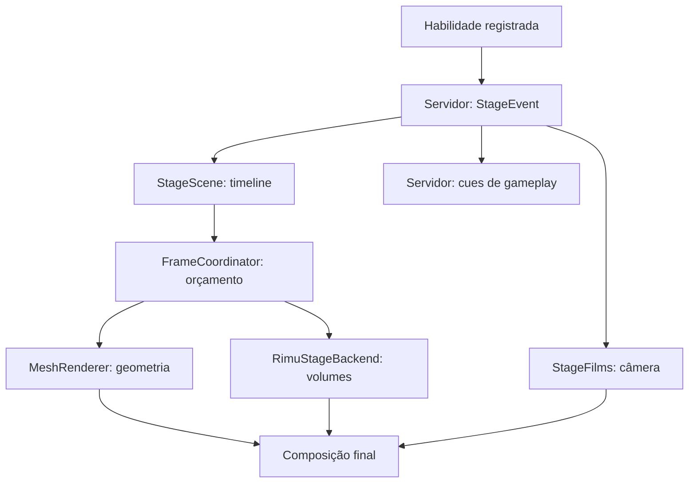

# Manual geral do Calamidade_Awakening 0.6.2

Minecraft Java 1.21.1 · NeoForge 21.1.267 · Java 21 · RimuLib 1.3.0

> Arquivo gerado por `scripts/gerar_manual.py` a partir dos capítulos em `docs/`. Edite os capítulos, não este arquivo.

## Por onde começar

**Para jogar**, instale a RimuLib e o JAR do Calamidade na pasta mods do cliente e do servidor. Pressione N para abrir o Atlas no mundo, mire em um cartão e ataque para conjurar. Usar item passa à próxima página quando há addons. Para o segundo menu, obtenha o Focus com `/give @s calamidade_awakening:focus`, segure-o e pressione H. Veja o capítulo 1.

**Para criar seu primeiro efeito**, comece pelo capítulo 2. Use uma posição fixa para um portal ou uma âncora de entidade para acompanhar um personagem. Para que o efeito cause dano ou outra consequência no mundo, registre um cue (capítulo 3). Para publicar um cartão, adicionar uma câmera ou fornecer um shader pelo JAR do seu mod, siga o capítulo 4. O Sinal de Maré é o exemplo executável de todo esse fluxo.

**Para efeitos no nível de chefe** (uniforms próprios, vários passes por fase, zoom blur, câmera com cortes e travellings), use os ganchos do capítulo 5.

**Para modificar o motor**, consulte os capítulos 6 e 7. Coloque a dependência oficial em `libs/rimulib-1.3.0-neoforge.jar`. Na raiz, use `./gradlew build` para compilar e testar, `./gradlew dist` para copiar o JAR para `dist/` e `./gradlew runClient` para abrir o cliente de desenvolvimento. No Windows, use `gradlew.bat`.

**Para medir e validar**, use o capítulo 8 (painel F7, gravação de quadros e `/calamidade bench`) e registre os resultados no capítulo 9.

**Escopo.** As cinco habilidades internas são cosméticas. O motor oferece iluminação visual por materiais e shaders; alterar a iluminação de blocos da simulação ou substituir globalmente o skybox exige implementação adicional. Consequências de gameplay pertencem aos addons, pelos cues de servidor.


1. [Jogar e instalar](#cap1)
2. [API de efeitos e impact frames](#cap2)
3. [Gameplay sincronizado no servidor](#cap3)
4. [Criar addons e publicar cartões](#cap4)
5. [Ganchos avançados: pós-processamento, câmera e início](#cap5)
6. [Arquitetura do motor](#cap6)
7. [Criar habilidades dentro do motor](#cap7)
8. [Testes em GPU real e multiplayer](#cap8)
9. [Validação, medições e limites](#cap9)
10. [Histórico e evolução prevista](#cap10)

Leitura complementar, fora do manual: [estudo técnico da integração da SA Series](ESTUDO-SA-SERIES.md).

<a id="cap1"></a>

## 1. Jogar e instalar

Motor modular de efeitos visuais para Minecraft Java 1.21.1, NeoForge 21.1.x e Java 21. A versão 0.6.2 usa RimuLib 1.3.0. As cinco habilidades internas são cosméticas; consequências no mundo (dano, empurrão) vêm de addons que usam os cues de servidor.

### Instalação

Coloque o JAR `dist/calamidade_awakening-0.6.2.jar` e o [JAR oficial da RimuLib 1.3.0 para NeoForge](https://www.curseforge.com/minecraft/mc-mods/rimulib/files/9676532) na pasta mods. Use as mesmas versões no servidor e em todos os clientes. Substitua o JAR da versão anterior; o namespace, o item e as teclas da 0.1.2 em diante continuam compatíveis. Para obter o Focus, use `/give @s calamidade_awakening:focus`. Teclas personalizadas são reatribuídas em Controles.

A interface usa inglês como padrão e tem tradução para português do Brasil pela opção de idioma do Minecraft.

| Tecla padrão | Ação |
|---|---|
| N | Abrir ou fechar o Atlas Estelar |
| K | Pulso Prismático |
| U | Florescência Cristalina |
| I | Vitrais do Horizonte |
| V | Convergência da Aurora |
| Y | Núcleo do Horizonte |
| O | Interromper a câmera cinematográfica |
| F7 | Painel de diagnóstico |
| F8 | Alternar a qualidade visual |

Se a Convergência da Aurora ainda estiver em L depois de atualizar, reatribua para V em Controles. L abre a tela de Progressos do Minecraft.

### Atlas Estelar

Abra o **Atlas Estelar** pelo menu de pausa ou pressione **N** durante o jogo. Cinco cartões aparecem quatro blocos à frente da câmera. É possível andar em volta deles ou olhar para outro lado. Mire em um cartão e pressione **Atacar** (botão esquerdo) para conjurar a habilidade pelo servidor. **Usar item** (botão direito) passa à próxima página quando há addons. O Atlas fecha depois da escolha, na troca de dimensão ou a mais de 24 blocos. Nenhum item é necessário para abri-lo.

O Atlas se abre em 0,44 segundo, com um pequeno atraso nos cartões externos. Um cartão em movimento já pode ser escolhido. O destaque acompanha o foco e marca a escolha enviada.

### Habilidades internas

**Núcleo do Horizonte** dura dez segundos. Quatro lâminas curvas se reúnem acima do alvo, estreitam-se numa fenda e liberam uma onda violeta e branca pelas superfícies visíveis próximas. A onda usa distância 3D, então chega mais tarde a blocos elevados. Quatro sons posicionais marcam reunião, tensão, ruptura e eco. A câmera segura o enquadramento durante o impacto; pressione O para voltar à sua visão.

**Pulso Prismático** libera o primeiro pulso cerca de quatro ticks depois da conjuração. Com 38 ticks de apresentação e 48 de recarga, é a alternativa rápida ao Núcleo do Horizonte.

A recarga é contada por habilidade: conjurar o Núcleo do Horizonte não impede o Pulso Prismático.

### Acessibilidade

Em **Mods → Calamidade_Awakening → Configurar** (ou no arquivo `config/calamidade_awakening-client.toml`):

- **Intensidade dos efeitos de tela** (0 a 1): reduz bloom, clarões, contraste e dessaturação deste mod e de todos os addons. 0 desliga.
- **Tremor de tela**: liga ou desliga o tremor.

A opção do Minecraft "Ocultar clarões de relâmpago" também desliga os clarões dos impact frames.

### Focus

Segurando o Foco Awakening, a tecla **H** abre o menu de habilidades da RimuLib. Escolha uma habilidade, feche o menu e use o Focus com o botão direito. Habilidades de addons aparecem no mesmo menu, com arte, descrição e, quando o addon define, controle de potência.

### Ferramentas de teste

**F7** mostra a GPU em uso, FPS, tempo de quadro (mediana e percentil 95), eventos ativos e o custo do quadro. `/calamidade_client record 30` grava 30 segundos em `calamidade_bench/` na pasta do jogo. Com permissão de comandos, `/calamidade bench 6` cria seis Núcleos do Horizonte à sua frente e `/calamidade bench stop` os encerra. O roteiro completo está no capítulo de testes em GPU real e multiplayer.

### Desenvolvimento

Coloque a dependência oficial em `libs/rimulib-1.3.0-neoforge.jar`. Com o JDK 21, `./gradlew build` compila e roda os testes de orçamento; `./gradlew dist` copia o JAR para `dist/`; `./gradlew runClient` abre o cliente de desenvolvimento e `./gradlew runServer` o servidor dedicado. No Windows, use `gradlew.bat`.

<a id="cap2"></a>

## 2. API de efeitos e impact frames

Este documento descreve a API introduzida na 0.3, que continua válida na 0.6.2. Para o exemplo incluído no pacote atual, caminhos de instalação e publicação de cartões, abra [Addons 0.4](ADDONS-0.4.md).

Para Minecraft Java 1.21.1, NeoForge 21.1.x e Java 21. A interface pública desta versão é `dev.calamidade_awakening.api.v1.Effects` e seus tipos internos. O pacote contém um JAR de motor e conteúdo. O consumidor instala seu próprio JAR junto dele e da RimuLib 1.3.0 em ambos os lados.

### Primeira integração

O projeto Gradle independente em [examples/vfx-sample](../examples/vfx-sample/) já contém o código e os recursos deste exercício. A partir da raiz extraída, coloque o JAR oficial da RimuLib em `libs/rimulib-1.3.0-neoforge.jar` e mantenha o JAR do Calamidade em `dist/`. Execute:

```sh
./gradlew -p examples/vfx-sample build
./gradlew -p examples/vfx-sample runClient
```

No Windows use `gradlew.bat`. O primeiro build precisa baixar os artefatos de desenvolvimento do NeoForge. Para testar sem compilar, gere o consumidor com `./gradlew -p examples/vfx-sample build`; o JAR `vfx-sample-1.3.1.jar` fica em `examples/vfx-sample/build/libs/`. Também é possível instalar o JAR produzido em `examples/vfx-sample/build/libs/` em um perfil NeoForge com os dois mods. Em um mundo com comandos habilitados:

1. Use `/vfxsample at`. O sinal aparece quatro blocos à frente. Ande para ver que ele fica parado.
2. Use `/vfxsample follow`. O exemplo encerra o sinal anterior e cria um novo na sua entidade. Use F5 e caminhe para ver o movimento.
3. Use `/vfxsample stop` durante os seis segundos do efeito. A emissão e a geometria cessam; partículas já emitidas completam a própria vida.

Para usar em outro repositório, copie o modelo de dependências de build.gradle, adapte os caminhos locais e leve a dependência obrigatória de calamidade_awakening do neoforge.mods.toml para o manifesto do seu mod. O exemplo atual declara o intervalo [0.6.1,0.7.0). As chamadas desta página existem desde a 0.3.0. O mod de exemplo é opcional.


A captura mostra o efeito de posição fixa antes do tick 40. Para comparar com o instante do impacto, observe a cor da grama e do céu no segundo 2.

### Onde registrar e onde executar

Registre a definição no construtor comum do mod, com o mesmo ID e os mesmos parâmetros em cliente e servidor. O ID é transmitido como namespace e caminho. A ordem de carregamento de dois consumidores não determina o ID na rede. Reserve um nome do seu próprio namespace para cada efeito.

```java
var signal = ResourceLocation.fromNamespaceAndPath("vfxsample", "signal");
Effects.register(signal, new Effects.Definition(120, 2.0, 0xff65e8c9,
    Effects.Shape.RINGS, Effects.Material.CRYSTAL,
    ResourceLocation.withDefaultNamespace("end_rod"), signal));
```

O primeiro ID opcional é um SimpleParticleType registrado. O segundo é uma entrada de sounds.json do cliente. O exemplo inclui assets/vfxsample/sounds.json e sounds/signal.ogg. Passe null em cada posição que deseja omitir. O som toca na posição de abertura para quem recebe o evento no início. Cada cliente emite uma partícula a cada quatro ticks na âncora; o Minecraft aplica as opções locais de partículas. O motor usa triângulos e composição próprios para a geometria e o material.

### Referência de execução

| Chamada | Resultado |
|---|---|
| Effects.register(id, definition) | Registra uma definição comum. ID duplicado ou namespace reservado do Calamidade gera erro. |
| Effects.start(id, serverLevel, position) | Abre uma instância fixa. Posição em blocos, em coordenadas absolutas do mundo. |
| Effects.follow(id, entity, offset) | Acompanha a posição interpolada dos pés da entidade. Offset em blocos nos eixos do mundo, independente da rotação. |
| Effects.start(id, serverPlayer, position) | Âncora fixa com identificação do conjurador. Para efeitos internos com filme configurado, o conjurador pode receber a câmera. |
| handle.stop() | Encerra a instância para os observadores. Retorna true ao encerrar e false se já terminou. |

Execute start, follow e stop na thread do servidor. Em callbacks assíncronos, despache primeiro com server.execute. Um ID desconhecido ou coordenadas não finitas geram IllegalArgumentException. As operações de início retornam Optional.empty() se a capacidade for atingida ou a âncora inicial estiver indisponível. Valide permissão, alcance, custos e recarga no mod que solicita o efeito. Para dano ou outra consequência sincronizada com o visual, registre um cue (capítulo de gameplay). Não envie posições ou IDs arbitrários de clientes diretamente para a API.

O servidor mantém até 64 instâncias. O cliente recebe inícios dentro do alcance da definição (128 blocos por padrão, configurável de 16 a 1024 com `withRange`) e usa o tempo original do evento ao entrar ou voltar à área. O cliente depende de rastrear a entidade para renderizar uma âncora móvel. Na troca de dimensão, o cliente limpa o estado local. A remoção ou transferência da entidade encerra aquela instância no servidor. A âncora fixa termina se o chunk for descarregado. O motor não mantém chunks carregados e as instâncias não são salvas entre sessões.

### Convenções visuais e limites

- Duração de 1 a 12000 ticks (10 minutos; até a 0.6.1 o limite era 1200). A 20 ticks/s, 120 ticks equivalem a seis segundos. Para efeitos ambientes, use uma duração longa e encerre com `stop()`. Acima de 1200 ticks, a entrada e a saída automáticas ficam fixas em 168 e 336 ticks em vez de proporcionais. Raio finito maior que zero e até 512 blocos.
- Alcance de distribuição de 16 a 1024 blocos: `new Definition(...).withRange(600)`. O efeito só pinta o que cada cliente renderizou; além da distância de renderização do jogador, só existem pixels de céu, então alcances grandes servem principalmente a efeitos no céu. A extensão visível depende do estilo.
- Cor em ARGB. O matiz afeta a geometria; os materiais volumétricos têm paletas próprias. A intensidade sobe e decai pela curva do motor.
- Geometrias disponíveis: NONE, RINGS, PRISM, ORBIT e NEXUS. Materiais: NONE, CRYSTAL, VEIL, LENS e NEBULA. Combine geometria e material separadamente. Os cinco efeitos jogáveis continuam acessíveis pelo Atlas; registrar um efeito externo não cria um cartão.
- LOW, BALANCED e HIGH selecionam até 3/6/12 sinais de geometria e 1/2/4 volumes por quadro. O servidor continua avançando o relógio quando o cliente omite uma camada. O filtro de distância e o orçamento por quadro não substituem o controle de quantidade de instâncias do consumidor.
- A iluminação de superfície é visual. Os efeitos não alteram níveis de luz dos blocos, IA, dano ou terreno. A interrupção impede novas emissões, mas um som de abertura já iniciado segue a duração de seu clipe.
- A versão 0.3 oferece materiais prontos e recursos de partículas e áudio do consumidor. Shaders GLSL arbitrários por namespace, modelos e ossos de Blockbench, skyboxes empilháveis, curvas de câmera externas e efeitos persistentes sem prazo ainda exigem evolução da API.

### Atualização a partir de 0.2.0

Substitua o JAR em cliente e servidor juntos. O formato de sincronização de efeitos mudou para incluir entidade e offset e passou a incluir uma mensagem de encerramento. O ID do mod, as teclas e o item Focus continuam compatíveis. Registros externos ficam fora do catálogo interno de habilidades e usam o mesmo agendador que os efeitos jogáveis.

### Como marcar o impacto de uma explosão

Escolha o tick do contato no relógio da habilidade. No projeto de exemplo, execute `/vfxsample at` e observe o segundo 2. O anel mantém sua cor durante a formação; no tick 40 começa uma breve perda de saturação com aumento de contraste. O trecho compilável está em Sample.java.

```java
var cue = new Effects.Impact(40, 3, .75f, Effects.ImpactStyle.MONOCHROME);
var definition = new Effects.Definition(120, 2, 0xff65e8c9,
    Effects.Shape.RINGS, Effects.Material.CRYSTAL, null, null, cue);
Effects.register(ResourceLocation.fromNamespaceAndPath("meumod", "explosao"), definition);
```

- **Tick e duração.** O primeiro número é o tick de início; o segundo é a duração, entre 1 e 20 ticks. Três ticks duram cerca de 150 ms a 20 ticks/s. O número de quadros mostrados depende do FPS. O pico ocorre no início e decai linearmente. A janela inteira precisa caber na duração do efeito.
- **Estilo.** MONOCHROME remove parte da saturação e aumenta o contraste do quadro. TINTED_FLASH ilumina a tela com o RGB da definição. Para um clarão discreto, experimente TINTED_FLASH com força 0.2f por dois ticks. A força aceita valores maiores que zero até 1.
- **Composição.** A distância reduz o impacto até zero a 64 blocos. A visibilidade e o orçamento do cliente também contam. Entre sinais simultâneos do mesmo estilo, prevalece o mais forte. Uma entrada tardia usa o relógio original e não repete um impacto passado.
- **Preferência do jogador.** Em Opções → Acessibilidade, habilitar a opção de ocultar clarões de relâmpago desativa os acentos de tela do Calamidade, inclusive o monocromático. Partículas, brilho das malhas e iluminação de superfícies continuam visíveis. Use também forma, movimento e som para comunicar o contato.
- **Dica de autoria.** Teste primeiro a geometria sem o acento e depois compare as duas versões no mesmo local. A definição de sete argumentos continua disponível e usa o acento suave padrão do motor. A versão com Impact substitui esse acento pela janela escolhida.

<a id="cap3"></a>

## 3. Gameplay sincronizado no servidor

O motor continua cosmético: ele não altera vida, blocos ou IA por conta própria. A partir da 0.5.0, um addon pode agendar **cues**: funções que rodam no servidor quando o relógio de uma instância chega a um tick. É o lugar certo para dano, empurrão, efeitos de poção, quebra de blocos ou custo de mana, porque o cue usa o mesmo relógio que o cliente usa para desenhar. O golpe acontece no quadro em que o jogador vê o contato.

### Registro

Registre o efeito e depois os cues, no construtor comum do mod:

```java
var golpe = ResourceLocation.fromNamespaceAndPath("meumod", "golpe");
Effects.register(golpe, new Effects.Definition(80, 4, 0xffffb050,
    Effects.Shape.RINGS, Effects.Material.LENS, null, null,
    new Effects.Impact(30, 3, .8f, Effects.ImpactStyle.TINTED_FLASH)));

// Mesmo tick do impact frame (30).
Effects.onImpact(golpe, ctx -> {
    var fonte = ctx.caster() == null ? ctx.level().damageSources().magic()
        : ctx.level().damageSources().indirectMagic(ctx.caster(), ctx.caster());
    for (var alvo : ctx.living(4)) alvo.hurt(fonte, 6);
});

// Qualquer outro tick, de 0 até a duração menos 1.
Effects.cue(golpe, 0, ctx -> ctx.level().playSound(null, BlockPos.containing(ctx.center()),
    SoundEvents.WARDEN_SONIC_CHARGE, SoundSource.HOSTILE, 1f, 1f));
```

| Chamada | Resultado |
|---|---|
| Effects.cue(id, tick, cue) | Agenda o cue no tick indicado de toda instância desse efeito. Vários cues por efeito e por tick são permitidos e rodam na ordem de registro. |
| Effects.onImpact(id, cue) | Atalho para o tick do Impact da definição. Gera erro se a definição não tiver Impact. |
| ctx.level(), ctx.center() | Mundo e centro atual. Para instâncias presas a uma entidade, o centro já inclui o offset. |
| ctx.caster() | Jogador que conjurou, ou null quando o efeito foi iniciado sem jogador ou o jogador saiu. |
| ctx.anchor() | Entidade âncora de Effects.follow, ou null. |
| ctx.living(raio) | Entidades vivas cujo centro está dentro do raio, sem o conjurador e sem a âncora. Raio até 128. |
| ctx.tick(), ctx.seed() | Tick agendado e seed da instância (a mesma que o cliente usa no visual). |
| ctx.handle() | Handle da própria instância. `ctx.handle().stop()` encerra o efeito, por exemplo quando o alvo morre. |

### Regras

- Registre somente efeitos do seu namespace. Os cinco efeitos internos não aceitam cues.
- O cue roda na thread do servidor, uma vez por instância e por tick agendado, mesmo se o servidor atrasar alguns ticks.
- Instâncias encerradas por `stop()`, perda da âncora ou descarregamento do chunk não executam os cues seguintes, nem os que estavam agendados para o mesmo tick depois do cue que chamou `stop()`.
- Uma exceção no cue é registrada no log e não derruba o efeito nem os outros cues.
- Valide permissões, PvP, proteção de terreno e custos dentro do cue ou no callback de conjuração. O motor não sabe quem pode ferir quem.
- Para chefes, combine `Effects.follow(id, chefe, offset)` com cues: o centro acompanha o chefe e o golpe acontece onde ele está naquele tick.

O Sinal de Maré do exemplo usa `onImpact` no tick 40 para causar 2 corações de dano e empurrar as criaturas a até três blocos. O código está em `examples/vfx-sample/src/main/java/example/vfxsample/Sample.java`.

<a id="cap4"></a>

## 4. Criar addons e publicar cartões

O projeto independente em [examples/vfx-sample](../examples/vfx-sample/) implementa o **Sinal de Maré**. Use-o como ponto de partida. O jogador pode descobrir o cartão no Atlas, ajustar a potência no Focus e acompanhar uma execução com câmera, malha, shader de superfície, partículas, som e HUD. O motor e o addon têm JARs e namespaces próprios.

### Teste de cinco minutos

1. Em Minecraft Java 1.21.1 com NeoForge, instale RimuLib 1.3.0 e o JAR 0.6.2 da pasta dist (gerado por `./gradlew dist`). Para experimentar o addon, acrescente o vfx-sample-1.3.1.jar gerado por `./gradlew -p examples/vfx-sample build` em examples/vfx-sample/build/libs. No multiplayer, instale as mesmas versões no servidor e nos clientes.
2. Pressione **N** olhando para um espaço livre. A página inicial contém as cinco habilidades internas. Use o botão **Usar item** (direito por padrão) para passar às páginas dos addons. Mire no Sinal de Maré e pressione **Atacar** (esquerdo por padrão). A tecla O interrompe a câmera.
3. Para o menu compartilhado, obtenha o Focus com `/give @s calamidade_awakening:focus`, segure-o e pressione **H**. Selecione o Sinal de Maré. Sua linha tem descrição, arte e controle de potência. O painel do addon explica o parâmetro. Aumentar a potência eleva o ponto da conjuração seguinte. Feche o menu, mire e use o Focus com o botão direito para conjurar a habilidade selecionada. A recarga do cartão é de 130 ticks. No tick 40, o impacto causa dano leve e empurra as criaturas a até três blocos (veja o capítulo de gameplay).
4. Os comandos `/vfxsample at`, `follow` e `stop` continuam disponíveis com permissão de comandos. Eles exercitam as instâncias diretamente. Para testar recarga, seleção do item e callback de conjuração, use o cartão.
5. Para recompilar o addon na raiz extraída, coloque a RimuLib oficial em libs/rimulib-1.3.0-neoforge.jar e execute `./gradlew -p examples/vfx-sample build` com Java 21. No Windows, use gradlew.bat. O exemplo compila contra o JAR em dist e declara sua dependência em META-INF/neoforge.mods.toml.

### Registro comum

O construtor do seu mod chama Effects.register para cada efeito. Addons.publish torna a definição selecionável. Essa segunda chamada é opcional: efeitos ambientais, fases internas de uma sequência e efeitos que dependem de lógica de um boss podem continuar privados ao fluxo de conjuração do seu mod.

```java
Addons.resources("meuaddon", MeuAddon.class);
var id = ResourceLocation.fromNamespaceAndPath("meuaddon", "onda");
Effects.register(id, new Effects.Definition(120, 4, 0xff65e8c9,
    Effects.Shape.RINGS, Effects.Material.CRYSTAL, null, null));
var card = new Addons.Card("ability.meuaddon.onda", "Wave", "TIDE", 140, null, List.of());
Addons.publish(id, card);
```

Addons.resources associa o namespace à classe do seu mod para que o carregador de shaders encontre o JAR correto. Isso é necessário para um shader empacotado em um módulo Java separado.

Use o mesmo registro nos dois lados, durante a construção do mod. O cadastro é fechado no registro de itens, antes da criação das teclas da RimuLib. O Atlas agrupa por namespace, ordena as entradas e cria páginas com até cinco cartões. IDs iguais em namespaces diferentes têm cartões independentes. O motor inclui as entradas no conjunto de habilidades do Focus em uma única etapa, depois que os addons terminam seus construtores.

### Arquivos que o addon fornece

| Recurso no JAR do addon | Uso |
|---|---|
| assets/calamidade_awakening/textures/gui/sprites/skill/focus/addon/meuaddon/onda.png | Arte compartilhada pelo Focus e pelo Atlas. Use PNG RGBA, proporção 2:1. O exemplo tem 64 × 32 pixels. O caminho inclui o namespace do autor para evitar colisão. |
| assets/meuaddon/lang/en_us.json e pt_br.json | Registre ability.meuaddon.onda para o título, skill.calamidade_awakening.focus.addon/meuaddon/onda.desc para a descrição e key.calamidade_awakening.focus.addon/meuaddon/onda para o controle. |
| assets/meuaddon/shaders/fx/onda.fsh | Passe opcional. Informe meuaddon:onda no campo shader do cartão. |
| assets/meuaddon/sounds.json e sounds/*.ogg | Recursos opcionais para a definição de efeito. Consulte [API de instâncias](API-0.3.md). |

### Decisão do servidor e composição

Addons.publish(id, card) usa o alvo calculado pelo servidor e inicia o efeito com identificação do conjurador. Para exigir um item, desbloqueio ou condição do seu mod, use a sobrecarga com callback. O pedido de rede identifica a habilidade e a potência desejada. O motor verifica a publicação, estado do jogador, recarga, capacidade e alvo. O callback deve validar os requisitos específicos antes de alterar o mundo. Retorne true quando aceitar a conjuração. A partir da 0.5.0, a recarga é contada no servidor por jogador **e por habilidade**: conjurar uma habilidade não bloqueia as outras. A duração vem do campo cooldown do cartão.

```java
Addons.publish(id, card, new Addons.Range(.5f, 1f, 2f), (player, target, power) -> {
    Vec3 center = target.add(0, power - 1, 0);
    return Effects.start(id, player, center).isPresent();
});
```

Range define mínimo, valor inicial e máximo finitos. O servidor limita o valor recebido; valores não finitos voltam ao inicial. A escala da potência é uma decisão do callback. No exemplo, o parâmetro altera altura em blocos. Para combinar dois efeitos, inicie a segunda definição a partir do mesmo callback. Guarde os handles se as etapas puderem ser canceladas. Se a segunda criação falhar e as duas precisarem ser indivisíveis, chame stop no primeiro handle antes de retornar false. Para um atraso, agende no relógio do servidor e limpe o trabalho na troca de mundo.

### Câmera, HUD e painel

Cada Addons.Shot contém o tick de fim, deslocamento de câmera em blocos relativo ao alvo na base usada por aroundTarget, e FOV em graus. A primeira posição é mantida até o primeiro fim; entre as seguintes o motor interpola posição e FOV. Use ticks crescentes dentro da duração. Uma lista vazia mantém a câmera do jogador. A apresentação automática depende das opções locais, da identidade do conjurador e da chegada do evento no início. O observador recebe os efeitos no mundo.

Registre os desenhos no setup **exclusivo do cliente**. A classe SampleClient do exemplo contém as três camadas funcionando juntas:

- AddonLayers.world(id, callback) recebe tempo normalizado, opacidade, seed, raio e um emissor de triângulos e fitas. Os pontos são offsets da âncora interpolada, em blocos. O motor aplica opacidade, profundidade e orçamento de vértices. Não armazene o emissor para outro quadro.
- AddonLayers.hud(id, callback) recebe GuiGraphics e o tempo. Desenhe em coordenadas da GUI. O motor escolhe uma instância por ID para o HUD dentre os efeitos visíveis priorizados naquele quadro. O HUD oculto pelo jogador é respeitado.
- AddonLayers.panel(id, callback) desenha informações suplementares no Focus quando o seu conjunto está aberto e a habilidade está selecionada. Um painel pode mostrar lore, progresso ou uma dica contextual. O controle editável implementado nesta versão é o slider de potência do Focus. Teclados ou seletores próprios de uma habilidade exigem lógica de entrada do addon.

### Shader autoral

Os fragment shaders recebem o cabeçalho comum da RimuLib. Omita #version e use sampleScene(texCoord) para a cor de entrada. O exemplo lê a profundidade do terreno, reconstrói a posição com scenePosAt e soma uma onda verde apenas na superfície visível.

| Uniform | Convenção |
|---|---|
| vec3 CaCenter | Posição da âncora relativa à câmera, no mesmo espaço de scenePosAt. |
| vec4 CaEffect | Progresso de 0 a 1, opacidade, seed normalizada, raio em blocos. |
| float CaFlashAllowed | 0 quando o jogador oculta clarões, 1 quando os permite. Um shader autoral precisa consultar esse valor para clarões de tela. Os impact frames da API já respeitam a preferência. |

Há até 1/2/4 passes de addon por quadro em LOW/BALANCED/HIGH, além do passe compartilhado do motor. Esse orçamento é dividido, na ordem de prioridade dos efeitos, entre shaders de cartão e cada passe pedido pelas camadas `AddonLayers.post`. Para uniforms próprios, vários passes por fase, zoom blur ou aberração, use os ganchos avançados da 0.6 ([AVANCADO-0.6.md](AVANCADO-0.6.md)). Entre efeitos concorrentes vale a ordem de prioridade do quadro. Comece com um passe, teste contra paredes e céu, e compare com o shader desligado. Para um simples anel, experimente a malha em lote antes de criar um passe de tela cheia. Evite texto, descrições ou callbacks com efeitos colaterais dentro de um shader ou de uma rotina de desenho.

### Diagnóstico e migração

- Dano, empurrão ou outra consequência no mundo: use Effects.cue ou Effects.onImpact (capítulo de gameplay) em vez de agendar tarefas próprias. O cue roda no relógio da instância, inclusive para instâncias iniciadas pelos comandos e por outros mods.
- Cartão ausente nos dois menus: confira a dependência no manifesto, o ID exatamente igual em register e publish e o registro no construtor comum. A API 0.3 de efeitos continua disponível. Atualize o intervalo de dependência do seu addon antes de usar a 0.4.
- Cartão aparece com textura ausente: verifique o caminho de sprite do Focus no JAR do addon, inclusive addon/namespace e caixa das letras.
- A habilidade aparece e o clique não conjura: confirme a recarga, os requisitos do callback e a mesma instalação nos dois lados. O destaque do Atlas indica o envio do pedido; a execução começa com a aceitação do servidor.
- Geometria aparece mas o shader falha: verifique namespace, shaders/fx e mensagens do compilador GLSL no log do cliente. Um shader de core do Minecraft tem outro contrato. Teste primeiro um passe que apenas devolve a cor de entrada.
- Ao publicar uma versão, teste o mod-base sozinho e com dois addons que escolham o mesmo nome de efeito em namespaces diferentes. Atualize cliente e servidor juntos: o pedido de conjuração da 0.4 inclui potência e usa o canal request_v2. A 0.5.0 mantém o mesmo protocolo de rede; a 0.6.0 também. Addons da 0.4 funcionam após ampliar o intervalo de dependência.

<a id="cap5"></a>

## 5. Ganchos avançados: pós-processamento, câmera e início

A API de cartões cobre o caso comum: um shader com `CaCenter` e `CaEffect`, uma lista linear de tomadas e o acento de impacto. Efeitos de chefe e sequências longas precisam de mais. A 0.6 abre três ganchos de cliente que entregam ao addon as ferramentas da própria RimuLib, sem perder o que o motor já oferece: sincronização, seleção por prioridade, orçamento por qualidade, Atlas, Focus e cues.

Registre todos no setup **exclusivo do cliente** (FMLClientSetupEvent), um por ID de efeito.

### AddonLayers.post: passes próprios e pós-processamento

```java
AddonLayers.post(id, post -> {
    float pulse = (float) Math.exp(-Math.abs(post.age() - 40) / 4.0);
    post.pass("meuaddon:fase_ruptura", u -> {
        u.v3("Centro", post.center());
        u.f4("Estado", (float) post.age(), pulse, post.time().opacity(), (float) post.time().radius());
    });
    // Passe extra só quando há orçamento e a fase pede.
    if (post.age() > 60 && post.passesLeft() > 0)
        post.pass("meuaddon:fase_eco", u -> u.v3("Centro", post.center()));
    post.bloom(pulse * .4f);
    post.flash(0xFFFFE0B0, pulse * .6f);
});
```

| Membro | Conteúdo |
|---|---|
| pass(programa, uniforms) | Enfileira um shader de `assets/<namespace>/shaders/fx` com uniforms próprios. Retorna false, sem desenhar, quando o orçamento do quadro acabou. |
| passesLeft() | Passes que ainda cabem neste quadro. Use para escolher uma variante mais barata. |
| bloom, shake, desaturate, contrast | Combinam pelo máximo com os outros efeitos e com o motor; nunca sobrescrevem. Passam pela configuração de acessibilidade do jogador: a intensidade multiplica bloom, contraste e dessaturação, e o tremor pode estar desligado. |
| flash(cor, intensidade) | Clarão colorido, multiplicado pela intensidade configurada. Ignorado quando o jogador oculta clarões. |
| center() | Centro relativo à câmera, no espaço de `scenePosAt`. Já acompanha a entidade em `Effects.follow`. |
| age(), partial() | Idade em ticks com o tempo parcial, e o tempo parcial do quadro. Use para fases: `smoothstep(início, início+subida, idade) * (1 - smoothstep(fim-queda, fim, idade))`. |
| time() | Progresso (0 a 1), opacidade do envelope do motor, seed e raio. |
| distance(), instance() | Distância até a câmera e identificador da instância. |
| quality() | LOW, BALANCED ou HIGH. Reduza passos de raymarch nos perfis menores. |
| flashAllowed() | Falso quando o jogador oculta clarões. Evite também estrobos e mudanças fortes de exposição no shader. |

Regras:

- **Orçamento por passe.** O quadro tem 1, 2 ou 4 passes de addon (LOW, BALANCED, HIGH). Shaders de cartão e cada `pass` dos posts consomem esse total na ordem de prioridade dos efeitos. Um efeito com shader de cartão e post já gasta uma vaga no cartão. Desde a 0.6.2, o callback é chamado mesmo sem vaga: `pass` retorna false, mas bloom, tremor, contraste e clarão continuam valendo. O painel F7 mostra os passes realmente enfileirados.
- **Outros efeitos de tela.** Aberração, zoom blur, vinheta, afterimage e grão ainda não têm método em `Post`, porque os nomes dos campos do ScreenFx da RimuLib 1.3.0 precisam ser confirmados no JAR. Estão no roadmap.
- **Arrays de uniforms.** Para listas (pontos de um hipercubo, células de uma grade), teste primeiro se a sua versão da RimuLib aceita nomes indexados como `u.f4("Pontos[3]", ...)`. Se não aceitar, empacote os dados em vários uniforms nomeados.
- **Falhas.** Uma exceção no callback desativa aquele post até reiniciar o jogo e é registrada uma vez no log. Os passes enfileirados antes da falha continuam contados.

### AddonLayers.film: câmera própria

```java
AddonLayers.film(id, film -> List.of(
    FilmApi.cut(0, 40, (s, partial, k) ->
        FilmApi.pose(s.aroundTarget(partial, 3 - k, 2, 6), s.target(), 60f)),
    FilmApi.sweep(40, 120, 12, (s, partial, k) ->
        FilmApi.pose(s.aroundTarget(partial, -6 + 12 * k, 4, 9), s.target(), 72f))));
```

O callback roda no cliente do conjurador quando a instância começa e recebe o `Subject` já criado pelo motor (`film.subject()`), o centro, a duração e o identificador. Devolva tomadas da RimuLib (`FilmApi.cut`, `sweep`, `pose`, os helpers do Subject). O motor toca a sequência, cuida do pular, da tecla O e do encerramento junto com a instância. O gancho substitui a lista `camera` do cartão e também funciona para efeitos sem cartão iniciados com `Effects.start(id, jogador, posição)`. Devolva uma lista vazia para não ter câmera.

### AddonLayers.start: início em todos os clientes

```java
AddonLayers.start(id, start -> {
    if (start.age() > 2) return; // quem chegou atrasado não ouve o início
    start.level().playLocalSound(start.center().x, start.center().y, start.center().z,
        SoundEvents.WARDEN_SONIC_BOOM, SoundSource.HOSTILE, 1f, 1f, false);
});
```

Roda uma vez em cada cliente que aceita a instância, inclusive quem entra atrasado ou volta ao alcance da definição (`age()` maior que zero). Serve para estado local, partículas e sons pontuais. `caster()` é verdadeiro no cliente de quem conjurou.

### Quando ir direto à RimuLib

| Necessidade | Caminho |
|---|---|
| Quebrar ou esculpir terreno | `CarveApi` da RimuLib dentro de um cue de servidor (`Effects.cue`/`onImpact`). Defina área máxima, blocos protegidos e permissões. |
| Cutscene independente de efeito | `FilmApi` direto no addon, com pacote próprio. Para câmera ligada a uma instância, prefira `AddonLayers.film`. |
| Menu ou tela própria | `MenuApi`/`UiApi` ou um Screen do addon. O painel do Focus continua em `AddonLayers.panel`. |
| Passe de tela sem instância do Calamidade | Um `FxApi.stage` do próprio addon. Para qualquer coisa ligada a uma instância, prefira `AddonLayers.post`, que já traz tempo, centro e orçamento. |

### Exemplo completo

O Sinal de Maré 1.3.1 usa os três ganchos. Em `SampleClient.java`: um passe `signal_ripple` com uniforms próprios (anéis dourados que saem do impacto, pedidos só a partir do tick 36 e omitidos em LOW porque o cartão já usa a única vaga) e bloom e tremor no pico; uma câmera de corte seco seguida de travelling; e um som para quem assiste de fora. O shader está em `assets/vfxsample/shaders/fx/signal_ripple.fsh`.

<a id="cap6"></a>

## 6. Arquitetura do motor



### Um conjunto de definições

VisualKind mantém um catálogo imutável de definições após a inicialização. Cada habilidade possui ID numérico estável, nome de recursos, título, cor, duração, raio, estilo de geometria, material de volume e opções de cinema e cena orbital. AwakeningSkills cria os itens do menu a partir do mesmo catálogo. O cliente e servidor devem usar a mesma versão.

### Servidor e rede

StageNetwork usa a API pública NetApi da RimuLib. CastRequest contém a chave com namespace da habilidade (por exemplo, `calamidade_awakening:prism`). O servidor valida esse ID, jogador, recarga (por jogador e por habilidade, em Cooldowns) e limite de sequências, calcula a origem com AimApi e emite StageEvent. A cada tick, antes de remover instâncias vencidas, o servidor executa os cues de gameplay agendados no relógio de cada instância.

| Campo | Finalidade |
|---|---|
| visual | Chave com namespace no pacote, convertida em ID local ao receber |
| order | Identidade e ordenação da sequência |
| tick | Relógio de início |
| caster | Identidade do jogador |
| dimension | Dimensão autoritativa |
| center | Centro mundial |
| seed | Aleatoriedade reproduzível |

O servidor mantém até 64 sequências ativas. Envia ao conjurador e observadores dentro do alcance da definição (128 blocos nos efeitos internos, 16 a 1024 nos de addons), inclusive quem entra durante a execução. O cliente deduplica por order, descarta eventos expirados e verifica a dimensão. Ele calcula progresso a partir do relógio de mundo, produzindo a mesma fase sem pacotes por quadro.

### Cliente e orçamento

StageScene mantém até 96 sequências residentes. Para cada quadro, FrameBudget calcula prioridade baseada em distância e intensidade. FrameCoordinator gera uma seleção que GeometryEffects e RimuStageBackend compartilham.

Os limites de Quality controlam número de efeitos, número de volumes, passos do shader, vértices, segmentos por primitiva e partículas por efeito. O orçamento de vértices é dividido entre efeitos de geometria no quadro. Efeitos distantes usam menos segmentos e partículas. A seleção testa os limites do efeito contra os planos do frustum antes de priorizar os candidatos. RenderFrameEvent.Pre e mudanças de estado invalidam a seleção para o próximo quadro.

### Geometria

MeshRenderer conecta a geometria a AFTER_PARTICLES. O renderer emite triângulos com posições relativas à câmera, usa teste de profundidade e blend aditivo, e salva/restaura os estados gráficos que altera. Um buffer é compartilhado pelos efeitos selecionados. O material energy é registrado pelo RegisterShadersEvent.

Mesh fornece triangles, quad, ring, billboard, ribbon, beam e sphere. Anéis, feixes e esferas reduzem a subdivisão antes de emitir os vértices. Se a forma mínima não couber, ela é omitida. GeometryEffects compõe essas primitivas com envelopes, rotação e amostragem determinística.

### Volumes, lente e cena orbital

RimuStageBackend registra uma única camada via FxApi. Não cria outro RenderTarget. Quando há volumes relevantes ou uma cena orbital, envia um passe com os parâmetros de até quatro marcas e número de passos do perfil.

O shader `assets/calamidade_awakening/shaders/fx/awakening_field.fsh` usa o ambiente da RimuLib:

- imagem e profundidade da cena;
- raio por pixel e reconstrução da posição;
- projeção de centro do efeito;
- interseção raio-esfera, limites de amostragem por profundidade;
- quatro materiais (cristal, véu refrativo, lente, nebulosa);
- composição de emissividade, deslocamento, aberração cromática e núcleo escuro;
- cena orbital procedural opcional com planeta, estrelas e nuvens.

Amostras volumétricas só são executadas para raios que atravessam o volume e segmento visível. Quando não há volumes nem cena, não há passe de campo. A camada pode contribuir ao bloom compartilhado quando só há geometria, e ao flash e tremor na fase de liberação, com atenuação por distância.

### Câmera

StageFilms utiliza FilmApi.follow, cut, sweep e play. As tomadas são calculadas com base no raio e duração da definição. Somente o conjurador local recebe a cinematográfica automática. O skip da RimuLib e a tecla O cancelam a câmera. A cena espacial usa FilmApi.weight e time, portanto sua contribuição termina quando a tomada perde controle da câmera.

### Dependência e recursos

A versão de referência usa RimuLib 1.3.0, NeoForge 21.1.267 e JDK 21. A RimuLib é instalada separadamente; a API pública é descrita em [docs.rimuru.cyou](https://docs.rimuru.cyou/rimulib/).

### Atlas Estelar

StarAtlas registra a posição e a orientação da câmera uma vez na abertura. Cartões, órbita e textos usam coordenadas de mundo e profundidades diferentes. A seleção cruza o raio da câmera com o plano de cada cartão e testa os blocos até o ponto alcançado. O clique envia CastRequest para o mesmo caminho de validação das teclas de habilidade. O servidor mantém o controle da recarga e da execução. Cada cliente vê seu próprio atlas.

### Horizon Core na 0.2.0

A sequência usa 200 ticks do evento do servidor. Durante a formação, quatro fitas espirais convergem para o centro. A compressão fecha as fitas e o volume em torno de uma fenda. A ruptura começa no tick 120. O filme segura o enquadramento durante a ruptura e recua a partir do tick 150. A tecla O libera a câmera e os demais clientes continuam vendo o efeito.

O shader reconstrói a posição da superfície visível e calcula a distância tridimensional ao ponto de impacto. A borda branca e o rastro violeta chegam mais tarde a superfícies elevadas. A onda descreve uma expansão esférica sobre as superfícies visíveis. Uma simulação de propagação por blocos conectados teria outro comportamento em túneis e atrás de paredes. O sinal é composto no passe existente.

Quatro sons posicionais originais são agendados nos ticks 4, 69, 120 e 145. Um cliente que entra tarde só ouve os próximos sinais. O índice temporal do cliente reinicia na troca de mundo.

O Atlas interpola coordenadas locais na abertura e usa a mesma função de posição no desenho e no teste do clique. Uma seleção válida envia o pedido imediatamente. O cartão marca a escolha brevemente e o servidor decide a execução.

### Diagnóstico (0.5.0)

PerfOverlay (tecla F7) mostra o renderizador OpenGL, FPS, mediana e percentil 95 dos últimos 240 quadros, perfil de qualidade, sequências residentes, efeitos e volumes desenhados, vértices emitidos e passes de pós-processamento. Os renderizadores escrevem os contadores durante o quadro e o painel publica os valores no início do quadro seguinte, então ele sempre mostra o último quadro completo. `/calamidade_client record <segundos>` grava os mesmos dados por quadro em `calamidade_bench/frames-*.csv` na pasta do jogo. No servidor, `/calamidade bench <n> [efeito]` cria uma carga reproduzível e `/calamidade status` informa as instâncias ativas. O roteiro de uso está em [TESTE-REAL.md](TESTE-REAL.md).

<a id="cap7"></a>

## 7. Criar habilidades dentro do motor

Para publicar uma habilidade em um JAR separado, use o [tutorial de criação de addons 0.4](ADDONS-0.4.md).

### Nova definição

Abra `src/main/java/dev/calamidade_awakening/api/VisualKind.java`. Cada definição associa uma habilidade a materiais e geometria. Exemplo de uma habilidade original adicional:

```java
public static final VisualKind HALO = register(
    5, "halo", "Ascending Halo", 0xFFFFCB85,
    120, 8,
    Geometry.ORBIT, Volume.VEIL,
    false, false
);
```

Registre definições antes de AwakeningSkills selar o catálogo. IDs e chaves são únicos; após remover uma habilidade, evite reutilizar seu ID. O registro é gerado no cliente e servidor a partir das mesmas definições. A nova habilidade terá um atalho configurável e aparecerá no menu ao segurar Foco Awakening.

Adicione traduções em assets/calamidade_awakening/lang e card PNG 64×32 em assets/calamidade_awakening/textures/gui/sprites/skill/focus/halo.png.

### Estilos reutilizáveis

| Geometria | Resultado |
|---|---|
| NONE | Sem lote de geometria para aquela habilidade |
| PRISM | Anéis, partículas, núcleo e feixe |
| RINGS | Anéis e partículas |
| ORBIT | Anéis inclinados, trilhas, feixe, ondas |
| NEXUS | Quatro lâminas curvas, fenda e frente de ruptura no Horizon Core |

| Material | Resultado |
|---|---|
| NONE | Sem passe volumétrico para aquela habilidade |
| CRYSTAL | Volume de cristal e malha |
| VEIL | Aro deformado com deslocamento tangencial |
| LENS | Lente radial, núcleo escuro e aberração |
| NEBULA | Campo comprimido com lente, luz na superfície e rastro da onda |

### Criar geometria própria

Adicione um estilo ao enum Geometry e sua composição em GeometryEffects. Use Mesh para emitir as primitivas, o centro e progresso de StageScene.Sample, e o perfil de qualidade. Não acesse diretamente o framebuffer nessa camada.

Exemplo de três anéis horizontais:

```java
for (int i = 0; i < 3 && frame.mesh().remaining() >= 12; i++) {
    double radius = 1 + i * 1.5 + sample.progress() * 5;
    frame.mesh().ring(sample.event().center(), new Vec3(1, 0, 0),
        new Vec3(0, 0, 1), radius, .2, quality.segments,
        new Color(.4f, .8f, 1f, sample.opacity()));
}
```

### Material volumétrico próprio

Adicione um modo de shader estável ao enum Volume e implemente uma função de densidade em awakening_field.fsh. A função recebe a posição normalizada dentro do volume, progressão da habilidade e seed. O passe já cuida da interseção, orçamento de passos, oclusão por profundidade e composição. Mantenha a densidade não negativa.

Exemplo conceitual de concha luminosa:

```glsl
float shell = exp(-abs(length(q) - 0.6) * 20.0);
float density = shell * (0.55 + 0.45 * sin(phase * 12.0 + q.y * 8.0));
```

### Sequência cinematográfica

Marque film=true para criar uma tomada local. orbital=true ativa a transição procedural por envelope durante uma parte da sequência. Use StageFilms para personalizar os planos futuros, mantendo um único diretor e cancelamento.

### Testes

O task Gradle checkBudget valida a seleção, a estabilidade em empates, as quantidades máximas, a integridade do catálogo, a recarga por habilidade e o agendamento de cues. Para cada nova habilidade, confirme o descarte após duração, render em outra dimensão, qualidade baixa e efeitos simultâneos.

### Publicar um efeito em outro mod

Para consumidores da 0.3.x, comece pelo [guia da API pública](API-0.3.md) e pelo projeto Gradle em examples/vfx-sample. As instruções anteriores desta página descrevem alterações internas do motor. Um consumidor pode manter a definição, a partícula e o som em seu próprio namespace.

Ao documentar uma nova camada, inclua o registro completo, o evento que a inicia, as unidades e os limites dos parâmetros, o comportamento para observadores e um comando para reproduzir o resultado. Para eventos luminosos, descreva também o resultado com a redução de clarões ligada. Faça o exemplo compilar contra o JAR que será distribuído.

<a id="cap8"></a>

## 8. Testes em GPU real e multiplayer

Até a 0.4.0, toda a validação gráfica usou Mesa llvmpipe (renderização por software) com servidor integrado. Este roteiro cobre o que faltava: desempenho em placa de vídeo física e sincronização entre dois clientes. Ele usa as ferramentas da 0.5.0 e leva cerca de 40 minutos.

### Ferramentas

| Ferramenta | Onde | Uso |
|---|---|---|
| F7 | Cliente | Painel com GPU, FPS, mediana e p95 do tempo de quadro, perfil, eventos residentes e desenhados, volumes, vértices e passes. |
| `/calamidade_client record <s>` | Cliente | Grava cada quadro em `calamidade_bench/frames-AAAAMMDD-HHMMSS.csv` e mostra mediana e p95 no chat. Até 300 s. |
| `/calamidade bench <n> [efeito]` | Servidor (permissão 2) | Cria n instâncias (1 a 64) num arco 14 blocos à frente do jogador, sem câmera. Padrão: `calamidade_awakening:nexus`. |
| `/calamidade bench stop` | Servidor | Encerra as instâncias do benchmark. |
| `/calamidade status` | Servidor | Instâncias ativas no servidor (limite 64). |

### Parte 1 — desempenho em GPU física

**Preparação.** Mundo plano novo, criativo, sem outros mods de renderização. Janela 1920 × 1080 (repita depois em 1440p se tiver monitor). Gráficos Fancy, distância de renderização 12, limite de FPS em "Ilimitado" e VSync desligado. Pressione F7 e confira que a linha GPU mostra a sua placa (por exemplo, NVIDIA ou AMD), não "llvmpipe" nem "Microsoft Basic Render".

**Medição.** Para cada perfil (F8 alterna LOW, BALANCED, HIGH) e para cada carga 0, 1, 3, 6 e 12:

1. Fique parado, olhando para a frente, no mesmo lugar em todas as rodadas.
2. Rode `/calamidade bench <n>` (pule para a carga 0).
3. Logo em seguida, rode `/calamidade_client record 8`. O Núcleo do Horizonte dura 10 s, então 8 s cobrem formação, ruptura e eco.
4. Anote mediana e p95 do chat. O CSV fica salvo para análise.
5. `/calamidade bench stop` e espere 2 s antes da próxima rodada.

São 15 rodadas. Repita a carga 6 com `calamidade_awakening:prism` e com `vfxsample:signal` para comparar geometria pura, volume e shader de addon.

**Como ler.** O orçamento de qualidade limita os efeitos desenhados (3/6/12) e os volumes (1/2/4). Com 12 instâncias em BALANCED, a coluna "desenhados" deve parar em 6 e "volumes" em 2. Se o p95 subir muito acima da mediana (mais de 2×), há travadas e não só custo médio. Isso costuma vir de compilação de shader no primeiro uso; repita a rodada para confirmar.

**Variações.** Repita BALANCED com 6 instâncias em Fast e Fabulous, e com Sodium/Embeddium e Iris/Oculus se o seu público usa esses mods. Anote se algum efeito desaparece ou fica com cor errada.

### Parte 2 — dois clientes em servidor dedicado

**Preparação.** Servidor dedicado NeoForge 21.1.267 com RimuLib, Calamidade 0.6.2 e o vfx-sample. Para testar sozinho no mesmo PC, use `./gradlew runServer` (ou o instalador de servidor do NeoForge), defina `online-mode=false` em `server.properties` **apenas para este teste local** e abra dois clientes com nomes diferentes: por exemplo, `./gradlew runClient` e uma instância do seu launcher com os mesmos mods. Dê permissão aos dois com `/op`. Chame os jogadores de A (conjura) e B (observa).

| # | Ação | Resultado esperado |
|---|---|---|
| 1 | A conjura o Núcleo do Horizonte com Y; B está a 20 blocos, olhando. | B vê o efeito inteiro, na mesma posição, e ouve os quatro sons. Só A recebe a câmera. |
| 2 | B se afasta a mais de 128 blocos durante o efeito e volta antes do fim. | Ao sair, o efeito some para B; ao voltar, reaparece na fase correta, não do começo. |
| 3 | A conjura; B entra no servidor no meio da execução e vai até o local. | B vê o efeito a partir da fase atual. Não recebe câmera. |
| 4 | A usa `/vfxsample follow` e anda; B observa em F5. | O sinal acompanha A sem atraso perceptível nos dois clientes. |
| 5 | A usa `/vfxsample follow`; durante o efeito, A atravessa um portal do Nether. | O efeito termina para B e não aparece na nova dimensão de A. |
| 6 | A conjura o Sinal de Maré pelo Atlas perto de três mobs e de B. | No impacto (2 s), os mobs e B (com `pvp=true`, o padrão) levam dano leve e são empurrados para longe do centro; A não. Os dois clientes veem o empurrão no mesmo momento do impact frame. |
| 7 | Sem o Focus na mão, A conjura o Núcleo do Horizonte com Y e, logo depois, o Pulso Prismático com K. | O Pulso sai normalmente (recarga por habilidade). Uma segunda tentativa de Núcleo durante os 10 s é recusada. |
| 8 | B conjura enquanto A está em recarga. | B conjura normalmente; a recarga é de cada jogador. |
| 9 | `/calamidade bench 64` e depois A tenta conjurar. | `/calamidade status` mostra 64/64; a conjuração de A é recusada sem erro. Após `bench stop`, volta a funcionar. |
| 10 | A pressiona O durante o Núcleo do Horizonte. | A volta à própria visão; B continua vendo o efeito até o fim. |
| 11 | Em Mods → Calamidade_Awakening → Configurar, B põe a intensidade em 0 e desliga o tremor; A conjura o Núcleo do Horizonte e o Sinal de Maré. | B vê a geometria e as ondas, sem bloom, clarão, dessaturação nem tremor. A continua vendo tudo. |
| 12 | Em qualidade LOW, A conjura o Sinal de Maré. | O shader do cartão aparece; os anéis dourados não (sem vaga), mas o bloom do pico ainda acontece. O F7 mostra 1 passe de addon. |

Anote qualquer diferença entre A e B: posição, fase, som ou momento do impacto. Uma diferença de até um tick (50 ms) entre clientes é esperada pela latência.

### Registro dos resultados

Copie para VALIDACAO.md, na seção da versão testada: modelo da GPU e driver (linha GPU do F7), resolução, a tabela de mediana e p95 por perfil e carga, o resultado de cada caso da parte 2 e o SHA-256 dos JARs testados (`sha256sum dist/*.jar` no Linux, `Get-FileHash` no PowerShell). Guarde os CSVs junto com o relatório.

<a id="cap9"></a>

## 9. Validação, medições e limites

### Versões 0.5.0 a 0.6.2 — estado atual

**Ainda não compiladas nem executadas.** As mudanças da 0.5.0 (cues, recarga por habilidade, diagnóstico, Atlas) da 0.6.0 (ganchos post, film e start) da 0.6.1 (orçamento por passe, contagem real no F7, cues após cancelamento) e da 0.6.2 (post sempre chamado, alcance por definição, duração até 12000 ticks, configuração de acessibilidade) foram escritas sem acesso a um ambiente com NeoForge e RimuLib. Antes de distribuir:

1. Rode `./gradlew build` na raiz. O build inclui `checkBudget`, que agora também cobre a recarga por habilidade e o agendamento de cues, e `checkFrustum`.
2. Rode `./gradlew dist` para copiar o JAR para `dist/` e depois `./gradlew -p examples/vfx-sample build`.
3. Siga o roteiro de [TESTE-REAL.md](TESTE-REAL.md) e registre aqui os resultados, o SHA-256 dos JARs e os CSVs de quadro.

O protocolo de rede não mudou em relação à 0.4.0 (canais event, end e request_v2). Pontos a conferir contra o JAR da RimuLib 1.3.0: os tipos `FxApi.Frame`, `FxApi.Uniforms`, `cinematic.Shot` e `cinematic.Subject` usados em `AddonLayers`; o tipo de retorno de `Frame.partial()`; os campos e métodos do ScreenFx usados por `AddonLayers.Post` (`bloom`, `shake`, `desaturate`, `contrast`, `addFlash`); e a aceitação de nomes de uniform indexados.

---

### Versão 0.4.0

Minecraft Java 1.21.1, NeoForge 21.1.267, RimuLib 1.3.0 e Java 21. O motor e o addon foram compilados separadamente. O projeto de exemplo compilou contra o JAR público do motor. O build passou nas verificações de orçamento e frustum. O manifesto do motor declara Minecraft, NeoForge e RimuLib.

O cliente gráfico carregou os dois JARs e um segundo addon temporário de teste em um mundo plano com servidor integrado. A execução confirmou:

- Cinco habilidades internas, o Sinal de Maré e seis habilidades de teste formaram doze entradas no Focus e quatro páginas no Atlas. Duas habilidades com o caminho signal em namespaces diferentes mantiveram identidades próprias.
- O cartão do Sinal de Maré carregou sua imagem e recebeu um atalho reconfigurável. Mirar e conjurar pelo Atlas criou a instância no servidor, iniciou a câmera e compilou o shader vfxsample:signal do JAR externo. Pular a tomada devolveu o controle da câmera.
- Durante a recarga, um segundo pedido deixou a contagem de instâncias em um. Um pedido para conjurar um efeito privado também manteve essa contagem.
- Com o Focus em mãos, a tecla H abriu o conjunto correto. O painel exibiu a instrução do addon. O teste ajustou a potência a 2 pela mesma API cliente do slider e usou o Focus para conjurar. A altura recebida foi um bloco acima do alvo padrão. O gesto de arrastar o slider com o mouse não foi automatizado.

[Cartão no Atlas](gameplay/addon-atlas-040.png) · [Conjuração no mundo](gameplay/addon-cast-040.png) · [Focus com o painel selecionado](gameplay/addon-focus-040.png). As entradas Probe no Focus pertencem ao segundo addon temporário, que não fornece artes. O pacote distribuído inclui somente o exemplo Sinal de Maré.

SHA-256 do JAR do motor: `3695eaf585c9bbc615148e27b8c038f11f244240535cefbec512e7b43861bb48`.

O cliente usou Mesa llvmpipe. Esta rodada cobre o servidor integrado. Desempenho em GPU física e sincronização entre dois clientes independentes continuam sem medição para a 0.4.0. Consulte o [guia de autoria](ADDONS-0.4.md) para reproduzir a conjuração.

---

### Versão 0.3.0

O motor e o projeto de integração foram compilados separadamente para Minecraft 1.21.1, NeoForge 21.1.267, Java 21 e RimuLib 1.3.0. O consumidor compilou contra o JAR do motor. O cliente gráfico de teste carregou ambos como JARs e usou um componente temporário de automação em um mundo com servidor integrado. O pacote de entrega contém o exemplo opcional e seu fonte.

O teste confirmou registro por namespace, início fixo, âncora na entidade correta, posição de renderização após deslocamento de três blocos, cancelamento pelo servidor, nova conjuração e expiração natural. A tecla do Pulso Prismático percorreu o caminho público de início. Para os impact frames, uma camada de observação leu os parâmetros finais na etapa de composição da RimuLib. Confirmou dessaturação e contraste na janela programada, clarão colorido numa segunda definição e ausência dos acentos com a opção de ocultar clarões ligada. O teste de orçamento também cobre os limites temporais e a queda de intensidade do impacto.

SHA-256 do JAR distribuído

`c1d8fc8cae97c7b735bd75c3bfafa6b98bee98d32c30c08632bc7ac45ae0b24f`

A execução gráfica usou Mesa llvmpipe. Duas máquinas em multiplayer, custo em GPU física, transferência de dimensão e reentrada no alcance de uma âncora móvel não foram exercitados nesta rodada. A duração de um impacto é medida em ticks. A captura do guia mostra a fase anterior ao impacto.

---

### Versão 0.2.0

Minecraft Java 1.21.1, NeoForge 21.1.267, Java 21 e RimuLib 1.3.0. O build offline reutilizou os artefatos de desenvolvimento da 1.21.1 e passou em checkBudget e checkFrustum. O JAR de distribuição foi instalado em um projeto de teste separado com RimuLib e um componente temporário de automação.

SHA-256 do JAR da versão 0.2.0

`e84ced25c50b5dddf31afb99e36c3187d7d175fd0d9fb49b093f538941e6dc08`

O teste abriu o Atlas, mirou no cartão do Horizon Core e confirmou a execução aceita pelo servidor e o início da câmera. Em outra execução, um jogador simulado conjurou a habilidade no servidor integrado. O cliente recebeu o evento de outro conjurador e permaneceu com a câmera livre. A cena inclui uma escada de quartzo construída com blocos inteiros.

Os vídeos em gameplay/horizon-core-caster.mp4 e gameplay/horizon-core-observer.mp4 usam capturas do cliente a cada dois ticks, reproduzidas a 10 quadros por segundo. As faixas de áudio dos vídeos foram montadas com os quatro arquivos do mod nos tempos da sequência. A captura de vídeo não mede a mixagem posicional da saída de áudio do jogo. Os PNGs da pasta gameplay documentam a versão 0.1.2.

#### Custo observado

Mundo plano, janela 854 × 480, alcance de 3 chunks, perfil BALANCED, limite de 40 fps, Mesa llvmpipe. Os tempos abaixo são intervalos entre quadros do cliente, coletados fora da gravação em uma execução. O observador manteve a mesma posição e o mesmo enquadramento. No perfil BALANCED, no máximo dois volumes entram no shader por quadro.

| Horizon Cores simultâneos | Quadros | Mediana | Percentil 95 |
|---|---:|---:|---:|
| 0 | 149 | 25,16 ms | 27,81 ms |
| 1 | 325 | 28,15 ms | 35,32 ms |
| 3 | 253 | 36,24 ms | 46,85 ms |

A base já encosta no limite de 40 fps. Os valores incluem CPU e renderização por software. GPU física, dois clientes independentes, shaders externos e resoluções maiores seguem sem medição.

---

### Versão 0.1.2

#### Build e dependências

Minecraft Java 1.21.1, NeoForge 21.1.267, RimuLib 1.3.0, Java 21 e Gradle 9.2.1. Duas compilações do mod em diretórios separados produziram JARs idênticos. Uma executou `clean build` com a etapa de preparação dos artefatos do Minecraft. Ambas passaram em `checkBudget` e `checkFrustum`.

SHA-256 de `dist/calamidade_awakening-0.1.2.jar`

`9b9e9511836ba1695c59b40b2c895669a703d7010bb5898fef057f094b50824c`

O manifesto declara Minecraft, NeoForge e RimuLib como requisitos. A validação do pacote compara os recursos e as classes do JAR com a saída do build e verifica a ausência de JARs incorporados.

#### Cobertura dos testes

- O teste de geometria cobre orçamento de vértices, continuidade de anéis e esferas, prioridade dos efeitos e chaves de rede.
- O teste de visibilidade usa o frustum do Minecraft e inclui as bordas laterais e verticais, o observador dentro do volume e objetos atrás da câmera.

#### Atlas no Minecraft

O JAR foi colocado na pasta mods de um projeto de teste separado. Um componente temporário acionou os controles e observou os eventos do jogo em um mundo com servidor integrado. A lista de mods continha Minecraft, NeoForge, RimuLib, Calamidade_Awakening e esse componente de teste. O componente fica fora do pacote de entrega.

A tecla N abriu e fechou o atlas com as mãos vazias. Após um deslocamento lateral de um bloco, a coordenada mundial da âncora permaneceu igual. O botão Atlas Estelar no menu de pausa abriu a mesma interface. Um clique de ataque no cartão central fechou o atlas e o cliente recebeu do servidor o evento do Pulso Prismático.


As outras quatro habilidades foram acionadas pelas teclas padrão U, I, V e Y. Foram verificados o recebimento dos eventos, a ativação da câmera nas três habilidades cinematográficas e sua liberação ao pressionar O durante Núcleo do Horizonte. As cinco capturas estão em gameplay/.

O cliente usou Mesa llvmpipe com OpenGL 4.5. O teste cobriu um jogador em servidor integrado. Continuam pendentes multiplayer com dois clientes e medições de desempenho em GPU física.

<a id="cap10"></a>

## 10. Histórico e evolução prevista

### Versões publicadas

#### 0.1 — base do motor

- Catálogo de habilidades, menu e transporte compartilhados.
- Timeline de cliente, deduplicação e seleção por prioridade.
- Primitivas geométricas, volume, lente, cena orbital e cinematográfica.
- Cinco habilidades visuais e regulagem de qualidade.
- JAR distribuído e testes isolados de geometria. Consulte VALIDACAO.md para a cobertura da versão.

#### 0.2.0 — Atlas e Horizon Core

- Abertura e foco do Atlas com seleção durante o movimento.
- Horizon Core com câmera, áudio posicional e onda em superfícies.
- Pulso Prismático com início rápido e recarga reduzida.

#### 0.3.0 — integração externa

- API pública com registro por namespace, âncoras de posição e entidade, cancelamento e sincronização.
- Acento de impacto configurável em ticks, com clarão colorido ou dessaturação e contraste.
- Projeto consumidor separado e guia API-0.3.md com exemplo de registro e comandos de teste.

#### 0.4.0 — addons de habilidades

- Cartões publicados pelo addon no Atlas paginado e no conjunto do Focus.
- Potência configurável com limites definidos e aplicados pelo servidor.
- Shader no namespace do addon, malha por instância, HUD, painel e tomadas de câmera.
- Exemplo completo Sinal de Maré. Consulte ADDONS-0.4.md.

#### 0.5.0 — gameplay e diagnóstico

- Cues de servidor (`Effects.cue`, `Effects.onImpact`) para dano, empurrão e outras consequências no mesmo tick do visual. Consulte GAMEPLAY-0.5.md.
- Recarga por jogador e por habilidade, em vez de uma recarga única por jogador.
- Painel de diagnóstico (F7), gravação de tempos de quadro em CSV e comando `/calamidade bench` para carga reproduzível. Consulte TESTE-REAL.md.
- Atlas: títulos ajustados ao cartão e órbita decorativa mais discreta.
- O Sinal de Maré passa a demonstrar gameplay no impacto.

#### 0.6.0 — ganchos avançados para addons

- `AddonLayers.post`: frame da RimuLib por instância, com uniforms próprios, vários passes e pós-processamento por fase, dentro do orçamento de qualidade.
- `AddonLayers.film`: câmera própria com tomadas da RimuLib, controlada pelo motor (pular, cancelar, encerrar).
- `AddonLayers.start`: evento de início em todos os clientes, inclusive entradas tardias.
- Sinal de Maré 1.3.0 demonstra os três ganchos. Consulte AVANCADO-0.6.md.

#### 0.6.1 — correções de revisão

- `AddonLayers.Post` deixa de expor o frame cru: cada passe pedido por `post.pass(...)` consome o orçamento do quadro (1/2/4) e passes além dele são recusados. Shaders de cartão e posts dividem o orçamento na ordem de prioridade dos efeitos.
- Efeitos de tela por métodos que combinam pelo máximo (`bloom`, `shake`, `desaturate`, `contrast`, `flash`); `flash` respeita a opção de ocultar clarões.
- O painel F7 conta os passes realmente enfileirados.
- Um cue que encerra a própria instância impede os cues seguintes no mesmo tick.

#### 0.6.2 — revisão de prioridade, alcance, duração e acessibilidade

- O callback `AddonLayers.post` é chamado mesmo sem vaga no orçamento; só os passes são recusados, e os ajustes de tela continuam valendo.
- Alcance de distribuição por definição (`withRange`, 16 a 1024 blocos; padrão 128).
- Duração até 12000 ticks e raio até 512 blocos para efeitos de addon; rampas automáticas limitadas em ticks acima de 1200.
- Configuração de cliente centralizada: intensidade dos efeitos de tela e tremor, aplicadas ao motor e aos addons, editáveis na lista de mods.

### Medições pendentes

As ferramentas da 0.5.0 existem para fechar estes itens. O roteiro está em TESTE-REAL.md.

- Tempo de quadro com 1, 3, 6 e 12 eventos em GPU física, em 1080p e 1440p, nos três perfis de qualidade.
- Sincronização entre dois clientes em servidor dedicado: observador, entrada tardia, saída e retorno ao alcance, troca de dimensão.
- Pipeline em Fast, Fancy, Fabulous e com mods de renderização (Sodium/Embeddium, Iris/Oculus).

### Próximas versões

#### 0.7 — ferramentas criativas

- Parâmetros de habilidade via arquivos de dados.
- Editor de sequências e previsão de custo.

#### Evolução da API, sem versão definida

- Composição declarativa de estágios e keyframes.
- Trilha de áudio sincronizada, poses e eventos temporizados.
- Dados por instância enviados pelo servidor ao cliente (por exemplo, lista de alvos) para os ganchos de cliente.
- Fase de sustentação em loop para efeitos ambientes, como parte da Timeline API (0.7).
- Métodos de `AddonLayers.Post` para aberração, zoom blur, vinheta, afterimage e grão, depois de confirmar os campos do ScreenFx no JAR da RimuLib.
- Cache de malhas estáticas e LOD adaptativo ao frametime.
