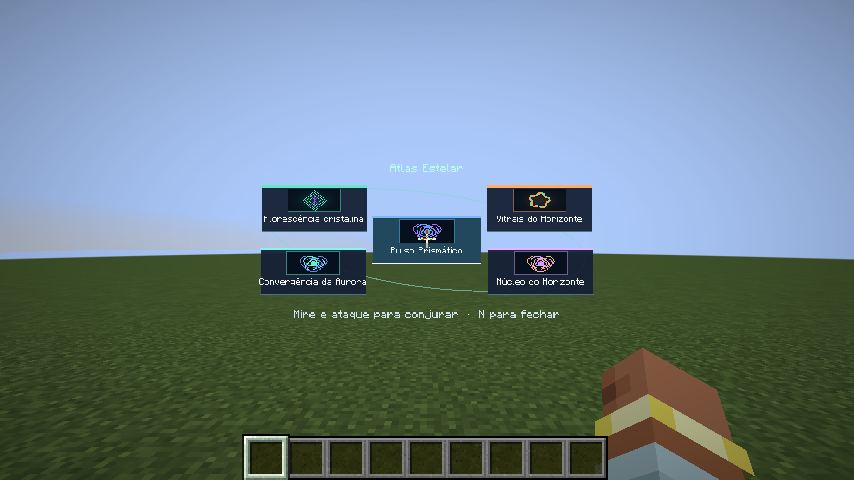

# Validação, medições e limites

## Versões 0.5.0 a 0.6.2 — estado atual

**Ainda não compiladas nem executadas.** As mudanças da 0.5.0 (cues, recarga por habilidade, diagnóstico, Atlas) da 0.6.0 (ganchos post, film e start) da 0.6.1 (orçamento por passe, contagem real no F7, cues após cancelamento) e da 0.6.2 (post sempre chamado, alcance por definição, duração até 12000 ticks, configuração de acessibilidade) foram escritas sem acesso a um ambiente com NeoForge e RimuLib. Antes de distribuir:

1. Rode `./gradlew build` na raiz. O build inclui `checkBudget`, que agora também cobre a recarga por habilidade e o agendamento de cues, e `checkFrustum`.
2. Rode `./gradlew dist` para copiar o JAR para `dist/` e depois `./gradlew -p examples/vfx-sample build`.
3. Siga o roteiro de [TESTE-REAL.md](TESTE-REAL.md) e registre aqui os resultados, o SHA-256 dos JARs e os CSVs de quadro.

O protocolo de rede não mudou em relação à 0.4.0 (canais event, end e request_v2). Pontos a conferir contra o JAR da RimuLib 1.3.0: os tipos `FxApi.Frame`, `FxApi.Uniforms`, `cinematic.Shot` e `cinematic.Subject` usados em `AddonLayers`; o tipo de retorno de `Frame.partial()`; os campos e métodos do ScreenFx usados por `AddonLayers.Post` (`bloom`, `shake`, `desaturate`, `contrast`, `addFlash`); e a aceitação de nomes de uniform indexados.

---

## Versão 0.4.0

Minecraft Java 1.21.1, NeoForge 21.1.267, RimuLib 1.3.0 e Java 21. O motor e o addon foram compilados separadamente. O projeto de exemplo compilou contra o JAR público do motor. O build passou nas verificações de orçamento e frustum. O manifesto do motor declara Minecraft, NeoForge e RimuLib.

O cliente gráfico carregou os dois JARs e um segundo addon temporário de teste em um mundo plano com servidor integrado. A execução confirmou:

- Cinco habilidades internas, o Sinal de Maré e seis habilidades de teste formaram doze entradas no Focus e quatro páginas no Atlas. Duas habilidades com o caminho signal em namespaces diferentes mantiveram identidades próprias.
- O cartão do Sinal de Maré carregou sua imagem e recebeu um atalho reconfigurável. Mirar e conjurar pelo Atlas criou a instância no servidor, iniciou a câmera e compilou o shader vfxsample:signal do JAR externo. Pular a tomada devolveu o controle da câmera.
- Durante a recarga, um segundo pedido deixou a contagem de instâncias em um. Um pedido para conjurar um efeito privado também manteve essa contagem.
- Com o Focus em mãos, a tecla H abriu o conjunto correto. O painel exibiu a instrução do addon. O teste ajustou a potência a 2 pela mesma API cliente do slider e usou o Focus para conjurar. A altura recebida foi um bloco acima do alvo padrão. O gesto de arrastar o slider com o mouse não foi automatizado.

[Cartão no Atlas](gameplay/addon-atlas-040.png) · [Conjuração no mundo](gameplay/addon-cast-040.png) · [Focus com o painel selecionado](gameplay/addon-focus-040.png). As entradas Probe no Focus pertencem ao segundo addon temporário, que não fornece artes. O pacote distribuído inclui somente o exemplo Sinal de Maré.

SHA-256 do JAR do motor: `3695eaf585c9bbc615148e27b8c038f11f244240535cefbec512e7b43861bb48`.

O cliente usou Mesa llvmpipe. Esta rodada cobre o servidor integrado. Desempenho em GPU física e sincronização entre dois clientes independentes continuam sem medição para a 0.4.0. Consulte o [guia de autoria](ADDONS-0.4.md) para reproduzir a conjuração.

---

## Versão 0.3.0

O motor e o projeto de integração foram compilados separadamente para Minecraft 1.21.1, NeoForge 21.1.267, Java 21 e RimuLib 1.3.0. O consumidor compilou contra o JAR do motor. O cliente gráfico de teste carregou ambos como JARs e usou um componente temporário de automação em um mundo com servidor integrado. O pacote de entrega contém o exemplo opcional e seu fonte.

O teste confirmou registro por namespace, início fixo, âncora na entidade correta, posição de renderização após deslocamento de três blocos, cancelamento pelo servidor, nova conjuração e expiração natural. A tecla do Pulso Prismático percorreu o caminho público de início. Para os impact frames, uma camada de observação leu os parâmetros finais na etapa de composição da RimuLib. Confirmou dessaturação e contraste na janela programada, clarão colorido numa segunda definição e ausência dos acentos com a opção de ocultar clarões ligada. O teste de orçamento também cobre os limites temporais e a queda de intensidade do impacto.

SHA-256 do JAR distribuído

`c1d8fc8cae97c7b735bd75c3bfafa6b98bee98d32c30c08632bc7ac45ae0b24f`

A execução gráfica usou Mesa llvmpipe. Duas máquinas em multiplayer, custo em GPU física, transferência de dimensão e reentrada no alcance de uma âncora móvel não foram exercitados nesta rodada. A duração de um impacto é medida em ticks. A captura do guia mostra a fase anterior ao impacto.

---

## Versão 0.2.0

Minecraft Java 1.21.1, NeoForge 21.1.267, Java 21 e RimuLib 1.3.0. O build offline reutilizou os artefatos de desenvolvimento da 1.21.1 e passou em checkBudget e checkFrustum. O JAR de distribuição foi instalado em um projeto de teste separado com RimuLib e um componente temporário de automação.

SHA-256 do JAR da versão 0.2.0

`e84ced25c50b5dddf31afb99e36c3187d7d175fd0d9fb49b093f538941e6dc08`

O teste abriu o Atlas, mirou no cartão do Horizon Core e confirmou a execução aceita pelo servidor e o início da câmera. Em outra execução, um jogador simulado conjurou a habilidade no servidor integrado. O cliente recebeu o evento de outro conjurador e permaneceu com a câmera livre. A cena inclui uma escada de quartzo construída com blocos inteiros.

Os vídeos em gameplay/horizon-core-caster.mp4 e gameplay/horizon-core-observer.mp4 usam capturas do cliente a cada dois ticks, reproduzidas a 10 quadros por segundo. As faixas de áudio dos vídeos foram montadas com os quatro arquivos do mod nos tempos da sequência. A captura de vídeo não mede a mixagem posicional da saída de áudio do jogo. Os PNGs da pasta gameplay documentam a versão 0.1.2.

### Custo observado

Mundo plano, janela 854 × 480, alcance de 3 chunks, perfil BALANCED, limite de 40 fps, Mesa llvmpipe. Os tempos abaixo são intervalos entre quadros do cliente, coletados fora da gravação em uma execução. O observador manteve a mesma posição e o mesmo enquadramento. No perfil BALANCED, no máximo dois volumes entram no shader por quadro.

| Horizon Cores simultâneos | Quadros | Mediana | Percentil 95 |
|---|---:|---:|---:|
| 0 | 149 | 25,16 ms | 27,81 ms |
| 1 | 325 | 28,15 ms | 35,32 ms |
| 3 | 253 | 36,24 ms | 46,85 ms |

A base já encosta no limite de 40 fps. Os valores incluem CPU e renderização por software. GPU física, dois clientes independentes, shaders externos e resoluções maiores seguem sem medição.

---

## Versão 0.1.2

### Build e dependências

Minecraft Java 1.21.1, NeoForge 21.1.267, RimuLib 1.3.0, Java 21 e Gradle 9.2.1. Duas compilações do mod em diretórios separados produziram JARs idênticos. Uma executou `clean build` com a etapa de preparação dos artefatos do Minecraft. Ambas passaram em `checkBudget` e `checkFrustum`.

SHA-256 de `dist/calamidade_awakening-0.1.2.jar`

`9b9e9511836ba1695c59b40b2c895669a703d7010bb5898fef057f094b50824c`

O manifesto declara Minecraft, NeoForge e RimuLib como requisitos. A validação do pacote compara os recursos e as classes do JAR com a saída do build e verifica a ausência de JARs incorporados.

### Cobertura dos testes

- O teste de geometria cobre orçamento de vértices, continuidade de anéis e esferas, prioridade dos efeitos e chaves de rede.
- O teste de visibilidade usa o frustum do Minecraft e inclui as bordas laterais e verticais, o observador dentro do volume e objetos atrás da câmera.

### Atlas no Minecraft

O JAR foi colocado na pasta mods de um projeto de teste separado. Um componente temporário acionou os controles e observou os eventos do jogo em um mundo com servidor integrado. A lista de mods continha Minecraft, NeoForge, RimuLib, Calamidade_Awakening e esse componente de teste. O componente fica fora do pacote de entrega.

A tecla N abriu e fechou o atlas com as mãos vazias. Após um deslocamento lateral de um bloco, a coordenada mundial da âncora permaneceu igual. O botão Atlas Estelar no menu de pausa abriu a mesma interface. Um clique de ataque no cartão central fechou o atlas e o cliente recebeu do servidor o evento do Pulso Prismático.

As outras quatro habilidades foram acionadas pelas teclas padrão U, I, V e Y. Foram verificados o recebimento dos eventos, a ativação da câmera nas três habilidades cinematográficas e sua liberação ao pressionar O durante Núcleo do Horizonte. As cinco capturas estão em gameplay/.

O cliente usou Mesa llvmpipe com OpenGL 4.5. O teste cobriu um jogador em servidor integrado. Continuam pendentes multiplayer com dois clientes e medições de desempenho em GPU física.
