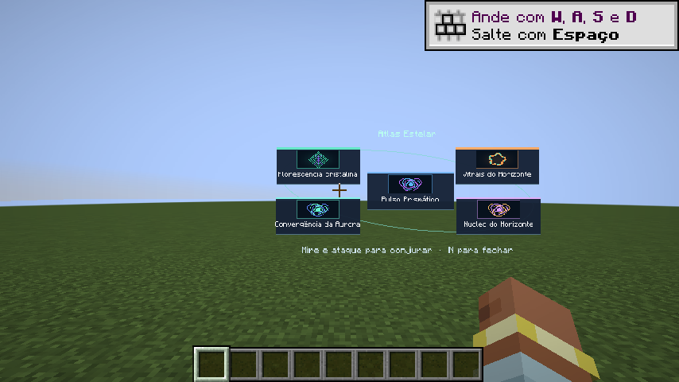

# Validação, medições e limites

## Versão 0.10.0 — integração com outros mods (estado atual)

**Compilada e coberta pelos testes de build; executada em jogo por um roteiro automatizado em renderização por software (Mesa llvmpipe), num cliente, no NeoForge 21.1.267 e no 21.1.265, com o mesmo roteiro e o mesmo resultado (53 de 53 verificações). Dois jogadores num servidor dedicado, GPU física e os casos manuais de TESTE-REAL.md (52 a 62) continuam pendentes.**

### Build

Minecraft Java 1.21.1, NeoForge 21.1.267 (e 21.1.265 com `-Pneoforge.version=21.1.265`), RimuLib 1.3.0 (baixada pela task `rimulib`, SHA-256 `15ccd4958a0412cbcf618a10962b0b6a7e1683fd66b94d07e10bc7cabeedb774`), OpenJDK 21.0.13, Gradle 9.2.1, glslangValidator 15.1.0.

- `./gradlew clean build`: passou, com `checkBudget` (`FrameBudgetCheck PASS`, com os novos `OrientationCheck`, `StageEventCheck`, `SourceCheck` e `TriggerCheck`), `checkFrustum`, `checkShaders` (11 shaders compilados), `checkApiDocs`, `checkRecipes` (agora também o modelo de dependência contra `examples/consumidor`) e `checkModVersion`. Cada etapa foi compilada e testada antes do seu commit.
- `./gradlew dist` e `./gradlew -p examples/vfx-sample build`: passaram, sem avisos.
- **NeoForge 21.1.265:** `./gradlew clean compileJava checkBudget checkFrustum -Pneoforge.version=21.1.265` e o exemplo com a mesma opção passaram; o `jar` compilado contra a 21.1.265 é byte a byte igual ao da 21.1.267.
- **Build reproduzível:** o `dist/calamidade_awakening-0.9.0.jar` refeito aqui a partir da tag tem o mesmo SHA-256 do anexo do release v0.9.0 (`4813b906…`), então o SHA-256 abaixo é o que o workflow de release vai publicar.

SHA-256 de `dist/calamidade_awakening-0.10.0.jar`: `c6229eb58a486c976429fc661b5228521ff87c96f69aaad10e0281170529bcde`

SHA-256 de `examples/vfx-sample/build/libs/vfx-sample-1.7.0.jar`: `937411881042d7cadcd5fed4a75242449b2948e1bc2ea584f7903331db1ec911`

### Consumo como dependência

- `examples/consumidor` (o modelo de `docs/ai/usar-como-dependencia.md`): com `-Pcalamidade.url=file:///…/dist/calamidade_awakening-0.10.0.jar`, a task `baixarDependencias` baixou o Calamidade e a RimuLib (do CurseForge), conferiu os dois SHA-256 e o projeto compilou; o JAR do consumidor tem só as próprias classes. Com um arquivo errado no lugar do Calamidade, a task falhou com "SHA-256 … não confere" e não deixou nada em `libs/`.
- O download do anexo do release v0.9.0 pelo endereço do GitHub (`…/releases/download/v0.9.0/calamidade_awakening-0.9.0.jar`) funcionou daqui e conferiu com o SHA-256 publicado.
- **Depois do release v0.10.0:** os anexos publicados pelo workflow têm os mesmos SHA-256 do build local (`c6229eb5…` e `93741188…`), e `./gradlew -p examples/consumidor clean build`, sem endereço alternativo, baixou `calamidade_awakening-0.10.0.jar` do release no GitHub, conferiu o SHA-256 e compilou.
- O mod de teste em jogo (abaixo) usa o mesmo esquema (`compileOnly` + `runtimeOnly` com os JARs do motor, da RimuLib e do exemplo): no `runClient` do NeoForge 21.1.267 e do 21.1.265, os três foram carregados como mods a partir do classpath.

### Escolhas desta versão

- **Referencial.** Os eixos locais do Minecraft (`^x ^y ^z`: x à esquerda, y para cima, z para a frente), com yaw e pitch na convenção do jogo. Yaw 0 e pitch 0 dão exatamente os eixos do mundo, então efeitos da 0.9 não mudam. A frente do `Basis` é igual a `Vec3.directionFromRotation(pitch, yaw)` em 13 × 24 combinações (teste).
- **Seguir o corpo.** No servidor, `LivingEntity.yBodyRot`; no cliente, `Mth.rotLerp(parcial, yBodyRotO, yBodyRot)`, como o renderizador de entidades. O `getPreciseBodyRotation` do jogo usa `Mth.lerp` simples (conferido com `javap -c`), que salta na volta de 180 para -180; por isso não foi usado.
- **Canal novo em vez de mudar o antigo.** O pacote de início passou a ser `event_v2`; um motor 0.9 não registra o canal, então versões misturadas não trocam efeitos em vez de ler bytes errados.
- **Reserva de jogadores vale para SCRIPT também.** O `/calamidade bench` (SCRIPT) chega a 48 com a reserva padrão; jogadores continuam podendo usar as 64.
- **Fim junto com o bloco.** `BlockEntity.isRemoved()` cobre quebra, troca e descarregamento: `LevelChunk.clearAllBlockEntities` chama `onChunkUnloaded` e `setRemoved` em cada block entity (conferido com `javap -c`).
- **Mob morto.** Uma instância presa a um mob dura até o mob ser removido, cerca de 20 ticks depois da morte (a animação de morte); o teste em jogo espera esse tempo.
- **Gatilhos em campos estáticos.** O efeito de um gatilho é procurado quando ele dispara, não quando é criado: os campos `static final` são inicializados quando a classe carrega, muitas vezes antes do `Effects.register` no construtor do mod.

### Testes novos

- **`OrientationCheck`**: identidade, direções conhecidas (yaw 90 é oeste; à esquerda de quem olha para o sul fica o leste; pitch 90 olha para baixo), frente igual a `Vec3.directionFromRotation`, 2000 bases aleatórias ortonormais e com a mesma orientação do mundo, ida e volta local → mundo → local, normalização do yaw, `yawTowards`/`pitchTowards`, `Point.facing`, `Placement` (cópias, `shifted`, `facing`, `arrivingFrom`, recusas) e `Effects.Context` (forma nova e formas da 0.6 e da 0.9).
- **`StageEventCheck`**: o pacote `event_v2` leva e devolve orientação, opção de seguir o corpo e tipo da fonte; leitura de valores inválidos (yaw não finito, pitch fora da faixa, seguir o corpo sem âncora, tipo de fonte desconhecido) cai em valores seguros.
- **`SourceCheck`**: igualdade das fontes (jogador e entidade com o mesmo UUID são fontes diferentes; posição de bloco copiada), regras e admissão (total, reserva, por fonte, sem reserva, reserva 64), uma simulação de 20000 inícios e fins aleatórios que nunca passa dos limites, recarga por mob e por bloco.
- **`TriggerCheck`**: modos PERIODIC, REDSTONE e PROXIMITY (bordas, repetição, release só uma vez, novas tentativas espaçadas quando o servidor recusa, recarga depois de recarregar o chunk) e validação das configurações dos três gatilhos.

### Compatibilidade

- O código do exemplo 1.6.0 compila sem mudança contra a 0.10.0 (Etapa 1).
- O JAR do vfx-sample 1.6.0 anexado ao release v0.9.0 (compilado contra a 0.9.0, SHA-256 `3ab2c335…`): as 172 referências ao motor, em 38 classes, existem no JAR 0.10.0 com a mesma assinatura (`javap -v` e `javap -p -s`). Contraprova: contra o JAR 0.8.0 o mesmo verificador acusa 44 referências que faltam (Beam, Light, prioridade).
- `Effects.Context` manteve os construtores da 0.6 e da 0.9; `AddonLayers.Post` e `World` mantiveram os seus; `Handle` ganhou só um método `default`.
- O protocolo de rede mudou (`event_v2`): servidor e clientes na mesma versão.

### Integração conferida no JAR (javap)

Minecraft 1.21.1: `LivingEntity.yBodyRot`, `yBodyRotO`, `getPreciseBodyRotation` (bytecode), `getSlotForHand`; `Mth.rotLerp`, `Mth.wrapDegrees`; `Vec3.directionFromRotation`, `atBottomCenterOf`; `Entity.getYRot`, `getXRot`, `getViewYRot`; `Item.use`, `Item.hurtEnemy`; `ItemStack.hurtAndBreak(int, LivingEntity, EquipmentSlot)` (que pula jogadores com `hasInfiniteMaterials`, conferido com `javap -c`); `ItemCooldowns.addCooldown`; `InteractionResultHolder.sidedSuccess`, `consume`, `fail`; `BlockEntity.isRemoved`, `setRemoved`; `LevelChunk.clearAllBlockEntities` (bytecode); `SignalGetter.hasNeighborSignal`; `EntityGetter.hasNearbyAlivePlayer` (filtra espectadores e mortos, conferido com `javap -c`); `BlockStateProperties.FACING` e `HORIZONTAL_FACING`; `Direction.toYRot`; `BaseEntityBlock.getRenderShape` (devolve `INVISIBLE`; o exemplo devolve `MODEL`); `BlockBehaviour.simpleCodec`; `BlockEntityType.Builder.of(...).build`; `SoundEvents.NOTE_BLOCK_CHIME` (um `Holder`).

NeoForge 21.1.267 e 21.1.265: `LivingDamageEvent.Post`, `BuildCreativeModeTabContentsEvent`, `DeferredRegister.Items`/`Blocks`, `ModConfigSpec` (`push`, `pop`, `defineInRange`), `ModConfig.Type.SERVER`, `IBlockEntityExtension.onChunkUnloaded`.

### Em jogo (roteiro automatizado, Mesa llvmpipe)

Cliente de desenvolvimento do NeoForge sob Xvfb, janela 1280 × 720, Mesa llvmpipe (LLVM 20.1.2, 256 bits), 10 a 39 FPS, qualidade BALANCED, distância 8, com os JARs desta versão (hashes acima), a RimuLib e um mod temporário de teste (fora do repositório) que cria um mundo plano (dificuldade fácil, `spawnChunkRadius 0`), roda os comandos como jogador, usa o item e ataca pelo `MultiPlayerGameMode` (o caminho real do clique), chama a API no servidor para os limites, lê o F7 e as instâncias do servidor por reflexão, mede as direções dos feixes resolvidos no cliente e tira capturas. Sem som e sem rede da Mojang. A RimuLib mostra a tela "Your graphics card can't run…" em renderizador por software; o mod de teste aperta "Ignore". O mesmo roteiro rodou no 21.1.267 e no 21.1.265: **53 de 53 verificações nas duas versões**.

| Passo | Resultado (igual nas duas versões) |
|---|---|
| `/vfxsample receita leque` com o jogador virado para o sul, o oeste e o noroeste (yaw 0, 90, -135) | O feixe central aponta para a frente do jogador com erro de 0,00°; os feixes de fora a 41,35° (40° a partir de um ponto 0,5 bloco à frente). F7: 5 feixes, 1 luz, "Fontes: 1 jogadores". |
| Seta (efeito do mod de teste: 3 feixes escritos com `Point.facing`) presa a um zumbi parado com `followingBody()`; o zumbi é virado de 180 para 90 graus | O yaw da instância no cliente é igual ao do corpo do zumbi (diferença < 1,5°) antes e depois; a seta vira 90 graus junto. Ao matar o zumbi, a instância acaba quando ele é removido. |
| Cajado em sobrevivência, olhando reto | O raio sai da mão direita (ponto a (-0,3; -0,25; 0,4) da câmera, como o offset pede) e vai reto para a frente (0,00°); durabilidade 1; a recarga aparece no item; o zumbi 8 blocos à frente perde 3 de vida pelo cue (`ctx.forward()`). |
| Segundo clique durante a recarga; terceiro depois dela, olhando para o oeste e 20° para cima | O segundo não dispara; o terceiro segue yaw e pitch do olhar (0,00°), durabilidade 2. |
| Golpe corpo a corpo num zumbi | O risco atravessa o alvo na direção do golpe (0,00°); anel de luz no chão. |
| Pilar periódico e pilar de redstone virado para o norte | O periódico pulsa sozinho; o de redstone fica quieto sem sinal, pulsa na borda de subida (1 instância), de novo 20 ticks depois (2 vivas, o limite por bloco) e para quando o sinal some. O feixe inclinado vai para o norte (0,00°). F7: "Fontes: 2 blocos". |
| Quebrar o pilar de redstone no meio de um pulso | A instância acaba no tick seguinte (o pulso duraria 30 ticks). |
| Ir a 4000 blocos e voltar | Longe: nenhuma instância de bloco no servidor. De volta: o periódico volta a pulsar. |
| Zumbi vanilla (com IA) atacando um aldeão parado | Feixe do peito do zumbi na direção da vítima (0,0° nas rodadas finais; até 3,2° numa anterior, com o zumbi se mexendo); F7: "Fontes: 1 mobs". |
| `/calamidade bench 64` | Para em 48 (SCRIPT); `/calamidade status`: "48 scripts", "recusadas 1 (reserva 1)". |
| Com o bench ativo, `/vfxsample receita leque` | O jogador começa o efeito na reserva (49 ativas); F7: "Fontes: 1 jogadores · 48 scripts". Depois que o leque aparece, ele tem 5 feixes e 1 luz em todos os quadros seguintes (12 e 11 quadros seguidos, a 8–13 FPS sob carga): não pisca. Um mob tentando o mesmo recebe `Optional.empty()`, sem erro. |
| 6 inícios no mesmo zumbi, 3 no mesmo bloco, 2 com recarga de 100 ticks no mesmo mob | 4 aceitos, 2 aceitos, 1 aceito (recarga restante: 100). `/calamidade status`: "5 mobs · 2 blocos", recusadas por reserva 2 e por fonte 3. |
| Regressão da 0.9: receita `pilar`, `protagonista` com `bench 40`, Sinal de Maré | Pilar: 1 feixe, 2 luzes. Protagonista: 1 HERO desenhado, 2/2 passes, feixes e luzes pagos pelo HERO. Sinal de Maré desenhado. |

Nenhum erro de shader, nenhuma camada desativada por falha e nenhuma exceção do motor ou do exemplo no log; as únicas exceções são do áudio (sem dispositivo OpenAL) e da rede da Mojang (`sessionserver.mojang.com`, `api.minecraftservices.com`), esperadas neste ambiente.

**O que o teste em jogo achou:** nada no motor. Na primeira rodada, 6 verificações falharam por erros do próprio roteiro: uma chamada ao servidor aninhada em outra (esperou até o tempo limite) e um bench iniciado 2 ticks depois de matar um zumbi, cujo efeito ainda vivia na animação de morte; o motor parou o bench corretamente em 47 (47 scripts + 1 mob = 48 vagas comuns), e as expectativas seguintes ficaram deslocadas. Numa rodada posterior, o zumbi-alvo do cajado perdeu 4 de vida em vez de 3: os zumbis do roteiro queimavam ao sol e um tique de fogo caiu dentro da medição. Numa terceira, o F7 lido no passo dos limites mostrava 0 feixes enquanto a captura do quadro seguinte mostrava o leque: o F7 mostra o quadro anterior e, com quadros lentos sob 48 Núcleos, o cliente roda vários ticks por quadro, então o quadro lido era de antes de o leque crescer. Para descartar um efeito piscando, o roteiro ganhou uma verificação quadro a quadro (acima), que passou. O roteiro passou a esperar a animação de morte, a não aninhar chamadas, a pôr capacete nos zumbis e a esperar o leque aparecer; as duas rodadas finais, com os JARs acima, passaram inteiras.

Capturas (21.1.267): [orientação](gameplay/orientacao-0100.jpg) · [gatilhos: cajado, pilares e zumbi](gameplay/gatilhos-0100.jpg) · [pilar de noite, limites e regressão](gameplay/limites-noite-0100.jpg).

### Pendente

- TESTE-REAL.md, parte 5 (casos 52 a 62), com dois jogadores num servidor dedicado e numa GPU física.
- O RespectCraft com o Finisher Engine usando efeitos do Calamidade (o modelo de dependência foi testado com `examples/consumidor`).
- Os pendentes da 0.9.0 continuam (abaixo).

---

## Versão 0.9.0 — Beam API, Light API e prioridade protagonista

**Compilada e coberta pelos testes de build; executada em jogo por um roteiro automatizado em renderização por software (Mesa llvmpipe), num cliente. GPU física, multiplayer e os casos manuais de TESTE-REAL.md (37 a 51) continuam pendentes.**

### Build

Minecraft Java 1.21.1, NeoForge 21.1.267, RimuLib 1.3.0 (`rimulib-1.3.0-neoforge.jar`, baixada do CurseForge pela task `rimulib`, SHA-256 `15ccd4958a0412cbcf618a10962b0b6a7e1683fd66b94d07e10bc7cabeedb774`), OpenJDK 21.0.13, Gradle 9.2.1, glslangValidator 15.1.0.

- `./gradlew clean build`: passou, com `checkBudget` (`FrameBudgetCheck PASS`, incluindo `TimelineCheck`, `AtmosphereCheck` e os novos `PriorityCheck`, `BeamCheck` e `LightCheck`), `checkFrustum`, `checkShaders` (11 shaders compilados), `checkApiDocs`, `checkRecipes` e `checkModVersion`. Cada etapa da 0.9.0 foi compilada e testada antes do seu commit.
- `./gradlew dist`: passou e gerou `dist/calamidade_awakening-0.9.0.jar`.
- `./gradlew -p examples/vfx-sample build`: passou, sem avisos, e gerou `vfx-sample-1.6.0.jar`.

SHA-256 de `dist/calamidade_awakening-0.9.0.jar`: `4813b906fd74e32b25af2168aa7446dc24252ac928bd140196c0ea801e61e256`

SHA-256 de `examples/vfx-sample/build/libs/vfx-sample-1.6.0.jar`: `3ab2c335d5c9158cfd854ad923a1732af188836bb119dd59bd3fa3fece02aa61`

Um `clean build` repetido depois do teste em jogo gerou os dois JARs byte a byte iguais aos testados.

### Escolhas desta versão

- **Dados dos passes por textura, não por uniforms.** 128 feixes × 7 vec4 passariam do mínimo de uniforms de fragmento que o OpenGL 3.2 garante (1024 componentes). Os feixes (7 texels cada) e as luzes (4 texels) vão numa textura RGBA32F por passe, lida com `texelFetch`. `Uniforms.glTexture(nome, id)` (conferido com `javap -c` em `PostFxRenderer$Binder`) liga a textura numa unidade própria, com `glBindSampler(unidade, 0)`, até 16 unidades; o upload (`DataTexture`) restaura a textura ligada, o buffer de pixel-unpack e os parâmetros de unpack que mexe, para o cache de estado do Minecraft continuar válido.
- **Ordem dos passes:** `lights`, `awakening_field`, cartões e `post.pass`, `beams`, `atmosphere`. As luzes vêm antes para os efeitos ficarem por cima delas e a atmosfera as cobrir na distância.
- **Pagamento:** feixes e luzes são pagos antes dos passes de addon, feixes primeiro; HERO paga quando um HERO desenhado os usa, senão o comum; um orçamento nunca paga pelo outro.
- **Seleção HERO:** os HERO ocupam vagas do limite de desenhados (o total continua 3/6/12) e são no máximo 2; como o menor limite é 3, um HERO nunca é cortado.
- **Névoa no passe de luzes:** `ViewportEvent.RenderFog` (`getNearPlaneDistance`, `getFarPlaneDistance`, `getFogShape`, conferidos com javap) registrado depois do ajuste da atmosfera, só no modo `FOG_TERRAIN`; o shader usa a mesma curva do `fog.glsl` do jogo (smoothstep, forma esférica ou cilíndrica).
- **Mira (`*_AIM`):** `Level.clip(new ClipContext(olho, olho + olhar × alcance, Block.OUTLINE, Fluid.NONE, entidade))` (conferido com javap), com cache por entidade e alcance no quadro.
- **Albedo estimado da luz:** `cor^0,4 × 0,8`. A prévia mostrou que `sqrt(cor) × 0,7` e um cosseno sem envolvimento deixavam uma fogueira quase invisível de noite.

### Testes novos

- **`PriorityCheck`** (Java puro): HERO nunca cortado (em LOW, BALANCED e HIGH, contra 40 NORMAL mais fortes e mais próximos), teto de 2 HERO (os mais próximos; empate pela ordem; 60 HERO desenham 2), filtros de alcance e intensidade, seleção NORMAL idêntica à da 0.8 em 500 conjuntos aleatórios sem HERO, orçamentos separados (gastar o HERO não toca o comum), `charge` limitado, `Definition` com prioridade (construtor da 0.8, `withRange` mantém a prioridade).
- **`BeamCheck`**: `Point` (fábricas, validação, igualdade), builder (padrões, faixas, nomes, trilha e fase duplas, pontas iguais), `validate`, amostragem (peso = envelope × fase × trilha; revelação limitada a 1 com OVERSHOOT; contagem de pulsos arredondada; deslocamento de ponta limitado a 256; NaN), registro (efeito desconhecido ou interno, 0 e 17 feixes, duplicado, antes da timeline, cues depois, lista imutável) e os passes compartilhados (teto por prioridade; HERO paga primeiro; nenhum orçamento paga pelo outro).
- **`LightCheck`**: formas e padrões, faixas, `along` (pontas e cor do feixe; cor explícita vence), validação, amostragem com trilhas e fase, cintilação (sempre entre `1 − quantidade` e 1, suave, determinística, diferente por seed, escalada pela intensidade e por "ocultar clarões"), registro (8 e 9 luzes, duplicado, feixe não registrado ou igual mas diferente, luz animada antes da timeline) e tetos 8/24/64.
- **GLSL:** `node scripts/testar_glsl.cjs` executou 106 casos (51 novos) de `calamidade_fx.glsl` versão 2 em WebGL2 (ANGLE/SwiftShader): 106/106. O `checkShaders` compila os 11 shaders do motor e do exemplo em GLSL 1.50 com o `common.glsl` real.
- **Prévia dos passes:** `node scripts/previa_passes.cjs` rodou `beams.fsh` e `lights.fsh` reais (com o `common.glsl` da RimuLib) sobre uma cena sintética. Achou três defeitos antes do jogo: anéis falsos na ondulação de feixes vistos de frente (o eixo lateral e a posição ao longo do feixe ficam mal definidos; a ondulação agora diminui entre ~30 e ~12 graus), halo forte demais (agora 55% da cor no eixo) e luz noturna fraca (albedo e cosseno ajustados).
- **Receitas, fora do jogo:** o registro real das 13 receitas e da luz do Sinal de Maré rodou com o classpath do jogo; todos os feixes, luzes e atmosferas foram amostrados em cada tick; o raio do anel de `onda_luz` é igual a 0,45 × (idade − 12), a frente da onda do shader.

### Compatibilidade

- O exemplo 1.5.0 da 0.8.0, sem mudança no código, compila contra o JAR 0.9.0.
- O mesmo exemplo compilado contra o JAR 0.8.0 (reconstruído da tag `v0.8.0`, com o mesmo SHA-256 do release, `786ac7f9…`): as 128 referências a classes, métodos e campos do motor, em 30 classes, existem no JAR 0.9.0 com a mesma assinatura (javap -v e javap -s). Contraprova: o exemplo 1.6.0 contra o JAR 0.8.0 acusa as 11 referências novas (Beam, Light, Point, `withPriority`, `Effects.beams` e `Effects.lights`).
- `Effects.Definition` ganhou o componente `priority`; o construtor canônico da 0.8 (9 parâmetros) continua existindo e dá `NORMAL`.
- Protocolo de rede igual ao da 0.7.0 e da 0.8.0 (event, end_effect, request_v2, release).
- Um addon cujo manifesto declara `[0.8.0,0.9.0)` não carrega com a 0.9.0 até ampliar o intervalo.

### Integração conferida no JAR (javap)

RimuLib 1.3.0: `Uniforms.glTexture(String, int)` e o `Binder` de `PostFxRenderer` (unidade própria, `glBindSampler(unidade, 0)`, até 16 unidades), `FxApi$Stage.render` (camadas desenhadas e passes executados no mesmo quadro).

NeoForge 21.1.267: `ViewportEvent.RenderFog.getFogShape()`, `com.mojang.blaze3d.shaders.FogShape` (`SPHERE`, `CYLINDER`).

Minecraft 1.21.1: `ClipContext(Vec3, Vec3, ClipContext.Block, ClipContext.Fluid, Entity)`, `BlockGetter.clip`, `HitResult.getType`/`getLocation`, `HitResult.Type.MISS`, `Entity.getEyePosition(float)`, `getPosition(float)`, `getViewVector(float)`, `getId()`, `EntityGetter.getPlayerByUUID`, e os `SoundEvents` das receitas (todos `SoundEvent`; `TRIDENT_THUNDER` e `GENERIC_EXPLODE` são `Holder` e não foram usados).

LWJGL 3.3.3: `GL30.GL_RGBA32F`, `GL21.GL_PIXEL_UNPACK_BUFFER(_BINDING)`, `GL11.glTexSubImage2D(…, FloatBuffer)`, `GL12.GL_TEXTURE_MAX_LEVEL`.

### Em jogo (roteiro automatizado, Mesa llvmpipe)

Cliente de desenvolvimento do NeoForge 21.1.267 sob Xvfb 1280 × 720, Mesa llvmpipe (LLVM 20.1.2, 256 bits), 5 a 39 FPS, qualidade BALANCED, gráficos Fancy, distância 8, com os JARs desta versão, a RimuLib e um mod temporário de teste (fora do repositório) que cria um mundo plano em criativo, roda os comandos como jogador, lê os contadores do F7 por reflexão (um tick depois da captura) e tira capturas com o F7 aberto. Sem som (sem dispositivo OpenAL) e sem rede da Mojang. A RimuLib mostra, em renderizador por software, uma tela "Your graphics card can't run…" com "Exit game" e "Ignore"; o mod de teste aperta "Ignore".

| Passo | F7 (desenhados · passes · HERO · feixes · luzes) | Visto na captura |
|---|---|---|
| Sem efeito, de dia | 0 · 0 · 0 · 0 · 0 | Cena normal. |
| `pilar` de dia | 1 · 2 · 0 · 1 comum · 2 comum | Feixe branco sobre o céu, pulsos; disco de luz amarelo no chão em volta da base. |
| `pilar` de noite | 1 · 2 · 0 · 1 comum · 2 comum | Halo âmbar, chão aceso em volta da base, a face do bloco de tijolos voltada para o feixe alaranjada. |
| `pilar` atrás de um muro de pedra | 1 · 2 · 0 · 1 comum · 2 comum | O muro esconde o feixe; só o trecho acima dele aparece, recortado pela borda. |
| `teia` | 1 · 1 · 0 · 8 comum · 0 | Oito fios ciano saindo do centro, pulsos, ondulação presa nas pontas. |
| `laser` mirando um bloco e o chão | 1 · 2 · 0 · 1 comum · 2 comum | Brilho cintilante no ponto de impacto e luz no chão em volta dele. |
| `fogueira` de noite | 1 · 1 · 0 · 0 · 1 comum | Poça de luz quente no chão (~10 blocos) e a face do pilar de pedregulho mais próximo alaranjada; nenhum feixe, vértice ou passe de addon. |
| `onda_luz` | 1 · 2 · 0 · 0 · 1 comum | Faixa de luz dourada no chão junto da onda; o clarão do centro já tinha passado (`Luzes: 1`). |
| `pilar` com intensidade dos efeitos de tela 0 | 1 · 2 · 0 · 1 comum · 2 comum | Só o núcleo branco, sem halo nem pulsos; a luz no chão continua. |
| `fogueira` e `pilar` debaixo d'água, de noite | 1 · 1 / 2 · 0 · 0 / 1 · 1 / 2 | A luz some na névoa da água; o feixe, atrás da parede do lago, não aparece. |
| `/calamidade bench 60` + `protagonista`, BALANCED, de dia | 6 · 3 · **1 HERO, 2/2** · 7 HERO · 3 HERO | 61 residentes; céu vermelho da atmosfera, lança, raios, anel e disco de luz entre os 5 Núcleos desenhados. |
| o mesmo em HIGH | 12 · 3 · **1, 2/3** · 7 HERO · 3 HERO | 12 desenhados, 4 volumes. |
| o mesmo em LOW | 3 · 2 · **1, 1/1** · 7 HERO · 0 | Feixes pagos pelo único passe HERO; luzes sem vaga, como documentado. |
| o mesmo de noite, BALANCED | 6 · 3 · 1, 2/2 · 7 HERO · 3 HERO | Lança e luzes sobre a cena escura. |
| Sinal de Maré no impacto, de noite | 1 · 3 · 0 · 0 · 1 comum | Luz verde-água no chão sob o sinal; atmosfera dourada ativa. |

Nenhum erro de compilação ou ligação dos shaders do motor e do exemplo no log, nenhuma camada desativada por falha. Na primeira rodada, os únicos avisos do compilador de shader foram 8 "used uninitialized" em variáveis internas da RimuLib (`gSeed`, `gTime`, `gPixel`); na segunda, nenhum.

**O que o teste em jogo achou e foi corrigido:** na primeira rodada, o laser visto por quem atira virava um cone largo saindo de baixo da mira (a 1–3 blocos dos olhos, o halo de 0,9 bloco ocupa dezenas de graus da tela). O passe agora limita a largura angular de feixes com uma ponta a menos de 2 blocos da câmera (~0,25 grau de núcleo, ~0,7 grau de halo); quem vê de fora continua vendo a largura real. A prévia (`node scripts/previa_passes.cjs laser`) e a segunda rodada, com os JARs finais (hashes abaixo), mostram o laser como um traço fino até o alvo; os demais resultados se repetiram.

Capturas da segunda rodada: [receitas novas](gameplay/receitas-090.jpg) · [protagonista sob carga](gameplay/protagonista-carga-090.jpg) · [fogueira de noite](gameplay/luz-noite-090.jpg) · [intensidade 0, água, protagonista de noite e Sinal de Maré](gameplay/acessibilidade-agua-090.jpg).

### Pendente

- Testes manuais de TESTE-REAL.md, casos 37 a 51, em GPU física: aparência dos feixes e da luz de dia, de noite e debaixo d'água, e custo dos passes sob carga (casos 45 e 50).
- Teste com dois jogadores num servidor dedicado (0.8.0 e 0.9.0).

---

## Versão 0.8.0 — Atmosphere API e kit para IAs

**Compilada e coberta pelos testes de build; executada em jogo por um roteiro automatizado em renderização por software (Mesa llvmpipe), num cliente. GPU física, multiplayer e os casos manuais de TESTE-REAL.md (13 a 36) continuam pendentes.**

### Build

Minecraft Java 1.21.1, NeoForge 21.1.267, RimuLib 1.3.0 (`rimulib-1.3.0-neoforge.jar`, baixada do CurseForge pela task `rimulib`, SHA-256 `15ccd4958a0412cbcf618a10962b0b6a7e1683fd66b94d07e10bc7cabeedb774`), OpenJDK 21.0.13, Gradle 9.2.1, glslangValidator 15.1.0.

- `./gradlew clean build`: passou, com `checkBudget` (`FrameBudgetCheck PASS`, incluindo `TimelineCheck` e o novo `AtmosphereCheck`), `checkFrustum`, `checkShaders` (9 shaders compilados), `checkApiDocs`, `checkRecipes` e `checkModVersion`. Cada etapa da 0.8.0 foi compilada e testada antes do seu commit.
- `./gradlew dist`: passou e gerou `dist/calamidade_awakening-0.8.0.jar`.
- `./gradlew -p examples/vfx-sample build`: passou, sem avisos, e gerou `vfx-sample-1.5.0.jar`.

SHA-256 de `dist/calamidade_awakening-0.8.0.jar`: `786ac7f9ebc1643be96c6028835421ef5da1c70f4f4c8fc29b1f7a21085bdc84`

SHA-256 de `examples/vfx-sample/build/libs/vfx-sample-1.5.0.jar`: `0a70b44990df526909c7e014bab28948ec2136830b8a08ff40ef6ca549cbadb2`

### Escolhas desta versão

- **`#include` de GLSL: sim.** `ShaderProgram.readSource` (javap -c) antepõe `common.glsl` e `#line 1 1`; `includes` troca cada linha que, aparada, começa com `#include "` e termina com `"` pelo arquivo `shaders/fx/<nome>` do namespace do shader e, se faltar, do namespace `rimulib`, seguido de `#line <n+2> 1`. Não há recursão. `Assets.open` monta o caminho `/assets/<namespace>/...` e o procura no módulo do mod daquele namespace, na RimuLib e nos demais mods, sempre com o mesmo caminho: um addon **não** alcança o namespace do motor, então copia a biblioteca para o seu. A biblioteca é `calamidade_fx.glsl`; não foi preciso o plano B (`docs/ai/glsl-snippets.md`).
- **Eventos de névoa do NeoForge: sim, os dois.** `ViewportEvent.ComputeFogColor` (get/setRed, Green, Blue) e `ViewportEvent.RenderFog` (`getMode`, `getType`, distâncias; `ICancellableEvent`). No código do `ClientHooks.onFogRender`, as distâncias só valem se o evento for cancelado; `FogRenderer.setupFog` dispara o evento depois de calcular cegueira, escuridão, fluidos e névoa grossa, então o `min` do motor nunca deixa a névoa mais rala. Prioridade `LOWEST`. A opção `vanillaFog` (padrão ligado) desliga as distâncias pelo jogo e faz o passe desenhar a névoa pela profundidade.
- **Exposição com "ocultar clarões":** no máximo 0,025 por tick (`AtmosphereMath.CALM_EXPOSURE_PER_TICK`).
- **Registro automático do esqueleto gerado:** o bytecode do FML 4.0.45 (`ModLoader.lambda$constructMods$3`) chama `constructMod` (que injeta os `@EventBusSubscriber` em `AutomaticEventSubscriber.inject`) e só depois envia `FMLConstructModEvent` ao barramento do mod. Por isso `scripts/novo_efeito.py` registra o efeito num assinante estático desse evento, sem editar a classe `@Mod`. `Rimulib.register` devolve o registro existente para um namespace já conectado, então `Addons.resources` pode ser repetido.

### Testes novos

- **`AtmosphereCheck`** (Java puro, no `checkBudget`): validação do builder (faixas, NaN, nomes, ligação dupla, fase dupla), `validate` contra a timeline, constantes e cores (alfa ignorado), trilhas (clamp na faixa, peso por fase e trilha `WEIGHT`, distâncias de névoa vindas de trilhas sempre com fim depois do início), peso zero e limiar de atividade, mistura (estado único, dois cheios, troca com força total, cores ponderadas, só as duas mais pesadas, empate pela ordem, simetria, distâncias pelo uso da névoa), `fogNear`, `fogFar`, `fogColorOver` e `screenFog`, extremos da mistura e os auxiliares do motor (fade por alcance, rampa de exposição: 1 → 2,5 leva 60 ticks, exposição pela intensidade).
- **Registro:** atmosfera para efeito desconhecido, interno ou duplicado; antes da timeline; trilha inexistente (rejeitada e não guardada); cues depois da atmosfera; amostragem da atmosfera registrada.
- **GLSL:** `node scripts/testar_glsl.cjs` executou 55 casos de `calamidade_fx.glsl` em WebGL2 (GLSL ES 3.00, ANGLE/SwiftShader no Chromium headless): 55/55. O `checkShaders` compila os 9 shaders do motor e do exemplo em GLSL 1.50 com o `common.glsl` real.
- **Receitas e exemplo, fora do jogo:** o registro real das 7 receitas, a validação das atmosferas do Sinal e do Farol contra as timelines e a mistura céu tingido + Sinal rodaram com o classpath do jogo e passaram.
- **Gerador:** `scripts/novo_efeito.py` gerou dois efeitos no vfx-sample (com e sem cartão); o exemplo compilou com eles, o `checkShaders` compilou os dois shaders novos e a recusa a sobrescrever funcionou. Os arquivos gerados foram removidos.

### Em jogo (roteiro automatizado, Mesa llvmpipe)

Cliente de desenvolvimento do NeoForge 21.1.267 sob Xvfb 1280 × 720, Mesa llvmpipe (LLVM 20.1.2, 256 bits), 2 a 10 FPS, com os JARs desta versão, a RimuLib e um mod temporário de teste (fora do repositório) que cria um mundo, roda os comandos como jogador, lê os contadores do F7 por reflexão e tira capturas. Não há som (sem dispositivo OpenAL) nem rede da Mojang.

| Passo | F7 (atmosferas · passe · passes de pós · vértices) | Visto na captura |
|---|---|---|
| Sem efeito | 0 · não · 0 · 0 | Céu e cena normais. |
| `/vfxsample receita ceu` (11 s) | 1 · sim · 0 · 0 | Céu roxo no alto e laranja no horizonte, nuvens preservadas, cena mais escura e quente, névoa laranja nas árvores distantes. |
| + `/vfxsample at` no impacto | 2 · sim · 3 · 1746 | Céu puxado para o dourado e mais claro; anéis dourados e lâminas do Sinal. |
| Depois de `receita stop` | 0 · não · 0 · 0 | Céu normal de novo. |
| `/vfxsample farol start` (6 s) | 1 · sim · 0 · 180 | Névoa âmbar no horizonte; o feixe continua nítido. |
| `farol release` (+4 s) | 0 · não · 0 · 0 | Apagado. |
| Receitas `anel`, `cubo`, `bolha`, `impacto`, `feixe` | 0 · não · 1 · 0 | Anel dourado no chão; cubo de grade com arestas e oclusão pelo terreno; bolha iridescente; quadro em duas cores; feixe com núcleo e halo. |
| Receita `ambiente` (+ `release`) | 0 · não · 0 · 576 | Vaga-lumes; depois do release, nada residente. |
| `ceu` com intensidade dos efeitos de tela 0 | 1 · sim · 0 · 0 | Céu e névoa mantidos, sem escurecimento nem tinta. |
| `ceu` com `vanillaFog` desligado | 1 · sim · 0 · 0 | Névoa desenhada pelo passe, pela profundidade. |

Nenhum erro de compilação ou ligação de shader no log, nenhuma camada desativada por falha. O roteiro rodou duas vezes; a segunda, com os JARs finais (hashes acima), repetiu os resultados. A 2 a 9 FPS, a leitura do F7, feita um tick depois da captura, às vezes cai fora de janelas curtas (na segunda rodada, 1 atmosfera e 2 passes no impacto do Sinal, e 0 passes no quadro de duas cores), sem diferença no que as capturas mostram. Na resolução cheia, as estrelas aparecem como pontos pequenos e cintilantes.

Capturas da segunda rodada: [céu tingido](gameplay/atmosfera-ceu-080.jpg) · [céu tingido + Sinal de Maré no impacto](gameplay/atmosfera-mistura-080.jpg) · [receitas anel, cubo, bolha, impacto, feixe e ambiente](gameplay/receitas-080.jpg).

### Em jogo, GPU física (teste do autor, registrado em 21/11/2026)

NVIDIA GeForce RTX 4060, qualidade BALANCED, com outros programas abertos no computador. Motor 0.8.0 e vfx-sample 1.5.0.

| Carga | Resultado |
|---|---|
| 60 × `vfxsample:receita_quadro` | F7: 60 residentes, 6 desenhados (o teto do BALANCED), 2 passes de pós (o orçamento de addons do BALANCED). FPS praticamente inalterado. |
| 6 × `vfxsample:receita_ceu` (`/calamidade bench 6 vfxsample:receita_ceu`) | Tempo de quadro: mediana 8,37 ms, p95 11,29 ms, em 933 quadros. |
| Referência: 6 × `nexus` na 0.6.2 | Mediana 8,40 ms, p95 11,56 ms. |

Leitura: o orçamento corta como projetado (60 residentes viram 6 desenhados e 2 passes), e seis atmosferas simultâneas (que somam um único passe de motor) custam o mesmo que seis Nexus da 0.6.2, dentro da variação de uma máquina com outros programas abertos.

- Teste visual detalhado (céu tingido, névoa, estrelas, Sinal de Maré e Farol com atmosfera, receitas): feito pelo autor, **sem problemas** encontrados. Nada foi corrigido antes da 0.9.0 por causa dele.
- Teste com dois jogadores num servidor dedicado: pendente.

**O que quebrou e foi corrigido por causa do teste em jogo:**

- O `neoforge.mods.toml` do motor ainda declarava a versão `0.7.0` (desde a 0.7.0 o arquivo não acompanhava o `build.gradle`). O exemplo 1.5.0, que exige `[0.8.0,0.9.0)`, era recusado no carregamento. Corrigido, com a task `checkModVersion` no build.
- O campo de estrelas era esparso e pequeno demais para aparecer (0,27% do hemisfério aceso no teste por GPU): o centro sorteado em células 3D muitas vezes ficava longe da superfície da esfera. `caStars` passou a usar um mapa octaédrico 2D do hemisfério de cima, com o centro sempre dentro da célula (0,68% do hemisfério, brilho médio 10 vezes maior).

### Compatibilidade

- O exemplo 1.4.0 da 0.7.0, sem mudança no código, compila contra o JAR 0.8.0 (o `build.gradle` dele só precisa apontar para o JAR novo).
- O mesmo exemplo compilado contra o JAR 0.7.0: as 107 referências a classes, métodos e campos do motor no bytecode existem no JAR 0.8.0 com a mesma assinatura (javap -v e javap -s).
- Protocolo de rede igual ao da 0.7.0 (event, end_effect, request_v2, release); a atmosfera não usa rede.
- Um addon cujo manifesto declara `[0.7.0,0.8.0)` não carrega com a 0.8.0 até ampliar o intervalo.

### Integração conferida no JAR (javap)

RimuLib 1.3.0: `ShaderProgram.readSource`, `includes` e `read`; `Assets.open`, `exists` e `split`; `Rimulib.register` (namespace repetido devolve o existente); `FxApi$Stage.render` envia `GTime = (tempo do mundo mod 24000 + fração) / 20`; `Uniforms.f3`.

NeoForge 21.1.267 e FML 4.0.45: `ViewportEvent.ComputeFogColor`, `ViewportEvent.RenderFog`, `FogRenderer$FogMode`, `FogType`, `EventPriority.LOWEST`, `SubscribeEvent.priority`, `FMLConstructModEvent` e a ordem de construção acima.

Minecraft 1.21.1: `ClientLevel.getSkyColor(Vec3, float)`, `GameRenderer.getRenderDistance()`, `Camera.getFluidInCamera()`, `MobEffects.BLINDNESS` e `DARKNESS` (`Holder<MobEffect>`), `LivingEntity.hasEffect(Holder)`, e os campos de `SoundEvents` usados pelas receitas (todos `SoundEvent`, não `Holder`).

### Pendente

- Testes manuais de TESTE-REAL.md, casos 13 a 36, em GPU física e com dois clientes num servidor dedicado; resposta do autor em 21/11/2026: a 0.7.0 ainda não foi testada em jogo.
- O JAR da RimuLib saiu do índice, mas continua no histórico do git (commit `2ec9d14`). Apagá-lo do histórico exige reescrever a `main` com push forçado; não foi feito sem autorização.

---

## Dependência RimuLib: fora do repositório e dos releases (21/11/2026)

Até a 0.7.0, `libs/rimulib-1.3.0-neoforge.jar` estava versionado (commit `2ec9d14`) e o workflow o anexava ao release v0.7.0. Corrigido antes da 0.8.0:

- `libs/*.jar` no `.gitignore`, sem exceção; o JAR saiu do índice (`git rm --cached`). Ele continua no histórico antigo do git: apagá-lo de lá exige reescrever a `main` com push forçado, o que não foi feito.
- O build baixa o arquivo oficial do CurseForge (`https://mediafilez.forgecdn.net/files/9676/532/rimulib-1.3.0-neoforge.jar`) pela task `rimulib` quando ele falta e falha se o SHA-256 não for `15ccd4958a0412cbcf618a10962b0b6a7e1683fd66b94d07e10bc7cabeedb774`. URL e hash ficam em `gradle.properties`.
- O workflow de release baixa o mesmo arquivo, confere o hash com `sha256sum -c` e recusa anexar qualquer JAR que não seja `calamidade_awakening-*.jar` ou `vfx-sample-*.jar`.
- O workflow `Limpar release` removeu a RimuLib do release v0.7.0, recalculou o `SHA256SUMS.txt` e trocou as notas, que agora mandam baixá-la do CurseForge. Os JARs do Calamidade e do exemplo da v0.7.0 não mudaram.

---

## Versão 0.7.0 — Timeline API

**Compilada e coberta pelos testes de build; ainda não executada em jogo.** Segundo o autor, os testes em jogo da 0.6.2 foram feitos; os resultados não estão registrados neste arquivo.

### Build

Minecraft Java 1.21.1, NeoForge 21.1.267, RimuLib 1.3.0 (`rimulib-1.3.0-neoforge.jar`, arquivo oficial do CurseForge, SHA-256 `15ccd4958a0412cbcf618a10962b0b6a7e1683fd66b94d07e10bc7cabeedb774`, igual ao da 0.6.2), OpenJDK 21.0.13 e Gradle 9.2.1.

- `./gradlew clean build`: passou, com `checkBudget` (`FrameBudgetCheck PASS`, agora incluindo `TimelineCheck`) e `checkFrustum`. Cada etapa da 0.7.0 foi compilada e testada antes do seu commit.
- `./gradlew dist`: passou e gerou `dist/calamidade_awakening-0.7.0.jar`. Um `clean build` repetido gerou o mesmo JAR, byte a byte.
- `./gradlew -p examples/vfx-sample build`: passou, sem avisos, e gerou `vfx-sample-1.4.0.jar`.
- Aviso restante: `StageNetwork` chama `LevelReader.hasChunkAt(BlockPos)`, marcado como obsoleto pela Mojang. No JAR do Minecraft, `hasChunkAt(int, int)` e `hasChunk(int, int)` também são obsoletos, e a alternativa sem aviso, `Level.isLoaded(BlockPos)`, recusa posições fora da altura do mundo, o que mudaria efeitos no céu. A chamada ficou como está.

SHA-256 de `dist/calamidade_awakening-0.7.0.jar`: `277a36b9515787da0ab6812f0bf2660ef80b2729d597a6a5ee53d44549aee259`

SHA-256 de `examples/vfx-sample/build/libs/vfx-sample-1.4.0.jar`: `e20856f59493178c93fcf59fb5dc6c93a8755b8e1fee0a5d05ed77683661558e`

### Testes novos no checkBudget

- `TimelineCheck` (Java puro): pesos das fases (subida, platô, queda, degraus, monotonia), cada easing nas pontas, no meio e com clamp, pico do `OVERSHOOT`, extremos e continuidade das trilhas, marcadores, loop do sustain com ticks parciais, transição para o release (inclusive antes do loop e com `release(início)` explícito), idade de expiração, continuidade da idade local fora dos saltos e de uma trilha com bordas iguais, e todas as validações do builder.
- `CueClock`: cue dentro do loop disparado a cada volta, cue depois do release disparado uma vez, ticks pulados pelo salto do release, fim da varredura quando a saída termina e interrupção pelo visitante (como num `stop()` dentro de um cue).
- Registro: ordem `register` → `timeline` → cues, timeline mais longa que a definição, efeito interno ou desconhecido, timeline duplicada, cue em marcador inexistente, relógio vazio para efeitos sem timeline e construtor de `Context` da 0.6.

### Compatibilidade com addons da 0.6

- O exemplo 1.3.1 da 0.6.2, sem nenhuma mudança no código, compila contra o JAR 0.7.0 (só o aviso antigo de `EventBusSubscriber.Bus`).
- O mesmo exemplo compilado contra o JAR 0.6.2: as 45 referências a classes, métodos e campos do motor no bytecode existem no JAR 0.7.0 com a mesma assinatura (conferido com `javap -v` e `javap -s`).
- Os registros que ganharam componentes (`Effects.Context`, `AddonLayers.Time` e `AddonLayers.Film`) mantêm os construtores antigos; `Post` mantém o construtor antigo; `Handle.release()` é um método default.
- Um addon cujo manifesto declara `[0.6.x,0.7.0)` não carrega com a 0.7.0 até ampliar o intervalo.

### Integração conferida no JAR (javap)

RimuLib 1.3.0:

- `client.render.Uniforms.f1(String, float)` é o envio de float usado por `Post.uploadTracks`.
- `client.render.ScreenFx`: campos públicos `float` `aberration`, `zoomBlur`, `afterimage` e `grain`; `addVignette(int, float)` só substitui a vinheta quando a nova intensidade é maior, então já combina pelo máximo.
- **Arrays de uniforms.** A implementação de `Uniforms` é `client.render.PostFxRenderer$Binder`. `f1` a `f4` passam o nome sem alteração a `ShaderProgram.location(String)`, que guarda o resultado num `HashMap` (`computeIfAbsent`) e chama `GL20.glGetUniformLocation(id, nome)` com a mesma string; localização `-1` pula o `glUniform*`. `vec4s` procura `nome + "[0]"` e depois `nome`, e envia o array inteiro com `glUniform4fv`. **Conclusão:** `"Pontos[3]"` chega ao `glGetUniformLocation` exatamente como escrito. Detalhes em [AVANCADO-0.6.md](AVANCADO-0.6.md).

NeoForge 21.1.267 (FML loader 4.0.45):

- `AutomaticEventSubscriber.inject` lê só os atributos `value` e `modid` de `@EventBusSubscriber`; não lê `bus`. Cada método `@SubscribeEvent` vai para o barramento do mod quando o tipo do evento implementa `IModBusEvent` e para o barramento do jogo nos outros casos.
- `FMLClientSetupEvent` (via `ModLifecycleEvent`), `RegisterKeyMappingsEvent` e `RegisterShadersEvent` implementam `IModBusEvent`. Remover `bus = Bus.MOD` de `ClientHooks.Setup` e do `SampleClient` não muda nada.

### Pendente

**Resposta do autor em 21/11/2026, ao iniciar a 0.8.0:** a 0.7.0 ainda não foi testada em jogo (Sinal de Maré com fases, Farol com sustain/release/stop e motionEffects). Nenhuma falha relatada; a 0.8.0 começou sobre a 0.7.0 sem correções.

Nada da 0.7.0 foi executado em jogo. Siga [TESTE-REAL.md](TESTE-REAL.md), casos 13 a 20, além dos anteriores. Pontos a observar:

- as fases e a câmera do Sinal de Maré, o dano no marcador `impacto` e o zoom blur e a aberração no impacto;
- o farol em loop, o som a cada volta, o release sincronizado nos dois clientes e a entrada tardia durante o loop e durante a saída;
- a opção Efeitos de movimento desligada;
- nomes de uniform indexados e `vec4s` num driver real.

Protocolo de rede: canais event, end_effect, request_v2 e o novo **release**. Servidor e clientes precisam estar na 0.7.0.

---

## Versões 0.5.0 a 0.6.2

**Compiladas; ainda não executadas em jogo.** As mudanças da 0.5.0 (cues, recarga por habilidade, diagnóstico, Atlas), da 0.6.0 (ganchos post, film e start), da 0.6.1 (orçamento por passe, contagem real no F7, cues após cancelamento) e da 0.6.2 (post sempre chamado, alcance por definição, duração até 12000 ticks, configuração de acessibilidade) foram escritas sem compilar e compiladas pela primeira vez na 0.6.2.

### Build

Minecraft Java 1.21.1, NeoForge 21.1.267, RimuLib 1.3.0 (`rimulib-1.3.0-neoforge.jar`, SHA-256 `15ccd4958a0412cbcf618a10962b0b6a7e1683fd66b94d07e10bc7cabeedb774`), OpenJDK 21 e Gradle 9.2.1.

- `./gradlew build`: o primeiro build falhou com um único erro de compilação. `AddonLayers.Post.pass` usava `FxApi.Uniforms`, que não existe; o tipo real é `cyou.rimuru.rimulib.mc1211.client.render.Uniforms`. Depois da correção, o build passou, com `checkBudget` (`FrameBudgetCheck PASS`) e `checkFrustum`.
- `./gradlew dist`: passou e gerou `dist/calamidade_awakening-0.6.2.jar`.
- `./gradlew -p examples/vfx-sample build`: passou e gerou `vfx-sample-1.3.1.jar`.
- Avisos restantes, sem efeito no build: `EventBusSubscriber.Bus` está marcado para remoção, em `ClientHooks` e no `SampleClient`; e `StageNetwork` usa uma API obsoleta.

SHA-256 de `dist/calamidade_awakening-0.6.2.jar`: `fd44ae6de877eddc86f11a372163474f58ffb8eccc1905f352e36922082065c5`

SHA-256 de `examples/vfx-sample/build/libs/vfx-sample-1.3.1.jar`: `08f15d46e06619cedc5c47747e6c5c55da5f3e3bdec2ada1722e06451e2f5871`

### Integração conferida no JAR (javap)

RimuLib 1.3.0, pacote `cyou.rimuru.rimulib.mc1211`:

- `client.api.FxApi.Frame`: `pass(String, Consumer<client.render.Uniforms>)`, `screen()` retorna `ScreenFx` e `partial()` retorna `float`. Não existe `FxApi.Uniforms`. `Uniforms` é uma interface com `f1`, `f2`, `f3`, `f4`, `vec4s`, `texture`, `glTexture`, `tape`, `kept` e `v3`.
- `client.render.ScreenFx`: os campos públicos `float` `bloom`, `shake`, `desaturate` e `contrast` existem, assim como o método `addFlash(int, float)`.
- `client.cinematic.Shot` é um record `(int start, int end, int blendIn, Shot.Path path)`. `Shot.Path.pose(Subject, float, float)` retorna `CameraPose`. `FilmApi.cut(int, int, Shot.Path)` e `FilmApi.sweep(int, int, int, Shot.Path)` aceitam as lambdas `(s, partial, k) -> FilmApi.pose(...)` usadas pelo motor e pelo exemplo.
- `client.cinematic.Subject`: interface com `feet`, `target`, `forward`, `eye`, `anchor`, `right`, `frame`, `aroundTarget`, `clears` e `clear`.
- Outros campos públicos do `ScreenFx`, ainda sem método em `Post`:
  - aberração: `aberration`;
  - zoom blur: `zoomBlur`;
  - vinheta: `vignette`, `vignetteR`, `vignetteG`, `vignetteB`, além do método `addVignette(int, float)`;
  - afterimage: `afterimage`;
  - grão: `grain`.
  
  O `ScreenFx` também tem `flash`, `flashR`, `flashG`, `flashB`, `bloomRadius`, `bloomWide`, `impact`, `impactMode`, `impactX`, `impactY`, `freeze`, `keepHot`, `synthetic`, `priority`, `stepFps`, `tape`, `rewind`, `rewindTear`, `tapeStyle`, `tapeHz` e `keep`, além dos métodos `addImpact(float, int, float, float)`, `reset()` e `idle()`.

NeoForge 21.1.267 (FML loader 4.0.45):

- `ModContainer.registerConfig(ModConfig.Type, IConfigSpec)` existe.
- `ModConfigSpec.Builder.translation(String)`, `defineInRange(String, double, double, double)`, que retorna `DoubleValue`, e `define(String, boolean)`, que retorna `BooleanValue`: os três existem.
- `IConfigScreenFactory.createScreen(ModContainer, Screen)` existe, e o construtor `ConfigurationScreen(ModContainer, Screen)` existe. Por isso, `ConfigurationScreen::new` serve como fábrica.

### Pendente

Nada da 0.5.0 à 0.6.2 foi executado em jogo. Siga o roteiro de [TESTE-REAL.md](TESTE-REAL.md) e registre aqui os resultados e os CSVs de quadro. Pontos a observar:

- os cues de servidor e o dano do Sinal de Maré;
- o orçamento por passe e o painel F7;
- o post chamado sem vaga;
- o alcance por definição;
- os efeitos longos;
- a tela de configuração na lista de mods e o efeito dos dois ajustes;
- a câmera própria (film);
- a aceitação de nomes de uniform indexados (`u.f4("Pontos[3]", ...)`), que o javap não mostra.

O protocolo de rede não mudou em relação à 0.4.0 (canais event, end e request_v2).

---

## Versão 0.4.0

Minecraft Java 1.21.1, NeoForge 21.1.267, RimuLib 1.3.0 e Java 21. O motor e o addon foram compilados separadamente. O projeto de exemplo compilou contra o JAR público do motor. O build passou nas verificações de orçamento e frustum. O manifesto do motor declara Minecraft, NeoForge e RimuLib.

O cliente gráfico carregou os dois JARs e um segundo addon temporário de teste em um mundo plano com servidor integrado. A execução confirmou:

- Cinco habilidades internas, o Sinal de Maré e seis habilidades de teste formaram doze entradas no Focus e quatro páginas no Atlas. Duas habilidades com o caminho signal em namespaces diferentes mantiveram identidades próprias.
- O cartão do Sinal de Maré carregou sua imagem e recebeu um atalho reconfigurável. Mirar e conjurar pelo Atlas criou a instância no servidor, iniciou a câmera e compilou o shader vfxsample:signal do JAR externo. Pular a tomada devolveu o controle da câmera.
- Durante a recarga, um segundo pedido deixou a contagem de instâncias em um. Um pedido para conjurar um efeito privado também manteve essa contagem.
- Com o Focus em mãos, a tecla H abriu o conjunto correto. O painel exibiu a instrução do addon. O teste ajustou a potência a 2 pela mesma API cliente do slider e usou o Focus para conjurar. A altura recebida foi um bloco acima do alvo padrão. O gesto de arrastar o slider com o mouse não foi automatizado.

[Cartão no Atlas](gameplay/addon-atlas-040.png) · [Conjuração no mundo](gameplay/addon-cast-040.png) · [Focus com o painel selecionado](gameplay/addon-focus-040.png). As entradas Probe no Focus pertencem ao segundo addon temporário, que não fornece artes. O pacote distribuído inclui somente o exemplo Sinal de Maré.

SHA-256 do JAR do motor: `3695eaf585c9bbc615148e27b8c038f11f244240535cefbec512e7b43861bb48`.

O cliente usou Mesa llvmpipe. Esta rodada cobre o servidor integrado. Desempenho em GPU física e sincronização entre dois clientes independentes continuam sem medição para a 0.4.0. Consulte o [guia de autoria](ADDONS-0.4.md) para reproduzir a conjuração.

---

## Versão 0.3.0

O motor e o projeto de integração foram compilados separadamente para Minecraft 1.21.1, NeoForge 21.1.267, Java 21 e RimuLib 1.3.0. O consumidor compilou contra o JAR do motor. O cliente gráfico de teste carregou ambos como JARs e usou um componente temporário de automação em um mundo com servidor integrado. O pacote de entrega contém o exemplo opcional e seu fonte.

O teste confirmou registro por namespace, início fixo, âncora na entidade correta, posição de renderização após deslocamento de três blocos, cancelamento pelo servidor, nova conjuração e expiração natural. A tecla do Pulso Prismático percorreu o caminho público de início. Para os impact frames, uma camada de observação leu os parâmetros finais na etapa de composição da RimuLib. Confirmou dessaturação e contraste na janela programada, clarão colorido numa segunda definição e ausência dos acentos com a opção de ocultar clarões ligada. O teste de orçamento também cobre os limites temporais e a queda de intensidade do impacto.

SHA-256 do JAR distribuído

`c1d8fc8cae97c7b735bd75c3bfafa6b98bee98d32c30c08632bc7ac45ae0b24f`

A execução gráfica usou Mesa llvmpipe. Duas máquinas em multiplayer, custo em GPU física, transferência de dimensão e reentrada no alcance de uma âncora móvel não foram exercitados nesta rodada. A duração de um impacto é medida em ticks. A captura do guia mostra a fase anterior ao impacto.

---

## Versão 0.2.0

Minecraft Java 1.21.1, NeoForge 21.1.267, Java 21 e RimuLib 1.3.0. O build offline reutilizou os artefatos de desenvolvimento da 1.21.1 e passou em checkBudget e checkFrustum. O JAR de distribuição foi instalado em um projeto de teste separado com RimuLib e um componente temporário de automação.

SHA-256 do JAR da versão 0.2.0

`e84ced25c50b5dddf31afb99e36c3187d7d175fd0d9fb49b093f538941e6dc08`

O teste abriu o Atlas, mirou no cartão do Horizon Core e confirmou a execução aceita pelo servidor e o início da câmera. Em outra execução, um jogador simulado conjurou a habilidade no servidor integrado. O cliente recebeu o evento de outro conjurador e permaneceu com a câmera livre. A cena inclui uma escada de quartzo construída com blocos inteiros.

Os vídeos em gameplay/horizon-core-caster.mp4 e gameplay/horizon-core-observer.mp4 usam capturas do cliente a cada dois ticks, reproduzidas a 10 quadros por segundo. As faixas de áudio dos vídeos foram montadas com os quatro arquivos do mod nos tempos da sequência. A captura de vídeo não mede a mixagem posicional da saída de áudio do jogo. Os PNGs da pasta gameplay documentam a versão 0.1.2.

### Custo observado

Mundo plano, janela 854 × 480, alcance de 3 chunks, perfil BALANCED, limite de 40 fps, Mesa llvmpipe. Os tempos abaixo são intervalos entre quadros do cliente, coletados fora da gravação em uma execução. O observador manteve a mesma posição e o mesmo enquadramento. No perfil BALANCED, no máximo dois volumes entram no shader por quadro.

| Horizon Cores simultâneos | Quadros | Mediana | Percentil 95 |
|---|---:|---:|---:|
| 0 | 149 | 25,16 ms | 27,81 ms |
| 1 | 325 | 28,15 ms | 35,32 ms |
| 3 | 253 | 36,24 ms | 46,85 ms |

A base já encosta no limite de 40 fps. Os valores incluem CPU e renderização por software. GPU física, dois clientes independentes, shaders externos e resoluções maiores seguem sem medição.

---

## Versão 0.1.2

### Build e dependências

Minecraft Java 1.21.1, NeoForge 21.1.267, RimuLib 1.3.0, Java 21 e Gradle 9.2.1. Duas compilações do mod em diretórios separados produziram JARs idênticos. Uma executou `clean build` com a etapa de preparação dos artefatos do Minecraft. Ambas passaram em `checkBudget` e `checkFrustum`.

SHA-256 de `dist/calamidade_awakening-0.1.2.jar`

`9b9e9511836ba1695c59b40b2c895669a703d7010bb5898fef057f094b50824c`

O manifesto declara Minecraft, NeoForge e RimuLib como requisitos. A validação do pacote compara os recursos e as classes do JAR com a saída do build e verifica a ausência de JARs incorporados.

### Cobertura dos testes

- O teste de geometria cobre orçamento de vértices, continuidade de anéis e esferas, prioridade dos efeitos e chaves de rede.
- O teste de visibilidade usa o frustum do Minecraft e inclui as bordas laterais e verticais, o observador dentro do volume e objetos atrás da câmera.

### Atlas no Minecraft

O JAR foi colocado na pasta mods de um projeto de teste separado. Um componente temporário acionou os controles e observou os eventos do jogo em um mundo com servidor integrado. A lista de mods continha Minecraft, NeoForge, RimuLib, Calamidade_Awakening e esse componente de teste. O componente fica fora do pacote de entrega.

A tecla N abriu e fechou o atlas com as mãos vazias. Após um deslocamento lateral de um bloco, a coordenada mundial da âncora permaneceu igual. O botão Atlas Estelar no menu de pausa abriu a mesma interface. Um clique de ataque no cartão central fechou o atlas e o cliente recebeu do servidor o evento do Pulso Prismático.

As outras quatro habilidades foram acionadas pelas teclas padrão U, I, V e Y. Foram verificados o recebimento dos eventos, a ativação da câmera nas três habilidades cinematográficas e sua liberação ao pressionar O durante Núcleo do Horizonte. As cinco capturas estão em gameplay/.

O cliente usou Mesa llvmpipe com OpenGL 4.5. O teste cobriu um jogador em servidor integrado. Continuam pendentes multiplayer com dois clientes e medições de desempenho em GPU física.
