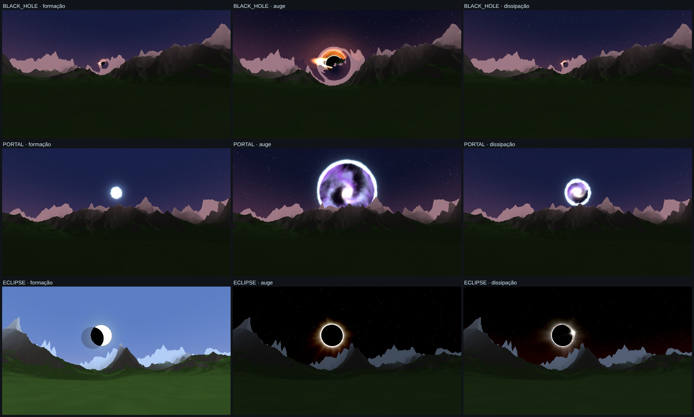

# Sky API 0.12.0 — prévia visual (a aprovar)

Renderizadas fora do jogo com `node scripts/previa_passes.cjs ceu` (folha em `build/previa/ceu-0120.png`). Rodam os shaders **reais** do motor (`sky.fsh`, `atmosphere.fsh`, `calamidade_fx.glsl`, `calamidade_sky.glsl`) com o `common.glsl` da RimuLib, no WebGL2 do Chromium headless (SwiftShader), com os mesmos dados que o `SkyFrame` e o `AtmosphereFrame` mandam no jogo. A cena é sintética: montanhas num mapa de altura, céu e névoa no modelo do jogo (`caVanillaSky`) e o **sol do jogo somado como o `LevelRenderer` soma** (mesmo quadrado, mesma textura, lida do JAR de recursos que o build baixa e nunca versionada). Não substitui o teste numa GPU de verdade: vale a forma, a ordem dos passes e as cores; o brilho final depende do bloom e da tela.

| Linha | Formação | Auge | Dissipação |
|---|---|---|---|
| **BLACK_HOLE** (azimute -25, elevação 13, crepúsculo com estrelas da atmosfera) | 10 graus, disco 30% aceso: a sombra surge sobre as montanhas | 30 graus, disco cheio girando, anel de fótons, lado que se aproxima mais claro; a lente entorta as cristas das montanhas em arco e as estrelas em volta (anel de Einstein) | 7 graus colapsando, disco a 55% |
| **PORTAL** (azimute 15, elevação 28) | abertura 14%: a semente acende (clarão de nascimento, some com "ocultar clarões") | aberto: anel com arcos de energia, nebulosa, estrelas densas e uma galáxia espiral girando por dentro | fechando (42%), a galáxia ainda girando |
| **ECLIPSE** (no sol do jogo, de manhã, a leste, 13 graus) | 62%: o sol quadrado do jogo foi apagado e redesenhado redondo; o disco morde o sol e, fora dele, é só uma sombra leve | total: coroa com serpentinas, céu e mundo escuros (escurecimento ligado às regras da atmosfera), estrelas | 95,5%: anel de diamante no último ponto de sol (clarão, some com "ocultar clarões") |

Arquivos: [buraco_negro-formacao](buraco_negro-formacao.jpg), [buraco_negro-auge](buraco_negro-auge.jpg), [buraco_negro-dissipacao](buraco_negro-dissipacao.jpg), [portal-formacao](portal-formacao.jpg), [portal-auge](portal-auge.jpg), [portal-dissipacao](portal-dissipacao.jpg), [eclipse-formacao](eclipse-formacao.jpg), [eclipse-auge](eclipse-auge.jpg), [eclipse-dissipacao](eclipse-dissipacao.jpg).

O que fica de fora da prévia: bloom e clarões da RimuLib (vêm depois dos passes), a névoa por fragmento do jogo, nuvens e as estrelas do próprio jogo (no jogo, à noite, elas também passam pela lente).
